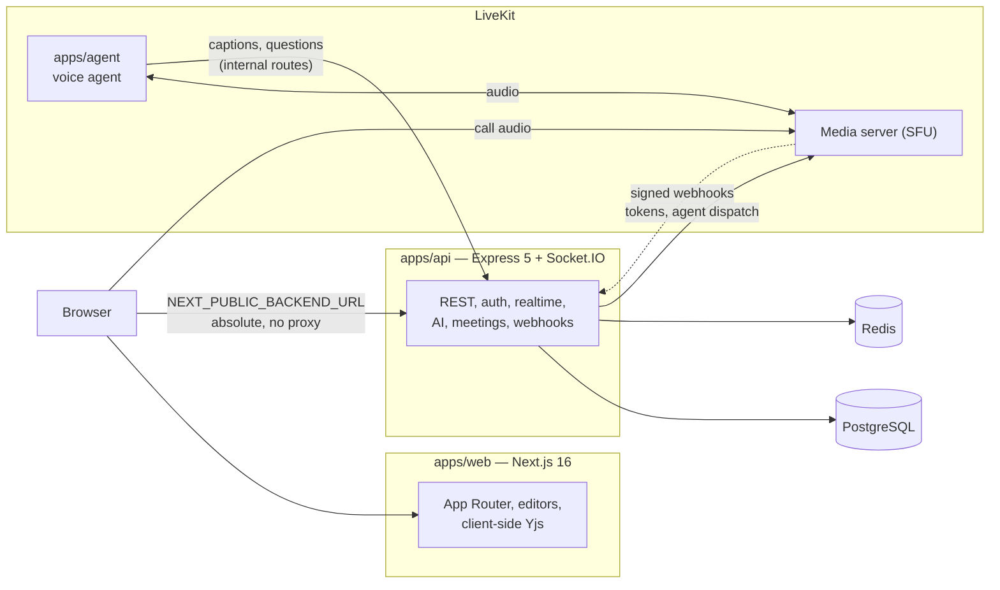

<div align="center">

# ☁️ Nimbus

**The Unified Real-time Collaborative Workspace for Modern Teams**

A real-time collaborative workspace that unifies Markdown documents, infinite canvas whiteboards, chat and voice calls, with an AI teammate that remembers what the team said, joins its calls and writes its meeting notes.

[](https://opensource.org/licenses/MIT)
[](https://nextjs.org/)
[](https://turbo.build/)
[](http://makeapullrequest.com)

[Live Demo](https://nimbus.tejasnasa.me) · [Report Bug](https://github.com/tejasnasa/nimbus/issues) · [Request Feature](https://github.com/tejasnasa/nimbus/issues)

</div>

---

## 🌟 Why Nimbus?

In a world where remote work and asynchronous communication are the norm, context switching between tools kills productivity. **Nimbus** removes the friction by putting your documents, whiteboards, chat, voice calls and an AI teammate in one workspace, and by making the AI remember what the team has already said, written and decided.

Mention **@nimbus** in chat and it answers from the workspace's own history, searches its documents and meetings, drafts a whole document or diagram, or updates the team's action items. Start it in a call and it joins as a participant: it captions everyone, translates captions live, answers questions asked out loud, and writes the meeting notes when the call ends.

---

## ✨ Features

### 🔄 Real-Time Collaboration

- **Two sync models, chosen per workload** — Markdown documents are a true CRDT (Yjs), so concurrent typing merges character by character and nobody's keystrokes are lost. Canvases are full-state, last-write-wins, because diagram elements are discrete objects where "the last drag wins" is the outcome a user expects. The split is deliberate — see [docs/realtime/overview.md](docs/realtime/overview.md).
- **Socket.IO with a Redis adapter** — Broadcasts fan out across every API instance.
- **Presence, typing and call rosters in Redis** — Ephemeral state lives in Redis with a TTL guard rather than in one process's memory.
- **Honest scaling story** — Document and canvas state is process-local today, so a multi-replica deployment needs sticky sessions or a shared Yjs store. [docs/realtime/overview.md](docs/realtime/overview.md) explains the failure mode and both fixes.

### 📝 Editors

- **Markdown editor (Milkdown)** — A collaborative Markdown editor synced through Yjs, with slash commands and live cursors.
- **Infinite canvas (Excalidraw)** — Sketch diagrams, flowcharts and wireframes on a shared whiteboard.
- **Document search** — Full-text search across every document in the workspace, Markdown and canvas alike.

### 🎙️ Voice Calls and Meetings

- **One call per workspace, on LiveKit** — Audio runs through a LiveKit media server (an SFU). The API decides who may join, mints short-lived join tokens, keeps the roster from LiveKit's signed webhooks, and removes a member from the call the moment their membership ends. See [docs/meetings/voice-and-livekit.md](docs/meetings/voice-and-livekit.md).
- **An AI voice agent that joins the call** — `apps/agent`, a LiveKit Agents worker, listens to each person's microphone separately, transcribes their speech, and answers when someone says "Nimbus", stopping the moment someone talks over it. It holds no database connection and no long-lived keys: everything it needs for one meeting arrives in exchange for a single-use ticket. See [docs/meetings/voice-agent.md](docs/meetings/voice-agent.md).
- **Live captions and translation** — Captions appear for everyone while people talk, and each viewer can read them translated into their own language.
- **"Catch me up"** — A rolling summary of the live meeting for anyone who joins late.
- **Meeting notes, decisions and action items** — When the call ends, Nimbus writes the notes as a workspace document and extracts decisions and action items with owners and due dates. Action items can be added, edited and closed from the UI, from chat or by voice. See [docs/meetings/transcripts-and-notes.md](docs/meetings/transcripts-and-notes.md).
- **An assistant with tools** — Asked out loud, the assistant can read the transcript, search past meetings, list decisions, manage action items, start a new document, or draw what the meeting has discussed as a diagram. See [docs/meetings/assistant-and-tools.md](docs/meetings/assistant-and-tools.md).

### 🤖 Nimbus, the AI in Every Workspace

- **Answers in chat** — Mention `@nimbus` (or the older `@nimbusbot`) and it replies with the last 20 messages as context, and can read an attached image. It runs detached from the chat path, so a slow model never delays message delivery. See [docs/ai/nimbusbot.md](docs/ai/nimbusbot.md).
- **Workspace memory without a vector store** — Questions about the past ("what did we decide about pricing on Tuesday?") are answered from recalled meetings and chat. Recall is plain Postgres full-text search plus a deterministic reader of dates and intent, so it costs no extra model call. See [docs/ai/memory-and-search.md](docs/ai/memory-and-search.md).
- **AI document generation** — Ask for a Markdown document or an Excalidraw diagram, or attach a photo of a whiteboard to have it redrawn. Markdown streams straight from the model. Canvases go through a JSON → validate → layout (ELK) → Excalidraw pipeline, so the geometry is computed in code rather than guessed by the model. See [docs/ai/document-generation.md](docs/ai/document-generation.md).
- **Bring your own key, or use the free tier** — A workspace admin can add keys for OpenAI, Groq, DeepSeek or OpenRouter, choose the model per feature, and set a monthly spend cap. Without a key, members fall back to the operator's free tier, metered per person (free document generations and free assistant minutes). See [docs/ai/providers-and-byok.md](docs/ai/providers-and-byok.md) and [docs/ai/quotas-and-free-tier.md](docs/ai/quotas-and-free-tier.md).
- **Credentials encrypted at rest** — Keys are sealed with AES-256-GCM in an envelope format, bound to their workspace and provider, with key-rotation support. A save-time probe proves a key works before it is stored.

### 🔒 Security & Privacy

- **Authentication** — Better-Auth with email and password (verification required, with a resend from the sign-in form) and Google OAuth, server-validated sessions, and per-device session management.
- **RBAC** — `OWNER > ADMIN > MEMBER`, enforced in the controller layer. There is always exactly one owner: ownership moves only through a transfer that promotes the new owner and demotes the old one in one transaction. Socket handlers re-check membership, so a removed member loses access, and their place in the call, immediately. See [docs/architecture/security.md](docs/architecture/security.md).
- **A locked-down voice agent** — The agent reaches the API only on internal routes behind a shared secret plus a per-meeting session token, and receives a meeting's speech key only for that meeting.
- **Self-hostable** — You control where your data lives.

### 👤 Account & Workspace Management

- **Account settings** — A `/settings` page with Profile, Password, Sessions, AI and Danger Zone tabs.
- **Workspace settings** — Members and roles, invite codes, AI keys and models, usage, and meetings, each in its own tab.
- **Leave or hand over a workspace** — Members can leave; the owner transfers ownership to another member first.
- **Avatars and chat images** — Profile pictures and chat attachments go to Cloudinary through signed direct uploads.
- **Password & recovery** — Change your password (optionally signing out every other device) or reset it by email. Google-only accounts are offered a "set a password" link instead.
- **Account deletion** — Typed-email confirmation plus password re-auth, cascading every solely-owned workspace and cleaning up the avatar.
- **Contact** — A public contact form with honeypot spam protection that emails the operator.

---

## 🛠 Tech Stack

| Layer              | Technology                                          | Description                                                                                                     |
| ------------------ | --------------------------------------------------- | --------------------------------------------------------------------------------------------------------------- |
| **Framework**      | Next.js 16 (App Router)                             | The web client, with server-rendered first paint.                                                               |
| **Monorepo**       | Turborepo + npm workspaces                          | Task graph and caching across three apps and six packages.                                                      |
| **Backend**        | Node.js + Express 5                                 | REST API, auth, persistence, AI and webhooks.                                                                   |
| **Real-Time**      | Socket.IO + Yjs                                     | Chat, presence, CRDT document sync and canvas sync over one connection.                                         |
| **Voice**          | LiveKit (SFU) + LiveKit Agents                      | Call audio through a hosted media server; the voice agent is a LiveKit Agents worker.                           |
| **AI Layer**       | Multi-provider (OpenAI, Groq, DeepSeek, OpenRouter) | Per-feature model selection, BYOK or the operator's free tier, tool calling, speech-to-text and text-to-speech. |
| **Database**       | PostgreSQL + Prisma                                 | Every durable record, plus the full-text search behind memory and search.                                       |
| **Cache/PubSub**   | Redis (ioredis)                                     | Presence, typing, call rosters, meeting tickets and sessions, and Socket.IO fan-out.                            |
| **File Storage**   | Cloudinary                                          | Signed direct uploads for avatars and chat images.                                                              |
| **Email**          | Resend                                              | Verification, password reset and contact-form mail.                                                             |
| **Authentication** | Better-Auth                                         | Email and password, Google OAuth, sessions.                                                                     |
| **UI & Styling**   | Tailwind CSS v4 + Framer Motion                     | Design tokens as CSS variables, and animation.                                                                  |

---

## 🚀 Getting Started

Want to run Nimbus locally or contribute to the project? Follow these steps. [docs/getting-started/local-setup.md](docs/getting-started/local-setup.md) has the full version, with troubleshooting.

### Prerequisites

- **Node.js** 18 or later, and npm
- **Docker**, for the local Postgres, Redis and LiveKit containers (or your own Postgres 14+ and Redis 6+)
- **Git**

### Local Development Setup

1. **Clone the repository**

   ```bash
   git clone https://github.com/tejasnasa/nimbus.git
   cd nimbus
   ```

2. **Install dependencies**

   ```bash
   npm install
   ```

3. **Environment configuration**
   Copy the example file to `apps/api/.env` and fill it in. It lists every variable the API reads, splits
   required from optional, and explains the ones with non-obvious behaviour. The API validates it at startup
   and names the first missing variable. The voice agent reads its own, smaller set of variables; see
   [docs/reference/environment.md](docs/reference/environment.md).

   ```bash
   cp .env.example apps/api/.env
   ```

4. **Start Postgres, Redis and LiveKit, and apply the schema**

   ```bash
   make test-infra-up   # Postgres :5434, Redis :6381, LiveKit dev server :7880
   make test-schema     # apply the migrations
   ```

   These are the test containers, and the test suites truncate that database. Point `DATABASE_URL` at
   your own database if you want data that survives a test run.

5. **Start the development servers**

   ```bash
   npm run dev                 # API on :3001 and web on :3000
   npm run dev -w apps/agent   # the voice agent, only needed for the in-call assistant
   ```

   _The web client is available at `http://localhost:3000` and the API/WebSocket server at `http://localhost:3001`._

   The browser reaches the API directly via `NEXT_PUBLIC_BACKEND_URL`: there are no Next.js route handlers
   proxying to it, and no `app/api` directory. Chat, documents and canvases need only the API, Postgres and
   Redis; calls also need LiveKit, and the assistant needs the agent.

---

## 🧪 Running Tests

Tests are orchestrated by Turborepo and sharded by workspace. Integration and smoke suites run against
**real** Postgres, Redis and LiveKit (never mocks); only external HTTP such as the AI providers and Resend
is stubbed.

```bash
make test-infra-up   # start Postgres, Redis and LiveKit
make test-schema     # apply migrations to the test DB (first run, and after pulling a migration)
npm test             # every workspace
```

`make help` lists every target. Narrower slices:

```bash
make test-api                        # API only
make test-web                        # web only
make test-packages                   # shared packages only
make test-suite SUITE=smoke          # one API shard: smoke, unit, integration or security
make test-file FILE=src/__tests__/smoke/boot.test.ts   # one API file
npm test -w apps/agent               # the voice agent
```

Test configuration lives in the committed `.env.test` (throwaway local values, not secrets). The suites
share one test database and truncate tables between tests, so run them one at a time.

Two suites need the database for different reasons, so they use **different databases** on the same
server: `apps/api` runs against `nimbus_test`, and `packages/database` creates and migrates its own
`nimbus_schema_test` before its workers start.

### Coverage

Each package carries a `.coverage-floor` file, and `node scripts/check-coverage.mjs <package-dir>…` fails
if a package drops below it. The floors are fixed minimums set a few points under the measured numbers, so
run-to-run noise never fails a build while a real drop still does.

```bash
make test-coverage         # every suite with coverage
make test-coverage-check   # the same, then fail on any drop below a floor
```

### End-to-end

`make test-e2e` runs the Playwright suite in `apps/web/e2e` against Chromium. It seeds the test database,
starts both servers itself and drives real browsers, so it runs nightly in CI rather than on every PR.

```bash
make test-e2e        # start the containers, seed, boot both servers, run
make test-e2e-seed   # re-seed the fixtures without running the suite
```

The API is started with `DOTENV_CONFIG_PATH` pointing at `.env.test`, which is what keeps the suite off any
real database. Do not remove it.

### Production smoke suite

A second, separate Playwright suite (`apps/web/e2e-prod`, nightly at 04:41 UTC) drives the **deployed**
site rather than a local stack: it signs in through the real form, creates a workspace, and exercises
document persistence, chat delivery, real-time sync, Nimbus replies and RBAC against production. It has
its own config with no `webServer` and no seeding, and refuses to start unless the target is an
allowlisted host over HTTPS. Traces are deliberately off there, because a trace records form `fill`
values, which for sign-in means the password.

[docs/testing/overview.md](docs/testing/overview.md) and [docs/testing/end-to-end.md](docs/testing/end-to-end.md)
are the long-form guide: every suite, fixtures, and troubleshooting.

---

## 🏗 Architecture Overview

Nimbus runs as **three processes** that share code only through `packages/*`, plus a hosted media server:



The API owns every piece of persistence, authentication and realtime coordination; the web app renders
and talks to it directly, and the voice agent posts everything it hears to it. There is no Next.js
`app/api` directory and no self-hosted TURN server. [docs/architecture/overview.md](docs/architecture/overview.md)
walks through all of it.

Nimbus uses a monorepo structure managed by Turborepo, separating concerns while sharing type safety.

```text
nimbus/
├── apps/
│   ├── web/                  # Next.js 16 client — App Router, UI, client-side Yjs (port 3000)
│   ├── api/                  # Express 5 + Socket.IO — persistence, auth, realtime, AI, meetings (port 3001)
│   └── agent/                # LiveKit Agents worker — the in-call voice assistant
├── packages/
│   ├── database/             # Prisma schema, migrations and client (package name: @nimbus/db)
│   ├── ui/                   # Shared React components and design system
│   ├── types/                # Socket event contract, API types, Zod schemas, the AI provider registry
│   ├── utils/                # Pure helpers (model selection, slugs, time formatting)
│   ├── eslint-config/        # Shared ESLint configuration
│   └── typescript-config/    # Shared tsconfig bases
├── docs/                     # Architecture and subsystem documentation, also served at /docs
└── turbo.json                # Turborepo orchestration and caching rules
```

Note the package name differs from the directory: `@nimbus/db` lives in `packages/database/`.

---

## 📚 Documentation

Nimbus is documented subsystem by subsystem in [`docs/`](docs/), also rendered on the site at `/docs`. Each page
explains not only how something works, but **why it was built that way and what it costs** — every page ends with
its design trade-offs and stated limits. [docs/README.md](docs/README.md) is the index, with a reading guide and a
glossary.

**Start here**

| Document                                               | Covers                                                                             |
| ------------------------------------------------------ | ---------------------------------------------------------------------------------- |
| [Local setup](docs/getting-started/local-setup.md)     | Prerequisites, install, env files, the test stack, first run and troubleshooting.  |
| [The monorepo](docs/getting-started/monorepo.md)       | Every workspace, the turbo task graph, and the code conventions.                   |
| [Architecture overview](docs/architecture/overview.md) | The processes, one request traced end to end, and where every kind of state lives. |

**Subsystems**

| Area                   | Documents                                                                                                                                                                                                                                                         |
| ---------------------- | ----------------------------------------------------------------------------------------------------------------------------------------------------------------------------------------------------------------------------------------------------------------- |
| Auth and security      | [Auth](docs/architecture/auth.md) · [Security and RBAC](docs/architecture/security.md)                                                                                                                                                                            |
| Realtime collaboration | [Overview](docs/realtime/overview.md) · [Markdown sync (Yjs)](docs/realtime/markdown-sync.md) · [Canvas sync](docs/realtime/canvas-sync.md) · [Presence and chat](docs/realtime/presence-and-chat.md)                                                             |
| Meetings and voice     | [Voice and LiveKit](docs/meetings/voice-and-livekit.md) · [The voice agent](docs/meetings/voice-agent.md) · [Transcripts and notes](docs/meetings/transcripts-and-notes.md) · [Assistant and tools](docs/meetings/assistant-and-tools.md)                         |
| AI                     | [Providers and BYOK](docs/ai/providers-and-byok.md) · [Quotas and the free tier](docs/ai/quotas-and-free-tier.md) · [NimbusBot](docs/ai/nimbusbot.md) · [Document generation](docs/ai/document-generation.md) · [Memory and search](docs/ai/memory-and-search.md) |
| Frontend               | [Frontend overview](docs/frontend/overview.md)                                                                                                                                                                                                                    |
| Testing                | [Testing overview](docs/testing/overview.md) · [End-to-end and production smoke](docs/testing/end-to-end.md)                                                                                                                                                      |
| Operations             | [Deployment and CI/CD](docs/operations/deployment.md) · [Runbook](docs/operations/runbook.md)                                                                                                                                                                     |

**How-to guides and reference**

| Kind          | Documents                                                                                                                                                                                                                           |
| ------------- | ----------------------------------------------------------------------------------------------------------------------------------------------------------------------------------------------------------------------------------- |
| How-to guides | [Add an endpoint](docs/guides/add-an-endpoint.md) · [Add a socket event](docs/guides/add-a-socket-event.md) · [Add an assistant tool](docs/guides/add-an-assistant-tool.md) · [Change the schema](docs/guides/change-the-schema.md) |
| Reference     | [REST API](docs/reference/rest-api.md) · [Socket events](docs/reference/socket-events.md) · [Data model](docs/reference/data-model.md) · [Environment variables](docs/reference/environment.md)                                     |

---

## 🤝 Contributing

We welcome contributions from the community! Whether it's a bug fix, new feature, or documentation improvement, your help makes Nimbus better.

1. Fork the Project
2. Create your Feature Branch (`git checkout -b feature/AmazingFeature`)
3. Commit your Changes (`git commit -m 'Add some AmazingFeature'`)
4. Push to the Branch (`git push origin feature/AmazingFeature`)
5. Open a Pull Request

Please read our [CONTRIBUTING.md](CONTRIBUTING.md) for details on our code of conduct and the process for submitting pull requests.

---

## 🛡 Security

If you discover a security vulnerability within Nimbus, please send an e-mail to tejasnasa1908@gmail.com. All security vulnerabilities will be promptly addressed.

---

## 📄 License

Distributed under the MIT License. See `LICENSE` for more information.

---

<div align="center">

**Built with ❤️ for teams everywhere by [Tejas Nasa](https://github.com/tejasnasa)**

[](https://github.com/tejasnasa)
[](https://twitter.com/tejasnasa)

</div>
