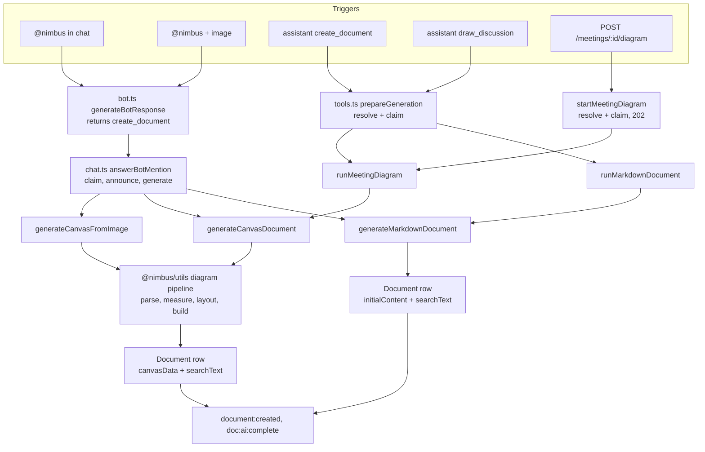
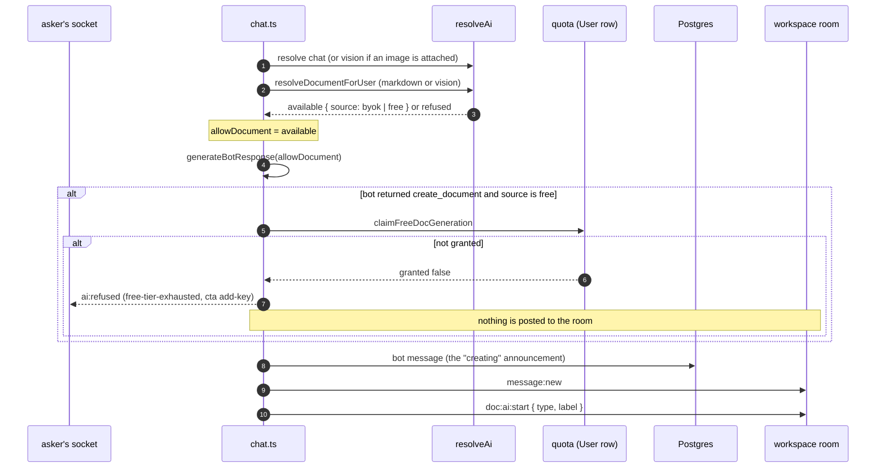
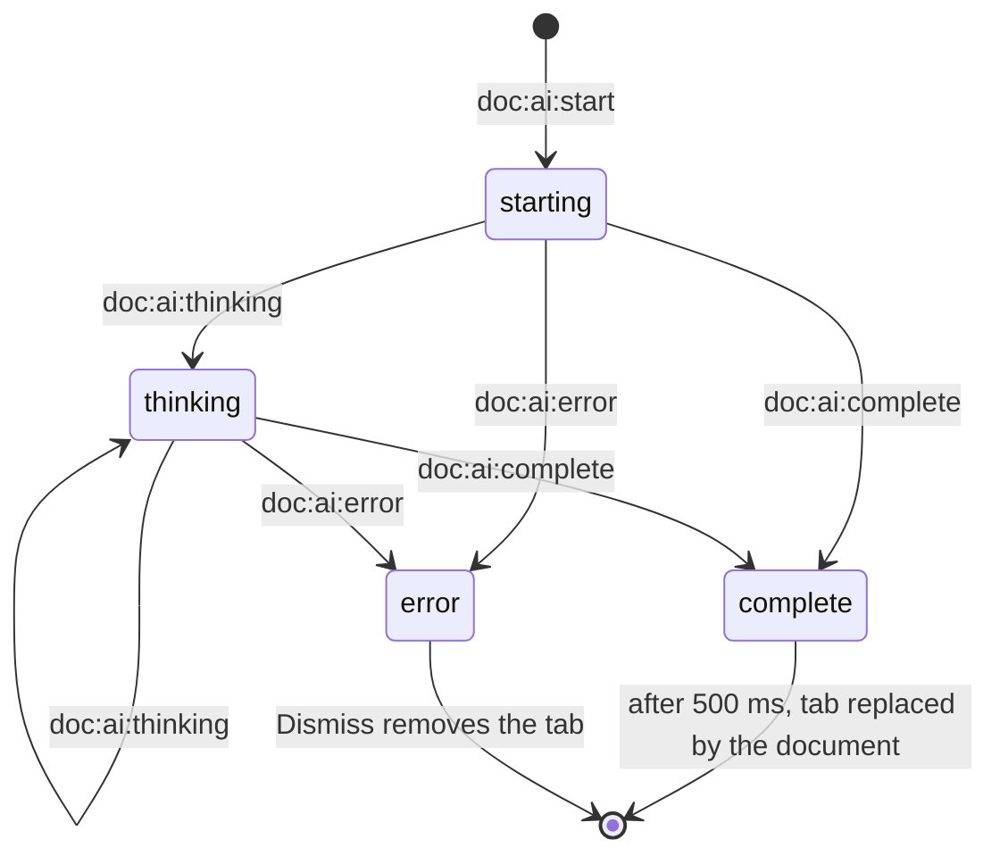
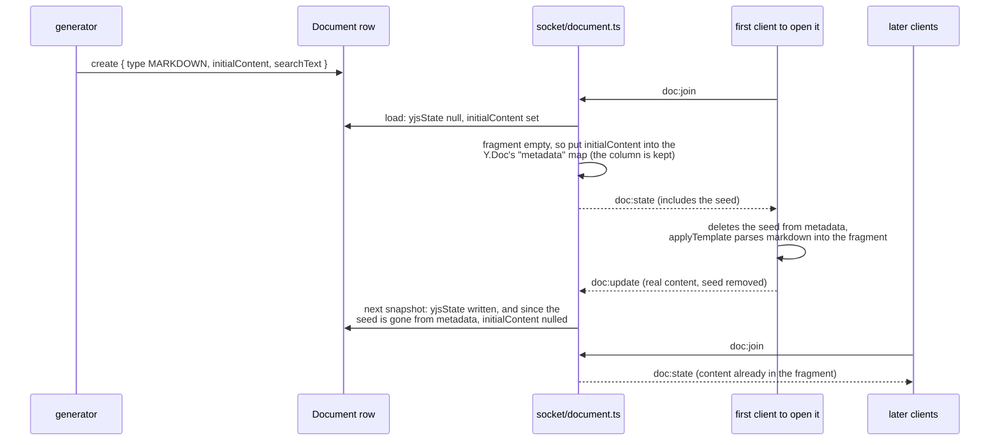
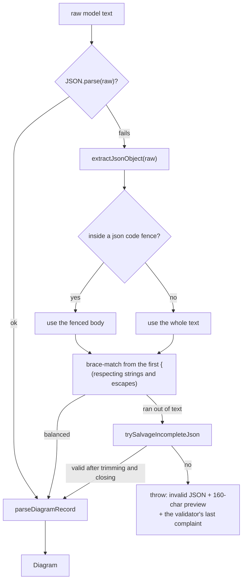
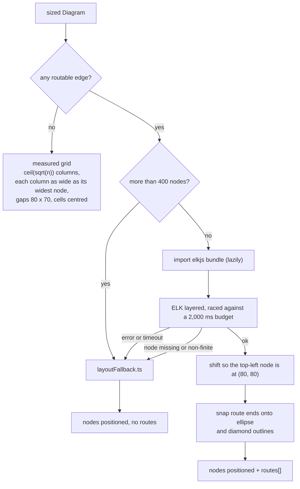
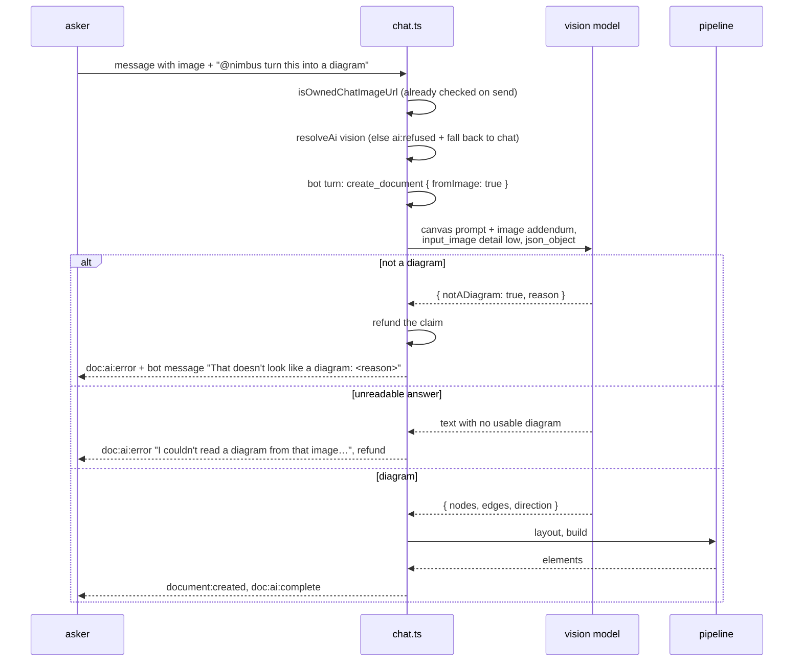

# Document generation

How Nimbus writes a whole document for you. A **markdown** document is written by a model in one streamed call. A **canvas** (an Excalidraw diagram) is produced by a deterministic pipeline: the model describes only *what* is in the diagram (nodes and edges), and code measures every label, sizes every box, lays the graph out with ELK, routes the arrows and builds the Excalidraw elements. A photographed diagram goes through the same pipeline after one vision call. This page follows a request from the chat message that triggers it to the tab that appears for everyone in the workspace, stage by stage, with the exact constants, failure paths and reasoning behind each choice.

## Entry points

There are five ways a document gets generated. All of them end in the same two generators and emit the same `doc:ai:*` events, so the web app renders them identically.

| Trigger | Where | Type | Who resolves the model | Claim and refund |
| --- | --- | --- | --- | --- |
| `@nimbus` in chat, model calls `create_document` | [`socket/chat.ts`](../../apps/api/src/socket/chat.ts) `answerBotMention` | MARKDOWN or CANVAS | `resolveAi` for `markdown` or `canvas`, after the chat turn | In `chat.ts` |
| `@nimbus` with an attached image, `fromImage: true` | `chat.ts` → [`imageCanvas.ts`](../../apps/api/src/lib/imageCanvas.ts) | CANVAS | The `vision` resolution made at the start of the turn | In `chat.ts`; also refunded for "not a diagram" |
| Assistant tool `create_document` (in a call or chat) | [`meeting/tools.ts`](../../apps/api/src/lib/meeting/tools.ts) → [`meeting/documents.ts`](../../apps/api/src/lib/meeting/documents.ts) or [`meeting/diagram.ts`](../../apps/api/src/lib/meeting/diagram.ts) | MARKDOWN or CANVAS | `prepareGeneration` in `tools.ts` | `prepareGeneration` claims; the runner refunds |
| Assistant tool `draw_discussion` (live meeting only) | `tools.ts` → `buildLiveDiagramPrompt` → `runMeetingDiagram` | CANVAS | `prepareGeneration` | Same |
| `POST /api/meetings/:id/diagram` ("Draw the discussion" on a finished meeting) | [`meeting.controller.ts`](../../apps/api/src/controllers/meeting.controller.ts) `startMeetingDiagram` → `buildDiagramPrompt` → `runMeetingDiagram` | CANVAS | The controller | The controller claims; the runner refunds |



## Step 1: deciding to create a document

In chat the decision belongs to the model. [`bot.ts`](../../apps/api/src/lib/bot.ts) offers a single strict function tool:

| Property | Type | Notes |
| --- | --- | --- |
| `type` | `"MARKDOWN" \| "CANVAS"` | MARKDOWN for text, CANVAS for diagrams, flowcharts and wireframes |
| `label` | string | The title; becomes `Document.title` |
| `prompt` | string | A detailed description of the content, written by the chat model for the generator model |
| `fromImage` | `boolean \| null` | **Only offered when the message has an image.** Strict mode requires every property in `required`, so "not set" is `null` |

`strict: true` with `additionalProperties: false` is what lets the same schema work on OpenAI, Groq and DeepSeek: without it some providers reject the schema, and others return arguments with extra or missing keys.

The tool is **only offered when a document could actually be produced**. Before the chat call, `chat.ts` resolves the document entitlement on its own (`resolveDocumentForUser`). If that is refused (no capable model, free allowance spent, spend cap reached), `allowDocument` is false, the tool is left out of `tools` entirely, and the instructions gain "Document creation is unavailable in this conversation; answer in text." Removing the tool is stronger than refusing the call: a model cannot call a tool it was never offered, and the extra sentence stops it from *promising* a document that will never arrive.

When the model calls the tool, `bot.ts` normalises the arguments instead of rejecting them:

- `fromImage` is honoured only if an image really is attached, and always forces `CANVAS` (an image becomes a diagram, never a text document).
- Any `type` other than `CANVAS` becomes `MARKDOWN`.
- A missing `label` becomes `"Untitled Document"`, a missing `prompt` the empty string.
- The interim chat message is fixed text: `Sure! I am creating the document "<label>" for you now. Please wait...`
- Arguments that are not valid JSON are logged and the turn falls through to a plain text reply, so a malformed tool call never crashes chat.

`create_document` ends the bot's turn. The handler in `chat.ts` does everything after that.

## Step 2: who pays, and the claim



The rules, all enforced in code:

- **Only the free tier is metered.** `resolveDocumentForUser` returns the `source` of the resolution, and `chat.ts` claims only when `source === "free"`. A workspace or user key (BYOK) neither spends nor is blocked by the operator's allowance. The module's `@important` note spells out why: charging BYOK users would refuse them a document with "add an API key" while they already have one.
- **The quick check and the real claim are separate.** `resolveDocumentForUser` reads the counter cheaply (`readQuotaState`) so that `allowDocument` is honest. Correctness comes from the claim at generation time.
- **The claim is atomic.** `claimFreeDocGeneration` is one conditional update: `UPDATE "user" SET freeDocGenerationsUsed = freeDocGenerationsUsed + 1 WHERE id = $1 AND freeDocGenerationsUsed < limit`. Two concurrent mentions cannot both take the last slot; exactly one row count comes back as 1. The limit is `AI_FREE_DOC_LIMIT` (default 5).
- **Claim before announcing.** The announcement is posted only after the claim succeeds, so a user out of allowance never sees "I am creating the document…" followed by nothing. A failed claim sends `ai:refused` **to the asker's socket only**: the reason is personal, and a broadcast would put a phantom generating tab in everyone's editor.
- **Defence in depth.** If the bot somehow calls `create_document` while the document resolution was refused, `chat.ts` refuses instead of generating.
- **Refund exactly one claim.** `refundFreeDocGeneration` decrements with a `> 0` guard. It runs only on the failure path of a generation whose claim succeeded (a local `claimed` flag is set on claim and cleared on success or refund), so it cannot be farmed and never returns more than was taken.

The model used for generation is resolved **again** per feature: `markdown` or `canvas` (`vision` for images). A user can choose a different provider and model for each feature in AI settings, so the chat model that decided to write a document is not necessarily the one that writes it. If that second resolution fails, generation fails and the claim is refunded.

The assistant paths do the same in `prepareGeneration` (in `tools.ts`): resolve the feature, claim if free, and throw a `ToolRefusal` the model can read aloud ("The free document generations are used up…") if not granted. The REST diagram endpoint does it in the controller and answers **403** with `{ reason, cta }` on refusal, **409** if the meeting has no notes yet, **404** for a missing meeting or a non-member, and **202** once generation has started in the background.

## Step 3: the event protocol

Every path speaks the same protocol to the workspace room. Event types are in [`socketEvents.ts`](../../packages/types/src/socket/socketEvents.ts).

| Event | Payload | When |
| --- | --- | --- |
| `doc:ai:start` | `{ type, label }` | After the claim and announcement, before the model call |
| `doc:ai:thinking` | `{ token }` | For each **reasoning** delta from the model (see below) |
| `document:created` | `{ document: DocumentSummaryDTO }` | After the row is committed, through `announceDocumentCreated` |
| `doc:ai:complete` | `{ documentId, label, type, canvasData? }` | After the row is committed; canvases carry their elements |
| `doc:ai:error` | `{ message }` | Any failure after `doc:ai:start` |
| `ai:refused` | `{ feature, reason, message, cta }` | Entitlement refusals, to the asker only |



**What streams is reasoning, not content.** Both generators call `onThinking`/`onReasoning` with reasoning deltas (`response.reasoning_text.delta`, and for canvases also `response.reasoning_summary_text.delta`), and the orchestrators forward exactly those as `doc:ai:thinking`. The markdown generator also reports each content delta through `onToken`, but every caller passes a no-op: the document's text is **not** streamed to the room. It appears all at once when the document opens. The canvas `onStatus` milestones ("Planning diagram…", "Layout — 9 nodes, 11 edges", …) are likewise not forwarded by any current caller. A model with no reasoning output therefore shows the overlay's spinner and status line with an empty log until it completes.

`document:created` and `doc:ai:complete` can arrive in either order. The client dedupes by document id ([`DocEditor.tsx`](../../apps/web/components/DocEditor.tsx) `replaceGeneratingTab`): if the real tab already exists when the generation completes, the placeholder is dropped rather than replaced, so the document never appears twice.

## Step 4a: markdown

[`markdownGeneration.ts`](../../apps/api/src/lib/markdownGeneration.ts) makes one streamed Responses API call:

| Setting | Value | Why |
| --- | --- | --- |
| `instructions` | "You are an expert technical writer and document generator…", asking for headings, lists, fenced code with languages, tables, blockquotes and emphasis, plus `Document Title: <label>` | One fixed system prompt; the chat model's `prompt` carries the specifics |
| `input` | The tool call's `prompt` | |
| Reasoning | `reasoningKwargs(handle, "low")` | Effort is set explicitly because each provider's default differs; `low` is the cheapest level every verified provider accepts. `reasoningKwargs` is capability-aware: no reasoning block for models without it, no `summary` where the model rejects it |
| Output limit | Provider default | |

Each `response.output_text.delta` is appended to `fullContent`. On `response.completed`, usage is written to the call log. If the stream ends without a completion event the call is still logged (it cost a request). The function returns `{ fullContent }`; a thrown provider error is logged as failed and propagates to the orchestrator.

**The result is stored as text, not as a Yjs document.** The editor's content is a Milkdown/ProseMirror tree inside a Yjs `XmlFragment`, and the API has no Milkdown schema or parser, so it cannot build that tree. Instead:



The column is kept until a snapshot proves the editor consumed the seed, so a tab that closes before applying it cannot lose the document: the next open publishes the seed again. Once consumed, the content lives in ordinary Yjs state and is never seeded twice. The full lifecycle is in [Markdown sync](../realtime/markdown-sync.md#the-ai-seed).

`searchText` is filled at creation with `searchTextForNew({ initialContent })`, which strips markdown syntax (`markdownToText` in [`documentText.ts`](../../apps/api/src/lib/documentText.ts)). The document is therefore searchable by the assistant and the search box before anyone has opened it.

## Step 4b: canvas — the model call

[`canvasGeneration.ts`](../../apps/api/src/lib/canvasGeneration.ts) owns the prompt and the call; everything spatial lives in [`packages/utils/src/diagram`](../../packages/utils/src/diagram).

The system prompt (`buildCanvasSystemPrompt(label)`) asks for exactly this shape and nothing else:

```json
{
  "nodes": [
    { "id": "unique_snake_case_id", "shape": "rectangle",
      "label": "Short label shown inside the shape",
      "backgroundColor": "#e8f0fe", "strokeColor": "#1e1e1e" }
  ],
  "edges": [ { "from": "source_id", "to": "target_id" } ]
}
```

Its rules, each with a purpose:

| Rule | Purpose |
| --- | --- |
| JSON only, no markdown, no commentary | The parser is tolerant, but clean output is cheaper to recover |
| 4 to 18 nodes | Keeps diagrams readable and the output well under the token cap |
| Shapes: rectangle, ellipse or diamond | The three shapes the builder knows how to fit text into |
| All visible text in node labels; never separate text or arrow elements | The builder owns text and arrows |
| Edges are logical; "the app draws arrows" | Arrows are routed by ELK, not by the model |
| Never emit x, y, width or height | Models are bad at geometry and the pipeline would discard it anyway |
| List nodes in reading order, branches adjacent | ELK is told to respect model order, so node order breaks layout ties |
| Distinct soft backgrounds from the palette | Six fills: `#e3faf2`, `#e8f0fe`, `#fff3bf`, `#ffe8cc`, `#f3d9fa`, `#d3f9d8` |
| Every edge endpoint must be an existing id | Asked for, but also enforced in parsing |

The call: streamed Responses API, `text.format = json_object`, reasoning at `low` effort through `reasoningKwargs`, and `max_output_tokens = CANVAS_MAX_OUTPUT_TOKENS` (16,384). The input is `Create a professional diagram as a JSON object for:\n<prompt>`.

The stream delivers the same answer up to three ways, and the code reconciles them:

1. **Deltas** (`response.output_text.delta`) are concatenated.
2. **`response.output_text.done`** carries the full text; it replaces the accumulated text only if it is at least as long (protecting against out-of-order delivery).
3. **`response.completed`** carries the final response. Its text is reconciled with the same "only if not shorter" guard, and if the provider filled `output_parsed` with an object that has a `nodes` array, the **fast path** runs: validate, lay out and build straight from that object.

The fast path is an optimisation, never the only route. If the structured payload fails validation, its error is kept and the code falls through to parsing the text, and a failure of both reports both ("… (structured payload rejected: …)"). If the text is empty, the call fails with "AI provider returned an empty canvas response". If parsing the text fails, the code tries once more over **content plus the reasoning log**, because some models leak the JSON into the reasoning channel.

## Step 5: parse and validate

[`parse.ts`](../../packages/utils/src/diagram/parse.ts) turns raw model text into a validated `Diagram` ([`diagram.ts`](../../packages/types/src/diagram/diagram.ts)). It is pure: no I/O, no environment.



**Salvaging truncated JSON.** A stream cut off at the token cap ends mid-object. The salvager trims the dangling tail with four patterns (a half-written key, a key with a half-written value, a trailing partial object or array, a trailing comma), walks what is left counting open `{` and `[` (outside strings), appends the matching closers in reverse order, and returns the result only if `JSON.parse` accepts it. A closer that does not match its opener aborts the salvage instead of guessing. The effect: a diagram truncated after its 14th node arrives with 13 or 14 nodes and the edges completed so far, instead of failing.

**Validation with safe defaults** (`parseDiagramRecord`):

| Input | Becomes |
| --- | --- |
| No `nodes` array, or an empty one | Error: "must include at least one node" |
| A node that is not an object | Error naming its index |
| Unknown or missing `shape` | `rectangle` |
| Missing or blank `id` | `node_<index+1>` |
| Missing `label` | `Step <index+1>` |
| Missing `backgroundColor` | The palette entry `index % 6` |
| Missing `strokeColor` | `#1e1e1e` |
| `x`/`y` given | Kept as a hint (numeric strings accepted; `null`, `""`, booleans and arrays ignored so they do not mean "the origin"); ELK overwrites them |
| Edge with a missing or unknown endpoint | Dropped |
| Self-loop (`from === to`) | Dropped |
| Duplicate edge | Dropped |
| `direction` of `LR`/`RL` or `TB`/`BT` | `LR` or `TB` (only the image prompt asks for it; text diagrams default to `LR`) |

**Unique ids are established here**, and only here. Every later stage keys its maps by node id, so a repeated id would leave one node unplaced and bind its arrows to the other. A repeated id is treated as the same logical node: all original ids are reserved first, later duplicates get `_2`, `_3`… suffixes that cannot collide with a real id, and an edge naming the shared id is fanned out to every node that claimed it.

## Step 6: measure labels and size boxes

The server has no browser, no canvas and no font files at runtime, yet the boxes must fit their labels exactly as Excalidraw will draw them. [`measure.ts`](../../packages/utils/src/diagram/measure.ts) solves this with a table.

- **Font.** Every label is drawn in Virgil, Excalidraw's hand-drawn font (`fontFamily: 1`), at `LABEL_FONT_SIZE = 16` px with `LABEL_LINE_HEIGHT = 1.35`.
- **Advance table.** Exact per-character advance widths (in em) for printable ASCII (U+0020–U+007E), taken from Virgil's `hmtx` table. Non-breaking space counts as a space.
- **Estimates for everything else:** a few typographic specials (en and em dash, curly quotes, bullet, ellipsis) have their own values; CJK, kana, Hangul and full-width forms count as 1 em; emoji and pictographs 1.2 em; any other letter 0.6 em; combining marks, joiners and variation selectors 0.
- **Safety margin.** Measured widths are multiplied by `MEASURE_SAFETY = 1.03`, so rendering differences never clip a line.
- **Wrapping.** Greedy at word boundaries, honouring explicit `\n`. A word wider than the line is broken by character. Every line holds at least one character, so wrapping always terminates.

Each shape holds text differently, and `fitNodesToLabels` sizes each node accordingly:

| Shape | Text area inside the box | Padding around text | Wrap width |
| --- | --- | --- | --- |
| Rectangle | The box minus a 12 px inset each side | 44 px horizontal, 40 px vertical | `360 − 44 − 1` = 315 px |
| Ellipse | The inscribed rectangle: each side ÷ √2 | 24 / 16 px | `360/√2 − 24 − 1` ≈ 229 px |
| Diamond | The inscribed rectangle: each side ÷ 2 | 24 / 16 px | `360/2 − 24 − 1` = 155 px |

The box is `(text + padding) × scale`, clamped to `NODE_MIN_WIDTH = 180`, `NODE_MAX_WIDTH = 360` and `NODE_MIN_HEIGHT = 88`. The label is rewritten with the wrap's line breaks, so what the layout plans is exactly what is drawn.

## Step 7: layout

[`layout.ts`](../../packages/utils/src/diagram/layout.ts) places nodes and routes edges.



**ELK's layered algorithm** is a Sugiyama-style layout: it breaks cycles, assigns nodes to layers, orders the nodes within each layer to minimise crossings, places them, and routes edges between them. The options are fixed in `ELK_OPTIONS`; changing any of them changes every generated layout:

| Option | Value | Effect |
| --- | --- | --- |
| `elk.algorithm` | `layered` | Flow diagrams with a clear direction |
| `elk.direction` | `RIGHT` for `LR`, `DOWN` for `TB` | |
| `elk.edgeRouting` | `ORTHOGONAL` | Right-angled arrows, which Excalidraw draws as elbow arrows |
| `elk.randomSeed` | `1` | Same input, same layout |
| `elk.layered.crossingMinimization.strategy` | `LAYER_SWEEP` | Classic layer-by-layer crossing reduction |
| `elk.layered.thoroughness` | `8` | More sweeps than the default, still fast for under 20 nodes |
| `elk.layered.nodePlacement.strategy` | `NETWORK_SIMPLEX` | Straightens long edges, balanced placement |
| `elk.layered.cycleBreaking.strategy` | `GREEDY_MODEL_ORDER` | Cycles are broken according to the order the model listed nodes |
| `elk.layered.considerModelOrder.strategy` | `NODES_AND_EDGES` | Reading order from the model breaks ties |
| `elk.separateConnectedComponents` | `true`, spaced 70 | Unconnected clusters sit side by side |
| Spacing | node–node 56, between layers 96, edge–node 28, edge–edge 16 | Room for elbows and labels |

Nodes and edges are handed to ELK in the diagram's own order, and ELK is deterministic with a fixed seed, so a given diagram always lays out the same way.

**Guards.** Layout must never fail generation:

- ELK is imported lazily, so bundles that only import `@nimbus/utils` (the web app) do not pull it in.
- More than `DEFAULT_MAX_ELK_NODES = 400` nodes goes straight to the fallback. ELK runs on the calling thread, so this size cap is what bounds how long it can block the API's event loop.
- `DEFAULT_TIMEOUT_MS = 2000` bounds how long the *caller* waits. It cannot interrupt ELK mid-computation; it only stops waiting for it.
- ELK's result is computed into separate maps and only copied onto the nodes when it is complete and valid, so a failure part-way leaves the diagram untouched for the fallback.

**Snapping arrows to shapes.** ELK treats every node as its bounding rectangle. For an ellipse or a diamond, the real outline is inside that rectangle away from the side's midpoint, so an arrow ending on the rectangle would stop short. `snapToOutline` moves each route's first and last point inward along the arrival direction onto the true outline (`sqrt(1 − r²)` of the half-width for an ellipse, `1 − r` for a diamond).

**The fallback** ([`layoutFallback.ts`](../../packages/utils/src/diagram/layoutFallback.ts)) is synchronous and dependency-free:

1. **Ranks** by longest path: each node's rank is one more than its highest predecessor, relaxed Bellman-Ford style for at most `n − 1` passes so a cycle settles instead of looping.
2. **Layers.** Used ranks are compressed onto consecutive layers (a cycle can leave gaps that would otherwise push the drawing off-screen).
3. **Order.** The first layer keeps its given order; each later layer is sorted by the barycenter (mean cross-axis centre) of each node's predecessors, a one-pass crossing reduction.
4. **Place.** Layers are 220 px apart (`LR`) or 140 px (`TB`); within a layer nodes stack with an 80–180 px gap depending on direction and layer width, centred against the tallest layer.
5. **No routes.** The builder draws straight connectors instead.

Edgeless diagrams under the fallback use a row-wrapped grid with fixed gaps.

## Step 8: build Excalidraw elements

[`excalidraw.ts`](../../packages/utils/src/diagram/excalidraw.ts) emits elements in a fixed order: for each node, a shape and its text; then one arrow per edge. Each element gets a fractional index `a0`, `a1`, … for Excalidraw's z-order.

| Element | Key fields |
| --- | --- |
| Shape | `type` = the node's shape, position and size from layout, `fillStyle: solid`, `roughness: 1` (hand-drawn), rounded corners for rectangles (`roundness: { type: 3 }`), `boundElements` listing its text and every attached arrow |
| Text | `containerId` = the shape, `fontFamily: 1`, `fontSize: 16`, `lineHeight: 1.35`, centred both ways, `autoResize: false`, width = the shape's text area, height = the measured label height |
| Arrow (routed) | `elbowed: true`, `points` = ELK's polyline relative to its first point, `startBinding`/`endBinding` with `fixedPoint` = where the route meets each box as a 0–1 fraction, `gap: 8`, arrowhead at the end only |
| Arrow (fallback) | Same, but straight: it leaves from the side of the source box facing the target (decided by which axis dominates), and several arrows leaving the same node are fanned between 20 % and 80 % along that side |

Binding the text and arrows to their shapes matters: in the editor, moving a box moves its label and keeps its arrows attached, and deleting it deletes them. Using `fixedPoint` bindings means an arrow keeps the same attachment point on the box when someone drags things around later.

**Determinism is opt-in.** Ids (10 lowercase alphanumerics, padded when `toString(36)` comes up short), `seed`/`versionNonce` (Excalidraw's per-element randomness for the hand-drawn look) and the `updated` timestamp come from `generateId`, `random` and `now`, which default to `Math.random` and `Date.now`. The tests inject fixed sources and snapshot the output byte for byte ([`excalidraw.test.ts`](../../packages/utils/__tests__/diagram/excalidraw.test.ts)).

### A worked example

A prompt of "how a chat message reaches other members" might produce:

```json
{ "nodes": [
    { "id": "send", "shape": "ellipse", "label": "User sends message" },
    { "id": "auth", "shape": "diamond", "label": "Member?" },
    { "id": "save", "shape": "rectangle", "label": "Save to Postgres" },
    { "id": "fan", "shape": "rectangle", "label": "Broadcast to workspace room via Redis adapter" },
    { "id": "drop", "shape": "rectangle", "label": "Reject" } ],
  "edges": [ { "from": "send", "to": "auth" }, { "from": "auth", "to": "save" },
             { "from": "auth", "to": "drop" }, { "from": "save", "to": "fan" } ] }
```

Parsing fills in colours (palette entries 0–4) and stroke. Measuring wraps the long rectangle label onto two lines within 315 px and makes the box tall enough for both. ELK puts `send` in layer 0, `auth` in layer 1, `save` and `drop` side by side in layer 2 (in model order), and `fan` in layer 3. It routes the two arrows leaving the diamond as elbows, and the arrow ends on `send` and `auth` are snapped onto the ellipse and diamond outlines. The builder emits 5 shapes, 5 texts and 4 arrows: 14 elements.

## Step 9: persist and deliver

The orchestrator creates the row in one insert: `{ title: label, type: "CANVAS", workspaceId, canvasData, searchText }`. `searchText` comes from `extractCanvasText`, which collects every live text element (and frame names). It then calls `announceDocumentCreated` and emits `doc:ai:complete` **with the elements**, so the client can render the canvas immediately, before its first `canvas:join` round trip. From then on it is an ordinary canvas synced by last-write-wins ([Canvas sync](../realtime/canvas-sync.md)).

## From a photograph

[`imageCanvas.ts`](../../apps/api/src/lib/imageCanvas.ts) turns a picture of a whiteboard, sketch, flowchart, mind map or wireframe into the same JSON with one vision call, then runs the same layout and builder.



The image addendum to the canvas prompt says, in order: one node per box or labelled item, **labels copied exactly**, handwriting corrected only when unambiguous, **never invent a node, transcribe rather than improve**; one edge per arrow from tail to head, lines without arrowheads top-to-bottom or left-to-right, a double-headed arrow as two edges; a top-level `direction` of `LR` or `TB`; ignore paper, glare and people; and if the picture is not a diagram, return exactly `{"notADiagram": true, "reason": "<one sentence>"}`. The 4–18 node range is lifted when the image shows fewer. That wording was tuned on real photographs, which is why the module marks it `@important`.

Details that matter:

- The image goes to the provider **by URL** at `detail: "low"` (cheaper, and enough for diagram structure). The URL must already have passed `isOwnedChatImageUrl` (it is a Cloudinary image uploaded to this workspace's chat); the module sends whatever it is given.
- What the user typed is appended as "The user asked: …", so "only the left half" or "make it top to bottom" is honoured.
- A "not a diagram" answer is a **successful** call in the log; the reason is cut to 200 characters. Text with no usable diagram is logged as `parse-failed`, and the user sees a fixed, helpful message rather than a parser error.
- If the workspace has no vision-capable model, the turn falls back to a normal chat reply, the asker gets an `ai:refused` pointing at AI settings, and the bot is told the image is there but cannot be seen, so it does not guess.

## From a meeting

Meetings generate diagrams from what was said, never by editing an existing canvas.

| Path | Prompt source | Label |
| --- | --- | --- |
| `POST /api/meetings/:id/diagram` (finished meeting) | `buildDiagramPrompt(notes)`: title, summary, topics, decisions and open questions from the stored notes | `Discussion: <title>` (≤ 120 chars) |
| `draw_discussion` tool (live meeting) | `buildLiveDiagramPrompt`: the rolling summary plus up to 3,000 characters of recent captions as `Name: text` lines | `Discussion: meeting of YYYY-MM-DD` |

Both prompts are capped at 4,000 characters; the live one keeps the **newest** discussion when it is too long. The tool refuses with "Nothing has been said yet to draw." if there is neither a summary nor any transcript. The assistant's `create_document` posts "Creating the document … as asked in the call." to chat and starts `runMarkdownDocument` or `runMeetingDiagram` **without awaiting it** (`void`), returning `{ started: true }` immediately so the assistant can answer while the document is written. Both runners never throw: on failure they refund a claim, emit `doc:ai:error`, and return `null`.

## In the browser

[`DocEditor.tsx`](../../apps/web/components/DocEditor.tsx) and [`AiGenOverlay.tsx`](../../apps/web/components/AiGenOverlay.tsx) render the protocol for everyone in the workspace, not just the asker:

1. **`doc:ai:start`** removes any stale generating tab (one overlay at a time), appends a pseudo-tab `generating:<timestamp>` titled with the label, selects it, and shows "Writing your document..." or "Generating your canvas...".
2. **`doc:ai:thinking`** appends each token to a log panel that auto-scrolls; the stage becomes `thinking`.
3. **`doc:ai:complete`** shows a check and "Document created successfully!", then after **500 ms** replaces the pseudo-tab with the real document (canvases start with the elements from the event) and briefly highlights the new tab.
4. **`doc:ai:error`** shows the message with a Dismiss button that removes the pseudo-tab.

Because the socket callbacks are registered once, the current generating tab id is read from a ref (`aiGeneratingRef`) rather than from state captured at registration time.

## Failures and what the user sees

| Failure | Detected in | Refund | Room sees | Asker sees |
| --- | --- | --- | --- | --- |
| No chat model at all | `resolveAi chat` | — | nothing | `ai:refused` |
| Document not entitled | `resolveDocumentForUser` | — | a text reply, no tool offered | the bot answers in text |
| Free allowance gone at claim time | `claimFreeDocGeneration` | — | nothing | `ai:refused`, `cta: add-key` |
| Per-feature model not available | second `resolveAi` | yes | `doc:ai:error` + "Sorry, I failed to create…" | same |
| Provider error, timeout, abort | the generator throws | yes | same | same |
| Canvas: empty answer, unparseable JSON, no nodes | `generateCanvasDocument` throws | yes | same | same |
| Canvas: ELK fails or is too slow | caught in `layoutDiagram` | — | a diagram with straight arrows | — |
| Image: not a diagram | `generateCanvasFromImage` returns `not-a-diagram` | yes | `doc:ai:error` + bot explains what it saw | same |
| Image: unreadable | `AiCallError parse-failed` | yes | `doc:ai:error` with the image message | same |
| Meeting diagram: no notes yet | controller | — | — | 409 |

## Logging and cost

Every model call goes through the call log ([`callLog.ts`](../../apps/api/src/lib/ai/callLog.ts)): `startAiCall(meta)` before the request, then `finish(usage)` on completion or `fail(error)` on a throw; the image path wraps the call and its interpretation in `withAiCall` so a parse failure is logged as such. Each row records the feature (`markdown`, `canvas`, `vision`), the source (`byok` or `free`), provider, model, tokens, latency and outcome, and is visible to admins in the workspace's Usage tab. Spend caps and costs are covered in [AI entitlements, quotas and the free tier](quotas-and-free-tier.md).

## Tests

| Suite | Covers |
| --- | --- |
| [`parse.test.ts`](../../packages/utils/__tests__/diagram/parse.test.ts) | Fences, prose, truncation salvage, defaults, unique ids and alias fan-out, edge filtering |
| [`measure.test.ts`](../../packages/utils/__tests__/diagram/measure.test.ts) | Advances, wrapping, long words, scripts |
| [`layout.test.ts`](../../packages/utils/__tests__/diagram/layout.test.ts) | ELK placement without overlaps, determinism, fallback on failure, grids, outline snapping |
| [`excalidraw.test.ts`](../../packages/utils/__tests__/diagram/excalidraw.test.ts) | Byte-stable snapshot, bindings, routed and straight connectors |
| [`canvasGeneration.test.ts`](../../apps/api/src/__tests__/unit/canvasGeneration.test.ts), [`markdownGeneration.test.ts`](../../apps/api/src/__tests__/unit/markdownGeneration.test.ts), [`imageCanvas.test.ts`](../../apps/api/src/__tests__/unit/imageCanvas.test.ts) | Stream reconciliation, the fast path and its fallback, reasoning leakage, not-a-diagram, call logging |
| [`meetings.diagram.http.test.ts`](../../apps/api/src/__tests__/integration/http/meetings.diagram.http.test.ts) | The REST endpoint's 202/403/404/409 and refunds |
| `image-canvas.spec.ts` (Playwright) | A photo becoming a canvas end to end, against the fake provider |

## Design trade-offs and limits

- **Logical JSON plus deterministic layout.** The model never places anything, so labels never overflow and arrows never cross boxes, and the same JSON always yields the same drawing. The cost is expressiveness: no free-form shapes, containers, swimlanes, colours by meaning, text outside nodes, or edge labels. Edges carry no text at all.
- **A font table instead of a renderer.** Exact for ASCII in Virgil and approximate for everything else, with a 3 % margin. If the builder's font changes, the table must be regenerated from the new font or labels overflow again.
- **ELK on the API's thread.** Fine for the 4–18 nodes the prompt asks for; the 400-node cap bounds the worst case, but a diagram near the cap would still block other requests for its duration. A worker thread would remove that.
- **Reasoning is streamed, content is not.** The overlay shows the model thinking, and the finished text appears at once. A model without reasoning output shows only a spinner. Streaming the markdown body would need the editor to render a document that does not exist yet.
- **Markdown is seeded, not built.** A generated document has no Yjs state until someone opens it, and its first rendering depends on a client parsing the seed. Search works immediately because `searchText` is written at creation.
- **Every run creates a new document.** There is no tool for revising an existing document or canvas, and no way to cancel a generation once started.
- **Free claims are per user, not per workspace,** and a refund is only issued for failures the server sees. A generation that succeeds but disappoints still spends an allowance.
- **The image path trusts the picture's structure.** Handwriting the model cannot read becomes a wrong or missing label; arrows it cannot see become missing edges. "Transcribe, don't improve" trades polish for fidelity.

## Related documentation

- [Nimbus, the chat assistant](nimbusbot.md)
- [AI entitlements, quotas and the free tier](quotas-and-free-tier.md)
- [AI providers and bring-your-own-key](providers-and-byok.md)
- [Markdown sync](../realtime/markdown-sync.md)
- [Canvas sync](../realtime/canvas-sync.md)
- [The assistant and its tools](../meetings/assistant-and-tools.md)
