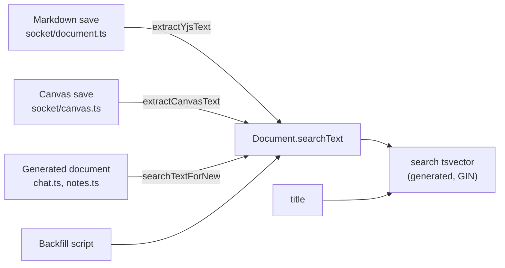
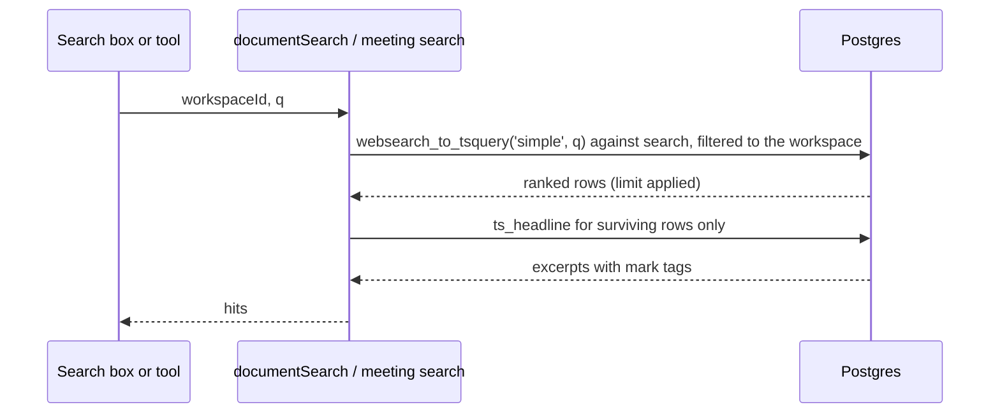
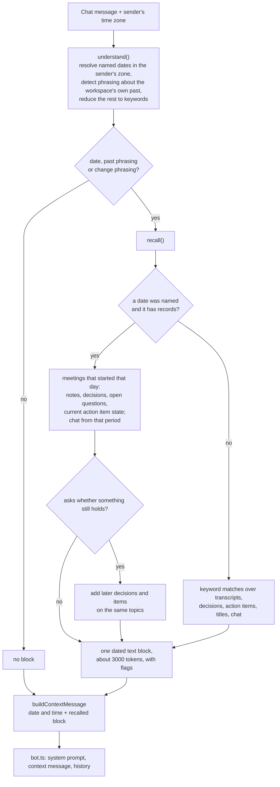
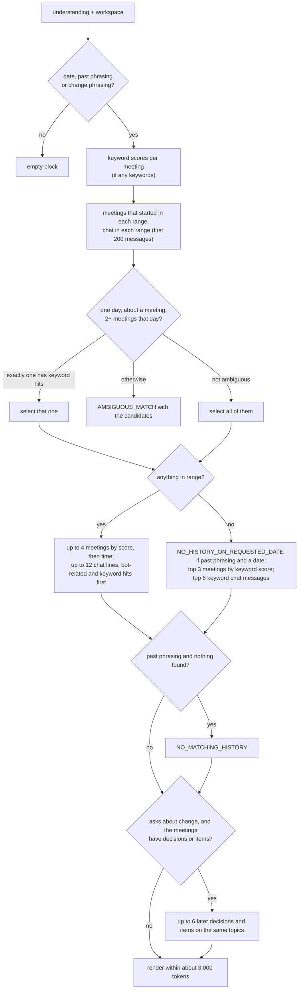

# Memory and search

How Nimbus remembers what a workspace has already said and written. There is no vector store and no embedding model: memory is plain Postgres full-text search plus a deterministic reader of dates and intent, run before the bot calls a model. The same search powers the document search box, the meetings search and the assistants' `search_workspace` and `search_meetings` tools.

## The pieces

| Piece | Module | Uses a model? |
| --- | --- | :-: |
| Text extraction for documents | [`documentText.ts`](../../apps/api/src/lib/documentText.ts) | no |
| Document keyword search | [`documentSearch.ts`](../../apps/api/src/lib/documentSearch.ts) | no |
| Transcript keyword search | [`meeting/search.ts`](../../apps/api/src/lib/meeting/search.ts) | no |
| Reading a question's dates and intent | [`memory/understand.ts`](../../apps/api/src/lib/memory/understand.ts) | no |
| Recalling dated history | [`memory/recall.ts`](../../apps/api/src/lib/memory/recall.ts) | no |
| Building the per-turn context message | [`memory/context.ts`](../../apps/api/src/lib/memory/context.ts) | no |
| Backfilling old documents | [`documentBackfill.ts`](../../apps/api/src/lib/documentBackfill.ts) | no |

## Searchable text for documents

A markdown document's content is a binary Yjs state and a canvas is an Excalidraw element array; neither is searchable as is. So every write also stores plain text in `Document.searchText`, and Postgres maintains a generated `tsvector` column `search` over `searchText` and the title, with a GIN index ([Data model](../reference/data-model.md)).



- `extractYjsText` walks the `"prosemirror"` fragment that Milkdown writes through y-prosemirror. Unknown node types are read as plain containers, so a schema change degrades formatting, never the search text.
- `extractCanvasText` collects the text of a canvas's elements.
- Text is capped at `SEARCH_TEXT_MAX = 200_000` characters, because Postgres refuses a `tsvector` over 1 MB and a failed update would also lose the snapshot it rides on.
- The same module renders a Yjs document back to markdown (`yjsToMarkdown`) for `GET /api/document/:id/export`. It is a purpose-built serializer, since Milkdown's own packages are browser-only ESM.

Documents created before search existed are filled by [`scripts/backfill_document_search.ts`](../../apps/api/scripts/backfill_document_search.ts). It accepts only an explicit `DATABASE_URL` argument and never loads a `.env` file, touches only documents with no search text unless told `all`, and reports the target by host and database name only.

## Keyword search

Documents and transcripts are searched the same way:



- `websearch_to_tsquery` reads ordinary search syntax (quoted phrases, `or`, a leading `-`) and never errors on odd input.
- The `simple` configuration does no stemming and has no stop words, deliberately: documents and captions are written in any language, and a language-specific stemmer would be wrong for most of them.
- Every value is a bound parameter of a tagged `$queryRaw` template, and the workspace filter is part of the statement.
- Excerpts are built only for rows that survive the limit, because `ts_headline` over large text is the costly part.

Surfaces: `GET /api/document/search` ([`DocumentSearch.tsx`](../../apps/web/components/DocumentSearch.tsx), [`useDocumentSearch`](../../apps/web/hooks/useDocumentSearch.ts)), `GET /api/meetings/search`, and the bot's `search_workspace` tool (documents and transcripts, five hits each).

## Memory for the chat bot

Before NimbusBot answers, the chat handler reads the question without a model and recalls the workspace's relevant past with plain SQL. The result becomes part of a context message placed after the fixed system prompt.



### When recall runs at all

Recall is **not** run for every message. `recall` returns an empty result immediately unless the question does at least one of three things:

| Signal | Detected by | Example |
|---|---|---|
| Names a day or last week | `chrono-node` results kept by `understand` | "what did we cover on Tuesday?" |
| Points at the workspace's own past | `PAST_PHRASES` | "you said the deadline was…", "what did we decide about pricing?" |
| Asks whether something still holds | `CHANGE_PHRASES` | "is that still the plan?", "any updates since then?" |

A plain question such as "what's our launch plan?" therefore gets **no** recalled block (the context message says "No earlier history was recalled for this message."). The bot can still find the answer with its `search_workspace` tool, which searches documents and transcripts; recall is the narrower, cheaper path for questions that are explicitly about the past. Documents are never part of the recalled block, only meetings and chat.

### Understanding the question

[`understand.ts`](../../apps/api/src/lib/memory/understand.ts) is strict about dates. A bare weekday or a day with a month resolves to the occurrence that already happened; "last week" is the previous Monday-to-Monday range; "yesterday" and "today" are accepted only where certain; anything vaguer ("next month", "in the morning") is ignored rather than guessed. Ranges are built in the sender's time zone, because the same instant is a different day in Asia/Kolkata and UTC.

A date alone never marks a question as being about the workspace's past: "what did Apple ship on Monday?" names a past day but asks about the world. Only phrasing like "you said", "we decided" or "in the meeting" does, otherwise the bot would claim to have no record of things it was never part of.

### What `understand` extracts, by example

Assume the sender is in `Asia/Kolkata` and it is Thursday 2026-11-12, 10:00 local time. These rows are the parser's actual output for those inputs.

| Message | `ranges` | `refersToPast` | `refersToMeeting` | `asksAboutChange` | `searchQuery` |
|---|---|:-:|:-:|:-:|---|
| "What did we decide about pricing on Tuesday?" | 2026-11-10, one day | ✓ ("did we decide") | ✓ ("decide") | | `pricing` |
| "Summarise last week's standup" | 2026-11-02 to 2026-11-09, a week | | ✓ ("standup") | | `summarise or standup` |
| "Is the Friday launch still the plan?" | 2026-11-06 (the Friday already past) | ✓ ("still the plan") | | ✓ | `launch` |
| "What did Apple ship on Monday?" | 2026-11-09 | | | | `apple or ship` |
| "Book a room next month" | none ("next month" is too vague) | | | | `book or room` |

Points the table makes concrete:

- **Past bias.** A bare weekday or a day-and-month that would fall in the future is moved back a week or a year (`applyPastBias`), because people asking a memory question mean the occurrence that happened.
- **The matched date words are removed** before keywords are taken, so "Tuesday" never becomes a search term. What remains is lower-cased, split on anything but letters, digits, `+`, `#` and `.`, and filtered: at least three characters and not in a stopword list that also contains weekday, month and time words.
- **Keywords are OR-ed.** `searchQuery` joins them with ` or ` for `websearch_to_tsquery`, so any one word matching counts, and ranking does the rest.
- **The Apple question recalls nothing.** It names a day, so recall does run, but without past phrasing the block carries no "nothing on that date" flag either; the bot answers from what it knows rather than claiming the workspace has no record.

### Recall

[`recall.ts`](../../apps/api/src/lib/memory/recall.ts) assembles the block:

| Constant | Value | Meaning |
| --- | --- | --- |
| `MAX_RECALLED_MEETINGS` | 4 | Meetings included at most |
| `MAX_CHAT_LINES` | 12 | Chat lines from the period |
| `MAX_LATER_ITEMS` | 6 | Later decisions and items for "does this still hold" questions |
| `RECALL_TOKEN_BUDGET` | 3000 | Estimated tokens for the whole block |

Dates win over keywords: when a day was named, that day's records come first and keywords only order them. Keyword search over decisions, action items, meeting titles and chat builds its `tsvector` on the fly after filtering to one workspace, because a workspace holds hundreds of such rows, not millions, so the scan is cheap and needs no extra generated columns. Messages already sent to the model as conversation history are excluded so nothing appears twice.

The block opens with flags the system prompt tells the model to obey: `NO_MATCHING_HISTORY`, `NO_HISTORY_ON_REQUESTED_DATE` and `AMBIGUOUS_MATCH`. Their names and the prompt rules in [`bot.ts`](../../apps/api/src/lib/bot.ts) must change together.

### How `recall` chooses, step by step



**Keyword scoring.** Four searches run in parallel, each limited to 40 rows and each tolerated if it fails (`Promise.allSettled`), and every hit adds a weight to its meeting:

| Source | Weight |
|---|---|
| A transcript segment (`searchSegments`, the indexed column) | 1 |
| A decision (`to_tsvector` on the fly) | 2 |
| An action item still linked to a meeting | 2 |
| The meeting's title | 3 |

A meeting mentioned in its title and in two decisions therefore outranks one with five matching captions. In the dated path, scores only **order** the day's meetings; in the fallback path they **choose** them.

**Chat in a range.** Up to 200 messages from the named days are read in time order, excluding those already sent as conversation history. The bot's own replies, messages that mention the bot and keyword hits take the first places; ordinary messages fill the rest, newest kept; the result is shown in time order, at most 12 lines.

**Then versus now.** For "is that still the plan?", `laterItems` builds a topic word set from the keywords and from the recalled meetings' decisions and action items, then reads up to 20 later meetings (after the earliest recalled one, up to now). A later decision or item counts as related when it contains one of the question's keywords (if there were any) and shares at least two topic words with the recalled material (or one, if the text has three words or fewer). The last six are kept, so the newest changes win.

**Spending the budget.** `buildBlock` writes the flags first, then the sections in an order the question decides (meetings, later items, chat for a question about a meeting; chat first otherwise). Each item is tried in its full rendering, then its compact one, then skipped, with tokens estimated as characters ÷ 4. The compact form of a meeting keeps the header, a 240-character summary, up to six decisions and six action items, and drops open questions and transcript excerpts.

### What the model receives

A recalled block for "What did we decide about pricing on Tuesday?", rendered in the sender's time zone:

```text
Meetings (dates are in the user's timezone):
[Tue 10 Nov 2026, 15:02] Meeting "Pricing review" (42 min, Ana Ruiz, Ben Okafor, Priya Shah)
  Notes document: [Meeting notes: Pricing review (2026-11-10)](nimbus-doc:ck9…)
  Summary: The team compared the two tier structures and settled on usage-based pricing for the API.
  Decisions:
  - Move the API to usage-based pricing from January.
  Action items (current status):
  - Draft the pricing page | owner Priya Shah | due 2026-11-20 | OPEN

Workspace chat (dates are in the user's timezone):
[Tue 10 Nov 2026, 16:30] Ben Okafor: @nimbus can you summarise the pricing call?
[Tue 10 Nov 2026, 16:30] Nimbus: The team chose usage-based pricing for the API…
```

It sits inside the context message, after `[Context for this turn, not a message from a user]` and today's date and time in the sender's zone. Two properties matter:

- **Action items show their current state,** not their state when the meeting ended, so "did Priya finish the pricing page?" is answered from today's record.
- **Document links use `nimbus-doc:<id>`,** which the web client renders as a link to the document, and titles are cleaned of brackets so they cannot break the link syntax.

The sender's time zone comes from the browser with each chat message (`chat:message`'s `timeZone`) and is normalised; an invalid or missing one falls back to a default rather than failing the message. Recall throwing (a database error) degrades to no block; the bot still answers.

### Why a separate context message

[`context.ts`](../../apps/api/src/lib/memory/context.ts) puts everything that changes per turn (today's date and time in the sender's zone, the recalled block) in its own message after the system prompt, never inside it. The system prompt then stays a stable prefix that providers can cache across turns.

## Tests

| Suite | What it pins |
| --- | --- |
| [memoryUnderstand.test.ts](../../apps/api/src/__tests__/unit/memoryUnderstand.test.ts) | Date resolution in the sender's zone, past bias, last week, vague phrases ignored, past and change phrasing, keyword extraction |
| [memoryRecall.test.ts](../../apps/api/src/__tests__/integration/persistence/memoryRecall.test.ts) | Dated recall, ambiguity, the three flags, keyword fallback, chat prioritisation and exclusion, then-versus-now items, workspace scoping, the budget |
| [memoryRender.test.ts](../../apps/api/src/__tests__/unit/memoryRender.test.ts) | Full and compact meeting rendering, links, current action item state |
| [documentText.test.ts](../../apps/api/src/__tests__/unit/documentText.test.ts), [documentSearchText.test.ts](../../apps/api/src/__tests__/integration/persistence/documentSearchText.test.ts) | Text extraction from Yjs and canvases, markdown export, `searchText` written by each save path |
| [searchSegments.test.ts](../../apps/api/src/__tests__/integration/persistence/searchSegments.test.ts) | Transcript search syntax, ranking, excerpts and workspace scoping |
| [documentManage.http.test.ts](../../apps/api/src/__tests__/integration/http/documentManage.http.test.ts), [documents.security.test.ts](../../apps/api/src/__tests__/security/documents.security.test.ts) | The document search endpoint and its membership checks |

## Design trade-offs and limits

- **Keyword search, not semantic search.** There are no embeddings, so "the onboarding flow" will not find a document that only says "sign-up steps". In exchange there is no vector store to run, no embedding cost per write, and results are explainable (the matched words are highlighted).
- **No stemming.** "deploy" does not match "deployed"; this is the multilingual trade-off described above.
- **Recall is opt-in by phrasing.** A question with no date, no past phrasing and no "still" wording gets no recalled block; the bot must decide to search instead.
- **A busy day is read from its start.** Chat for a named day is the first 200 messages of it, so in a very active workspace the end of the day can be missed.
- **Recall is rule-based.** Deterministic date parsing never invents a date, but questions phrased in ways the rules do not recognise get keyword recall only.
- **On-the-fly `tsvector`s** for decisions, items and chat are fine at today's workspace sizes and would need generated columns and indexes if a workspace grew to hundreds of thousands of rows.
- **`searchText` is a copy** that must be kept in step by every writer; a new write path that forgets it leaves a document unsearchable until the backfill runs.
- **Search text is capped** at 200,000 characters, so the tail of a very large document is not searchable.

## Related documentation

- [NimbusBot](nimbusbot.md)
- [Transcripts and notes](../meetings/transcripts-and-notes.md)
- [Markdown sync](../realtime/markdown-sync.md)
- [Data model](../reference/data-model.md)
- [REST API](../reference/rest-api.md)
