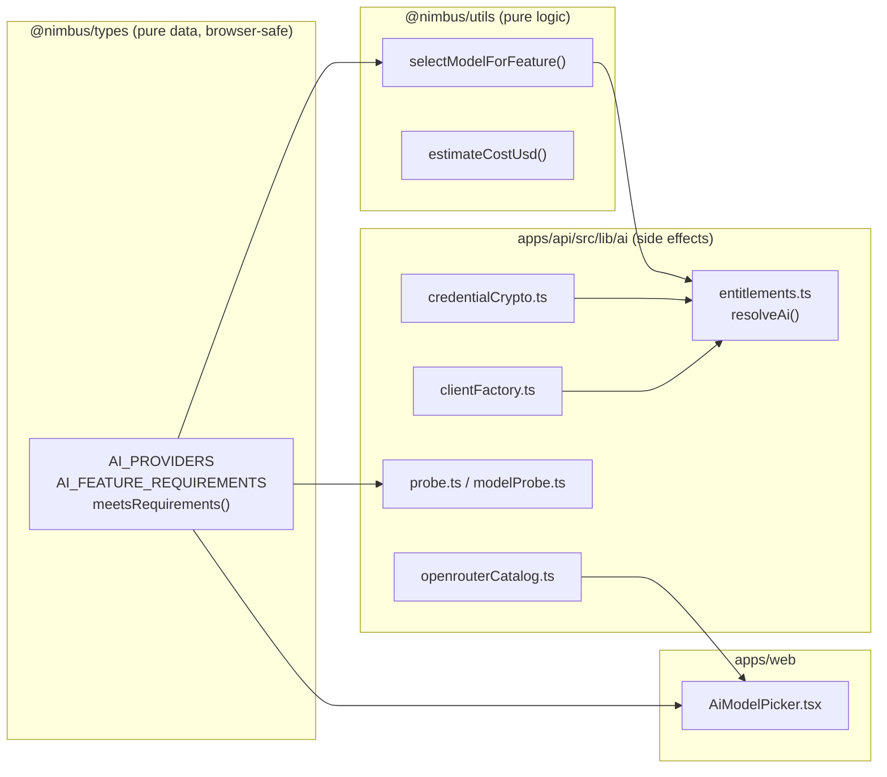
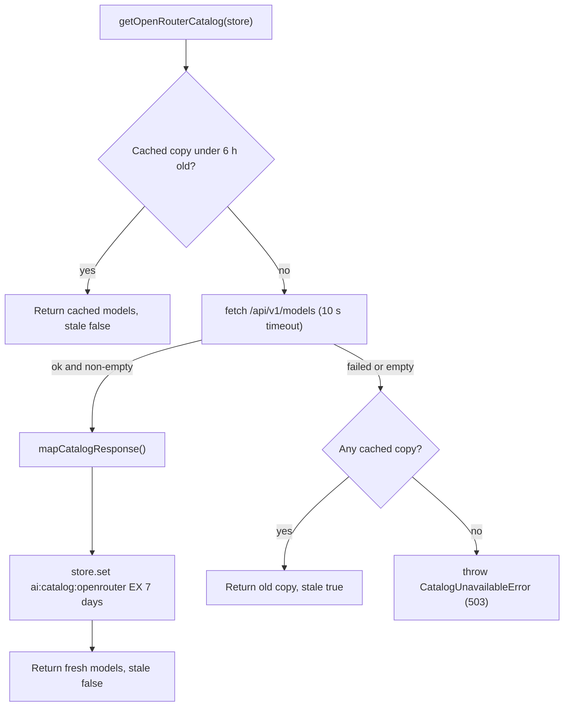
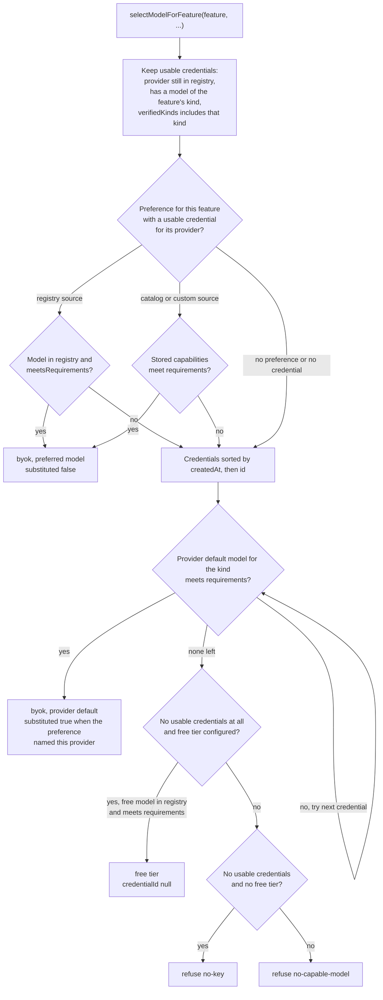
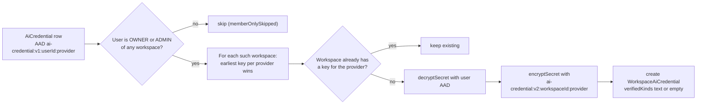
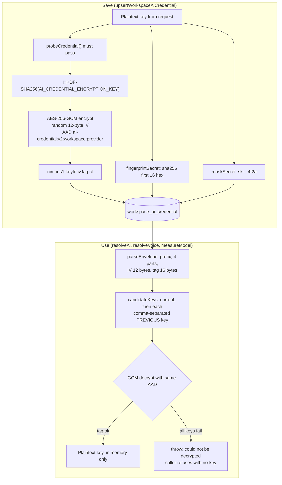
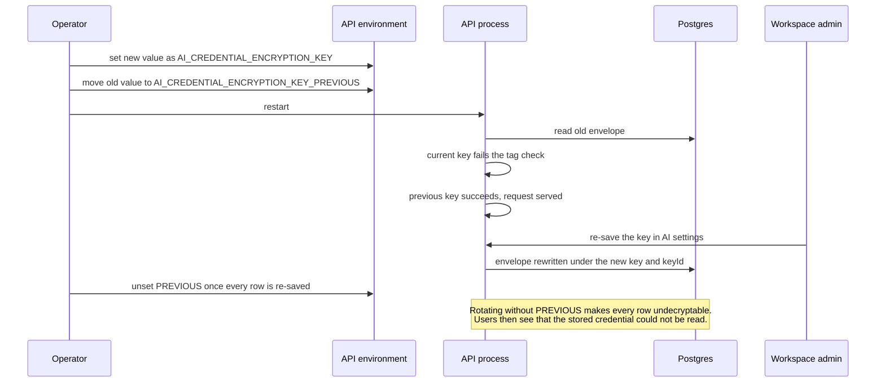
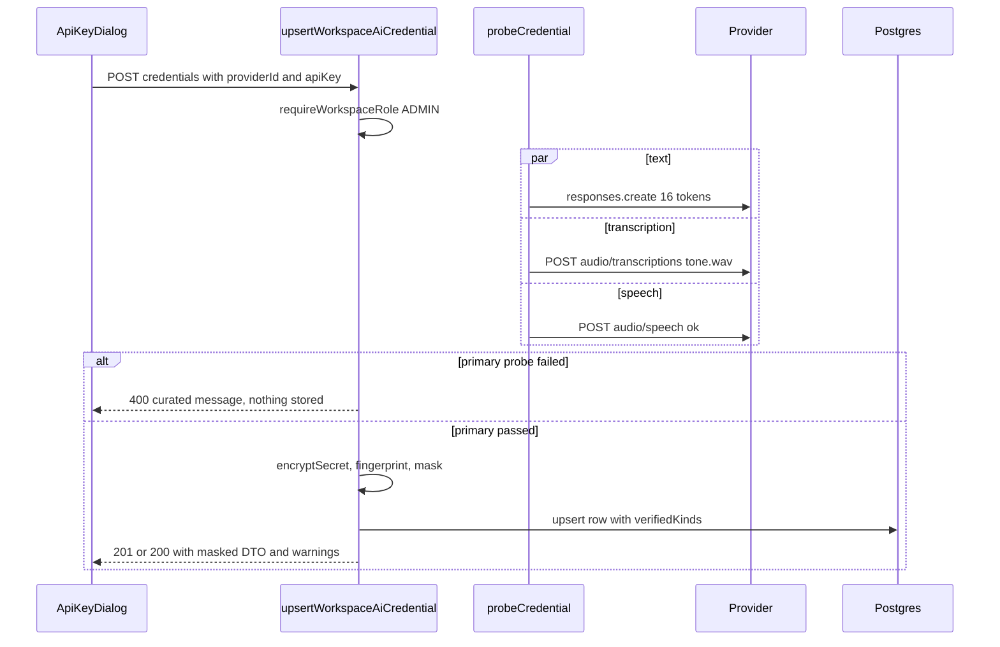
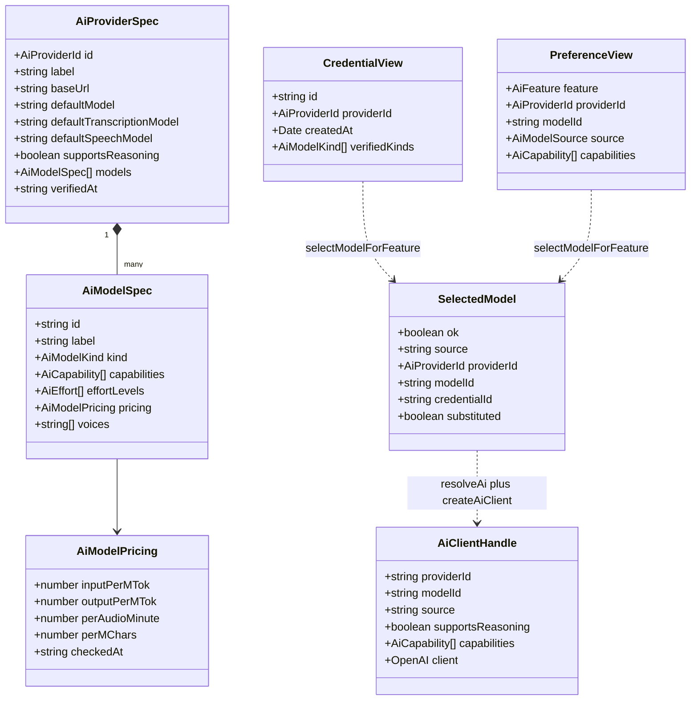

# AI providers and bring-your-own-key

Every AI feature in Nimbus (chat replies, generated documents and diagrams, reading images, the meeting assistant, transcription and speech) runs through one provider-agnostic layer: a registry of OpenAI-compatible providers and their models, a pure function that picks a model for a feature, encrypted storage for the API keys a workspace brings, save-time probes that prove a key works, and a factory that builds SDK clients lazily. This page explains that layer from the registry in `packages/types` to the settings panel in the browser. It matters because it lets the app boot and serve with no AI keys at all, lets each workspace pay for its own usage, and lets a new provider be added by editing one data file.

## The problem this layer solves

A naive "the app uses an LLM" design is one module-level client built at import time from an environment variable. That breaks as soon as you need any of:

- **Keys that belong to a workspace, not the deployment.** A workspace admin pastes a key; every member who uses AI in that workspace spends it. The key must reach the call site at request time and the app must boot without it.
- **Several providers.** OpenAI, Groq, DeepSeek and OpenRouter all speak the OpenAI Responses API, but differ in base URL, model catalogue and, importantly, which request parameters each model accepts.
- **Per-feature model choice.** A workspace may want a cheap model for chat and a stronger one for documents, or a vision-capable model for images.
- **A metered free tier.** A workspace without a key should still be able to try AI on the operator's key, up to a per-user limit (see [quotas-and-free-tier.md](quotas-and-free-tier.md)).

The work is split by purity. [providers.ts](../../packages/types/src/ai/providers.ts) is data only (it imports nothing and ships in the web bundle so the model picker can read it). [selectModel.ts](../../packages/utils/src/ai/selectModel.ts) is the pure precedence logic (no DB, no env, no SDK, no logger). Everything with a side effect lives in [apps/api/src/lib/ai](../../apps/api/src/lib/ai).



## The provider registry

[providers.ts](../../packages/types/src/ai/providers.ts) is the single source of truth for providers, base URLs, models and what each model can do. `AI_PROVIDER_IDS` is `["openai", "groq", "deepseek", "openrouter"]`, and `AI_PROVIDERS` maps each id to an `AiProviderSpec`.

| Id | Label | Base URL (`baseUrl`) | Default text model | Text models in the registry | Audio models | `verifiedAt` |
| --- | --- | --- | --- | --- | --- | --- |
| `openai` | OpenAI | `https://api.openai.com/v1` | `gpt-5-nano` | `gpt-5-nano`, `gpt-6-luna`, `gpt-5-mini`, `gpt-5`, `gpt-4.1-mini` | transcription `gpt-4o-mini-transcribe` (default), speech `gpt-4o-mini-tts` (default, 11 voices) | 2026-09-27 |
| `groq` | Groq | `https://api.groq.com/openai/v1` | `openai/gpt-oss-120b` | `openai/gpt-oss-120b`, `openai/gpt-oss-20b`, `qwen/qwen3.8-27b`, `llama-3.3-70b-versatile`, `llama-3.1-8b-instant` | none | 2026-09-27 |
| `deepseek` | DeepSeek | `https://api.deepseek.com` (no `/v1`) | `deepseek-flash` | `deepseek-flash`, `deepseek-v4-pro` | none | 2026-09-27 |
| `openrouter` | OpenRouter | `https://openrouter.ai/api/v1` | `openai/gpt-4o-mini` | `openai/gpt-4o-mini`, `openai/gpt-5-mini`, `deepseek/deepseek-v4-flash`, plus the live catalogue | transcription `openai/gpt-transcribe` (default), `openai/whisper-large-v3-turbo`, `openai/whisper-large-v3`, `qwen/qwen3-asr-0.6b`; speech `heygen/heygen-voice-1-turbo` (default), `hexgrad/kokoro-82m`, `canopylabs/orpheus-3b-0.1-ft`, `sesame/csm-1b`, `google/gemini-2.5-flash-tts`, `google/gemini-3.8-flash-lite-tts` | 2026-11-03 |

The SDK appends `/responses` (or `/audio/...`) to `baseUrl`, so the value is not uniform: DeepSeek's has no `/v1`. A wrong value fails as a 404 at request time, not at import, which is why `verifiedAt` is stamped from a measurement (see [Scripts](#scripts)). A provider whose `verifiedAt` is `null` is treated by the picker as "not offered yet".

### Capabilities

Models carry a capability list (`AiCapability`). The rest of the system reasons about capabilities rather than model names.

| Capability | Meaning | Who relies on it |
| --- | --- | --- |
| `tools` | Accepts function tools | Chat (`create_document` is a tool call), meeting work |
| `streaming` | Accepts `stream: true` | Markdown and canvas generation, meeting answers |
| `jsonMode` | Accepts `text.format: json_object` | Canvas, vision, meeting work |
| `reasoning` | Accepts `reasoning: { effort }` | Optional for every feature; feeds the "thinking" log |
| `reasoningSummary` | Also accepts `reasoning.summary` | Measured separately because Groq's gpt-oss rejects `summary` with a 400 |
| `vision` | Accepts `input_image` | The `vision` feature |

Each model also lists `effortLevels` (DeepSeek accepts `low`, `high`, `max` but not `minimal`), optional `pricing`, and, for speech models, `voices` and `audioFormats`.

### Features, kinds and requirements

`AI_FEATURES` lists the seven call sites. Each feature needs a model of one kind (`AI_FEATURE_KIND`), must meet hard requirements (`AI_FEATURE_REQUIREMENTS`) and may prefer soft ones (`AI_FEATURE_RECOMMENDED`).

| Feature | Kind | Hard requirements | Recommended | Used by |
| --- | --- | --- | --- | --- |
| `chat` | text | `tools` | none | [nimbusbot.md](nimbusbot.md) |
| `markdown` | text | `streaming` | `reasoning` | [document-generation.md](document-generation.md) |
| `canvas` | text | `streaming`, `jsonMode` | `reasoning` | [document-generation.md](document-generation.md) |
| `vision` | text | `vision`, `jsonMode` | none | image turns in chat, image to canvas |
| `transcription` | transcription | none (kind only) | none | the meeting voice agent |
| `speech` | speech | none (kind only) | none | the meeting voice agent |
| `meeting` | text | `tools`, `jsonMode`, `streaming` | none | notes, rolling summary, translation, the in-call assistant |

`meetsRequirements(model, feature)` checks the kind first, then every hard capability, so a speech model never passes for chat. `capabilitiesMeetRequirements(capabilities, feature)` is the same rule for models that are not in the registry; it only ever passes text features, because audio models are registry-only. `featuresServedBy(capabilities)` lists the features a measured set can serve. `reasoning` is deliberately soft for canvas: it only feeds the generation log and one last-resort JSON salvage path, and requiring it would exclude most of the catalogue.

### Prices and cost estimates

A model's `pricing` holds USD per million input and output tokens, per audio minute, or per million characters, each optional and stamped with `checkedAt`. `estimateCostUsd` in [cost.ts](../../packages/utils/src/ai/cost.ts) multiplies whatever usage is present by the matching price, rounds to 6 decimal places, and returns `null` the moment a needed price is missing, because a wrong cost shown as fact is worse than none. It ignores cached-input discounts and off-peak rates, so DeepSeek estimates (peak-hour prices) are upper bounds. Token-billed speech models such as the Gemini TTS entries carry no price, so their cost is neither estimated nor counted toward a spend cap.

## Three sources of models

A saved preference records where its model came from (`AI_MODEL_SOURCES`), and capabilities are read from the right place for each.

| `modelSource` | Providers | Where its capabilities come from |
| --- | --- | --- |
| `registry` | all | The curated `AiModelSpec` in `AI_PROVIDERS` |
| `catalog` | OpenRouter only | OpenRouter's public `GET /api/v1/models`, mapped by [openrouterCatalog.ts](../../apps/api/src/lib/ai/openrouterCatalog.ts) and copied onto the preference row |
| `custom` | all, text features only | Measured by the capability probe in [modelProbe.ts](../../apps/api/src/lib/ai/modelProbe.ts) and copied onto the row |

For `catalog` and `custom` preferences the capabilities are stored in `WorkspaceAiPreference.modelCapabilities`. They are **never read from the request**: the preference schema in [validations/ai.ts](../../packages/types/src/validations/ai.ts) has no `capabilities` field, and the controller copies or measures them itself. Voice features (`transcription`, `speech`) accept `registry` only.

### The OpenRouter catalogue

`getOpenRouterCatalog` fetches `https://openrouter.ai/api/v1/models` (public, no key) with a 10 s timeout (`CATALOG_FETCH_TIMEOUT_MS`) and maps each entry with text output:

- `tools` when `supported_parameters` includes `tools`;
- `jsonMode` from `response_format` or `structured_outputs`;
- `reasoning` from `reasoning` or `include_reasoning`;
- `vision` when `architecture.input_modalities` includes `image`;
- `streaming` assumed for every text model;
- `reasoningSummary` never inferred.

Per-token prices are scaled to per million; a negative price (OpenRouter's routers use `-1`) becomes `pricing: null`. The mapped list is cached in Redis under `ai:catalog:openrouter` (`CATALOG_CACHE_KEY`) and served from there while under six hours old (`CATALOG_TTL_MS`). The key is kept for seven days so that, when a refresh fails, the last copy is served marked `stale: true`. Only a cold cache plus a failed fetch raises `CatalogUnavailableError`, which the controller turns into a 503.



## Choosing a model

`selectModelForFeature(feature, preferences, credentials, freeTier)` in [selectModel.ts](../../packages/utils/src/ai/selectModel.ts) returns either a `SelectedModel` (`source`, `providerId`, `modelId`, `credentialId`, `substituted`) or a `SelectionRefusal` (`no-key` or `no-capable-model`). It is pure, so the status endpoint and the resolver call the same function and can never disagree.



Details that are easy to miss:

- **A stale preference degrades instead of refusing.** If the preference names a provider without a credential, or a model that no longer meets the requirements, selection falls through to the credential defaults rather than failing the feature.
- **`substituted` is about the user's choice, not which key.** It is true only when a preference existed for the same provider and the provider's default is used instead. The status endpoint surfaces it so the UI can explain the swap.
- **Ordering is deterministic.** Credentials sort by `createdAt` and then `id`, so two keys created in the same millisecond still select the same way on every call.
- **The free tier is only for workspaces with no usable credential for the feature's kind.** A workspace that brought a key never consumes the operator's allowance.
- **`verifiedKinds` gates every credential.** The selector treats an absent list as "every kind", but the database column defaults to `[]`, so in practice every row has a list, and a row with an empty list (for example a legacy credential copied without validation) serves nothing.

`resolveAi` wraps this with decryption, the spend cap and client construction; that flow is drawn in [quotas-and-free-tier.md](quotas-and-free-tier.md).

## Keys belong to the workspace

Credentials and preferences are workspace-scoped. `WorkspaceAiCredential` holds one row per (workspace, provider) and `WorkspaceAiPreference` one row per (workspace, feature); both cascade when the workspace is deleted. Only an ADMIN or OWNER can add, replace or remove a key or change a preference; whoever triggers a request then spends the workspace's key, and the triggering user is recorded in the call log. Field-by-field definitions are in [data-model.md](../reference/data-model.md).

| Model | Unique on | Key columns |
| --- | --- | --- |
| `WorkspaceAiCredential` | `workspaceId, providerId` | `keyEnvelope`, `keyId`, `keyFingerprint`, `maskedPreview`, `verifiedKinds`, `validatedAt`, `createdById`, `lastUsedAt` |
| `WorkspaceAiPreference` | `workspaceId, feature` | `providerId`, `modelId`, `modelSource`, `modelCapabilities`, `voice`, `updatedById` |
| `AiCredential`, `AiFeaturePreference` | `userId, providerId` / `userId, feature` | The older user-scoped tables. No request path reads them any more; only the copy script below does. |

### Migrating user keys to workspaces

Keys used to belong to a person. [copyAiCredentialsToWorkspaces.ts](../../apps/api/src/scripts/copyAiCredentialsToWorkspaces.ts) is the one-off migration, run from the API container as `node dist/scripts/copyAiCredentialsToWorkspaces.js --dry-run` and then without the flag. For every `AiCredential` it finds the workspaces where that user is OWNER or ADMIN, decrypts with the user-scoped AAD, re-encrypts with the workspace-scoped AAD and creates a `WorkspaceAiCredential`. Its rules:

- A user who is only a MEMBER anywhere contributes nothing, so a key never becomes readable to a workspace whose admins never saw it.
- When two admins of one workspace had a key for the same provider, the earliest `createdAt` (then `id`) wins and the conflict is printed.
- An existing workspace credential or preference is kept, which also makes a second run copy nothing.
- Copied rows get `verifiedKinds: ["text"]` when the source was validated and `[]` otherwise, because the old probe only tested text.
- Output is counts and non-secret ids only. `--dry-run` still decrypts every key it would copy, so an unreadable envelope is reported before the real run.



## Credential encryption

[credentialCrypto.ts](../../apps/api/src/lib/ai/credentialCrypto.ts) encrypts every stored key with **AES-256-GCM**, an authenticated cipher that detects any change to the ciphertext. The stored value is a self-describing envelope:

```text
nimbus1.<keyId>.<ivB64>.<tagB64>.<ctB64>
```

- `nimbus1.` is the format version. `parseEnvelope` refuses anything without it.
- `keyId` is `sha256(derivedKey)` truncated to 8 hex characters (`KEY_ID_HEX_LENGTH`), a hint naming which master key encrypted the row. Collisions are acceptable because it is a hint, not a lookup key.
- `iv` is a fresh random 12-byte nonce (`IV_LENGTH`), `tag` the 16-byte GCM auth tag (`TAG_LENGTH`), `ct` the ciphertext.

The master key comes from `AI_CREDENTIAL_ENCRYPTION_KEY`, a passphrase of at least 32 characters validated at boot in [env.ts](../../apps/api/src/lib/env.ts). It is run through **HKDF-SHA256** (a key-derivation function) with the salt `nimbus/ai-credential-encryption/v1` and info `ai-credential:v1` to produce the 32-byte AES key. Accepting any long passphrase rather than "exactly 32 base64 bytes" means both `openssl rand -base64 32` output and a long phrase work, and short values fail loudly. There is no "BYOK off" mode: the variable is required, and `requireMasterKey` throws rather than invent a default.

### AAD binds a row to its owner

GCM also authenticates "additional authenticated data" (AAD) that is not stored in the envelope. `buildAad(scope, providerId)` produces:

| Scope | AAD | Used by |
| --- | --- | --- |
| `workspace` | `ai-credential:v2:<workspaceId>:<providerId>` | Every current read and write |
| `user` | `ai-credential:v1:<userId>:<providerId>` | Only the copy script, to read legacy rows |

Because the owner and provider are part of what the tag authenticates, copying an envelope into another workspace's row, or onto another provider, fails decryption instead of yielding a usable key. This closes the row-swap attack an unbound ciphertext allows.



### Key rotation

Rotation needs no stored bookkeeping. `candidateKeys` derives the current key and then each comma-separated value in `AI_CREDENTIAL_ENCRYPTION_KEY_PREVIOUS` (values shorter than 32 characters are skipped), and `decryptSecret` tries them in order. It does not match on `keyId` first, because a wrong key and a tampered envelope look the same from outside (both are a GCM tag failure). Decrypting with a previous key does not re-encrypt the row; a row moves to the new key only when an admin saves the key again. There is no bulk re-encryption script in the repo.



When decryption fails at request time, `resolveAi` logs the row's fingerprint and the workspace id (never the key) and refuses with `no-key` and the message that an admin needs to add the key again, because reporting `invalid-key` would be false: the key itself may be fine.

### Previews, fingerprints and what never leaves the server

- `maskSecret` shows three characters of head, an ellipsis and four of tail (`sk-…4f2a`). Below 12 characters (`PREVIEW_MIN_LENGTH`) the whole key becomes dots. The mask is a shoulder-surfing guard, not a security boundary.
- `fingerprintSecret` is `sha256(apiKey)` truncated to 16 hex characters: a non-reversible identity used in log lines and the client cache key. It is never returned over HTTP.
- Controllers build DTOs field by field ([ai.controller.ts](../../apps/api/src/controllers/ai.controller.ts) `toCredentialDTO`), and the DTO types in [api/ai.ts](../../packages/types/src/api/ai.ts) have no field for the envelope, key id or fingerprint, so a leak would be a type error.
- The module's rules forbid logging the plaintext, the envelope or the derived key, putting key bytes in an error message (including an error `cause`), accepting an envelope without the prefix, and using a non-AEAD mode or a static IV.

The threat model, stated plainly in the module: the process holds the master key in its environment, so anyone with the running container's environment, a memory dump, or a database dump plus the master key can decrypt every stored key. What encryption at rest buys is a smaller blast radius for the realistic incidents (a leaked backup, a read-only SQL injection, a `SELECT *` in a support tool, a stray log line). It is not a vault: no per-workspace keys, no HSM, no re-authentication before use. See [security.md](../architecture/security.md).

## The save-time probe

A key is verified with real requests **before it is stored** ([probe.ts](../../apps/api/src/lib/ai/probe.ts)). `probeCredential(provider, apiKey)` runs, in parallel, one probe per model kind the provider has:

- **text**: `probeApiKey` sends `responses.create({ model, input: "hi", max_output_tokens: 16, ...reasoningKwargs(handle, "low") })` to the provider's default text model, with `timeout: 15_000` and `maxRetries: 0`. It sends the same reasoning shape a real call sends, because a simpler probe would verify a request nobody makes.
- **transcription**: `probeTranscription` posts a one-second 440 Hz tone, built in memory by `buildToneWav` (16 kHz mono PCM WAV), as multipart to `/audio/transcriptions`. Success is a 200 whose JSON has a `text` string.
- **speech**: `probeSpeech` asks `/audio/speech` to say "ok" as `pcm` with the model's first voice. Success is a 200 with a non-empty body.

Each audio probe has a 15 s budget (`AUDIO_PROBE_TIMEOUT_MS`). The primary probe (text when the provider has text models, otherwise transcription) decides whether the key is stored at all. A failed secondary probe does not block the save: its kind is left out of `verifiedKinds` and a warning is returned, so the resolver never relies on an unverified kind.

Failures map to curated messages by HTTP status, never by SDK error class, so an SDK upgrade that renames classes cannot break the mapping:

| Status | Reason | Message |
| --- | --- | --- |
| 401, 403 | `incorrect-key` | "Incorrect API key." |
| 404 | `model-not-found` | "That model isn't available on {provider}." |
| none (DNS, refused, timeout) | `unreachable` | "Could not reach {provider}." |
| anything else | `unknown-error` | "{provider} could not validate the request. Please try again." |

The controller stores only on success: a failed primary probe throws `AiProbeFailedError`, which becomes a 400 with the curated message and leaves the table untouched, while a database failure after a good probe is a 500.



## The capability probe for custom ids

When an admin types a model id that is neither in the registry nor in the catalogue, `probeModel(provider, apiKey, modelId)` in [modelProbe.ts](../../apps/api/src/lib/ai/modelProbe.ts) measures it. A basic `responses.create({ input: "hi" })` runs first; if it fails, the id is rejected with the curated reason from `classifyProbeError` and nothing else runs. Otherwise five probes run in parallel, each with a 15 s timeout (`MODEL_PROBE_TIMEOUT_MS`) and no retries:

| Probe | Request | Capability when it passes |
| --- | --- | --- |
| tools | one trivial `ping` function, `tool_choice: "auto"` (DeepSeek rejects `required` in thinking mode), 1024-token cap | `tools`, if a `function_call` comes back |
| json | `text.format: json_object`, 1024-token cap | `jsonMode`, if the output parses |
| streaming | `stream: true` | `streaming`, on the first event (then the stream is aborted) |
| reasoning | `reasoning: { effort: "low" }` | `reasoning`, then a second call with `summary: "detailed"` decides `reasoningSummary` |
| vision | a 1x1 PNG as `input_image` | `vision` |

The answer-producing probes get a 1024-token cap (`PROBE_ANSWER_MAX_OUTPUT_TOKENS`) because reasoning models spend a small budget on thinking and would end `incomplete` before any tool call or JSON appears; the others use 64. A probe that errors for any reason leaves its capability out, which errs toward offering the model for fewer features. Results are cached in Redis for ten minutes (`PROBE_CACHE_TTL_SECONDS`) under `ai:probe:<workspaceId>:<providerId>:<modelId>` (`probeCacheKey`), which holds no key material, so the save that follows a "Check model" click does not pay for a second round.

## The client factory

[clientFactory.ts](../../apps/api/src/lib/ai/clientFactory.ts) is the only module that constructs SDK clients. Building a client per call site at import time used to make every provider key a required variable, because the SDK throws when the key is absent; taking the key as an argument lets a process with no keys boot. `createAiClient({ provider, apiKey, model, source })` returns an `AiClientHandle`:

| Field | Meaning |
| --- | --- |
| `providerId`, `modelId` | What the call sites pass to `responses.create` |
| `source` | `byok` (the workspace's key) or `free` (the operator's key) |
| `supportsReasoning` | `true` when the model has `reasoning` |
| `capabilities` | The registry's set, or the stored set for a catalogue or custom model |
| `client` | An `OpenAI` instance with `apiKey` and `baseURL` set explicitly |

Call sites do `handle.client.responses.create({ model: handle.modelId, ... })` and never know whose key pays. Clients are never configured from `OPENAI_BASE_URL`, so a stray environment variable cannot redirect calls. `resolveBaseUrl(provider)` in [providers.ts](../../apps/api/src/lib/ai/providers.ts) is the one place a URL is chosen: it returns the registry's `baseUrl`, except that under `NODE_ENV=test` an `AI_TEST_BASE_URL` redirects every provider to a local fake (the gate means a stray value in production is inert).

### The client cache

Handles are cached in a process-local `Map` keyed by `${providerId}|${keyFingerprint}|${modelId}`, using the fingerprint so the cache holds the least identifying material that still keeps two keys distinct. It holds at most 50 entries (`CACHE_MAX_ENTRIES`), each for 10 minutes (`CACHE_TTL_MS`); on overflow the entry with the oldest expiry is evicted, and a hit is moved to the back. The TTL is the bound on how long a deleted credential can keep working in a process.

### `reasoningKwargs`

`reasoningKwargs(handle, effort)` is the one piece of request shaping a call site cannot decide alone:

| Model has | Sent |
| --- | --- |
| no `reasoning` | `{}`, because the parameter would 400 |
| `reasoning` without `reasoningSummary` | `{ reasoning: { effort } }` (Groq's gpt-oss) |
| both | `{ reasoning: { effort, summary: "detailed" } }` |

Every call site in the repo requests `low` explicitly: provider defaults are unstated and differ, reasoning tokens count against `max_output_tokens`, and `low` is the cheapest level every verified provider accepts (DeepSeek has no `minimal`).

### Classifying call-time errors

`classifyClientError(err)` maps a failed call by its `status`: 401 and 403 become `invalid-key` ("The provider rejected the credential. Update it in AI settings."), everything else `provider-error`. The provider's raw error text is never shown or stored, because some SDK error formats echo request parameters, including the key.

## The REST surface

[ai.router.ts](../../apps/api/src/routers/ai.router.ts) is mounted at `/api/ai` behind `authCheck`. Every workspace route goes through `requireWorkspaceRole`, which answers 404 to a non-member (so the workspace's existence does not leak) and 403 below the needed role. The full reference is in [rest-api.md](../reference/rest-api.md).

| Method | Path | Role | Purpose |
| --- | --- | --- | --- |
| GET | `/me/free-usage` | self | The caller's free allowances and the workspaces they administer |
| GET | `/workspaces/:workspaceId/status` | MEMBER | Per-feature enablement, voice availability, free allowance, `canManage` |
| GET | `/workspaces/:workspaceId/credentials` | ADMIN | Masked credential DTOs, oldest first |
| POST | `/workspaces/:workspaceId/credentials` | ADMIN | Probe, encrypt and upsert (201 new, 200 replaced, 400 failed probe) |
| DELETE | `/workspaces/:workspaceId/credentials/:providerId` | ADMIN | Delete the key and its preferences in one transaction; returns `clearedPreferences` |
| GET | `/workspaces/:workspaceId/preferences` | MEMBER | `{ feature: preference or null }` |
| PUT | `/workspaces/:workspaceId/preferences` | ADMIN | Validate and save one feature's provider, model, source and voice |
| GET | `/workspaces/:workspaceId/settings` | MEMBER | Spend cap, assistant switches, month-to-date spend |
| PUT | `/workspaces/:workspaceId/settings` | ADMIN | Change any of them |
| GET | `/workspaces/:workspaceId/usage` | ADMIN | Cursor-paged call log plus this month's totals |
| GET | `/workspaces/:workspaceId/catalog/openrouter?feature=` | ADMIN | Catalogue filtered to the feature, curated picks first |
| POST | `/workspaces/:workspaceId/models/probe` | ADMIN | Measure a custom id with the workspace's key |

`upsertWorkspaceAiPreference` refuses with 422 for an unknown provider, a non-registry source on a voice feature, a voice on any feature other than `speech`, no credential for the provider, a credential not verified for the feature's kind, an unknown or incapable registry model, a voice the model does not list, a catalogue id not in the catalogue, or measured capabilities that lack a requirement (the message names the missing capability). A custom id the probe rejects is a 400; an unreachable catalogue with nothing cached is a 503.

## Scripts

| Script | What it does | Safety notes |
| --- | --- | --- |
| [verifyProvider.ts](../../apps/api/src/scripts/verifyProvider.ts) | Runs `probeApiKey` and `probeModel` for `PROVIDER_ID` with `PROVIDER_API_KEY` (and optional `MODEL_ID`) and compares the result with the registry, so `verifiedAt` and capabilities are stamped from evidence | Reads the key from the environment only, never prints it, writes nothing, makes tiny billable requests |
| [probe_ai_providers.ts](../../apps/api/scripts/probe_ai_providers.ts) | Ops diagnostic that exercises the exact request shapes the call sites build against each provider with an operator key (`--json`, `--provider`, `--canvas`) | Loads `apps/api/.env` through `dotenv/config` and makes real requests; refers to keys by length and last four characters only |
| [copyAiCredentialsToWorkspaces.ts](../../apps/api/src/scripts/copyAiCredentialsToWorkspaces.ts) | The user-to-workspace key migration described above | Writes to whatever database the environment points at; use `--dry-run` first |

## The web side

- [WorkspaceAiPanel.tsx](../../apps/web/components/WorkspaceAiPanel.tsx) is the workspace settings "AI" tab. Admins and owners manage keys (with the kinds each was verified for), pick a model per feature, flip the assistant switches and set the spend cap; members see a read-only summary. The role comes from the server's `canManage`, never from a client guess.
- [AiModelPicker.tsx](../../apps/web/components/AiModelPicker.tsx) renders a provider select and a searchable model combobox per feature. Only providers with a key verified for the feature's kind are listed. Rows show the label, id, capability chips and price. For OpenRouter the live catalogue follows the registry models, and the last row, **Use a custom model id...**, swaps in a text field and a **Check model** button that runs the probe and saves only when the measured set can serve the feature. Saving is immediate on change.
- [ApiKeyDialog.tsx](../../apps/web/components/ApiKeyDialog.tsx) is the add or replace modal. The plaintext key lives only in form state and is cleared on success and on close.
- Hooks: [useWorkspaceAiStatus.ts](../../apps/web/hooks/useWorkspaceAiStatus.ts), [useWorkspaceAiCredentials.ts](../../apps/web/hooks/useWorkspaceAiCredentials.ts), [useWorkspaceAiPreferences.ts](../../apps/web/hooks/useWorkspaceAiPreferences.ts) (per-feature pending and error state), [useAiCatalog.ts](../../apps/web/hooks/useAiCatalog.ts) (fetches only while enabled, so a workspace without an OpenRouter key never calls it), [useAiModelProbe.ts](../../apps/web/hooks/useAiModelProbe.ts).
- [aiApi.ts](../../apps/web/lib/aiApi.ts) is the shared fetch wrapper: it sends the session cookie, reads the `ServerResponse` envelope and turns every failure into `{ ok: false, message }` instead of throwing. [api/ai.ts](../../apps/web/api/ai.ts) is the server-side helper that seeds pages; it resolves to a disabled-everything shape on failure so a page never 500s because the AI endpoint did.

## Key types



## Design trade-offs and limits

- **One API shape for every provider.** Everything goes through the OpenAI SDK's Responses API and audio endpoints. That keeps call sites free of provider branches, but a provider that does not speak this shape cannot be added without a new client path, and per-provider quirks (Groq rejecting `reasoning.summary`, DeepSeek rejecting `tool_choice: "required"` and `minimal` effort) must be expressed as capabilities or hard-coded choices.
- **The registry is hand-maintained.** Capabilities and prices are curated and stamped with dates; they go stale when providers change, and nothing refreshes them automatically. `verifyProvider.ts` makes re-checking cheap but it is a manual step.
- **Catalogue capabilities are inferred.** OpenRouter's `supported_parameters` are trusted as-is, `streaming` is assumed, and `reasoningSummary` is never inferred, so a catalogue model may be offered for a feature and still fail at call time.
- **Probes measure a moment.** A custom id's capabilities are measured once at save time; if the provider changes the model later, the stored set is wrong until the preference is saved again. A probe error of any kind reads as "capability absent", which can under-offer a model on a flaky day.
- **Encryption at rest, not a vault.** The master key sits in the process environment; a compromise of the running container defeats it. Rotation relies on admins re-saving keys, and there is no script that re-encrypts rows in bulk.
- **The client cache is per process.** Each API replica keeps its own 50-entry cache, and a deleted key can keep working in a replica for up to 10 minutes.
- **Legacy tables remain.** `AiCredential` and `AiFeaturePreference` are still in the schema although only the copy script reads them; dropping them is a separate migration.

## Related documentation

- [quotas-and-free-tier.md](quotas-and-free-tier.md)
- [nimbusbot.md](nimbusbot.md)
- [document-generation.md](document-generation.md)
- [security.md](../architecture/security.md)
- [rest-api.md](../reference/rest-api.md)
- [data-model.md](../reference/data-model.md)
- [environment.md](../reference/environment.md)
- [runbook.md](../operations/runbook.md)
