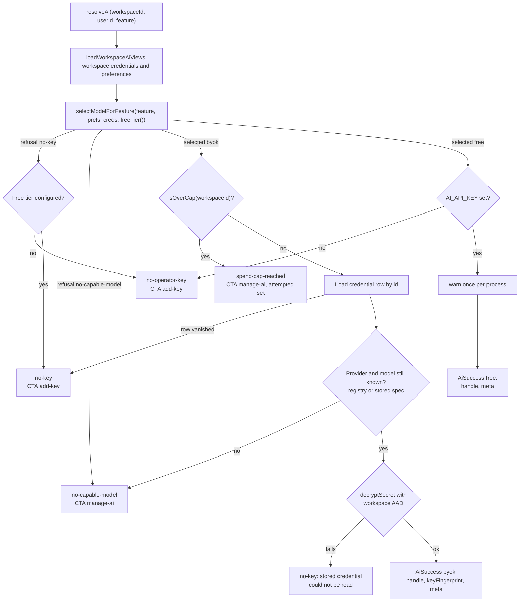
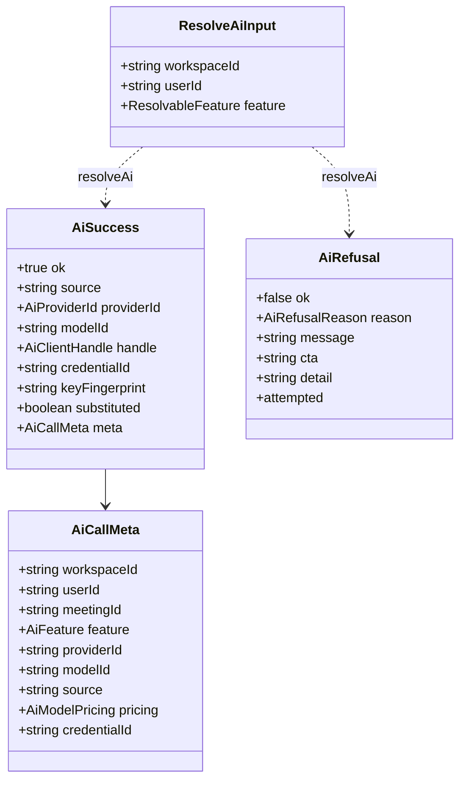
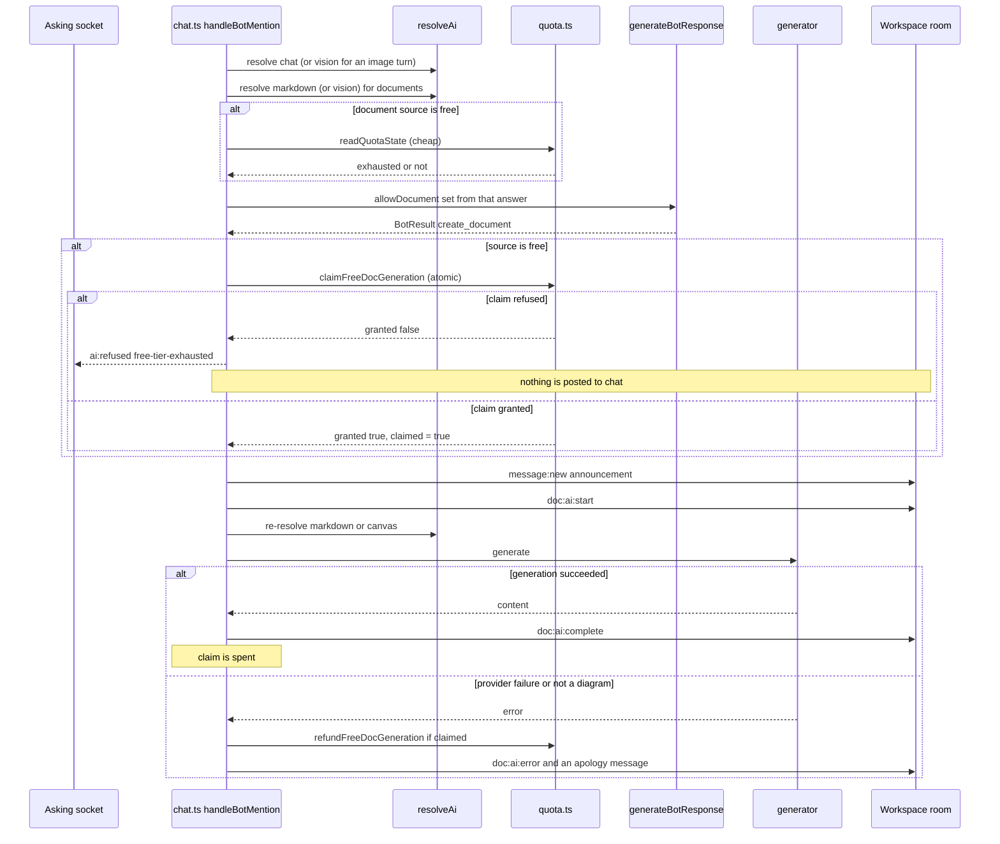
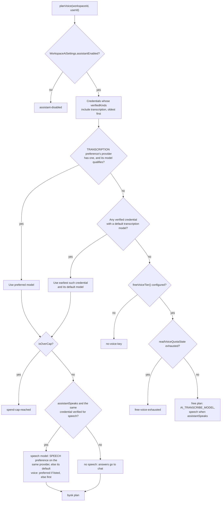

# AI entitlements, quotas and the free tier

Before any model is called, Nimbus decides whether the request may run at all and whose money pays for it: the workspace's own key, or the operator's free tier. This page covers that decision (`resolveAi` for text features and `planVoice` for the meeting assistant), the two per-user free allowances (document generations and assistant seconds), the per-workspace monthly spend cap, the call log every model call is written to, and the workspace AI settings that switch features on and off. It matters because these are the controls that keep a public deployment's AI bill bounded while still letting anyone try the features.

## Who pays for a call

Two sources can pay, and the rules differ for each. Keys and the spend cap belong to a workspace; the free allowances belong to a person.

| Source | Whose money | What bounds it | Where the bound lives |
| --- | --- | --- | --- |
| `byok` | The workspace's own key, added by an admin | The workspace's monthly spend cap, if an admin set one | `WorkspaceAiSettings.monthlySpendCapUsd`, checked in [spendCap.ts](../../apps/api/src/lib/ai/spendCap.ts) |
| `free` (text) | The operator's `AI_API_KEY` | Chat is unlimited; each document or diagram generation uses one of the asking user's free generations | `User.freeDocGenerationsUsed`, [quota.ts](../../apps/api/src/lib/ai/quota.ts) |
| `free` (voice) | The operator's `AI_VOICE_API_KEY` | The asking user's free assistant seconds | `User.freeVoiceSecondsUsed`, charged when a meeting ends |

The free allowances are per user and not per workspace, so creating ten workspaces does not give a user ten allowances. A workspace that has a usable key for a feature never touches the free tier for it, and free-tier calls never count toward a workspace's spend cap (they did not spend the workspace's money).

## Configuring the free tier

Every value is read at call time from `process.env`, and validated at boot in [env.ts](../../apps/api/src/lib/env.ts). The full list is in [environment.md](../reference/environment.md).

| Variable | Default | Effect |
| --- | --- | --- |
| `AI_API_KEY` | unset | The operator's text key. Unset or empty disables the text free tier: `freeTier()` returns `null` and requests that would have used it are refused with `no-operator-key`. |
| `AI_PROVIDER` | `deepseek` | Registry provider of the free text model. An unknown value falls back to `deepseek` in `parseProviderId`. |
| `AI_MODEL` | `deepseek-flash` | Free text model id. |
| `AI_FREE_DOC_LIMIT` | `5` | Free document generations per user. `readQuotaLimit` also falls back to 5 for a negative or non-numeric value. |
| `AI_VOICE_API_KEY` | unset | The operator's voice key. Unset or empty disables free voice. |
| `AI_VOICE_BASE_URL` | `https://openrouter.ai/api/v1` | Where free transcription and speech requests go. |
| `AI_TRANSCRIBE_MODEL` | `openai/gpt-transcribe` | Free transcription model (OpenRouter's registry default). |
| `AI_SPEECH_MODEL` | `heygen/heygen-voice-1-turbo` | Free speech model (OpenRouter's registry default). |
| `AI_SPEECH_VOICE` | `default` | Free voice. `freeSpeechVoice` keeps it only when the speech model lists it (or the model is not in the registry); otherwise it uses the model's first voice, because the assistant speaks one sentence per request and a model left to pick its own speaker would change voice mid-answer. |
| `AI_FREE_VOICE_SECONDS` | `600` (ten minutes) | Free assistant seconds per user. |

The default free model `deepseek-flash` has `tools`, `streaming`, `jsonMode`, `reasoning`, `reasoningSummary` and `vision`, so on a stock deployment the free tier can serve every text feature: chat, markdown, canvas, vision and meeting.

### Free-tier capabilities

[entitlements.ts](../../apps/api/src/lib/ai/entitlements.ts) logs one warning per process, "Free-tier capabilities are assumed, not enforced", the first time a free-tier handle is built (`warnFreeTierCapabilitiesOnce`). In the current code the selector does check the free model against the registry: `selectModelForFeature` only grants the free tier when `AI_MODEL` is a registry model of `AI_PROVIDER` that meets the feature's requirements, and refuses with `no-capable-model` otherwise. The warning is therefore a reminder that the operator chose the model, rather than a sign that no check runs.

## Entitlement resolution for text features

`resolveAi({ workspaceId, userId, feature })` serves the five text features (`ResolvableFeature`: `chat`, `markdown`, `canvas`, `vision`, `meeting`). It makes no provider call: every refusal it produces is a configuration state, not a runtime failure. It composes `loadWorkspaceAiViews`, the pure `selectModelForFeature` (drawn in [providers-and-byok.md](providers-and-byok.md)), `isOverCap`, `decryptSecret` and `createAiClient`.



The refusal reasons and what the UI does with each:

| Reason | Produced by | Message (abridged) | `cta` |
| --- | --- | --- | --- |
| `no-operator-key` | `refusalFor`, free-tier branch | The free tier is not configured on this deployment; an admin can add a key | `add-key` |
| `no-key` | `refusalFor`, missing row, failed decrypt | An admin needs to add a provider key (or add it again) | `add-key` |
| `no-capable-model` | `refusalFor`, `noCapableModel` | No available model supports this feature | `manage-ai` |
| `spend-cap-reached` | the cap check | The workspace reached its monthly AI spend cap; an admin can raise it | `manage-ai` |
| `free-tier-exhausted` | the caller after a quota read or a failed claim | You've used all your free document generations | `add-key` |
| `invalid-key`, `provider-error` | `classifyClientError`, at call time | The provider rejected the credential / could not complete the request | none |

`no-capable-model` points at **manage-ai** rather than **add-key** because a credential row already exists; the fix is a different model or a key for another provider. The two call-time reasons are not in `AiRefusalReason` because the resolver sees no network.

A successful resolution carries a `meta: AiCallMeta` (workspace, user, feature, provider, model, source, pricing, credential id) that the call sites hand to the call log, so the log can describe a call without the call site knowing anything about entitlements.



## Free document generations

Chat replies on the free tier are unlimited; each generated document or diagram costs one free generation. The counter is `User.freeDocGenerationsUsed` and the limit is `AI_FREE_DOC_LIMIT`. [quota.ts](../../apps/api/src/lib/ai/quota.ts) exposes three functions with different jobs:

- `readQuotaState(userId)`: a cheap, lock-free read (`used`, `limit`, `remaining`, `exhausted`) for the status endpoint and for deciding whether to offer the bot a document tool. It can be one generation stale under concurrency; its job is honest UX.
- `claimFreeDocGeneration(userId)`: the authoritative, atomic claim.
- `refundFreeDocGeneration(userId)`: returns a slot after a provider-side failure.

The claim is a single conditional update, race-safe by construction:

```ts
await prisma.user.updateMany({
  where: { id: userId, freeDocGenerationsUsed: { lt: limit } },
  data: { freeDocGenerationsUsed: { increment: 1 } },
});
```

Postgres locks the user row; a concurrent claim waits, then re-evaluates the `WHERE` against the incremented row and matches nothing, so `count === 0` is the authoritative "exhausted" signal. A refused claim is a quota refusal, never a UI bug: a read that said "1 remaining" can lose the slot to a concurrent request. The refund is the mirror image, `decrement` guarded by `{ gt: 0 }` so the counter never goes negative.

### The claim-then-announce order

The chat handler in [chat.ts](../../apps/api/src/socket/chat.ts) claims **before** posting "Sure! I am creating the document…", so a user who has run out never sees a promise of a document that will not arrive. It claims only when the document resolution's `source` is `free`; a workspace generating on its own key neither spends nor is blocked by the free allowance.



The same claim is made, again only for `source === "free"`, by the meeting assistant's `create_document` and `draw_discussion` tools (`prepareGeneration` in [tools.ts](../../apps/api/src/lib/meeting/tools.ts)) and by `POST /api/meetings/:meetingId/diagram` in [meeting.controller.ts](../../apps/api/src/controllers/meeting.controller.ts). Refunds are bounded: a refund only returns what that call claimed, gated on a `claimed` flag in the detached scope, and only a failed generation (or, for image-to-canvas, a picture the model says is not a diagram) reaches it.

## Free assistant minutes

The meeting voice agent needs a transcription model and, to speak, a speech model. Whether it can run and on whose key is decided by `planVoice` in [voiceAvailability.ts](../../apps/api/src/lib/ai/voiceAvailability.ts), which never touches a plaintext key. Only `resolveVoice` in [voiceEntitlements.ts](../../apps/api/src/lib/ai/voiceEntitlements.ts) turns a plan into secrets, and a `no-restricted-imports` rule in the API's ESLint config allows only `lib/meeting/tickets.ts` to import it.



Speech rides the same credential as transcription: the agent receives one base URL and one key, so a speech model on another provider cannot be combined with it. The free seconds are charged when the meeting ends, by `chargeFreeSeconds` in [lifecycle.ts](../../apps/api/src/lib/meeting/lifecycle.ts): the elapsed seconds, capped by the meeting's `budgetSeconds`, are added with `LEAST(GREATEST(limit, used), used + charged)`, so the counter is capped at the limit but never lowered, and shrinking the allowance later refunds nobody. A partial unique index on `Meeting` allows at most one live free-tier meeting per user across all workspaces, so one allowance cannot be handed to several meetings at once. The meeting lifecycle and budget enforcement are covered in [transcripts-and-notes.md](../meetings/transcripts-and-notes.md) and [voice-agent.md](../meetings/voice-agent.md).

## The monthly spend cap

An admin can set `monthlySpendCapUsd` (positive, at most 1,000,000, two decimal places, or `null` for none; see `aiSettingsSchema` in [validations/ai.ts](../../packages/types/src/validations/ai.ts)). `isOverCap(workspaceId)` returns `false` when no cap is set; otherwise it compares the month-to-date cost with the cap.

`monthToDateCostUsd` sums `AiCall.costUsd` over the workspace's `BYOK` calls since the start of the current UTC month (`monthStart`). The sum is cached in Redis for 30 seconds (`SPEND_CACHE_TTL_SECONDS`) under `spend:<workspaceId>:<yyyy-mm>`, so a burst of chat messages costs one aggregate query rather than one per message. A Redis failure is treated as a cache miss.

The cap is a **soft ceiling, not a meter**, and the settings UI says so:

- the cached sum can be up to 30 s behind;
- a call already running when the cap is reached finishes;
- a call whose model has no price counts as zero.

## The call log

Every model call, successful or not, becomes one `AiCall` row ([callLog.ts](../../apps/api/src/lib/ai/callLog.ts)). It feeds the admin Usage tab and the spend cap.

| Entry point | Shape | Used by |
| --- | --- | --- |
| `withAiCall(meta, fn, extractUsage?)` | Wraps a request and response call; records `OK` with usage, or the failure, and rethrows | The bot's model rounds, image-to-canvas |
| `startAiCall(meta)` | Returns `finish(usage)` and `fail(err)`; whichever runs first records the row, later calls do nothing | Streaming markdown and canvas generation (usage arrives on `response.completed`) |
| `recordAiRefusal(input)` | A `REFUSED` row with the attempted provider and model, or `"none"` | `emitRefusal` in the chat handler |

| Column | Meaning |
| --- | --- |
| `status` | `OK`, `ERROR`, `REFUSED`, `CANCELLED` |
| `errorReason` | A curated reason only: `invalid-key`, `provider-error`, `timeout`, `parse-failed`, `cancelled`, or the refusal reason. Provider error text is never stored. |
| `inputTokens`, `outputTokens`, `reasoningTokens` | From `usageFromResponse` (reasoning tokens are already part of the output count) |
| `audioSeconds`, `characters` | Voice usage |
| `latencyMs` | Wall time of the call |
| `costUsd` | `estimateCallCost` from the model's list prices for `OK` and `CANCELLED` rows; `null` when unpriced |
| `meetingId` | Set when the in-call assistant made the call |

`classifyCallFailure` turns an abort (`AbortError`, `APIUserAbortError`) into `CANCELLED`, an `AiCallError` into its own reason (pipelines throw `new AiCallError("parse-failed")` for unreadable model output), a timeout into `timeout`, and otherwise defers to `classifyClientError`. Logging never fails the request it describes: `recordAiCall` swallows every error and logs only the error's name and code, because a database error can quote the values it was inserting. A successful BYOK call also stamps the credential's `lastUsedAt`, at most once a minute per credential (`LAST_USED_GATE_SECONDS`, a Redis `SET ai:lastused:<id> NX EX 60` gate).

`GET /api/ai/workspaces/:workspaceId/usage` pages the log newest first with a cursor of the form `<createdAt ISO>_<id>`, a `limit` of 1 to 100 (default 50) and optional `feature`, `status` and `userId` filters, and returns this UTC month's totals per feature alongside.

## Workspace AI settings

`WorkspaceAiSettings` is created lazily on the first save, so every reader goes through `readWorkspaceAiSettings` in [workspaceSettings.ts](../../apps/api/src/lib/ai/workspaceSettings.ts), which returns `DEFAULT_WORKSPACE_AI_SETTINGS` when no row exists.

| Setting | Default | Effect |
| --- | --- | --- |
| `monthlySpendCapUsd` | `null` (no cap) | Refuses BYOK text calls and BYOK voice plans once month-to-date spend reaches it |
| `assistantEnabled` | `true` | Off refuses the meeting assistant with `assistant-disabled` |
| `assistantSpeaks` | `true` | Off leaves the plan without speech, so answers go to chat |

Any member can read the settings (with `monthToDateCostUsd`); only admins can change them, and an empty body is refused with "Nothing to update".

## The status endpoint

`GET /api/ai/workspaces/:workspaceId/status` (`getWorkspaceAiStatus`) is the web's source of truth for whether the chat composer and AI controls are enabled. For each text feature it runs the same `selectModelForFeature` as the resolver, then applies the cap (BYOK only) and, for `markdown` and `canvas` on the free tier, the caller's document allowance. Voice features report `voiceAvailability`. The response also carries the caller's free allowance (`docsRemaining`, `docsLimit`, `voiceSecondsRemaining`, `voiceSecondsLimit`, and a state of `available`, `exhausted` or `unconfigured` for each) and `canManage` (true for ADMIN and OWNER). Because the read is not atomic, the one case it can get wrong is a free generation spent by a concurrent request after the read; the claim catches that.

## The web side

- [AiRefusalBanner.tsx](../../apps/web/components/AiRefusalBanner.tsx) sits beside the chat composer and shows a refusal with its CTA: `add-key` opens the key dialog, `manage-ai` opens the workspace AI settings. A member gets the message and "ask a workspace admin" instead of a button the server would refuse. It has no close button, because the refusal lasts until someone acts.
- [WorkspaceUsagePanel.tsx](../../apps/web/components/WorkspaceUsagePanel.tsx), backed by [useWorkspaceAiUsage.ts](../../apps/web/hooks/useWorkspaceAiUsage.ts), is the admin Usage tab. The server cursor only moves forward, so the hook remembers the cursor that opened each visited page to support Previous.
- [FreeUsagePanel.tsx](../../apps/web/components/FreeUsagePanel.tsx), backed by [useAiFreeUsage.ts](../../apps/web/hooks/useAiFreeUsage.ts), is the "Free usage" tab of account settings: remaining documents and assistant seconds, and the workspaces the user administers, where adding a key lifts the limits.
- [useWorkspaceAiSettings.ts](../../apps/web/hooks/useWorkspaceAiSettings.ts) reads and saves the cap and switches; a rejected save keeps the last good values on screen.

## Design trade-offs and limits

- **The quota read and the claim are separate on purpose.** The cheap read keeps the status endpoint lock-free; correctness rests entirely on the conditional update. The cost is that the UI can briefly show a slot that a concurrent request takes.
- **Refunds cover provider failures only.** A generation that succeeds but produces a document the user dislikes is spent. The bot's own decision to call `create_document` cannot be refunded either, so the free allowance can be consumed by a misread request.
- **The spend cap is soft.** A 30 s cache, in-flight calls and unpriced models mean a workspace can overshoot its cap. Prices are list-price estimates, so the cap tracks estimated spend, not the provider's invoice.
- **Free-tier text calls are unlimited for chat.** Only document generations and assistant seconds are counted; a busy free-tier chat has no per-user ceiling in this layer, so an operator relies on their provider-side limits.
- **Voice seconds are charged at the end.** A meeting that never ends cleanly is charged by whichever path ends it; the budget during the call is enforced from timestamps, not from this counter.
- **Everything here is per process or per row.** The once-per-process free-tier warning, the client cache and the typing counts live in memory; the quotas themselves are safe across replicas because they are database updates.

## Related documentation

- [providers-and-byok.md](providers-and-byok.md)
- [nimbusbot.md](nimbusbot.md)
- [document-generation.md](document-generation.md)
- [voice-agent.md](../meetings/voice-agent.md)
- [transcripts-and-notes.md](../meetings/transcripts-and-notes.md)
- [environment.md](../reference/environment.md)
- [rest-api.md](../reference/rest-api.md)
- [data-model.md](../reference/data-model.md)
