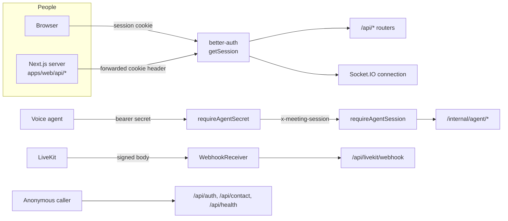
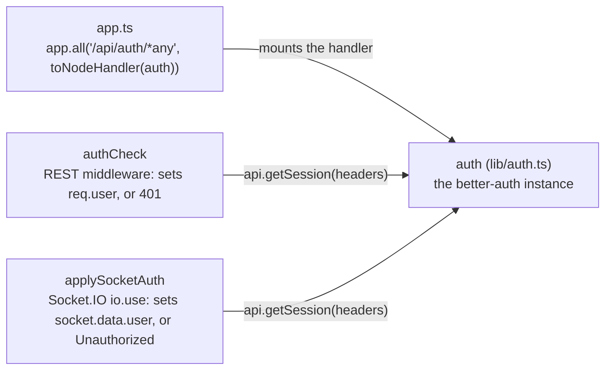
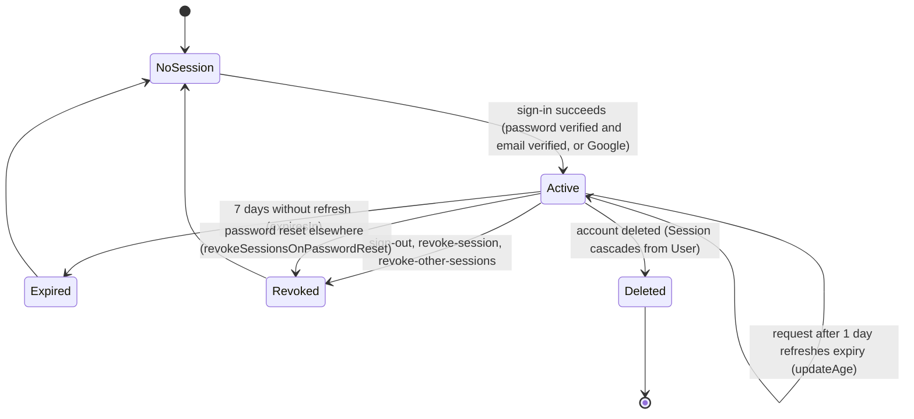
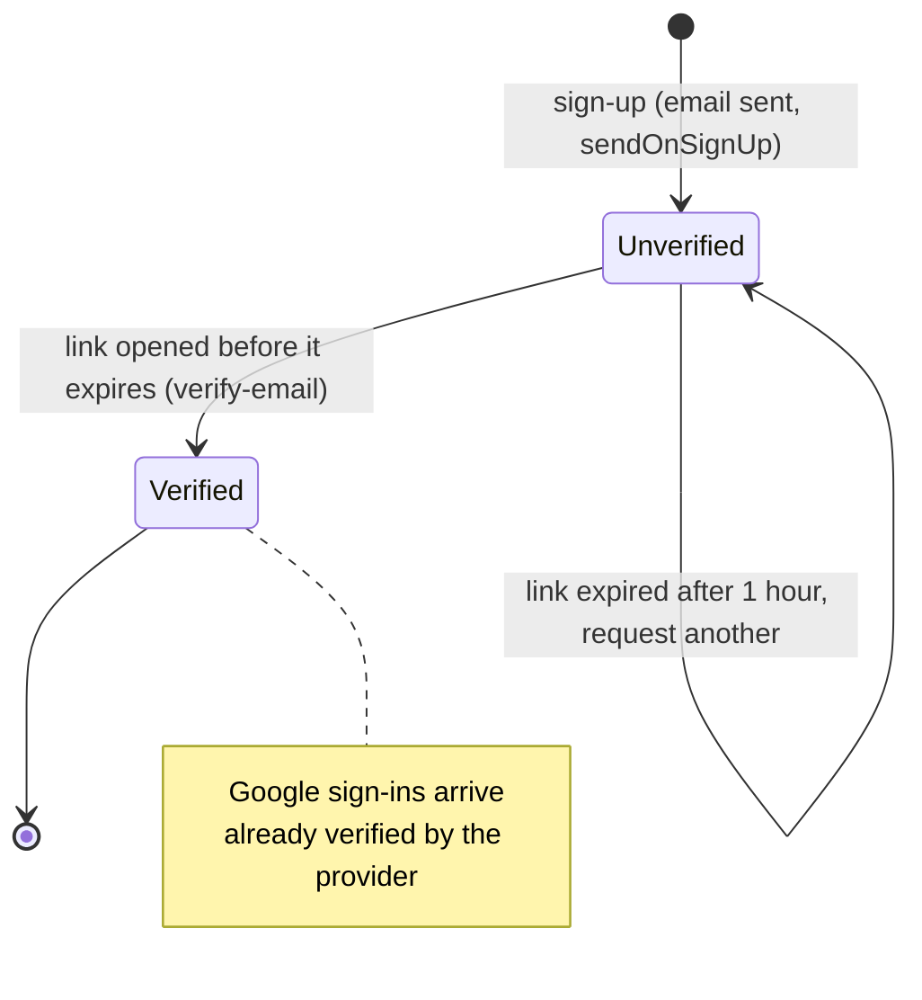
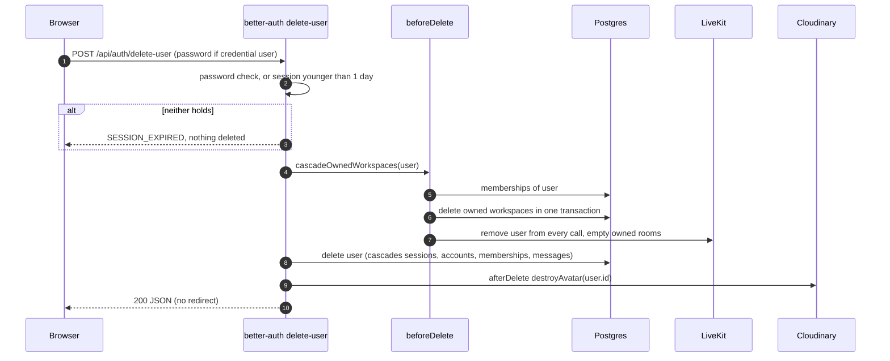
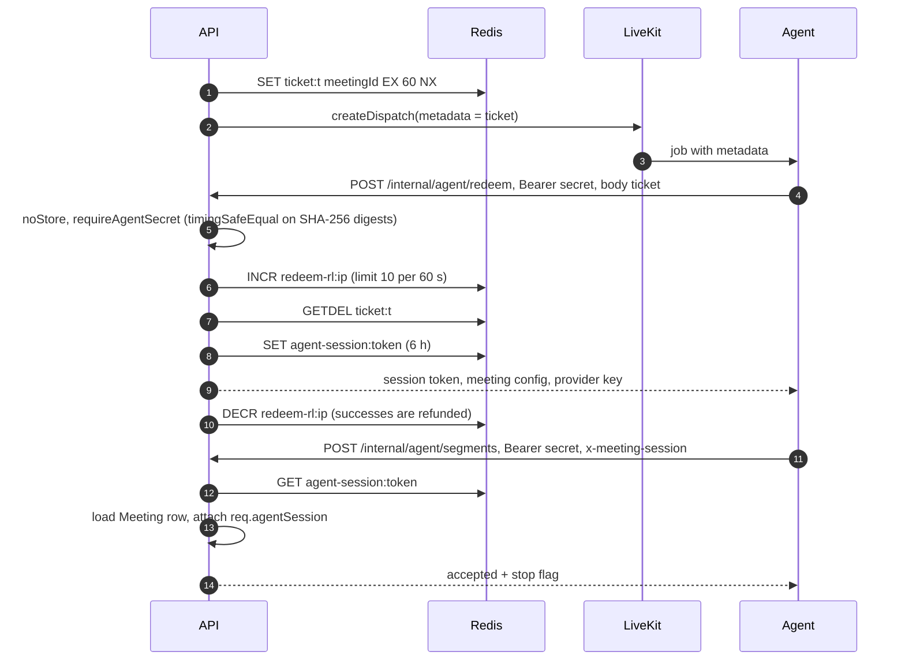

# Authentication

Every request into Nimbus is authenticated by one of four mechanisms: a better-auth session cookie (people, over REST and Socket.IO), a shared bearer secret plus a per-meeting session token (the voice agent), a LiveKit webhook signature (the media server), or nothing at all (three deliberately public endpoints). This page explains each mechanism, the single better-auth instance that backs the first one, how its cookie is scoped across the web and API hosts, the Next.js route guard, email verification, password reset and account deletion. If you change `apps/api/src/lib/auth.ts`, everything on this page is affected.

## The four ways a caller proves who it is

| Caller | Credential | Checked by | Where it applies |
|---|---|---|---|
| A signed-in person (browser or Next.js server) | better-auth session cookie | `auth.api.getSession` inside [`authCheck.middleware.ts`](../../apps/api/src/middleware/authCheck.middleware.ts) and [`socket.middleware.ts`](../../apps/api/src/middleware/socket.middleware.ts) | Every `/api/*` route under the master router, and every Socket.IO connection |
| The voice agent worker | `Authorization: Bearer <NIMBUS_AGENT_SECRET>`, then `x-meeting-session: <token>` | [`agentAuth.middleware.ts`](../../apps/api/src/middleware/agentAuth.middleware.ts) | `/internal/agent/*` only |
| The LiveKit media server | Signed JWT in the `Authorization` header over the raw body | `WebhookReceiver` in [`livekitWebhook.router.ts`](../../apps/api/src/routers/livekitWebhook.router.ts) | `POST /api/livekit/webhook` only |
| Anyone | none | — | `/api/auth/*` (better-auth's own endpoints), `POST /api/contact`, `GET /api/health` |

A fifth credential flows the other way: the API mints **LiveKit access tokens** that a browser presents to the media server (see [Voice and LiveKit](../meetings/voice-and-livekit.md)). The API never accepts those tokens itself.



## The better-auth instance

[`apps/api/src/lib/auth.ts`](../../apps/api/src/lib/auth.ts) exports a single `auth` object built by `betterAuth({...})`. [better-auth](https://www.better-auth.com/) is a TypeScript authentication library that owns the user, session, account and verification tables and exposes its own HTTP endpoints. Its configuration, option by option:

| Option | Value | Effect |
|---|---|---|
| `database` | `prismaAdapter(prisma, { provider: "postgresql" })` | Users and sessions live in Postgres through the shared `@nimbus/db` client (tables `user`, `session`, `account`, `verification`). |
| `emailAndPassword.enabled` | `true` | Email + password sign-up and sign-in. |
| `emailAndPassword.requireEmailVerification` | `true` | Sign-in is refused (403) until the address is verified. |
| `emailAndPassword.revokeSessionsOnPasswordReset` | `true` | A password reset signs out every other session — the control a compromised account needs. |
| `emailAndPassword.sendResetPassword` | `sendPasswordResetEmail` | Mails the reset link through Resend. |
| `emailVerification.sendOnSignUp` | `true` | A verification link is mailed at sign-up. |
| `emailVerification.sendOnSignIn` | `true` | A correct password on an unverified account mails a fresh link before refusing. |
| `emailVerification.callbackURL` / `sendVerificationEmail` | `${FRONTEND_URL}/email-verified` | The link's `callbackURL` query parameter is rewritten so the user lands on the web app, not the API. |
| `user.deleteUser` | `enabled`, `beforeDelete`, `afterDelete` | Self-service account deletion with Nimbus's cascade (below). `sendDeleteAccountVerification` is deliberately **not** set. |
| `socialProviders.google` | `GOOGLE_CLIENT_ID`, `GOOGLE_CLIENT_SECRET`, `prompt: "select_account"` | Google OAuth sign-in. |
| `trustedOrigins` | `[FRONTEND_URL]` | Only the web origin may make credentialed auth calls. |
| `baseURL` | `BETTER_AUTH_URL` | The API's public URL; also decides the cookie attributes. |
| `advanced.trustHost` | `true` | Trust the host header behind the reverse proxy. |
| `advanced.defaultCookieAttributes` / `crossSubDomainCookies` | from `resolveCookieAttributes` | See [Cookies and domains](#cookies-and-domains). |
| `experimental.joins` | `true` | Lets the adapter fetch session + user in one query. |

Values the config does **not** set fall back to better-auth's defaults (version 1.6.9 is installed): sessions expire after 7 days and are refreshed when used after 1 day (`expiresIn`, `updateAge`), the "fresh session" window for sensitive actions such as deleting an account is 1 day (`freshAge`), passwords must be 8–128 characters, verification and reset tokens last 1 hour, and the session secret is read from `BETTER_AUTH_SECRET`.

### Its three consumers in the API



1. **Mounted as routes.** `app.all("/api/auth/{*any}", toNodeHandler(auth))` in [`app.ts`](../../apps/api/src/app.ts), before every application router, so sign-in and friends never meet `authCheck` or Zod validation. It sits after `express.json()`; better-auth's Node handler copes with the already-parsed body.
2. **REST guard.** `authCheck` converts Express headers with `fromNodeHeaders`, calls `auth.api.getSession`, answers `ServerResponse.unauthorized()` (401) when there is no session, and otherwise sets `req.user` (typed in [`types/express.d.ts`](../../apps/api/src/types/express.d.ts)). [`master.router.ts`](../../apps/api/src/routers/master.router.ts) applies it to each of the eight domain routers individually.
3. **Socket handshake guard.** `applySocketAuth` runs the same lookup in `io.use(...)`, which executes during the handshake and before `io.on("connection")`. A missing session or any exception becomes `next(new Error("Unauthorized"))`, so the connection never reaches a handler. On success `socket.data.user` is set, and handlers trust it without re-authenticating.

`index.ts` also touches `auth` at boot (`void auth`) so a configuration error surfaces before the server binds.

### Endpoints better-auth exposes

These are served under `/api/auth` by the library, not by Nimbus code. The table lists the ones the web app calls (through [`apps/web/lib/auth-client.ts`](../../apps/web/lib/auth-client.ts)), plus the callbacks the browser is redirected through.

| Endpoint | Used by |
|---|---|
| `POST /sign-up/email` | Sign-up form |
| `POST /sign-in/email` | Login form ([`useLoginForm.ts`](../../apps/web/hooks/useLoginForm.ts)) |
| `POST /sign-in/social`, `GET /callback/:id` | "Continue with Google" and its OAuth return |
| `POST /sign-out` | Every logout path |
| `GET /get-session` | Server components and the `useSession` hook |
| `POST /send-verification-email`, `GET /verify-email` | The login form's resend button, and the link in the email |
| `POST /request-password-reset`, `GET /reset-password/:token`, `POST /reset-password` | Forgot-password and the Google-only "set a password" path |
| `POST /change-password` | Settings → password |
| `POST /update-user` | Settings → profile name and avatar URL |
| `POST /delete-user` | Settings → danger zone ([`useDeleteAccount.ts`](../../apps/web/hooks/useDeleteAccount.ts)) |
| `GET /list-sessions`, `POST /revoke-session`, `POST /revoke-other-sessions` | Settings → active sessions |
| `GET /list-accounts` | Deciding whether the user has a password (credential account) or is Google-only |

## Cookies and domains

The browser talks to two hosts: the web app and the API. The session cookie is set by the API, and it must also be visible to the Next.js server (which forwards it to the API) and to the Next.js route guard. How that works depends on the scheme of `BETTER_AUTH_URL`, decided by the pure function `resolveCookieAttributes` in [`lib/cookieAttributes.ts`](../../apps/api/src/lib/cookieAttributes.ts):

| `BETTER_AUTH_URL` | `AUTH_COOKIE_DOMAIN` | Resulting attributes | Typical environment |
|---|---|---|---|
| `http://…` | ignored | `sameSite=lax` only | Local development (`http://localhost:3001`) |
| `https://…` | unset | `sameSite=lax`, `secure` | A single-host HTTPS deployment |
| `https://…` | e.g. `.example.com` | `sameSite=lax`, `secure`, `crossSubDomainCookies` scoped to that domain | Production: web and API on sibling subdomains |
| malformed or another scheme | — | `sameSite=lax` only (the safe HTTP shape) | Misconfiguration; still boots |

Why the derivation exists: a `Secure` cookie over plain HTTP, or a production `Domain` on `localhost`, is silently refused by real browsers — sign-in returns 200 and no session is ever stored. Deriving the attributes from the one URL that already describes the deployment makes that mistake impossible. `describeCookieAttributes` prints the result at boot, for example `[auth] session cookie: sameSite=lax secure crossSubDomainCookies=.example.com`, which is the only visible signal that the coupling landed as expected.

`sameSite=lax` works because the web and API hosts are same-site (sibling subdomains) in production and both on `localhost` in development. CORS on both Express and Socket.IO allows exactly `FRONTEND_URL` with `credentials: true`, and better-auth's `trustedOrigins` matches. The browser sends the cookie because every client call opts in: `fetch(..., { credentials: "include" })` in hooks, and `withCredentials: true` on the Socket.IO client in [`apps/web/lib/socket.ts`](../../apps/web/lib/socket.ts).

The production smoke suite signs in through the real form, so it is the end-to-end test of this cookie path; it needs `AUTH_COOKIE_DOMAIN` set on the API host ([end-to-end testing](../testing/end-to-end.md)).

## Session lifecycle



A session is one row in `session` whose `token` the HTTP-only cookie carries. Because every guard calls `getSession`, which reads that row, a revoked or expired session stops working on the very next REST call or socket handshake. An already-open socket, however, was authenticated once at handshake and is not re-checked on each event — see [Design trade-offs and limits](#design-trade-offs-and-limits).

## Email verification



The flow, with the code that implements each step:

1. Sign-up creates the `user` row with `emailVerified = false` and calls `sendVerificationEmail`. The hook rewrites the link's `callbackURL` to `${FRONTEND_URL}/email-verified`, then calls `sendEmail` in [`lib/email.ts`](../../apps/api/src/lib/email.ts). The call is not awaited, and `sendEmail` goes through `deliver`, which **logs and swallows** failures: the account row already exists, so failing the request would leave a retry hitting "email already in use".
2. A sign-in with the right password on an unverified address is refused with 403. Because `sendOnSignIn` is on, better-auth mails a new link first (only after the password checks out, so the endpoint cannot be used to spam an address you do not control). [`useLoginForm.ts`](../../apps/web/hooks/useLoginForm.ts) shows "We've sent you a new link" and keeps the address so the user can press "Send again", which calls `sendVerificationEmail` directly.
3. Opening the link hits `GET /api/auth/verify-email`, which sets `emailVerified = true` and redirects to `/email-verified` on the web app.

Every email leaves from one fixed sender on the Resend-verified domain. A misconfigured `RESEND_API_KEY` therefore does not fail sign-up; it produces a loud `[email] … was not delivered` log line and users who cannot get in. Check that log first when someone reports a missing link.

## Password reset and password change

- **Forgot password.** `requestPasswordReset` → `sendResetPassword` → `sendPasswordResetEmail` (subject "Reset your Nimbus Password", same swallow-and-log contract). The link opens `/reset-password` on the web app, which posts the new password to `reset-password`. `revokeSessionsOnPasswordReset` then ends every other session.
- **Change password** (signed in, credential account). `changePassword` with the current password; the settings form has a default-on "sign out other sessions" checkbox (`revokeOtherSessions`).
- **Google-only users** have no credential account to change. [`useChangePasswordForm.ts`](../../apps/web/hooks/useChangePasswordForm.ts) detects that through `listAccounts` and sends a reset email instead, which creates the credential account when used.

## Account deletion

Deletion is the one auth flow with Nimbus-specific logic, because a workspace's ownership is recorded only in `WorkspaceMember.role = OWNER` and that row cascades away the instant the user row is deleted.



- `cascadeOwnedWorkspaces` in [`lib/accountDeletion.ts`](../../apps/api/src/lib/accountDeletion.ts) is a no-op for NimbusBot (`BOT_USERID`), whose membership in every workspace would otherwise make the delete catastrophic.
- Deleting a workspace cascades its members, messages, documents, meetings and AI rows (see [the data model](../reference/data-model.md)).
- `Message.user` is `onDelete: Cascade`, so the person's chat messages disappear from **other** members' workspaces too, with no tombstone. The delete dialog says so.
- `beforeDelete` and better-auth's own delete are not one transaction. A crash between them leaves owned workspaces gone and the account alive; re-running is harmless because the hook is idempotent.
- Credential users must send their password, which both re-authenticates and satisfies the freshness gate. Google-only users rely on a session younger than 1 day; on `SESSION_EXPIRED` the hook signs them out and sends them to `/login` to obtain a fresh one. Because the gate runs before `beforeDelete`, a refused attempt deletes nothing.

## The web side

### `apps/web/lib/auth-client.ts`

`createAuthClient({ baseURL: NEXT_PUBLIC_BACKEND_URL })` from `better-auth/react`. Client components use it for every flow above. Server components read the session the same way but must pass the incoming cookie explicitly:

```ts
const { data: session } = await authClient.getSession({
  fetchOptions: { headers: await headers() },
});
```

The fetch helpers in [`apps/web/api/`](../../apps/web/api/workspace.ts) do the same for REST: `headers: { cookie: (await headers()).get("cookie") ?? "" }` with `cache: "no-store"`, so nothing user-specific is cached by Next.js.

### `apps/web/proxy.ts` — the route guard

Next.js 16 calls the exported `proxy` function (not the older `middleware` export) on every request that matches `config.matcher`, which excludes `api`, `_next/static`, `_next/image` and `.png` files. [`proxy.ts`](../../apps/web/proxy.ts) only checks that a session cookie **exists** (`getSessionCookie`); it never verifies it.

| Path | Rule | No cookie | Cookie present |
|---|---|---|---|
| starts with `/home`, `/workspace` or `/settings` | protected (prefix match) | redirect to `/login` | continue |
| exactly `/login`, `/`, `/email-verified`, `/reset-password` | public auth pages | continue | redirect to `/home` |
| anything else (`/contact`, `/docs`, …) | untouched | continue | continue |

This is a user-experience redirect, not a security boundary. A stale or forged cookie passes the guard, and the page's own server-side fetch then gets a 401 from the API, which is the real check.

## The voice agent's authentication

The agent is a process, not a person, so it has its own scheme. It is layered so that the one response carrying a plaintext provider key (`redeem`) is the hardest to reach.



| Layer | Implementation | Detail |
|---|---|---|
| `noStore` | [`agentAuth.middleware.ts`](../../apps/api/src/middleware/agentAuth.middleware.ts) | Sets `Cache-Control: no-store` before any check, because the redeem response contains a key. |
| `requireAgentSecret` | `isValidAgentSecret` | `Authorization: Bearer <NIMBUS_AGENT_SECRET>`. The secret must be at least 32 characters in both the API's and the agent's env validation. Compared with `timingSafeEqual` over SHA-256 digests so neither value nor length leaks through timing. |
| `redeemRateLimit` | Redis `redeem-rl:<req.ip>` | `REDEEM_LIMIT = 10` per `REDEEM_WINDOW_SECONDS = 60`. Runs **after** the secret check because `req.ip` is one shared value behind the production proxy; otherwise anonymous traffic could fill the bucket and lock the agent out. Successful redemptions are refunded with `refundRedeemAttempt`. A Redis failure denies. |
| Ticket | [`lib/meeting/tickets.ts`](../../apps/api/src/lib/meeting/tickets.ts) | 32 random bytes (base64url), `TICKET_TTL_SECONDS = 60`, stored with `NX` and redeemed with `GETDEL`, so it works exactly once even under concurrent redemptions. Redemption re-resolves the voice key and ends the meeting if it is no longer available. |
| `requireAgentSession` | [`lib/meeting/agentSession.ts`](../../apps/api/src/lib/meeting/agentSession.ts) | `x-meeting-session` header → Redis `agent-session:<token>` (`SESSION_TTL_SECONDS = 21_600`, 6 h) → the `Meeting` row must still exist. |

Every failure, at every layer, is the same bare `401 Unauthorized` envelope, so a prober learns nothing about which part was wrong. The whole router is excluded from the morgan access log in [`app.ts`](../../apps/api/src/app.ts). The agent side is in [`apps/agent/src/api/nimbusClient.ts`](../../apps/agent/src/api/nimbusClient.ts); see [the voice agent](../meetings/voice-agent.md).

## The media server's webhook

LiveKit posts `application/webhook+json` to `/api/livekit/webhook`. The router is mounted with `express.raw` before the JSON parser, verifies the body with `new WebhookReceiver(LIVEKIT_API_KEY, LIVEKIT_API_SECRET).receive(body, authorization)`, and answers:

- `415` when the body did not arrive as a buffer (wrong content type);
- `401` when the signature fails — nothing from an unverified body is read, logged or echoed;
- `200` for a duplicate (`SET webhook:<id> NX EX 3600` already claimed) or a processed event;
- `500` when handling fails, after releasing the claim so LiveKit's retry is processed.

## Design trade-offs and limits

- **Sockets are authenticated once.** The handshake checks the session; a socket that stays connected after its session is revoked or expires keeps its `socket.data.user` until it disconnects. Membership is re-checked on the events that matter (see [Security](security.md)), and removing a member evicts their sockets, but signing out on another device does not close an open socket.
- **Cookie behaviour is coupled to `BETTER_AUTH_URL`.** This is intentional and logged at boot, but it means changing the API's public URL changes cookie scope. Setting `AUTH_COOKIE_DOMAIN` wrong (not a parent of both hosts) silently breaks sign-in in browsers while server-to-server tests still pass.
- **Verification and reset emails are fire-and-forget.** A Resend outage or bad key never fails a request; it only shows in logs.
- **better-auth's rate limiter is in-process memory.** In production it is on by default (100 requests per 10 s overall; 3 per 10 s for sign-in, sign-up and change-password; 3 per 60 s for reset and verification emails), but counters are per process and reset on restart. It keys on the client IP header; behind a proxy that does not forward one, better-auth logs that it skipped limiting.
- **The route guard trusts cookie presence.** It exists for redirects only; never rely on it for access control.
- **Account deletion is not atomic** across the owned-workspace cascade and the user delete; it is idempotent instead.
- **`BETTER_AUTH_API_KEY` is declared but unused.** [`lib/env.ts`](../../apps/api/src/lib/env.ts) accepts it as optional, and no other code reads it.
- **The agent secret is a single shared value.** Anyone holding `NIMBUS_AGENT_SECRET` and a live ticket or session token can act as the agent for that meeting. Rotation means updating the API env and the agent's LiveKit Cloud secrets together ([runbook](../operations/runbook.md)).

## Related documentation

- [System architecture overview](overview.md)
- [Security and permissions](security.md)
- [REST API reference](../reference/rest-api.md)
- [Realtime overview](../realtime/overview.md)
- [Voice and LiveKit](../meetings/voice-and-livekit.md)
- [The voice agent](../meetings/voice-agent.md)
- [Environment variables](../reference/environment.md)
