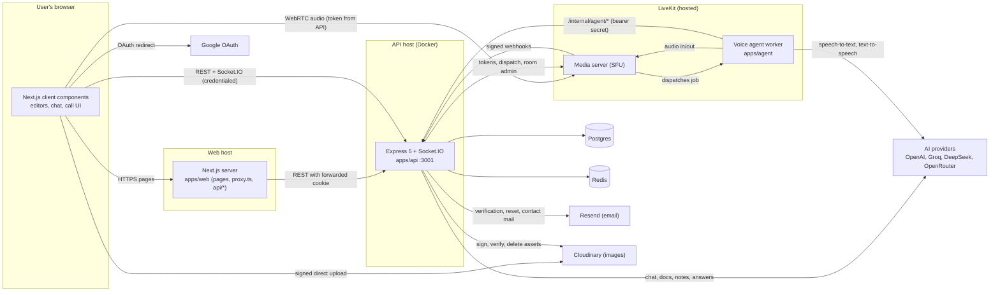
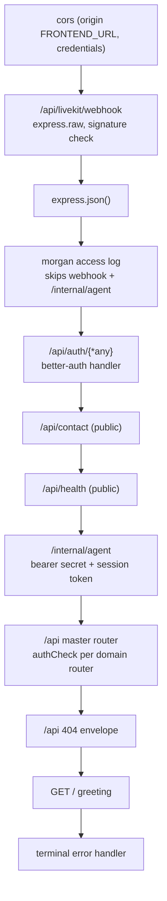
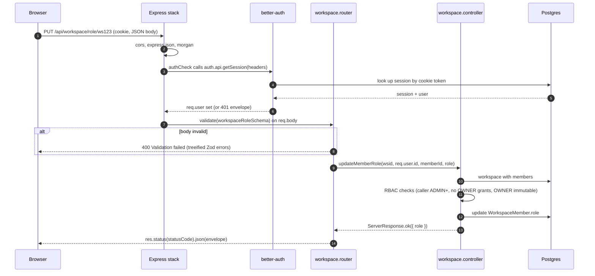
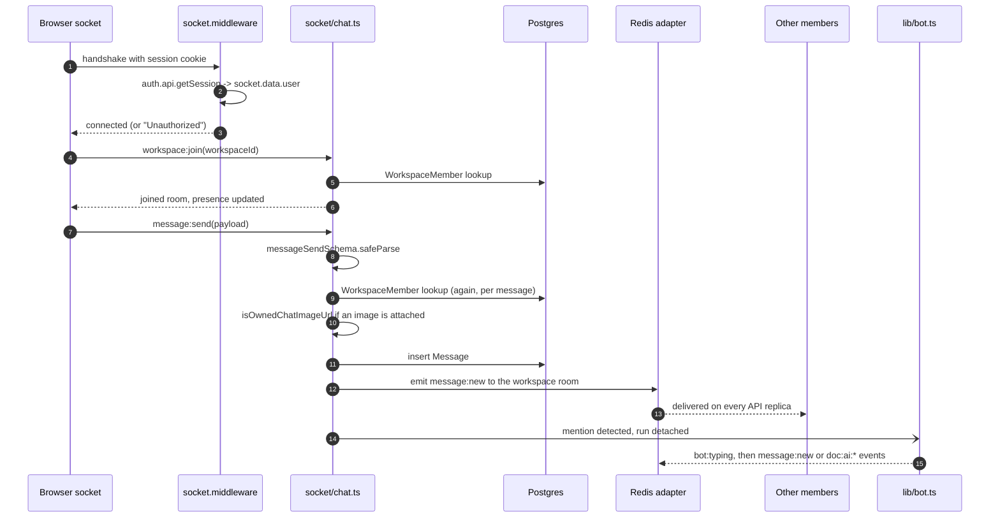
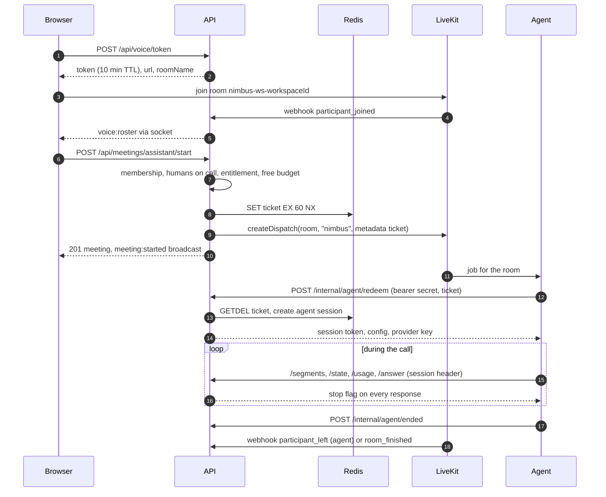

# Architecture overview

Nimbus is a real-time collaborative workspace (chat, markdown documents, whiteboard canvases, voice calls and an in-call AI assistant) built from three application processes, a hosted media server and two data stores. This page names every process, shows how they talk to each other, traces one REST request and one socket event end to end, and lists where every piece of state lives. Read it first: every other page in these docs assumes the map drawn here.

## The processes at a glance

Nimbus is a Turborepo monorepo (see [the monorepo guide](../getting-started/monorepo.md)). Three of its workspaces are deployable programs; the rest are libraries they share.

| Process | Workspace | Runtime | Port / host | What it owns |
|---|---|---|---|---|
| Web | `apps/web` | Next.js 16 App Router | `3000` locally | Pages, server-rendered first paint, the collaborative editors in the browser. Holds no data of its own. |
| API | `apps/api` | Express 5 + Socket.IO on one HTTP server | `3001` (the production compose file maps it to host port `8080`) | All persistence, authentication, authorisation, realtime fan-out, AI calls, media-server tokens and webhooks. |
| Voice agent | `apps/agent` | LiveKit Agents worker (Node) | No inbound port; dials out to LiveKit and the API | Joins a call as "Nimbus", transcribes speech, speaks answers. Owns no data; everything it learns is posted to the API. |
| Media server | LiveKit (hosted; a local `livekit-server` container in tests) | SFU | `LIVEKIT_URL` (`ws://` or `wss://`) | Routes call audio between participants and the agent; sends signed webhooks to the API. |
| Postgres | external | PostgreSQL 16 in tests | `DATABASE_URL` | The source of truth for every durable record (see [the data model](../reference/data-model.md)). |
| Redis | external | Redis 7 in tests | `REDIS_URL` | Socket.IO adapter fan-out, presence, call rosters, meeting tickets/sessions and short-lived flags. |

Two facts shape everything else:

- **The web app never touches the database.** Browser code and Next.js server code both reach the API over HTTP at the absolute `NEXT_PUBLIC_BACKEND_URL`; there is no Next.js `app/api` route directory and no rewrite proxy. The top-level [`apps/web/api/`](../../apps/web/api/workspace.ts) folder is a set of server-side fetch helpers that forward the caller's cookie to the Express API.
- **There is no self-hosted TURN server any more.** Earlier versions ran Coturn beside the API; commit `109f1d6` removed it and its environment variables when voice moved to LiveKit. NAT traversal for call audio is now the media server's concern. The production [`docker-compose.yml`](../../docker-compose.yml) contains exactly one service, `api`.

## System context

The agent's speech provider address and key are not part of its configuration: they arrive per meeting from the API when the agent redeems its ticket (see [`apps/agent/src/config.ts`](../../apps/agent/src/config.ts) and [Authentication](auth.md)). That is why the arrow from the agent to the AI providers exists even though the agent holds no keys at rest.

## Inside the API process

The API is composed in [`apps/api/src/app.ts`](../../apps/api/src/app.ts) by three factories (`createApp`, `createIoServer`, `createHttpServer`) so tests can build the identical wiring on an ephemeral port. [`apps/api/src/index.ts`](../../apps/api/src/index.ts) is a thin bootstrap that:

1. loads `.env` (`dotenv/config`) and validates it with [`lib/env.ts`](../../apps/api/src/lib/env.ts), which exits naming any missing required variable;
2. logs the resolved session-cookie attributes and forces the better-auth instance to load;
3. upserts NimbusBot's user row with `ensureBotUser` ([`lib/botUser.ts`](../../apps/api/src/lib/botUser.ts)) — boot fails if the database is unreachable or unmigrated;
4. listens on port `3001`;
5. runs `recoverOrphanedMeetings` (ends meetings whose media room no longer exists) and `startNotesRecovery` (retries unwritten meeting notes now and every 10 minutes, `RECOVERY_INTERVAL_MS` in [`lib/meeting/recovery.ts`](../../apps/api/src/lib/meeting/recovery.ts)).

### Express middleware order

Order matters, and `app.ts` documents it. Each request walks this stack top to bottom:

- The webhook is mounted **before** `express.json()` because LiveKit signs the exact bytes; once parsed, the signature cannot be checked ([`livekitWebhook.router.ts`](../../apps/api/src/routers/livekitWebhook.router.ts)).
- better-auth is mounted before the app routers so its endpoints never meet `authCheck` or Zod validation.
- `/api/contact`, `/api/health` and `/api/livekit/webhook` are public and live outside [`master.router.ts`](../../apps/api/src/routers/master.router.ts), which keeps that router's "everything under me is authenticated" invariant literally true.
- `/internal/agent` sits outside `/api` entirely: it is for one process, not for signed-in users.
- The last two handlers ([`error.middleware.ts`](../../apps/api/src/middleware/error.middleware.ts)) guarantee that even an unknown path or an escaped throw answers in the `ServerResponse` JSON envelope rather than an HTML page.

### Socket.IO

`createIoServer` attaches Socket.IO to the same HTTP server, with CORS limited to `FRONTEND_URL`, then:

1. attaches the Redis adapter (`@socket.io/redis-adapter` over `pubClient`/`subClient` from [`lib/redis.ts`](../../apps/api/src/lib/redis.ts)) so broadcasts reach sockets on every API replica;
2. registers the handshake guard ([`socket.middleware.ts`](../../apps/api/src/middleware/socket.middleware.ts)), which resolves the better-auth session from the handshake cookie and stores the user on `socket.data.user`;
3. on each connection registers four handler modules: [`socket/chat.ts`](../../apps/api/src/socket/chat.ts), [`socket/document.ts`](../../apps/api/src/socket/document.ts), [`socket/canvas.ts`](../../apps/api/src/socket/canvas.ts) and [`socket/meeting.ts`](../../apps/api/src/socket/meeting.ts). [`socket/roomState.ts`](../../apps/api/src/socket/roomState.ts) is a shared helper, not a handler.

Voice signalling no longer goes over Socket.IO at all: there is no `socket/voice.ts`. The browser asks the API for a LiveKit token over REST and connects to the media server directly. The API's only voice traffic on the socket is broadcasting `voice:roster` when a webhook changes who is on the call. The full realtime design is in [the realtime overview](../realtime/overview.md).

`createHttpServer` also stores `io` on the Express app (`app.set("io", io)`), which is how REST handlers broadcast: a document created over REST emits `document:created`, a removed member is evicted from rooms, a started meeting emits `meeting:started`.

## One REST request, traced

The example is `PUT /api/workspace/role/:wsid` — an admin changing a member's role. Every authenticated REST call follows the same path.

Things to notice:

- **Routers are thin.** They pull `req.user.id`, params and body, call one controller function and serialise its `ServerResponse`. All permission logic is in the controller (see [Security](security.md)).
- **Validation does not forward the parsed value.** [`validate.middleware.ts`](../../apps/api/src/middleware/validate.middleware.ts) only rejects; controllers re-read `req.body`. That is why the document rename route trims the title itself even though the schema trims too.
- **Controllers return errors instead of throwing.** A throw that does escape reaches `errorHandler`, which maps a carried 4xx (for example malformed JSON from `express.json()`) through and answers anything else as a generic 500.

## One socket event, traced

The example is a chat message with an `@nimbusbot` mention, which shows the realtime path, a per-event membership check, Redis fan-out and detached AI work.

The bot runs detached so model latency never delays delivery of the human's message; [NimbusBot](../ai/nimbusbot.md) covers that pipeline. Document and canvas edits follow a different gate: membership is checked at `doc:join` / `canvas:join`, and later `doc:update` / `canvas:update` events are accepted only from sockets already in that document's room. Removing a member evicts their sockets from those rooms ([`lib/socketEviction.ts`](../../apps/api/src/lib/socketEviction.ts)). [Security](security.md) has the full list of which events re-query membership.

## One meeting, end to end

The in-call assistant is the one feature that involves every process, so it is worth a third trace. Details live in [voice and LiveKit](../meetings/voice-and-livekit.md) and [the voice agent](../meetings/voice-agent.md).

## Where state lives

| State | Where | Lifetime | Owner module |
|---|---|---|---|
| Users, sessions, OAuth accounts, verification tokens | Postgres `user`, `session`, `account`, `verification` | Until deleted / expired | better-auth via [`lib/auth.ts`](../../apps/api/src/lib/auth.ts) |
| Workspaces, memberships and roles | Postgres `Workspace`, `WorkspaceMember` | Durable | [`workspace.controller.ts`](../../apps/api/src/controllers/workspace.controller.ts) |
| Chat messages | Postgres `Message` | Durable | [`socket/chat.ts`](../../apps/api/src/socket/chat.ts) |
| Chat images and avatars | Cloudinary (`nimbus/chat/<workspaceId>`, `nimbus/avatars/<userId>`); only the URL is in Postgres | Until deleted | [`lib/cloudinary.ts`](../../apps/api/src/lib/cloudinary.ts) |
| Markdown documents (live) | In-memory `Map` of `Y.Doc` per API process | While anyone is in the document room | [`socket/document.ts`](../../apps/api/src/socket/document.ts) |
| Markdown documents (persisted) | `Document.yjsState` bytes, plus `searchText` | Debounced save every 5 s | same |
| Canvases (live) | In-memory `Map` of canvas state per API process | While anyone is in the canvas room | [`socket/canvas.ts`](../../apps/api/src/socket/canvas.ts) |
| Canvases (persisted) | `Document.canvasData` JSON | Debounced save every 3 s | same |
| AI-generated markdown seed | `Document.initialContent`, nulled on first join | One-shot | [document generation](../ai/document-generation.md) |
| Workspace presence | Redis set `presence:<workspaceId>` | 24 h TTL guard | [`lib/presence.ts`](../../apps/api/src/lib/presence.ts) |
| Call roster | Redis hash `voice_presence:<workspaceId>` | 24 h TTL guard; cleared on `room_finished` | [`lib/voicePresence.ts`](../../apps/api/src/lib/voicePresence.ts) |
| Call audio | LiveKit only; never touches the API | Duration of the call | LiveKit |
| Webhook de-duplication | Redis `webhook:<eventId>` | 1 h | [`livekitWebhook.router.ts`](../../apps/api/src/routers/livekitWebhook.router.ts) |
| Agent dispatch ticket | Redis `ticket:<random>` | 60 s, single use (`GETDEL`) | [`lib/meeting/tickets.ts`](../../apps/api/src/lib/meeting/tickets.ts) |
| Agent session | Redis `agent-session:<token>` | 6 h (`SESSION_TTL_SECONDS = 21_600`) | [`lib/meeting/agentSession.ts`](../../apps/api/src/lib/meeting/agentSession.ts) |
| Meeting flags (stop, state, redeemed, caption languages) | Redis `meeting:<id>:*` | Short TTLs, deleted on end | [`lib/meeting/lifecycle.ts`](../../apps/api/src/lib/meeting/lifecycle.ts) |
| Meetings, transcripts, translations, action items, decisions | Postgres `Meeting`, `transcript_segment`, `segment_translation`, `action_item`, `decision` | Durable | [meeting pages](../meetings/transcripts-and-notes.md) |
| AI keys (encrypted), preferences, settings, call log | Postgres `workspace_ai_*`, `ai_call` | Durable | [providers and BYOK](../ai/providers-and-byok.md) |
| Month-to-date spend cache | Redis `spend:<workspaceId>:<month>` | Cache | [`lib/ai/spendCap.ts`](../../apps/api/src/lib/ai/spendCap.ts) |
| Agent redeem rate limit | Redis `redeem-rl:<ip>` | 60 s window | [`agentAuth.middleware.ts`](../../apps/api/src/middleware/agentAuth.middleware.ts) |
| Socket rate limits (cursors, awareness) | Closure per socket, in process | Per connection | [`lib/rateLimiter.ts`](../../apps/api/src/lib/rateLimiter.ts) |
| better-auth's own rate limit counters | In-process memory (better-auth default) | Per process | better-auth |
| Process-local timers (debounced saves, meeting budget backstop, dispatch timeout) | API process memory | Lost on restart; boot recovery re-arms meeting ones | [`lib/meeting/lifecycle.ts`](../../apps/api/src/lib/meeting/lifecycle.ts) |

The browser keeps no durable state beyond the session cookie and small per-viewer conveniences; there is no client state library ([the frontend overview](../frontend/overview.md)).

## Shared packages

| Package | Directory | Role |
|---|---|---|
| `@nimbus/types` | `packages/types` | Zod validation schemas, REST DTOs, the `ServerResponse` envelope, and the typed Socket.IO event maps used by both sides. Exposes `src` directly. |
| `@nimbus/db` | `packages/database` | The Prisma schema, migrations and the shared `prisma` client (pg driver adapter, pool of 10). Resolves through `dist`, so it must be built before the API type-checks. |
| `@nimbus/utils` | `packages/utils` | Pure helpers (`generateSlug`, caption-language checks and so on). |
| `@nimbus/ui` | `packages/ui` | Shared React components. |

## Design trade-offs and limits

- **Two processes, one origin of truth.** Putting every write behind the Express API means the web app can be hosted separately and scaled as static/SSR, and there is exactly one place that enforces permissions. The cost is a network hop for every server-rendered page and a cross-origin cookie that must be configured correctly (see [Authentication](auth.md)).
- **Live document state is process-local.** The Redis adapter fans out broadcasts across replicas, but the `Y.Doc` and canvas maps do not follow. Two replicas serving the same document would each hold their own copy and persist over each other. Horizontal scaling needs sticky sessions keyed by document or a shared document store; today the deployment is a single API container.
- **Timers are process-local.** Debounced saves (5 s markdown, 3 s canvas) are lost if the process dies inside the window. Meeting timers are re-armed by boot recovery; document timers are not.
- **The media server is a hard dependency for voice only.** `/api/health` probes LiveKit but never reports unhealthy because of it, so a LiveKit outage degrades voice without restarting the API.
- **The agent is a separate deployment.** It ships to LiveKit Cloud from its own workflow, so an API change to the `/internal/agent` contract must stay backward compatible until both are deployed.
- **No self-hosted TURN.** Removing Coturn removed an operational burden and a class of relay-abuse risk, but connectivity for users behind strict NATs now depends entirely on the media provider.

## Related documentation

- [Authentication](auth.md)
- [Security and permissions](security.md)
- [REST API reference](../reference/rest-api.md)
- [Data model](../reference/data-model.md)
- [Realtime overview](../realtime/overview.md)
- [Voice and LiveKit](../meetings/voice-and-livekit.md)
- [Deployment](../operations/deployment.md)
- [Docs index](../README.md)
