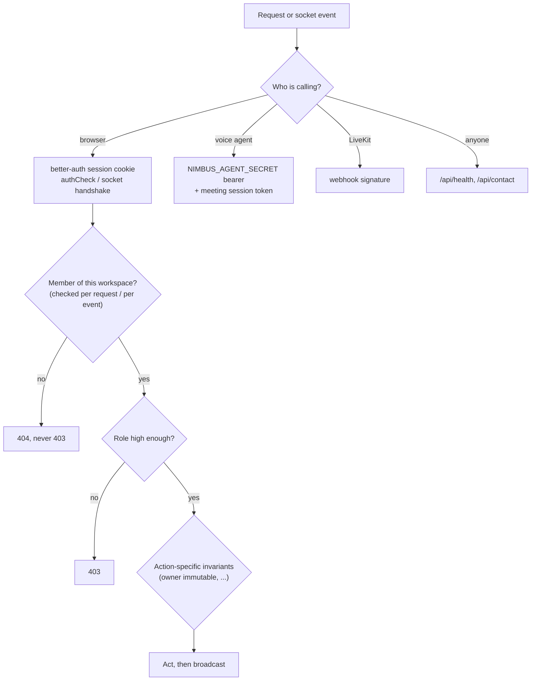
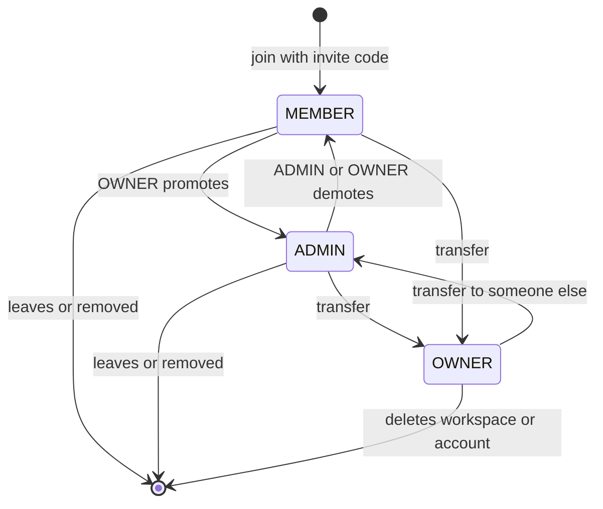
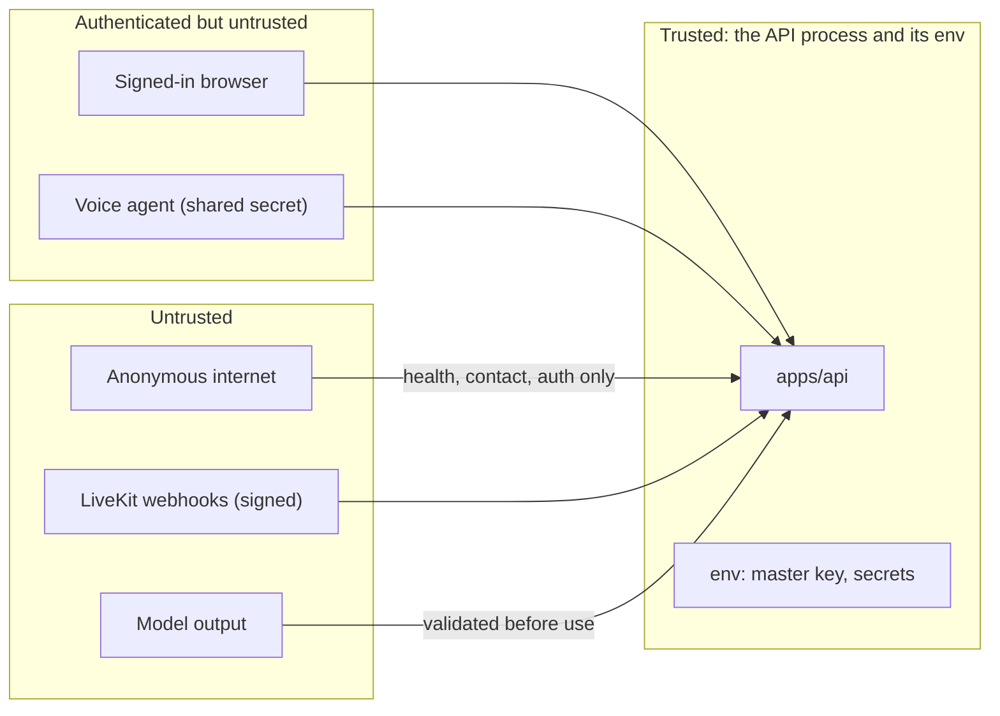

# Security and RBAC

How Nimbus decides who may do what, and how it protects the secrets it holds. Access is workspace-scoped: a user's role in a workspace (OWNER, ADMIN or MEMBER) decides what they can change there, and membership is re-checked on every request and every socket event rather than once at sign-in, so removing someone takes effect immediately across REST, realtime and voice. The page ends with the threat model and its honest limits.

## The layers

Authentication (who you are) is covered in [Auth](auth.md). This page is about authorization (what you may do) and data protection.

## Roles

Roles live on `WorkspaceMember.role` ([Data model](../reference/data-model.md)) and rank `MEMBER < ADMIN < OWNER` in [`workspaceAccess.ts`](../../apps/api/src/lib/workspaceAccess.ts), whose `requireWorkspaceRole(userId, workspaceId, minimum)` answers 404 for a non-member and 403 for a member below the minimum.

| Role | Who | How you get it |
| --- | --- | --- |
| OWNER | Exactly one per workspace | Creating the workspace, or receiving a transfer |
| ADMIN | Trusted members, and NimbusBot | Promotion by the OWNER; the previous owner after a transfer; NimbusBot is added as ADMIN at creation |
| MEMBER | Everyone else | Joining with the invite code |

### Permission matrix

Verified against the controllers named in the last column.

| Action | MEMBER | ADMIN | OWNER | Where |
| --- | :-: | :-: | :-: | --- |
| Read the workspace, chat, documents, meetings | ✓ | ✓ | ✓ | every controller |
| Send chat, edit documents and canvases | ✓ | ✓ | ✓ | `socket/*` |
| Create and rename documents | ✓ | ✓ | ✓ | [`document.controller.ts`](../../apps/api/src/controllers/document.controller.ts) |
| Delete a document | | ✓ | ✓ | `document.controller.ts` |
| Rename / re-describe the workspace | | ✓ | ✓ | [`workspace.controller.ts`](../../apps/api/src/controllers/workspace.controller.ts) `updateWorkspace` |
| Rotate the invite code | | ✓ | ✓ | `regenerateInviteCode` |
| Remove another member (not the OWNER) | | ✓ | ✓ | `removeMember` |
| Leave the workspace | ✓ | ✓ | must transfer first | `removeMember` with own id |
| Make someone MEMBER | | ✓ | ✓ | `updateMemberRole` |
| Make someone ADMIN | | | ✓ | `updateMemberRole` |
| Transfer ownership | | | ✓ | `transferOwnership` |
| Delete the workspace | | | ✓ | `deleteWorkspace` |
| Start / stop the meeting assistant | ✓ | ✓ | ✓ | [`meeting.controller.ts`](../../apps/api/src/controllers/meeting.controller.ts) |
| Delete an ended meeting | own meetings | ✓ | ✓ | `deleteMeeting` |
| Add or change an action item | ✓ | ✓ | ✓ | [`actionItems.ts`](../../apps/api/src/lib/meeting/actionItems.ts) |
| Delete an action item | if owner or creator | ✓ | ✓ | `removeActionItem` |
| See AI status, preferences, settings | ✓ | ✓ | ✓ | [`ai.controller.ts`](../../apps/api/src/controllers/ai.controller.ts) |
| Manage AI keys, preferences, settings, spend cap; read the call log | | ✓ | ✓ | `ai.controller.ts` |

### Invariants that are easy to break

- **The OWNER is sole.** Nobody can be made OWNER through a role change (`role === "OWNER"` is always rejected), the OWNER's role cannot be changed, and the OWNER cannot be removed or leave. The only way ownership moves is `transferOwnership`, which sets the new owner to OWNER and the old owner to ADMIN **in one transaction**, so there is never zero or two owners. It refuses the caller themself and NimbusBot.
- **ADMINs cannot mint ADMINs.** Only the OWNER promotes to ADMIN.
- **404 over 403 for outsiders.** `getWorkspaceBySlugId` and every workspace-scoped read answer a non-member exactly as if the thing did not exist, so ids cannot be probed.

## Revocation is immediate

A membership check at join time is not enough: a socket that joined a room keeps receiving broadcasts, and a LiveKit connection outlives the token that opened it. Three mechanisms close the gap when a membership ends (removal, leaving, workspace deletion, account deletion):

| Surface | Mechanism | Module |
| --- | --- | --- |
| REST | Membership read on every request | controllers, `workspaceAccess.ts` |
| Socket events | Membership re-checked in every handler | [`socket/`](../../apps/api/src/socket) |
| Listening sockets | Taken out of the workspace room and every document and canvas room of that workspace | [`socketEviction.ts`](../../apps/api/src/lib/socketEviction.ts) |
| Voice | Participant removed from the LiveKit room | [`revocation.ts`](../../apps/api/src/lib/livekit/revocation.ts) |

Eviction and revocation are best effort: a failure is logged and never fails the removal, because the per-event checks still refuse anything the evicted client tries next.

## Protecting secrets

### Provider keys (BYOK)

Workspace admins paste AI provider keys that can spend real money. [`credentialCrypto.ts`](../../apps/api/src/lib/ai/credentialCrypto.ts) stores them encrypted:

- **AES-256-GCM** with a random IV per write, in the envelope `nimbus1.<keyId>.<ivB64>.<tagB64>.<ctB64>`.
- The master key comes from `AI_CREDENTIAL_ENCRYPTION_KEY` (required, at least 32 characters); `AI_CREDENTIAL_ENCRYPTION_KEY_PREVIOUS` decrypts old envelopes during rotation.
- The **AAD names the owner**: `ai-credential:v2:<workspaceId>:<providerId>`. An envelope copied to another workspace's row fails to decrypt.
- DTOs are built field by field and never include `keyEnvelope`, `keyId` or `keyFingerprint`; the UI sees only `maskedPreview`.
- A plaintext key leaves the API in exactly one place: the voice agent's `POST /internal/agent/redeem`, which is `no-store` and excluded from the access log ([REST API](../reference/rest-api.md)).

The full design, including rotation, is in [Providers and BYOK](../ai/providers-and-byok.md).

### Other secrets

| Secret | Protection |
| --- | --- |
| Session cookies | better-auth; `Secure` and `Domain` derived from `BETTER_AUTH_URL` and `AUTH_COOKIE_DOMAIN` by [`cookieAttributes.ts`](../../apps/api/src/lib/cookieAttributes.ts) |
| Passwords | Hashed by better-auth in `account.password` |
| `NIMBUS_AGENT_SECRET` | Compared with `timingSafeEqual` over SHA-256 digests ([`agentAuth.middleware.ts`](../../apps/api/src/middleware/agentAuth.middleware.ts)) |
| Cloudinary API secret | Never leaves the server; the browser gets a short-lived signature per upload |
| LiveKit API secret | Signs join tokens server-side; webhooks are verified with it |

## Input and abuse limits

| Limit | Value | Where |
| --- | --- | --- |
| Chat message length | `MESSAGE_MAX_LENGTH = 4000` | [`validations/message.ts`](../../packages/types/src/validations/message.ts) |
| Chat images | `jpg,png,webp,heic`, limited to 2048×2048, uploaded into the workspace's own Cloudinary folder | [`cloudinary.ts`](../../apps/api/src/lib/cloudinary.ts) |
| Canvas pointer and doc awareness streams | 60 per second per socket, excess dropped | [`rateLimiter.ts`](../../apps/api/src/lib/rateLimiter.ts) |
| Agent ticket redemption | 10 failures per 60 s per IP | `agentAuth.middleware.ts` |
| Free tier | Lifetime document generations and voice seconds per user | [Quotas and the free tier](../ai/quotas-and-free-tier.md) |
| Workspace spend cap | Optional monthly USD cap on BYOK usage | [`spendCap.ts`](../../apps/api/src/lib/ai/spendCap.ts) |

Every request body is validated with Zod before a controller runs. CORS allows only `FRONTEND_URL`, with credentials.

## Threat model

What the design defends against: another user reading or changing a workspace they are not in; a removed member keeping access; a member escalating their role; a leaked database backup or read-only SQL injection exposing provider keys; replayed or forged webhooks; model output writing arbitrary data (tool arguments and generated canvases are validated before they touch the database).

## Design trade-offs and limits

- **The encryption is not a vault.** The API holds the master key in its environment, so anyone who can read the running container's env, or a database dump plus that key, can decrypt every stored provider key. It reduces the blast radius of the common incident (a backup, a stray `SELECT *`), nothing more.
- **Role checks live in controllers**, not in one policy layer. Each check is explicit and tested, but a new endpoint must remember to call `requireWorkspaceRole`; nothing enforces it structurally.
- **NimbusBot is an ADMIN everywhere.** It cannot sign in, but a bug that let a request act as `BOT_USERID` would act with ADMIN rights in every workspace.
- **No general rate limiting** on REST or sign-in beyond what better-auth provides; production relies on the proxy for that.
- **Invite codes are bearer secrets.** Anyone with the code can join as MEMBER until an ADMIN rotates it; there are no per-person invitations or expiry.
- **The agent secret is shared** by every agent worker. It is not per-meeting; per-meeting authority comes from the one-time ticket and the session token.

## Related documentation

- [Auth](auth.md)
- [Architecture overview](overview.md)
- [REST API](../reference/rest-api.md)
- [Providers and BYOK](../ai/providers-and-byok.md)
- [Voice and LiveKit](../meetings/voice-and-livekit.md)
