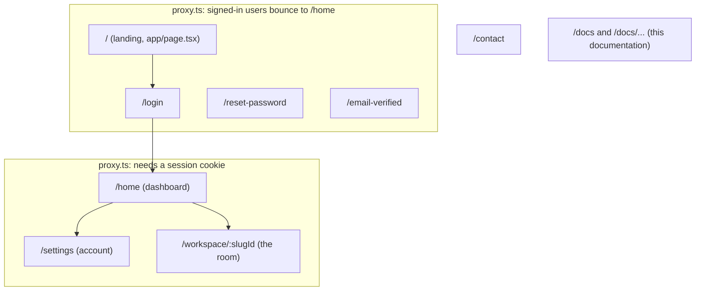
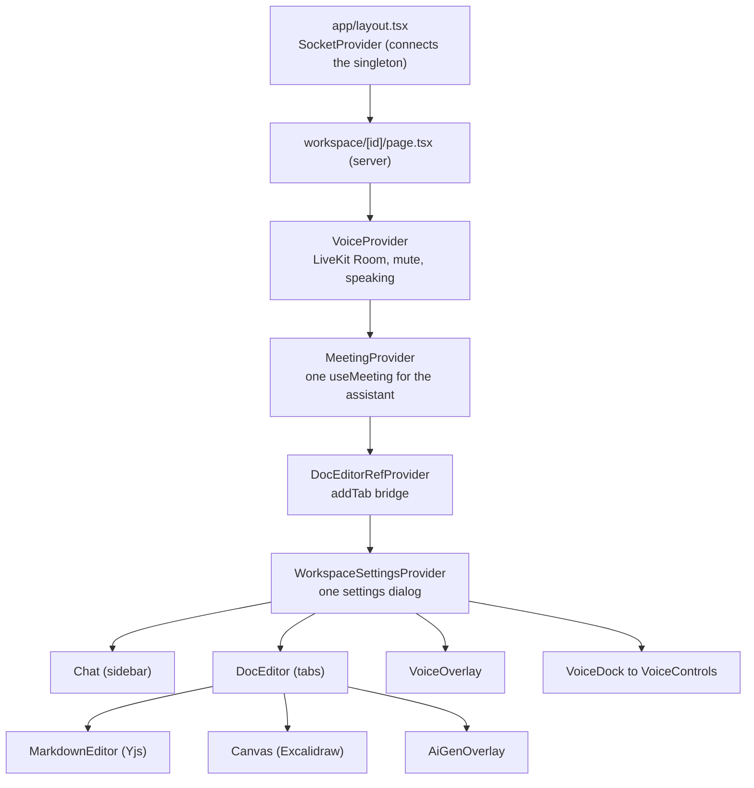

# Frontend overview

The browser side of Nimbus: a Next.js 16 App Router app in `apps/web` that renders the landing page, sign-in, the dashboard, settings, the docs site and, above all, the workspace room where chat, documents, canvases and the call live side by side. It owns no data of its own — every read and write goes to the Express API — and it deliberately has no state library: plain React state, a few small contexts, refs for live objects, and one module-level socket.

## Route map

| Route | File | Renders |
| --- | --- | --- |
| `/` | [`app/page.tsx`](../../apps/web/app/page.tsx) | Marketing landing page |
| `/login` | [`app/login/page.tsx`](../../apps/web/app/login/page.tsx) | `LoginForm`, `SignupForm`, `ForgotPasswordForm` |
| `/reset-password`, `/email-verified` | `app/reset-password`, `app/email-verified` | Password reset and verification landing |
| `/contact` | [`app/contact/page.tsx`](../../apps/web/app/contact/page.tsx) | Public contact form (`POST /api/contact`) |
| `/home` | [`app/home/page.tsx`](../../apps/web/app/home/page.tsx) | Server component: session, workspaces, `ViewWorkspaces` |
| `/settings` | [`app/settings/page.tsx`](../../apps/web/app/settings/page.tsx) | `AccountSettings` (profile, password, free usage, delete account) |
| `/workspace/:slugId` | [`app/workspace/[id]/page.tsx`](../../apps/web/app/workspace/[id]/page.tsx) | The workspace room |
| `/docs/...` | [`app/docs`](../../apps/web/app/docs) | This documentation, rendered from `docs/` |

### The route guard

[`proxy.ts`](../../apps/web/proxy.ts) is Next.js middleware exported as `proxy` (Next 16's name). It only checks that a better-auth session **cookie is present**: `/home`, `/workspace*` and `/settings` redirect to `/login` without one, and `/`, `/login`, `/email-verified` and `/reset-password` redirect a signed-in user to `/home`. It never validates the session; the API does that on every call, so the guard is a UX redirect, not a security boundary ([Auth](../architecture/auth.md)).

## Talking to the API

The browser calls the API directly at the absolute `NEXT_PUBLIC_BACKEND_URL`, with credentials. There are no Next.js route handlers and no rewrites.

| Layer | Where | Used by |
| --- | --- | --- |
| Server-side fetch helpers | [`apps/web/api/*.ts`](../../apps/web/api) | Server components: forward the request cookies, `cache: "no-store"`, and strip the NimbusBot pseudo-member (`NEXT_PUBLIC_BOT_USERID`) from member lists |
| Client API modules | `apps/web/lib/*Api.ts` (`aiApi`, `documentApi`, `meetingApi`, `voiceApi`) | Hooks, from the browser |
| Auth client | [`lib/auth-client.ts`](../../apps/web/lib/auth-client.ts) | better-auth's React client; server components call `authClient.getSession` with forwarded headers |
| Server actions | [`actions/auth.tsx`](../../apps/web/actions/auth.tsx) | Sign-out |
| Socket | [`lib/socket.ts`](../../apps/web/lib/socket.ts) | Everything realtime |

## The workspace room

The workspace page is a server component that loads the workspace, its messages, its documents and its AI status in one pass, then composes a client tree:

| Piece | Role |
| --- | --- |
| [`Chat.tsx`](../../apps/web/components/Chat.tsx) | Messages, presence dots, typing, image upload, refusal banner ([Presence and chat](../realtime/presence-and-chat.md)) |
| [`DocEditor.tsx`](../../apps/web/components/DocEditor.tsx) | The tab strip and per-tab editor. Handles the `doc:ai:*` stream: a generating pseudo-tab with `AiGenOverlay`, swapped for the real document on `doc:ai:complete`. Adds a meeting's notes as a background tab on `meeting:notes-ready`. |
| [`MarkdownEditor.tsx`](../../apps/web/components/MarkdownEditor.tsx) | Milkdown (with `@milkdown/plugin-collab`) over a local `Y.Doc`, synced manually over the shared socket ([Markdown sync](../realtime/markdown-sync.md)) |
| [`Canvas.tsx`](../../apps/web/components/Canvas.tsx) | Excalidraw with full-state, last-write-wins sync ([Canvas sync](../realtime/canvas-sync.md)) |
| [`VoiceProvider.tsx`](../../apps/web/providers/VoiceProvider.tsx) | Owns the `livekit-client` `Room`: `join()` fetches a token and connects muted, `leave()` disconnects, dropped on unmount and `pagehide` ([Voice and LiveKit](../meetings/voice-and-livekit.md)) |
| [`MeetingProvider.tsx`](../../apps/web/providers/MeetingProvider.tsx) | Shares one meeting state between call controls, captions and transcript; inert outside a workspace |
| [`VoiceDock.tsx`](../../apps/web/components/VoiceDock.tsx), `VoiceControls.tsx` | The floating call pill and card ("Start meeting", "Join meeting", "In meeting") |
| [`WorkspaceSettings.tsx`](../../apps/web/components/WorkspaceSettings.tsx) | One dialog with tabs for members, AI, usage and meetings, opened from the gear, the chat banner or the call card |
| `components/meeting/*`, `components/meetings/*` | Live captions and transcript; past meetings, notes and action items |

## State without a state library

| Need | Mechanism | Example |
| --- | --- | --- |
| Local UI state | `useState` | Composer text, open dialogs |
| Cross-tree sharing | Small contexts | `VoiceProvider`, `MeetingProvider`, `WorkspaceSettingsContext` |
| A callback siblings can call without re-rendering | Context holding a **ref** | [`DocEditorRefContext`](../../apps/web/components/DocEditorRefContext.tsx) exposes `DocEditor.addTab` |
| Live objects | `useRef` | The `Y.Doc`, the LiveKit `Room`, socket listeners |
| Server data and mutations | `apps/web/hooks/use*.ts` | `useWorkspaceDocuments`, `useActionItems`, `useWorkspaceAiSettings` |
| Forms | React Hook Form + Zod via `@hookform/resolvers`, schemas from `@nimbus/types` | `useLoginForm`, `useWorkspaceForm` |

The socket is **not** in a context. [`lib/socket.ts`](../../apps/web/lib/socket.ts) exports a typed singleton (`Socket<ServerToClientEvents, ClientToServerEvents>`, `withCredentials`, `autoConnect: false`); [`socketProvider.tsx`](../../apps/web/providers/socketProvider.tsx), mounted once in the root layout, connects it on mount and disconnects on unmount. Components import `socket` directly and subscribe in effects.

## Shared UI and styling

[`packages/ui`](../../packages/ui) holds the presentational components (`Button`, `Input`, `Select`, `Combobox`, `AlertDialog`, `Avatar`, `ChatMsgA`/`ChatMsgB`, `DocTabs`, `SettingTabs`, `AiGenOrb`, icons) and the design tokens in [`globals.css`](../../packages/ui/src/globals.css). Styling is Tailwind CSS v4: tokens are CSS variables (`--background`, `--card`, `--primary`, `--muted-foreground`, `--border`, OKLCH colours, one dark palette) referenced with v4's shorthand, for example `bg-(--background)`. [`app/globals.css`](../../apps/web/app/globals.css) imports Tailwind and the package's tokens. There is no `@/*` path alias: imports inside the app are relative, and cross-package imports use the `@nimbus/*` names.

## The docs site

`/docs` renders this documentation straight from the repository's `docs/` folder at build time:

| File | Role |
| --- | --- |
| [`lib/docs.ts`](../../apps/web/lib/docs.ts) | Walks `docs/` (pages live in topic folders), reads titles, summaries and `h2` headings, orders the sidebar from `DOC_SECTIONS`, and resolves relative links from the linking page's folder: another page becomes `/docs/<path>`, any other repo file a GitHub URL |
| [`app/docs/layout.tsx`](../../apps/web/app/docs/layout.tsx) | Site navbar plus the grouped sidebar (`DocsNav`) |
| [`app/docs/page.tsx`](../../apps/web/app/docs/page.tsx) | `/docs`, rendered from `docs/README.md` |
| [`app/docs/[...slug]/page.tsx`](../../apps/web/app/docs/[...slug]/page.tsx) | Every other page, statically generated with `dynamicParams = false`; a folder path, or a page name from the earlier flat tree, permanently redirects to the page that now holds it |
| [`components/docs/*`](../../apps/web/components/docs) | Markdown rendering (GFM, heading anchors, Shiki highlighting at build time), the "On this page" outline, previous and next links, and Mermaid diagrams rendered client-side with zoom and pan |

Because the pages must still read well on GitHub, they use plain relative `.md` links and fenced Mermaid blocks; nothing in them is site-specific. The unit tests in [`tests/unit/lib/docs.test.ts`](../../apps/web/tests/unit/lib/docs.test.ts) fail the build when a page is missing from the sidebar order, lacks a summary or a trade-offs section, or links to a page, heading or repo file that does not exist.

## Design trade-offs and limits

- **No state library** keeps the dependency list short and data flow explicit, but server data is re-fetched per hook with no shared cache; two components showing the same list fetch it twice.
- **Direct browser-to-API calls** need CORS with credentials and a cookie that works across the two origins (`AUTH_COOKIE_DOMAIN` in production), instead of the simpler same-origin model a Next.js proxy would give.
- **The route guard only checks a cookie exists.** An expired session still renders the shell until the first API call fails.
- **Collaborative editors are wired in components**, not hooks, because their lifecycles (Yjs providers, Excalidraw's imperative API) are tightly bound to mount and unmount. It makes the editors long files.
- **One dark palette.** The tokens support only the dark theme today; light mode exists only for the docs' code highlighting and diagrams.
- **The docs are read at build time**, so a docs change needs a web rebuild (the `build` task lists `docs/**` as an input).

## Related documentation

- [Architecture overview](../architecture/overview.md)
- [Auth](../architecture/auth.md)
- [Realtime overview](../realtime/overview.md)
- [Voice and LiveKit](../meetings/voice-and-livekit.md)
- [Testing overview](../testing/overview.md)
