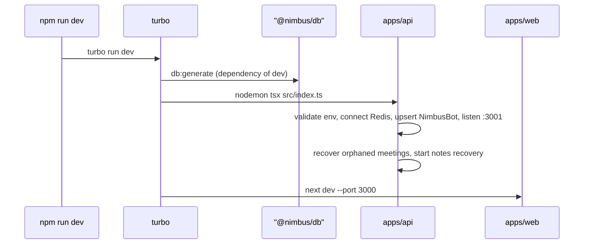
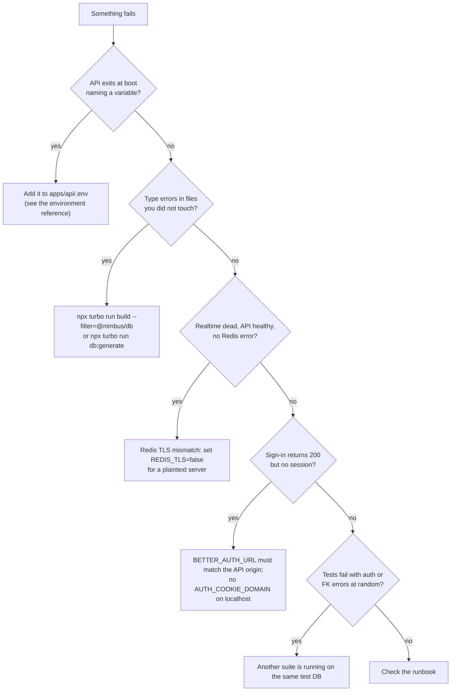

# Local setup

How to get Nimbus running on your machine: what to install, which environment files exist and what they must point at, how to start the test infrastructure, and how to run the apps and suites. Read the safety note first — the checked-in workflow assumes you never point a development or test command at a production database.

## Before you start: one safety rule

The `.env` files in a maintainer's checkout (`apps/api/.env`, `apps/web/.env`, `packages/database/.env`) point at the **deployed** database and API. They are gitignored, so yours start empty, but if you copy someone's, check every URL before running anything. Never run `db:migrate`, the seed scripts or the backfill against them. The test suites protect themselves by loading the committed `.env.test` instead, which points at the local test containers.

## Prerequisites

| Tool | Version | Why |
| --- | --- | --- |
| Node.js | 20 (CI uses 20; `engines` says ≥ 18) | Every workspace |
| npm | 11 (`packageManager: npm@11.5.2`) | Workspaces |
| Docker | any recent | Test Postgres, Redis and LiveKit |
| GNU Make | optional | The `Makefile` targets; each wraps a plain `npm`/`npx` command |

Accounts you need only for the features that use them: Google OAuth (sign-in with Google), Resend (verification and reset emails), Cloudinary (avatars, chat images), LiveKit (calls) and an AI provider key (the free tier). The API refuses to boot without the required ones; see [Environment variables](../reference/environment.md).

## Install

```bash
npm install                 # from the repository root, installs every workspace
npx turbo run db:generate   # generate the Prisma client (needed before the first type-check)
```

## Environment files

| File | Read by | Tracked |
| --- | --- | :-: |
| `.env.example` | humans: lists every variable the API reads | ✓ |
| `.env.test` | the API, `@nimbus/db` and e2e suites (local test containers) | ✓ |
| `apps/api/.env` | the API in `npm run dev` | ✗ |
| `apps/web/.env` | Next.js (`NEXT_PUBLIC_BACKEND_URL`, `NEXT_PUBLIC_BOT_USERID`) | ✗ |
| `packages/database/.env` | Prisma CLI (`DATABASE_URL`) | ✗ |
| `.env.smoke` | the production smoke suite | ✗ |

Copy `.env.example` into `apps/api/.env` and fill it in. [`apps/api/src/lib/env.ts`](../../apps/api/src/lib/env.ts) validates it at startup and names the first missing variable, so a bad file fails loudly instead of as a per-request 500. Point `DATABASE_URL` and `REDIS_URL` at databases you own: your own Postgres and Redis, or the test containers below (knowing that the test suites truncate that database).

## Start the infrastructure

```bash
make test-infra-up      # docker compose -f docker-compose.test.yml up -d
make test-schema        # apply migrations to the test database
```

[`docker-compose.test.yml`](../../docker-compose.test.yml) publishes Postgres 16 on **5434**, Redis 7 on **6381** and a LiveKit dev server on **7880** (with 7881/tcp and 7882/udp for media). The ports are offset from the usual defaults on purpose, so they do not clash with other local projects. `make test-infra-down` stops them; `make test-infra-reset` also deletes the data volume.

## Run the apps

```bash
npm run dev               # API on :3001 and web on :3000 together
npm run dev -w apps/api   # only the API (nodemon + tsx watch)
npm run dev -w apps/web   # only the web app
npm run dev -w apps/agent # the voice agent, against LIVEKIT_URL
```



Open `http://localhost:3000`, sign up, and verify your email (Resend must be configured, or read the verification link from the API log). The voice features need a reachable LiveKit server and the agent running; chat, documents and canvases need only the API, Postgres and Redis at runtime, although the API still requires the `LIVEKIT_*` variables to be set at boot (the test container's `ws://localhost:7880` with `devkey` / `secret` works).

## Run the checks

```bash
npm run lint            # every workspace, with --max-warnings budgets
npm run check-types     # builds @nimbus/db first, then tsc everywhere
npm test                # every suite (needs the test infrastructure)
make test-suite SUITE=smoke   # one API shard
make test-e2e           # Playwright; starts its own servers
```

Run suites **one at a time**: they share one test database and truncate tables between tests, so two concurrent runs corrupt each other and produce misleading auth and foreign-key failures. More in [Testing overview](../testing/overview.md).

## Troubleshooting



| Symptom | Cause | Fix |
| --- | --- | --- |
| `Cannot find module './generated/prisma/client'` | Prisma client not generated | `npx turbo run db:generate` |
| A bare `tsc` in `apps/api` fails on a fresh clone | `@nimbus/db` resolves through `dist` | `npx turbo run build --filter=@nimbus/db`, or use `npm run check-types` |
| Every socket feature silently dead | `redis://` to a host the client decided needs TLS, or the reverse | `REDIS_TLS=true` or `false` ([`redis.ts`](../../apps/api/src/lib/redis.ts) derives it from the host; a connect watchdog logs after 10 s) |
| Workspace creation fails | NimbusBot's row missing (`BOT_USERID`) | It is upserted at boot; check the database is migrated and reachable |
| The web app calls production | `apps/web/.env` points there | Set `NEXT_PUBLIC_BACKEND_URL=http://localhost:3001` |

## Design trade-offs and limits

- **No development compose file.** The only local containers are the test ones; using them for development means the test suites will wipe your data. A separate dev database is the safe choice.
- **Required external accounts.** The API validates OAuth, email, upload and LiveKit credentials at boot even if you will not use those features, so a first run needs placeholder values at least.
- **Voice needs extra moving parts** (a LiveKit server and the agent process); most work does not.
- **Make is a convenience,** not a requirement; every target is a thin wrapper and the commands above work without it on Windows.

## Related documentation

- [The monorepo](monorepo.md)
- [Environment variables](../reference/environment.md)
- [Testing overview](../testing/overview.md)
- [Runbook](../operations/runbook.md)
- [Architecture overview](../architecture/overview.md)
