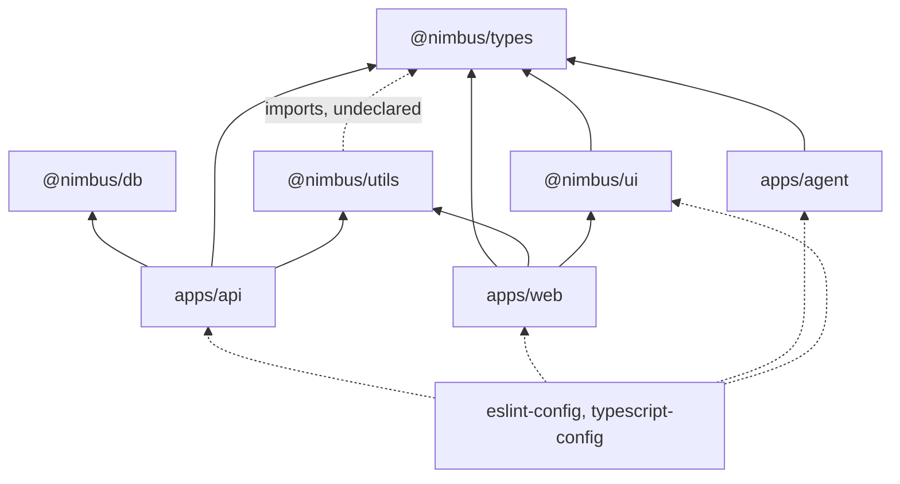
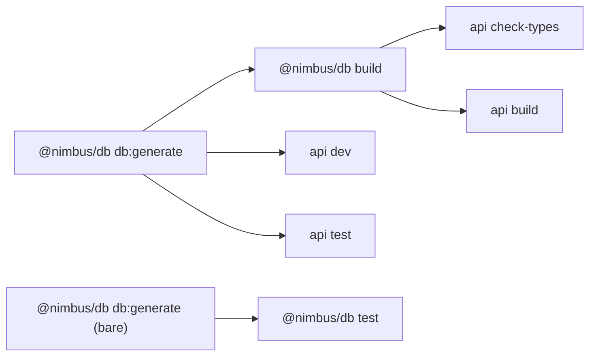

# The monorepo

Nimbus is one repository holding three deployable apps and five shared packages, wired together with npm workspaces and Turborepo. This page maps every workspace, shows how Turborepo orders the tasks between them, and lists the code conventions every file follows, so you know where a change belongs before you make it.

## Layout

```text
nimbus/
├── apps/
│   ├── web/        Next.js 16 App Router frontend            (port 3000, deployed on Vercel)
│   ├── api/        Express 5 + Socket.IO server              (port 3001, Docker on a droplet)
│   └── agent/      LiveKit Agents worker: the meeting voice  (LiveKit Cloud)
├── packages/
│   ├── database/   @nimbus/db: Prisma schema, migrations, client
│   ├── types/      @nimbus/types: socket contract, API DTOs, Zod schemas, provider registry
│   ├── utils/      @nimbus/utils: pure helpers (diagram pipeline, model selection, cost, slugs, time)
│   ├── ui/         @nimbus/ui: shared React components and design tokens
│   ├── eslint-config/      shared ESLint configuration
│   └── typescript-config/  shared tsconfig bases
├── docs/           this documentation (also served at /docs)
├── scripts/        check-coverage.mjs
├── .github/workflows/  ci, deploy, deploy-agent, e2e, prod-smoke
├── docker-compose.yml       production API container
├── docker-compose.test.yml  test Postgres, Redis and LiveKit
├── Makefile        the developer entry point (make help)
└── turbo.json      task graph and env contract
```

Note the one name/directory mismatch: the package **`@nimbus/db` lives in `packages/database`**. Imports say `@nimbus/db`; paths say `database`.

## How the workspaces depend on each other



| Workspace | Name | Resolves through | Tests |
| --- | --- | --- | --- |
| `apps/web` | `web` | — | Vitest (node + happy-dom), Playwright |
| `apps/api` | `api` | — | Vitest, four shards against real Postgres and Redis |
| `apps/agent` | `agent` | bundled by `tsup` | Vitest |
| `packages/database` | `@nimbus/db` | **`dist`** (must be built) | Vitest against its own database |
| `packages/types` | `@nimbus/types` | `src` via `exports` | through the API and web suites |
| `packages/utils` | `@nimbus/utils` | `src` via `exports` | Vitest (pure) |
| `packages/ui` | `@nimbus/ui` | `src` | Vitest (happy-dom) |

`@nimbus/db` is the only package consumers read from `dist`, because it wraps the generated Prisma client. Edits to `@nimbus/types` or `@nimbus/utils` need no rebuild; edits to the schema need `db:generate`.

## The two processes, and the third

The defining fact of the architecture is that the web app and the API are **separate processes** that share code only through `packages/*`. There is no Next.js `app/api` directory; `apps/web/api/` is a set of server-side fetch helpers that call the Express API, and the browser calls the API directly at `NEXT_PUBLIC_BACKEND_URL`. The voice agent is a third process that talks to the API over a private HTTP interface. See [Architecture overview](../architecture/overview.md).

## Turborepo tasks

Root scripts all delegate to Turbo: `npm run build`, `dev`, `lint`, `check-types`, `test`, `test:coverage`. Turbo reads [`turbo.json`](../../turbo.json):

| Task | Depends on | Cached | Notes |
| --- | --- | :-: | --- |
| `build` | `^build` | ✓ | Outputs `dist/**`, `.next/**`; env `DATABASE_URL`, `NEXT_PUBLIC_BACKEND_URL`. The web app's own [`turbo.json`](../../apps/web/turbo.json) adds `docs/**` as an input so a docs edit rebuilds the site. |
| `check-types` | `^build`, `^check-types` | ✓ | Builds `@nimbus/db` first on a cold cache |
| `lint` | `^lint` | ✓ | Budgets below |
| `dev` | `^db:generate` | ✗ | Persistent |
| `db:generate`, `db:migrate`, `db:deploy` | — | ✗ | `passThroughEnv` includes `DATABASE_URL` |
| `test`, `test:coverage` | `^db:generate`, `db:generate` | ✗ | `passThroughEnv` for the database, Redis, LiveKit and agent variables |



Turbo runs in **strict env mode**: a task sees only the variables named in its `env` or `passThroughEnv` (plus `globalPassThroughEnv`). A script can therefore pass on your machine because you exported a variable, and fail in CI with no error of its own. Add any new variable a task reads to `turbo.json`. The details, and the two times this broke CI, are in [Testing overview](../testing/overview.md).

### Lint budgets

Each workspace's `lint` script carries a `--max-warnings` ratchet, read from its `package.json`:

| Workspace | Budget |
| --- | --- |
| `apps/api` | `--max-warnings 156` |
| `apps/web` | `--max-warnings 0` |
| `apps/agent` | `--max-warnings 0` |
| `packages/ui` | `--max-warnings 0` |

A new warning fails the gate. Lowering a number is welcome; raising one is not.

## The Makefile

`make help` lists every target. The ones you will use most:

| Target | Does |
| --- | --- |
| `make install` | `npm install` from the root |
| `make dev` / `dev-api` / `dev-web` | Run the apps |
| `make db-generate` | Generate the Prisma client |
| `make test-infra-up` / `test-schema` | Start the test containers and migrate the test database |
| `make test`, `test-api`, `test-web`, `test-packages` | Run suites |
| `make test-suite SUITE=smoke` | One API shard |
| `make test-coverage-check` | Coverage, then the floor check |
| `make ci` | `check-types`, `lint` and `test`: the local CI gate |
| `make test-e2e` | The Playwright suite |

## Code conventions

These hold across every workspace and are worth matching in any change:

- **Module headers.** Every `.ts` and `.tsx` file opens with a `/** @module … @description … */` block saying what the file is for and what constrains it. Constraints are marked `@important`; they are load-bearing, so update them when the constraint changes.
- **TSDoc on exports**, with `@param` and `@returns`. Inline comments only for logic that is not obvious.
- **Prisma models and enums carry `///` doc comments.**
- **Relative imports inside an app** (no `@/*` alias); cross-package imports use the `@nimbus/*` names.
- **Responses use the `ServerResponse` envelope** and controllers return errors rather than throwing ([REST API](../reference/rest-api.md)).
- **Socket events are typed first** in `packages/types/src/socket/socketEvents.ts` ([Socket events](../reference/socket-events.md)).
- **Formatting is Prettier** (`npm run format`), checked by `make format-check`.

## Design trade-offs and limits

- **One repository, three deploy targets.** Shared types make cross-process contracts compile-time checked, but a change to `@nimbus/types` can require deploying the API, the web app and the agent together, and the three deploy on different platforms with different triggers.
- **`@nimbus/db` through `dist`** is the one place a stale build shows up as baffling type errors in innocent files. Run `npx turbo run build --filter=@nimbus/db` (or `check-types`, which does it) when that happens.
- **Strict env mode** is safer and more cache-correct, but every new variable must be declared, and forgetting it fails silently.
- **`@nimbus/utils` imports `@nimbus/types` without declaring it** in its `package.json`; it resolves through the workspace root today, but Turbo does not know about the edge, so it will not order or cache tasks by it.
- **The API's lint budget is not zero.** It carries existing warnings as a ratchet rather than fixing them all at once.

## Related documentation

- [Local setup](local-setup.md)
- [Architecture overview](../architecture/overview.md)
- [Testing overview](../testing/overview.md)
- [Deployment and CI/CD](../operations/deployment.md)
- [Environment variables](../reference/environment.md)
