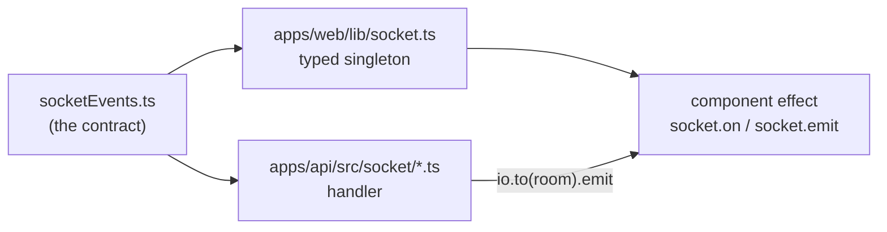

# Add a socket event

A step-by-step recipe for adding a realtime event: declaring it in the shared contract, handling it on the server with the membership checks every handler keeps, and listening for it in a component. The pattern is the same whether the event is a new chat feature, a document signal or a meeting update.

## The contract comes first

Socket.IO events are typed once, in [`packages/types/src/socket/socketEvents.ts`](../../packages/types/src/socket/socketEvents.ts), as `ClientToServerEvents` and `ServerToClientEvents`. The server's `Server` and the web app's [`socket.ts`](../../apps/web/lib/socket.ts) singleton are both typed with them, so a misspelled name or a wrong payload fails to compile on either side. Names follow `namespace:verb` (`canvas:pointer`, `meeting:caption`).



## Steps

### 1. Add the event to the contract

Add the client-to-server signature, the server-to-client signature, or both. Put any payload type that both sides build in `packages/types/src/socket`. No rebuild is needed: `@nimbus/types` resolves through `src`.

### 2. Handle it on the server

Handlers live in the four modules registered per socket in [`app.ts`](../../apps/api/src/app.ts): `socket/chat.ts`, `socket/document.ts`, `socket/canvas.ts` and `socket/meeting.ts`. Add yours to the module that owns its room. `socket.data.user` is already set by [`socket.middleware.ts`](../../apps/api/src/middleware/socket.middleware.ts); do not authenticate again.

The one rule that must not be broken: **check membership on every event, not only at join.** The existing handlers do it one of two ways:

| Event kind | Check | Example |
| --- | --- | --- |
| Joins, and anything that writes to the database | Read the `WorkspaceMember` row | `workspace:join`, `doc:join`, `message:send` in [`chat.ts`](../../apps/api/src/socket/chat.ts) |
| High-frequency relays inside a joined room | `socket.rooms.has(room)`; the join already checked the row | `canvas:update`, `canvas:pointer`, `doc:update`, `typing:start` |

The room gate is safe because [`socketEviction.ts`](../../apps/api/src/lib/socketEviction.ts) takes a removed member's sockets out of the workspace, document and canvas rooms when the membership ends. Also:

- Validate the payload's types before using it; the contract is compile-time only and a client can send anything.
- Wrap the body in `try`/`catch` and answer with the namespace's error event (`canvas:error`, `doc:error`) rather than throwing.
- Rate-limit anything a client can send in bursts (see the pointer budget in [`canvas.ts`](../../apps/api/src/socket/canvas.ts)).
- Use `socket.to(room)` to exclude the sender, `io.to(room)` to include it.

### 3. Listen in the web app

Import the singleton directly (it is not in a context) and register in an effect with a matching cleanup, as [`Chat.tsx`](../../apps/web/components/Chat.tsx) does:

```tsx
useEffect(() => {
  const onEvent = (payload: Payload) => { /* update state */ };
  socket.on("feature:event", onEvent);
  return () => {
    socket.off("feature:event", onEvent);
  };
}, [workspaceId]);
```

Pass the same function reference to `off`, or the listener leaks across re-renders. Emitting is `socket.emit("feature:verb", payload)`.

### 4. Test it

Add `apps/api/src/__tests__/integration/socket/<feature>.socket.test.ts`. [`socketHarness.ts`](../../apps/api/testhelpers/socketHarness.ts) gives `startTestServer()` (a real server with the real middleware), `connectClient()` and `waitForEvent()`. Cover:

- A member receives the broadcast; the sender does or does not, as intended.
- A non-member's event is refused and nothing is broadcast.
- **A member removed after joining** can no longer send or receive it ([`memberRemoval.socket.test.ts`](../../apps/api/src/__tests__/integration/socket/memberRemoval.socket.test.ts) is the model).
- Malformed payloads are ignored without crashing the handler.

## Checklist

- [ ] Event in `socketEvents.ts`, named `namespace:verb`
- [ ] Handler checks membership (row or room) on every event
- [ ] Payload validated at runtime; errors answered, never thrown
- [ ] Client listener cleaned up in the effect
- [ ] Socket test including the removed-member case
- [ ] [Socket events reference](../reference/socket-events.md) updated

## Design trade-offs and limits

- **The contract is types, not runtime validation.** Each handler checks its own payload; there is no shared schema layer for socket events as there is for REST bodies.
- **Room state is per process.** The Redis adapter fans broadcasts out across replicas, but anything the handler keeps in a `Map` (documents, canvases, budgets) is local ([Realtime overview](../realtime/overview.md)).
- **A database read per event is not free.** Use the room gate for high-frequency events, and keep the row check for writes.

## Related documentation

- [Socket events reference](../reference/socket-events.md)
- [Realtime overview](../realtime/overview.md)
- [Presence and chat](../realtime/presence-and-chat.md)
- [Add a REST endpoint](add-an-endpoint.md)
