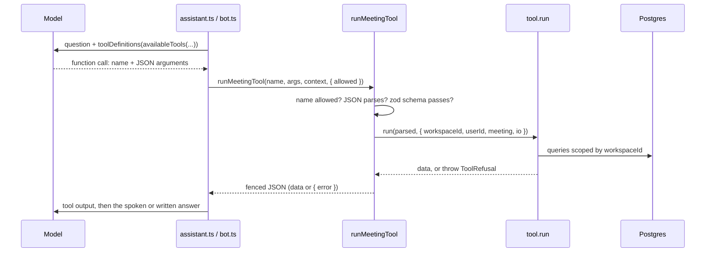

# Add an assistant tool

A step-by-step recipe for giving the in-call assistant (and, if it fits, Nimbus in chat) a new capability. Every tool is one entry in a single registry, [`apps/api/src/lib/meeting/tools.ts`](../../apps/api/src/lib/meeting/tools.ts), which the voice assistant and the chat bot both draw from; the model only ever sees the tools the registry offers it, and every tool runs confined to one workspace.

## How a tool call runs



Nothing a tool returns is trusted as instructions: `runMeetingTool` wraps every output in a fence (`fenceToolOutput`, capped at `TOOL_OUTPUT_MAX`) and the prompt's `TOOL_DATA_RULE` tells the model the fenced text is data.

## Steps

### 1. Name it

Add the name to `MEETING_TOOL_NAMES`. Use `verb_noun` in snake case, like the others (`list_decisions`, `create_action_item`). The voice assistant offers every name (`VOICE_TOOL_NAMES`); add it to `CHAT_TOOL_NAMES` too if it makes sense without a live meeting.

### 2. Write the two schemas

Each entry carries the same arguments twice:

| Field | For | Rules |
| --- | --- | --- |
| `parameters` | The model (strict function calling) | `type: "object"`, `additionalProperties: false`, and **every property listed in `required`**. Optional arguments are nullable (`["string", "null"]`, or the `nullableString` helper), not omitted. |
| `schema` | The server (Zod) | Accepts what `parameters` describes; this is what actually validates. Bound lengths and ranges here. |

Strict mode is why optional arguments are nullable: a strict schema must list every property as required, so "not given" is expressed as `null`.

### 3. Add the registry entry

```ts
{
  name: "list_widgets",
  description: "What it returns and when to use it, written for the model.",
  kind: "read",            // or "write" if it changes anything
  needsMeeting: false,     // true only if it reads the live meeting
  parameters: { /* strict JSON schema */ },
  schema: listWidgetsSchema,
  async run(args: z.infer<typeof listWidgetsSchema>, context) {
    const rows = await prisma.widget.findMany({
      where: { workspaceId: context.workspaceId /* always */ },
      take: LIST_TOOL_ROWS,
    });
    return { widgets: rows.map(({ id, name }) => ({ id, name })) };
  },
},
```

- **Confine every query to `context.workspaceId`.** For ids the model passes in, look them up with `{ id, workspaceId }`, so an id from another workspace reads as "not found".
- **Return plain data**, small and flat; the model reads it. Cap list sizes (`LIST_TOOL_ROWS`, `SEARCH_TOOL_HITS`).
- **Throw `ToolRefusal` for answers the model should relay** ("No meeting with that id in this workspace.", "Nothing to change was given."). Any other error is logged by name only and becomes a generic "That lookup failed" for the model.
- **Write tools broadcast** through `context.io` so open clients update, and credit `context.userId`.
- `needsMeeting: true` hides the tool when there is no live meeting (`availableTools`), so its `run` can rely on `context.meeting`.

### 4. Check the prompt

The assistant's instructions in [`assistant.ts`](../../apps/api/src/lib/meeting/assistant.ts) (voice) and [`bot.ts`](../../apps/api/src/lib/bot.ts) (chat) describe how to use tools in general; usually the tool's `description` is enough. Write tools run before the assistant starts speaking, so a write is committed before it is announced.

### 5. Test it

[`meetingTools.test.ts`](../../apps/api/src/__tests__/unit/meetingTools.test.ts) checks the registry as a whole, and will fail until the new tool is covered:

- **Registry shape:** `MEETING_TOOLS` matches `MEETING_TOOL_NAMES` in order; every `parameters` is strict with every property required.
- **`SAMPLES`:** add a `valid` and an `invalid` argument object for the tool; the Zod schema must accept one and refuse the other.
- **Workspace isolation:** add the tool to the `calls` list; the test runs it against workspace A and asserts nothing from workspace B is read or changed. "Covers the whole registry" fails until you do.
- Add a behaviour test of your own in the "tools against the database" block.

## Checklist

- [ ] Name in `MEETING_TOOL_NAMES` (and `CHAT_TOOL_NAMES` if it belongs in chat)
- [ ] Strict `parameters` with nullable optionals, and a matching Zod `schema`
- [ ] Every query scoped by `workspaceId`; refusals as `ToolRefusal`
- [ ] `kind` and `needsMeeting` set honestly
- [ ] Samples and isolation entry added to the tests
- [ ] [Assistant and tools](../meetings/assistant-and-tools.md) updated

## Design trade-offs and limits

- **One registry for two surfaces.** Voice and chat share tools, so behaviour stays consistent, but a description must read well for both, and chat lacks the meeting-only tools.
- **The model chooses.** Good descriptions matter more than code; a tool the model misunderstands is called with wrong arguments, which the Zod schema refuses but cannot correct.
- **No per-tool permissions.** Any workspace member in the call can trigger any write tool through the assistant; the tools themselves are bounded to the workspace, not to a role.
- **Outputs are capped.** Large results are cut at `TOOL_OUTPUT_MAX` characters, so return summaries and ids, not whole documents.

## Related documentation

- [Assistant and tools](../meetings/assistant-and-tools.md)
- [NimbusBot](../ai/nimbusbot.md)
- [The voice agent](../meetings/voice-agent.md)
- [Security and RBAC](../architecture/security.md)
