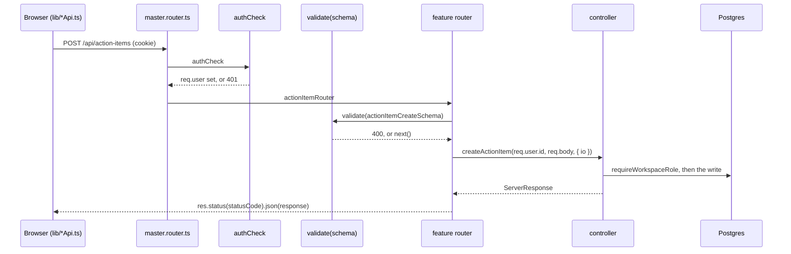

# Add a REST endpoint

A step-by-step recipe for adding an authenticated REST endpoint to the API and calling it from the web app, following the conventions every existing endpoint uses: a shared Zod schema, a thin router, a controller that owns the logic and returns a `ServerResponse`, and an integration test against the real database. The action items endpoints are the worked example throughout.

## The shape of a request



## Steps

### 1. Define the request schema in `@nimbus/types`

Add the body schema to the matching file in [`packages/types/src/validations`](../../packages/types/src/validations) (or a new file exported from the package index). Both the API's validation middleware and the web app's forms import it, so the client and server agree on the shape at compile time. If the endpoint returns a new shape, add its DTO type under `packages/types/src/api`.

### 2. Write the controller

In `apps/api/src/controllers/<feature>.controller.ts`, write one exported async function per operation. It takes plain values (the user id, parsed params, the body), never `req`/`res`, so it can be unit-tested and called from elsewhere.

- **Check access first.** For anything inside a workspace call [`requireWorkspaceRole`](../../apps/api/src/lib/workspaceAccess.ts)`(userId, workspaceId, minimumRole)`. A non-member gets a 404 (so existence does not leak) and a member below the role gets a 403; return `access.response` when `access.ok` is false.
- **Return, don't throw.** Every path returns a [`ServerResponse`](../../packages/types/src/api/serverResponse.ts) built with a static factory (`ok`, `created`, `badRequest`, `forbidden`, `notFound`, …). Wrap the body in `try`/`catch` and return a curated 500 rather than letting an error escape.
- **Scope every query by workspace.** Look records up with `where: { id, workspaceId }`, not `id` alone, so a valid id from another workspace finds nothing.
- **Broadcast if others should see it.** Take an optional `{ io }` and emit to the workspace room after the write commits.
- Add the TSDoc block with `@param` and `@returns`.

### 3. Add a thin router

In `apps/api/src/routers/<feature>.router.ts`, each route extracts `req.user!.id` and params, calls the controller, and writes the response:

```ts
actionItemRouter.post("/", validate(actionItemCreateSchema), async (req, res) => {
  const io = req.app.get("io") as Server | undefined;
  const response = await createActionItem(req.user!.id, req.body, { io });
  return res.status(response.statusCode).json(response);
});
```

[`validate.middleware.ts`](../../apps/api/src/middleware/validate.middleware.ts) answers 400 on a bad body but does not forward the parsed value, so the controller reads `req.body` (now trusted). Query strings are not validated by middleware; parse them with `safeParse` in the controller, as `listActionItems` does.

### 4. Mount it behind `authCheck`

Add one line to [`master.router.ts`](../../apps/api/src/routers/master.router.ts):

```ts
masterRouter.use("/action-items", authCheck, actionItemRouter);
```

Everything under the master router is authenticated. Only an endpoint meant for anonymous callers (like `/api/contact` and `/api/health`) is mounted in [`app.ts`](../../apps/api/src/app.ts) instead, ahead of the master router.

### 5. Call it from the web app

Browser-side calls live in `apps/web/lib/*Api.ts` (for example [`meetingApi.ts`](../../apps/web/lib/meetingApi.ts)): `fetch` against `NEXT_PUBLIC_BACKEND_URL` with `credentials: "include"`, unwrapping the envelope. Server components use the helpers in [`apps/web/api`](../../apps/web/api), which forward the incoming request's cookies. Mutations that a component triggers go in a hook under `apps/web/hooks/use*.ts`.

### 6. Test it

Add `apps/api/src/__tests__/integration/http/<feature>.http.test.ts`, using `createApp()`, `supertest` and the helpers from `@testhelpers` (`mintUser`, `createWorkspace`, `addMember`, `as(app, user)`, `fakeIo`, `resetDatabase`). Cover at least:

| Case | Expect |
| --- | --- |
| Anonymous | 401 |
| Outsider (not a member) | 404 |
| Member below the required role | 403 |
| Invalid body | 400 |
| An id from another workspace | 404, nothing changed |
| Happy path | The right status, the envelope, the row, the broadcast |

Run it alone with `npx vitest run src/__tests__/integration/http/<feature>.http.test.ts` from `apps/api`, with the test infrastructure up. Add a web hook test under `apps/web/tests/unit/hooks` with an MSW handler in [`handlers.ts`](../../apps/web/tests/msw/handlers.ts) if the client logic is non-trivial.

## Checklist

- [ ] Schema in `@nimbus/types`, used by both sides
- [ ] Controller returns `ServerResponse` on every path and checks `requireWorkspaceRole`
- [ ] Queries scoped by `workspaceId`
- [ ] Router is thin; mounted behind `authCheck`
- [ ] Module header and TSDoc on new files
- [ ] Integration test covering access, validation and isolation
- [ ] [REST API reference](../reference/rest-api.md) updated

## Design trade-offs and limits

- **The validator does not forward the parsed value,** so a schema with transforms or defaults has no effect on what the controller sees. Parse again in the controller if you need the transformed value.
- **Access checks are per controller, not declarative.** That keeps each rule next to the logic it protects, but a new controller that forgets `requireWorkspaceRole` is not caught by the router; the outsider test is what catches it.
- **No API versioning.** The web app and the API deploy separately, so a breaking change needs a compatible API release first ([Deployment](../operations/deployment.md)).

## Related documentation

- [REST API reference](../reference/rest-api.md)
- [Security and RBAC](../architecture/security.md)
- [Add a socket event](add-a-socket-event.md)
- [Testing overview](../testing/overview.md)
