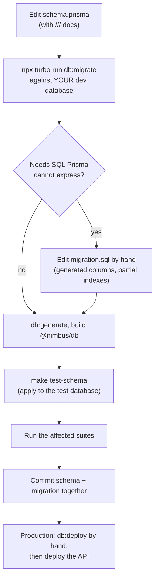

# Change the database schema

A step-by-step recipe for changing the Prisma schema safely: editing `schema.prisma`, generating a migration against a database you own, hand-writing the SQL Prisma cannot express, applying it to the test database, and rolling it out to production in an order that never breaks the running API.

## Where things live

| Thing | Path |
| --- | --- |
| Schema | [`packages/database/prisma/schema.prisma`](../../packages/database/prisma/schema.prisma) |
| Migrations | [`packages/database/prisma/migrations`](../../packages/database/prisma/migrations) |
| Generated client (gitignored) | `packages/database/src/generated/prisma` |
| Package | `@nimbus/db`, consumed through `dist` |

## The flow



## Steps

### 1. Edit the schema

Change `schema.prisma` and give every new model, field and enum a `///` doc comment, as the existing ones have. Prefer additive changes: new tables, new nullable columns, new columns with defaults.

### 2. Create the migration against your own database

```bash
npx turbo run db:migrate --filter=@nimbus/db   # prisma migrate dev
```

`prisma migrate dev` reads `DATABASE_URL` from `packages/database/.env`. **Check that it points at a development database you own before running it.** In a maintainer's checkout that file points at production, and `migrate dev` can reset a database it considers drifted. Never run it against the test containers either; they are migrated with `db:deploy` (step 4).

Name the migration for what it does (`add_message_image`, `one_free_meeting_per_user`).

### 3. Hand-write what Prisma cannot express

Some features are added by editing the generated `migration.sql` before it is applied. Existing examples:

| Need | Example migration | In `schema.prisma` |
| --- | --- | --- |
| A generated `tsvector` column with a GIN index | `20261110120000_document_search` | `Unsupported("tsvector")?` with `@default(dbgenerated(...))` |
| A partial unique index | `20261116120000_one_free_meeting_per_user` (one live free meeting per user) | Not representable; the index exists only in SQL |

When the schema cannot describe something, the migration is the source of truth. Leave a `///` comment on the model saying the index or column is maintained in SQL, so nobody "fixes" the drift.

### 4. Regenerate and apply to the test database

```bash
npx turbo run db:generate                  # new client
npx turbo run build --filter=@nimbus/db    # consumers read dist
make test-schema                           # db:deploy against .env.test's database
```

A stale client shows up as type errors in files you did not touch; regenerating and rebuilding clears them.

### 5. Update the code and tests

- If a test helper inserts into a changed table, update [`factories.ts`](../../apps/api/testhelpers/factories.ts).
- New tables need no test wiring: [`resetDatabase`](../../apps/api/testhelpers/database.ts) truncates every table in the `public` schema between tests.
- Run the API suites one shard at a time, and the `@nimbus/db` suite (which creates and migrates its own database).

### 6. Roll it out

Migrations are **not** applied by the image or by `deploy.yml`. In production:

1. Apply the migration from a trusted machine: `npx turbo run db:deploy --filter=@nimbus/db` with the production `DATABASE_URL` set only in that shell.
2. Then deploy the API.
3. Destructive steps (dropping a column the old API reads, renaming, tightening `NOT NULL`) go in a **later** migration, after every running process has stopped using the old shape.

See [Deployment and CI/CD](../operations/deployment.md) for the full deploy order.

## Checklist

- [ ] `///` docs on every new model, field and enum
- [ ] Migration generated against a database you own, and named for what it does
- [ ] Hand-written SQL noted in the schema
- [ ] Client regenerated and `@nimbus/db` rebuilt
- [ ] Test database migrated; factories updated
- [ ] Additive now, destructive later
- [ ] [Data model reference](../reference/data-model.md) updated

## Design trade-offs and limits

- **Manual production migrations.** Deliberate and reviewable, but forgetting one surfaces as runtime errors after a deploy.
- **SQL-only features drift from the schema.** Generated columns and partial indexes are invisible to Prisma's model, and `migrate dev` may propose dropping them if the schema and the SQL disagree; read every generated migration before applying it.
- **One shared test database.** Migrating it while a suite is running breaks that suite; run them one at a time.
- **No down migrations.** Prisma migrations go forward only; a rollback is a new migration.

## Related documentation

- [Data model reference](../reference/data-model.md)
- [Deployment and CI/CD](../operations/deployment.md)
- [Local setup](../getting-started/local-setup.md)
- [Testing overview](../testing/overview.md)
