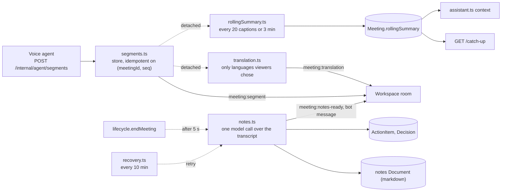
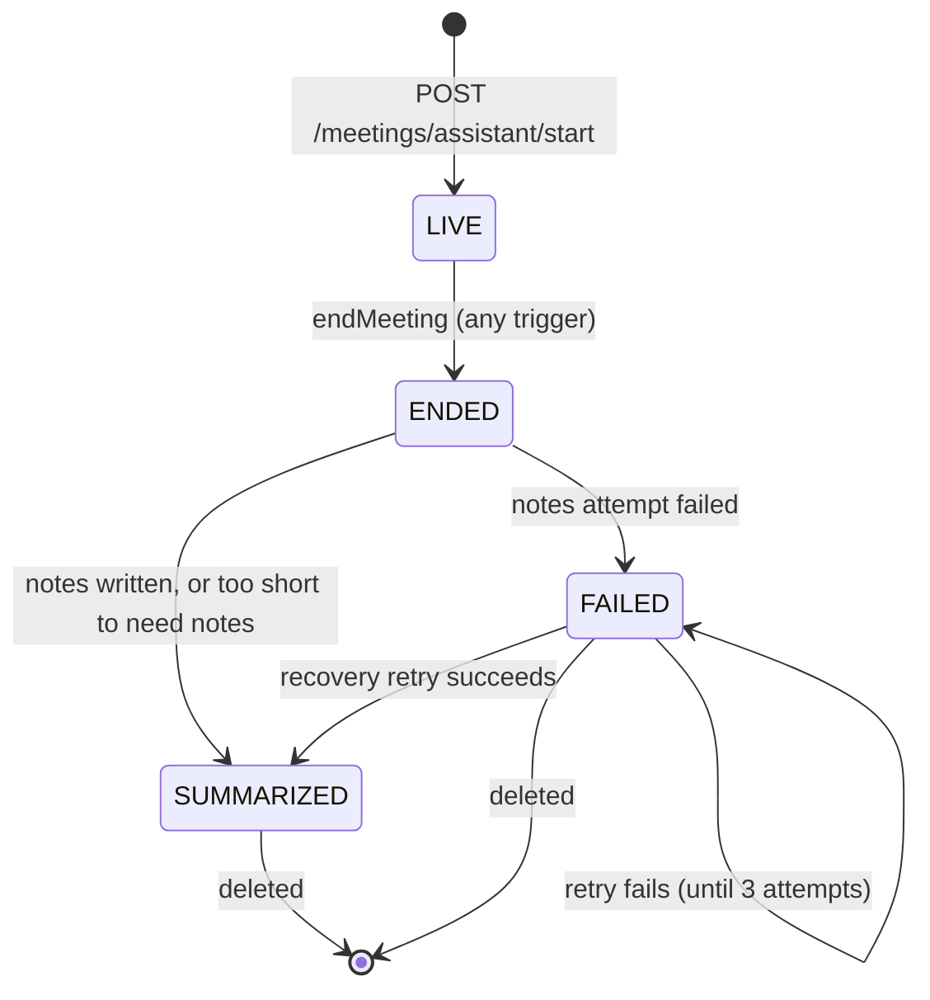
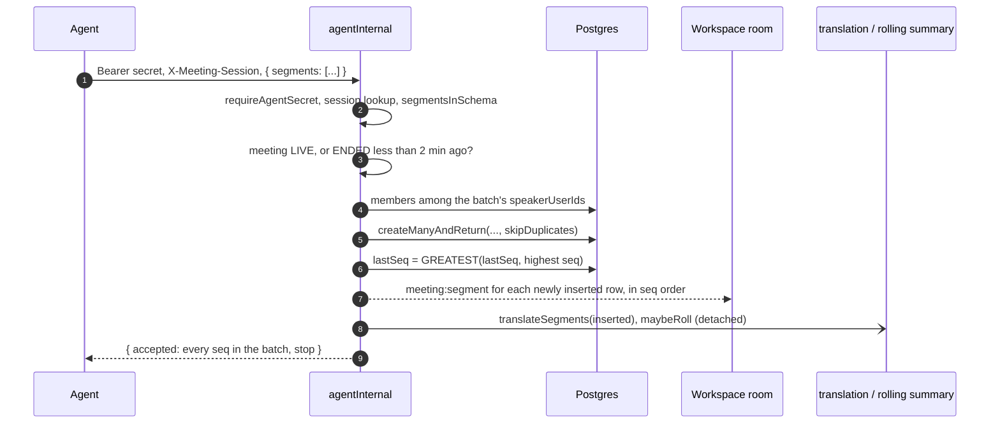
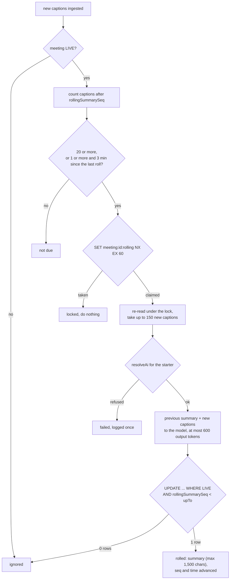
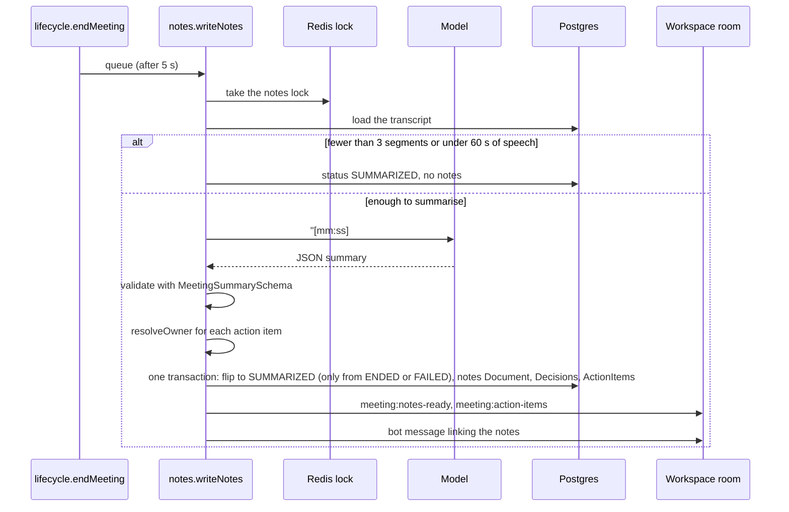

# Transcripts and notes

What happens to a meeting's words: from captions the voice agent posts while people talk, through live translation and a running summary, to the notes, decisions and action items written once the meeting ends. Everything here lives in the API under [`apps/api/src/lib/meeting`](../../apps/api/src/lib/meeting); the agent only transcribes and posts. The recurring design rule is that nothing slow (translation, summaries, notes) may block or fail the path that stores captions, and every step can be retried without doing anything twice.

## The data flow



## The meeting lifecycle

A `Meeting` row exists from the moment someone starts the assistant until it is deleted. Its `status` ([Data model](../reference/data-model.md)) moves forward only:



### Starting

`startAssistant` in [`meeting.controller.ts`](../../apps/api/src/controllers/meeting.controller.ts) walks a fixed sequence: membership; an existing live meeting (returned as-is, so the call is idempotent); a call with people in it; the voice entitlement (BYOK or free); the free allowance; then it creates the meeting row, a one-time **ticket** and the LiveKit agent dispatch. Two partial unique indexes back this up: one live meeting per workspace, and one live free meeting per user across workspaces (the free allowance is charged only at the end, so without it every workspace could spend the same balance). See [Voice and LiveKit](voice-and-livekit.md) and [The voice agent](voice-agent.md) for the dispatch.

### Tickets and agent sessions

| Credential | Store | Lifetime | Module |
| --- | --- | --- | --- |
| Ticket | `SET ticket:<t> <meetingId> EX 60 NX`, redeemed with `GETDEL` | 60 s, single use | [`tickets.ts`](../../apps/api/src/lib/meeting/tickets.ts) |
| Agent session | `agent-session:<token> → { meetingId, providerId, credentialId }` | `SESSION_TTL_SECONDS = 21_600` (6 h), reusable | [`agentSession.ts`](../../apps/api/src/lib/meeting/agentSession.ts) |

The dispatch metadata carries only the ticket, so a ticket leaked from the media server's logs is worthless after a minute or first use. Redemption re-resolves the voice key (it may have been removed in the last minute) and is the only path that produces a plaintext provider key; a lint rule keeps `voiceEntitlements` importable only from `tickets.ts`. A session token names exactly one meeting, so a request authenticated with it can only touch that meeting.

### Ending

Every way a meeting stops converges on `endMeeting` in [`lifecycle.ts`](../../apps/api/src/lib/meeting/lifecycle.ts):

| Trigger | `MeetingEndReason` |
| --- | --- |
| Someone presses Stop | `stopped` |
| The free budget runs out | `budget` |
| The agent's participant leaves the room (webhook) | `agent-left` |
| The room closes (webhook) | `room-finished` |
| The agent reports its own exit | `agent-ended` |
| The provider rejects the key | `invalid-key` |
| The workspace reaches its monthly spend cap | `spend-cap` |
| Boot sweep finds a live meeting whose room is gone | `orphaned` |
| The agent never redeemed its ticket within `DISPATCH_TIMEOUT_MS = 90_000` | `dispatch-failed` |

Ending is one conditional transition, `UPDATE … SET status = 'ENDED' WHERE status = 'LIVE'`. Only the caller whose update changed a row runs the side effects: charging free seconds, broadcasting `meeting:ended`, clearing Redis keys and queueing the notes. Several triggers racing therefore cannot charge or announce twice.

Free seconds are charged to the user who started the meeting as `ceil(endedAt − startedAt)`, capped at the budget handed to the agent, computed from the meeting's own timestamps rather than anything the agent reports. A process-local backstop timer (`BUDGET_GRACE_SECONDS = 20` past the budget) ends a free meeting if the agent's own timer fails; `recoverOrphanedMeetings` re-arms it at boot. A `dispatch-failed` meeting is never charged, because no assistant ran.

## Captions

The agent posts batches of segments to `POST /internal/agent/segments`. [`segments.ts`](../../apps/api/src/lib/meeting/segments.ts) stores them:

- **Idempotent on `(meetingId, seq)`.** The agent retries a batch after any network error; a replay inserts nothing and broadcasts nothing. Only newly inserted rows are announced, in order, as `meeting:segment`. `Meeting.lastSeq` only moves forward.
- **Speakers are checked.** A `speakerUserId` is kept only if that user is a current member of the workspace; otherwise the caption is stored with a null speaker and the name as spoken.
- **The assistant's own replies** are stored under a sequence number the agent reserved for them, with `fromAssistant` and the name `ASSISTANT_SPEAKER_NAME = "Nimbus"`, so they never collide with a later caption and appear in the transcript and notes.
- After storing, translation and the rolling summary are kicked off **detached**; neither can fail or delay the ingest.

The browser reads history with `GET /api/meetings/:id/segments?afterSeq=…` (up to 200 per page) and follows `meeting:segment` live.

### One ingest request, step by step

`POST /internal/agent/segments` is handled by `segments` in [`agentInternal.controller.ts`](../../apps/api/src/controllers/agentInternal.controller.ts) and `ingestSegments` in [`segments.ts`](../../apps/api/src/lib/meeting/segments.ts):



| Rule | Detail |
|---|---|
| Batch size | 1 to 50 segments (`segmentsInSchema`); the agent sends at most 10 |
| Field limits | `seq` 1 to 1,000,000; `speakerName` 1 to 120 characters; `text` 1 to 4,000 characters, trimmed; `language` 2 to 16 characters |
| A batch that fails validation | 400 for the whole batch; the agent treats that as "rejected" and **drops every segment in it** rather than retrying forever |
| `accepted` | every sequence number in the batch, new or already stored, so the agent clears its outbox either way |
| After the meeting ended | still accepted for `INGEST_GRACE_MS` (120 s), so the agent's shutdown flush lands; the response then says `stop: true` |
| `endMs` | clamped to at least `startMs` |
| Speaker check | a `speakerUserId` that is not a current member is stored as `null`, keeping the spoken name |

The broadcast and the detached work run only for rows **this request inserted**, which is what makes a retried batch free: no duplicate captions on screen, no second translation, no extra roll.

## Live caption translation

Each viewer may pick a caption language with the socket event `meeting:caption-language`. [`captionLanguages.ts`](../../apps/api/src/lib/meeting/captionLanguages.ts) keeps the choices in a Redis hash `meeting:<id>:langs` (socket id → language), removing a field when the socket changes its mind or disconnects, with a 24-hour TTL as a backstop. The set of active languages is therefore exactly what connected viewers want right now.

[`translation.ts`](../../apps/api/src/lib/meeting/translation.ts) batches captions that arrive within `TRANSLATION_BATCH_MS = 400`, sends the three previous segments as untranslated context (`TRANSLATION_CONTEXT_SEGMENTS = 3`) so pronouns and terms carry over, stores each result in `SegmentTranslation` and broadcasts `meeting:translation`. A meeting nobody reads translated costs nothing. Every batch goes through `resolveAi`, so translation stops when the meeting ends or a BYOK workspace reaches its spend cap. Failures are swallowed and the caption stays in its original language.

### Translation, in detail

**Who asks for which language.** A viewer's choice is stored per socket, not per user, because two tabs of the same person may want different languages. `activeCaptionLanguages(meetingId)` returns the distinct values in the hash, and each segment's targets are those languages minus the segment's own (`normalizeCaptionLanguage(segment.language)`, or `en` when the transcriber did not tag one).

**Batching.** The first new segment for a meeting starts a `TRANSLATION_BATCH_MS` (400 ms) timer; segments ingested before it fires join the same batch. The window is fixed from the first segment, not sliding, so a steady stream of captions is translated in roughly 400 ms slices rather than held indefinitely.

**One request.** The model gets fixed instructions, and an input that is itself JSON:

```json
{
  "context": [
    { "seq": 41, "speaker": "Ana", "text": "We moved the launch to Friday." }
  ],
  "segments": [
    { "seq": 42, "speaker": "Ben", "text": "Then it needs the new checklist.", "targets": ["es", "de"] }
  ]
}
```

and must reply `{ "translations": { "42": { "es": "...", "de": "..." } } }` in JSON mode. `parseTranslations` keeps every well-formed string it finds and ignores everything else, so a reply that translated one language of three still stores that one. Each result is upserted on `(segmentId, language)` and broadcast as `meeting:translation { meetingId, seq, language, text }`.

**Who receives it.** The broadcast goes to the whole workspace room, in every language; each client keeps only the language it chose. That keeps the server free of per-socket routing, at the cost of a few extra small events when several languages are active.

**History.** Translation runs on new captions only. Someone who switches to Spanish halfway through sees Spanish from then on; earlier captions stay in their original language unless someone else was already reading Spanish when they were spoken. `GET /api/meetings/:id/segments?language=es` returns whatever translations are stored for each segment, so a reload restores exactly what was translated live.

**Who pays.** `resolveAi` for the meeting's starter, feature `meeting`, the same as notes and the rolling summary. With a workspace key every batch counts toward its spend cap and stops when the cap is reached; on the free tier, translation is covered by the free voice allowance. A refused resolution is logged once per meeting (`refusalLogged`) and the captions simply stay untranslated.

## The rolling summary and "catch me up"

[`rollingSummary.ts`](../../apps/api/src/lib/meeting/rollingSummary.ts) keeps a short running summary of a live meeting, used by "catch me up" and as context for the in-call assistant.

| Constant | Value | Meaning |
| --- | --- | --- |
| `ROLL_MIN_SEGMENTS` | 20 | A roll is due after this many new captions… |
| `ROLL_MIN_INTERVAL_MS` | 3 min | …or after this long with at least one new caption |
| `ROLL_LOCK_TTL_SECONDS` | 60 | Redis lock `meeting:<id>:rolling`: one roll per meeting at a time, across replicas |
| `CATCH_UP_STALE_MS` | 90 s | `GET /catch-up` regenerates synchronously only when the summary is older than this and captions have arrived since |

The model receives the previous summary plus only the new captions and returns an updated summary of at most 150 words, so the cost of a roll does not grow with the length of the call. `rollingSummarySeq` only moves forward, and the write is conditional on the meeting still being live.

### How a roll runs



- **The input** is `Previous summary:` (or `(none yet)`) followed by `New captions:` as `Name: text` lines. The instructions ask for at most 150 words of bullet points covering topics, decisions so far and open questions, folding new material in and dropping detail rather than growing.
- **A backlog is consumed in steps.** One roll reads at most `ROLL_BATCH` = 150 new captions and advances `rollingSummarySeq` only to the last one it read; the next ingest finds the rest still due.
- **Overlap is harmless.** If a model call outlives the 60 s lock and a second roll starts, the conditional write (`rollingSummarySeq < upTo`) means the summary can only move forward, never be replaced by an older one.
- **Catch-up forces a roll** (ignoring the due rule) when the meeting is live, the summary is older than 90 s or missing, and there is at least one new caption. It waits for that roll, then returns `{ summary, upToSeq, generatedAt, minutesElapsed }`. After the meeting, it returns the last rolling summary, or the notes' `summary` if no roll ever ran.

## Notes, decisions and action items

A few seconds after a meeting ends (`NOTES_START_DELAY_MS = 5_000`, so captions flushed by a departing agent are included), [`notes.ts`](../../apps/api/src/lib/meeting/notes.ts) writes the notes:



- **What the model returns** is validated by `MeetingSummarySchema` in [`meetingSummary.ts`](../../packages/types/src/validations/meetingSummary.ts): a `title` (≤ 80 chars), a `summary` (≤ 1200), up to 50 `decisions` and the `actionItems`, each optionally citing the `#seq` it came from, which becomes `sourceSegmentId`. Relative dates ("by Friday") become ISO due dates because the model is told the meeting's date.
- **Owners** come back as spoken names. [`resolveOwner.ts`](../../apps/api/src/lib/meeting/resolveOwner.ts) matches them to members in three passes (full name, first name, prefix), Unicode-normalised (NFKC, case-folded); a pass that matches more than one person returns `null` rather than guessing. The spoken name is kept in `ownerName`.
- **The notes document** is a markdown `Document` created with `initialContent`, so it seeds its Yjs state on first open like any generated document ([Markdown sync](../realtime/markdown-sync.md)), and it is searchable at once.
- **Idempotent.** The final transaction only succeeds while the meeting is `ENDED` or `FAILED`; once `SUMMARIZED`, a second run changes nothing. A Redis lock stops the queued run and the recovery sweep from both calling the model.
- **Never throws.** A failure marks the meeting `FAILED` with a curated `failureReason` and leaves the transcript alone.

[`recovery.ts`](../../apps/api/src/lib/meeting/recovery.ts) sweeps every `RECOVERY_INTERVAL_MS = 10 min` for meetings that are `ENDED` or `FAILED`, ended more than a minute ago, with fewer than `NOTES_MAX_ATTEMPTS = 3` attempts, skipping `dispatch-failed` ones. After the third failure a meeting stays `FAILED` with its transcript intact.

### Inside a notes run

`writeNotes(meetingId)` takes the lock `meeting:<id>:notes` (`SET NX EX 300`), and returns `busy` if another run holds it. Under the lock, `run`:

1. **Re-checks the row.** Gone, still `LIVE`, already `SUMMARIZED`, ended as `dispatch-failed`, or out of attempts: `ignored`.
2. **Claims an attempt** with a conditional increment of `summaryAttempts` (only while `ENDED` or `FAILED` and below 3). The attempt is spent even if the meeting then turns out to be too short.
3. **Loads the transcript** in `seq` order, the assistant's own replies included.
4. **Skips short meetings**: fewer than `NOTES_MIN_SEGMENTS` (3) segments, or less than `NOTES_MIN_SPEECH_MS` (60 s) of summed `endMs − startMs`. The meeting becomes `SUMMARIZED` with no notes, and the outcome is `skipped-short`.
5. **Resolves the model** for the meeting's starter (`feature: "meeting"`). A meeting with no starter (their account was deleted) fails as `no-starter`; a refusal fails as `ai-unavailable: <reason>`.
6. **Builds the prompt.** The instructions name the meeting's date and weekday (UTC), explain the `[mm:ss] #seq Name: text` lines and `sourceSeq` citations, forbid inventing owners or dates, and give the exact JSON shape. The input is `Meeting date: YYYY-MM-DD` and the transcript. A transcript longer than 150,000 characters keeps whole lines from its beginning and end, about half each, with `[... N lines omitted for length ...]` between.
7. **Calls the model** in JSON mode at low reasoning effort, `max_output_tokens` 4,096. If `parseNotes` rejects the reply (no JSON object, invalid JSON, or schema errors, which it lists, up to eight), it asks **once more** with the same input plus "Your previous reply was rejected: <errors>". A second rejection fails as `invalid-summary: <errors>`; a provider error as `model-call-failed: <reason>`.
8. **Resolves owners** against the workspace's members (NimbusBot excluded) with `resolveOwner`, and turns each `due` into a UTC midnight date.
9. **Writes everything in one transaction**, starting with the conditional flip to `SUMMARIZED` (which also stores the whole validated object in `Meeting.summary` and its `title`). If the flip changes no row, nothing else is written and the outcome is `ignored`.
10. **Announces**: `document:created` for the notes document, `meeting:notes-ready { meetingId, documentId }`, `meeting:action-items` for the meeting, and a NimbusBot chat message whose second line is a `nimbus-doc:<documentId>` link the web client turns into a document link.

Any unexpected exception marks the meeting `FAILED` with `internal-error`. Failure reasons are stored cut to 300 characters and are written only while the row is still `ENDED` or `FAILED`, so a run that fails after another succeeded cannot undo it.

**What is stored where:**

| Model output | Stored in |
|---|---|
| `title` | `Meeting.title`, and the document title `Meeting notes: <title> (<date>)` |
| `summary` | `Meeting.summary.summary`, the notes document, and catch-up after the meeting |
| `decisions[]` | `Decision` rows, with `sourceSegmentId` when `sourceSeq` names a stored segment |
| `actionItems[]` | `ActionItem` rows (`ownerUserId` when resolved, `ownerName` always, `dueDate`, `sourceSegmentId`) |
| `openQuestions[]` | `Meeting.summary` and the notes document |
| `topics[]` | `Meeting.summary` only |

**The notes document** is rendered by `renderNotesMarkdown` from a fixed template: the title as `#`, then `## Summary`, `## Decisions`, `## Action items` (as `- [ ]` task items with the owner in bold and the due date), `## Open questions`, and a closing "Full transcript in Meetings." Empty sections say "_None recorded._" or "_None._". The owner shown is the member's current display name when resolved, otherwise the name as spoken.

**How many model calls a meeting can cost:** up to two per attempt and three attempts, so at most six. A meeting that fails because its workspace was over its spend cap uses its attempts on the next three sweeps (about thirty minutes) and then stays `FAILED`; there is no endpoint to retry it later.

### A worked example

Three lines of a transcript, as the model sees them:

```text
[12:04] #87 Ana Ruiz: So we're agreed, the launch moves to Friday.
[12:09] #88 Ben Okafor: Then someone has to update the checklist.
[12:12] #89 Ana Ruiz: Priya, can you take that by Thursday?
```

For a meeting on 2026-11-09 (a Monday), a valid reply contains:

```json
{
  "decisions": [{ "text": "The launch moves to Friday (2026-11-13).", "sourceSeq": 87 }],
  "actionItems": [{ "text": "Update the launch checklist", "ownerName": "Priya", "due": "2026-11-12", "sourceSeq": 89 }]
}
```

`resolveOwner("Priya", members)` finds one member whose first name is Priya and sets `ownerUserId`; the item's `sourceSegmentId` points at segment `#89`, the moment it was assigned. Had the workspace two members named Priya, `ownerUserId` would be `null`, `ownerName` would still read "Priya", and the item would wait for someone to assign it.

### Action items after the meeting

Action items outlive their meeting: deleting a meeting nulls `meetingId` and the items become ordinary workspace items. They are edited from the meetings panel through `/api/action-items` or by the assistant's tools, and both go through the same functions in [`actionItems.ts`](../../apps/api/src/lib/meeting/actionItems.ts) (`addActionItem`, `changeActionItem`, `removeActionItem`), so the same membership and permission rules apply. Every change is announced as one `meeting:action-items` event, carrying either a meeting's complete set or a single changed item.

## Search

`GET /api/meetings/search` runs keyword search over a workspace's transcripts ([`search.ts`](../../apps/api/src/lib/meeting/search.ts)): `websearch_to_tsquery('simple', …)` (quoted phrases, `or`, a leading `-`, never errors on odd input) against the generated, GIN-indexed `TranscriptSegment.search` column, with a `ts_headline` excerpt marking the matched words. Every value is a bound parameter, and the workspace filter is part of the join.

## On the web

| Piece | Role |
| --- | --- |
| [`useMeeting`](../../apps/web/hooks/useMeeting.ts), [`MeetingProvider`](../../apps/web/providers/MeetingProvider.tsx) | The live meeting and assistant state for the call UI |
| [`useMeetingTranscript`](../../apps/web/hooks/useMeetingTranscript.ts) | Paged segments plus `meeting:segment` and `meeting:translation` |
| [`useCaptionLanguage`](../../apps/web/hooks/useCaptionLanguage.ts), [`useCaptionPrefs`](../../apps/web/hooks/useCaptionPrefs.ts) | The viewer's caption language and display preferences |
| [`useCatchUp`](../../apps/web/hooks/useCatchUp.ts) | "Catch me up" |
| [`useWorkspaceMeetings`](../../apps/web/hooks/useWorkspaceMeetings.ts), [`useMeetingDetail`](../../apps/web/hooks/useMeetingDetail.ts), [`useMeetingSearch`](../../apps/web/hooks/useMeetingSearch.ts) | The meetings panel: list, detail with notes, search |
| [`useActionItems`](../../apps/web/hooks/useActionItems.ts) | Action items, following `meeting:action-items` |
| [`components/meeting`](../../apps/web/components/meeting), [`components/meetings`](../../apps/web/components/meetings) | Live captions and transcript; past meetings and their notes |

## Tests

| Suite | What it pins |
| --- | --- |
| [agentInternal.http.test.ts](../../apps/api/src/__tests__/integration/http/agentInternal.http.test.ts) | The internal routes end to end: secret and session checks, redemption, segment ingest and replays, the grace period, the stop flag, state, usage, notices, goodbye |
| [meetingLifecycle.test.ts](../../apps/api/src/__tests__/integration/persistence/meetingLifecycle.test.ts) | The single conditional end, charging once, the dispatch timeout, the budget backstop, the boot sweep |
| [translation.test.ts](../../apps/api/src/__tests__/unit/translation.test.ts) | Instructions, partial-reply parsing, batching, targets and context, storage and broadcast, stopping with the meeting and the cap |
| [translation.integration.test.ts](../../apps/api/src/__tests__/integration/persistence/translation.integration.test.ts) | Paging segments with the stored translation for a requested language, unsupported languages, 404 for non-members, deletion with the segment |
| [rollingSummary.test.ts](../../apps/api/src/__tests__/integration/persistence/rollingSummary.test.ts) | The due rule, the lock, forward-only writes, catch-up regeneration and its fallback to the notes |
| [notes.test.ts](../../apps/api/src/__tests__/unit/notes.test.ts), [notes.integration.test.ts](../../apps/api/src/__tests__/integration/persistence/notes.integration.test.ts) | Transcript rendering and trimming, the prompt, parsing and the repair retry, the markdown; the whole run, short meetings, idempotency, attempts and failure reasons |
| [meetingNotes.socket.test.ts](../../apps/api/src/__tests__/integration/socket/meetingNotes.socket.test.ts) | The events and the bot message when notes are ready |
| [meetingSummarySchema.test.ts](../../apps/api/src/__tests__/unit/meetingSummarySchema.test.ts), [resolveOwner.test.ts](../../apps/api/src/__tests__/unit/resolveOwner.test.ts) | The notes schema's limits; the three matching passes and refusing ambiguity |
| [actionItems.http.test.ts](../../apps/api/src/__tests__/integration/http/actionItems.http.test.ts) | Editing items after the meeting, permissions, the broadcast |
| [meetings.http.test.ts](../../apps/api/src/__tests__/integration/http/meetings.http.test.ts), [meetings.list.http.test.ts](../../apps/api/src/__tests__/integration/http/meetings.list.http.test.ts), [searchSegments.test.ts](../../apps/api/src/__tests__/integration/persistence/searchSegments.test.ts) | Starting, stopping, listing, paging segments with translations, deleting, transcript search |

## Design trade-offs and limits

- **Notes come from one model call over the whole transcript.** That is simple and consistent, but a very long meeting is bounded by the model's context and the `NOTES_MAX_OUTPUT_TOKENS = 4096` output limit; there is no chunked or hierarchical summarisation.
- **Timers are process-local.** The notes delay, the budget backstop and the dispatch timeout are `setTimeout`s that a restart loses. Each is backed by something durable (timestamps for the charge, the recovery sweep for notes, the boot check for orphaned meetings), so a restart delays work rather than losing it.
- **Owner matching refuses to guess.** Two members called Priya means the item has no owner, only `ownerName`, until someone assigns it.
- **Translation is best effort.** A failed batch leaves captions untranslated, with no retry; viewers see the original text.
- **`simple` text search** does no stemming ("deploy" does not match "deployed"), chosen because captions are multilingual.
- **No manual retry for notes.** After three failed attempts (about thirty minutes of sweeps) a meeting stays `FAILED`, even if the cause, such as a spend cap, has since cleared.
- **Translation only moves forward.** Choosing a language translates captions from then on; earlier captions are not backfilled.
- **One invalid segment loses its batch.** Validation is per request, and the agent drops a batch the API refuses, so a malformed segment takes up to nine valid neighbours with it.
- **Short meetings get no notes** (fewer than 3 segments or under a minute of speech), by design rather than by failure.

## Related documentation

- [Voice and LiveKit](voice-and-livekit.md)
- [The voice agent](voice-agent.md)
- [Assistant and tools](assistant-and-tools.md)
- [Quotas and the free tier](../ai/quotas-and-free-tier.md)
- [REST API](../reference/rest-api.md)
