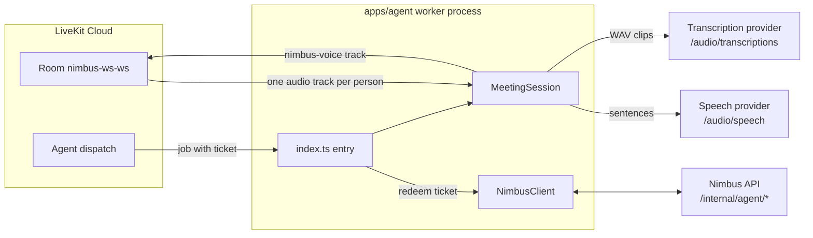
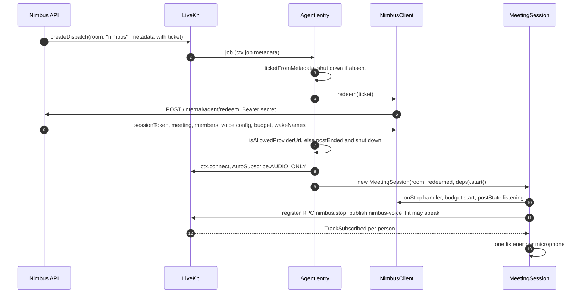
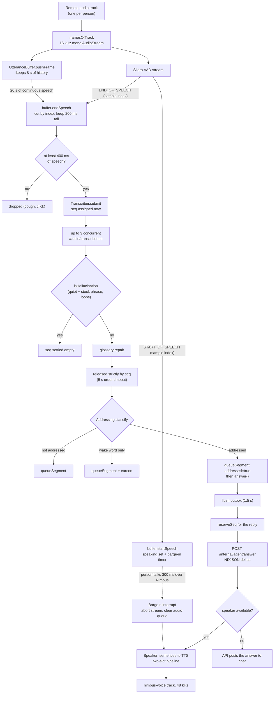
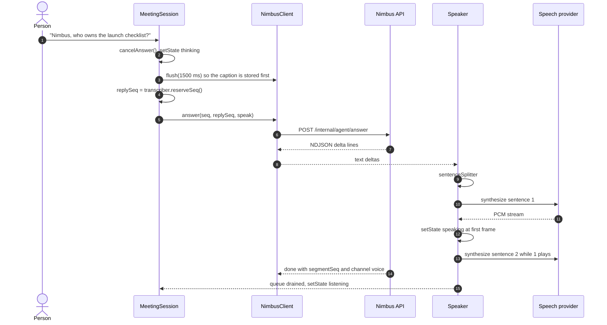
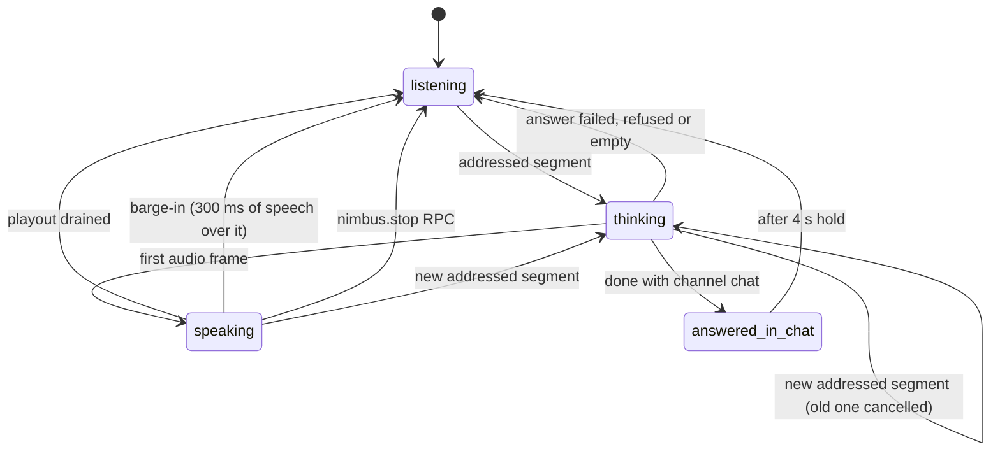
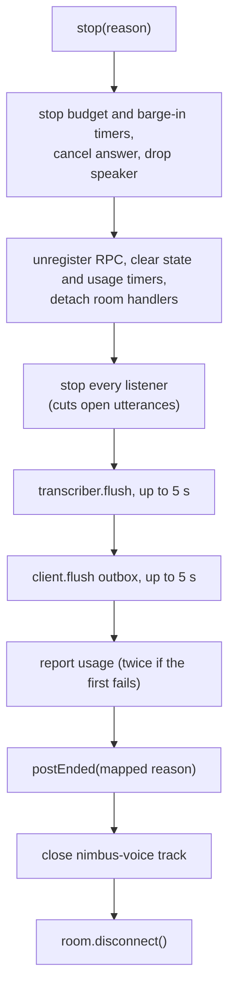

# The voice agent

`apps/agent` is a separate Node.js worker, built on the LiveKit Agents framework, that joins a workspace's call when someone starts Nimbus. It listens to every person's microphone separately, cuts their speech into utterances with a voice activity detector, transcribes them, posts the captions to the Nimbus API, notices when someone says "Nimbus" to it, and speaks the API's streamed answer back into the call, stopping the moment someone talks over it. It holds no database connection and no long-lived keys: everything it needs for one meeting arrives from the API in exchange for a single-use ticket.

## Why a separate process

Real-time audio is a poor fit for the API process. Each listening session runs a neural voice activity model (Silero, about 300 MB per process), decodes several audio streams at once and holds WebRTC connections open for the length of a call. Putting that in the Express server would tie API latency and memory to how many calls are running. Instead the agent is its own workspace, deployed to LiveKit Cloud, which starts worker processes near the media server and hands each one a job when a room needs it.

The agent and the API share only the type contract in `@nimbus/types` ([`api/agent.ts`](../../packages/types/src/api/agent.ts)) and talk over a private HTTP API (`/internal/agent/*`). The agent never reads the database, never sees a session cookie, and never decides policy: whether the assistant may run, which key pays, what it says and what it may change all live in the API.



## Layout

```text
apps/agent/
  src/
    index.ts                 worker definition: prewarm, entry, agentName
    config.ts                validated environment
    addressing.ts            wake-name rules and the wake window
    bargeIn.ts               interrupting the assistant by talking over it
    budget.ts                free-time and empty-room timers
    vadOptions.ts            Silero settings
    sharedConstants.ts       runtime values taken from @nimbus/types
    api/nimbusClient.ts      client for /internal/agent/*
    audio/trackFrames.ts     LiveKit track to 16 kHz mono frames
    audio/participantListener.ts   frames + VAD to utterances, per person
    audio/utteranceBuffer.ts sample-index cutting of utterances
    audio/energy.ts          RMS loudness
    audio/wav.ts             PCM to WAV
    stt/transcriber.ts       ordered, concurrent transcription
    stt/openaiCompatibleStt.ts   one /audio/transcriptions request
    stt/hallucinationFilter.ts   drops text invented for silence
    stt/glossary.ts          spelling repair for product and member names
    tts/openaiCompatibleTts.ts   one /audio/speech request, streamed PCM
    tts/sentenceSplitter.ts  text deltas to sentences
    output/speaker.ts        sentences to audio frames, interruptible
    output/roomOutput.ts     the published nimbus-voice track
    session/meetingSession.ts    one session: wiring and lifetime
    session/clock.ts         meeting time on a monotonic clock
  scripts/dispatch.ts        dispatch the agent by hand, as the API does
  Dockerfile, livekit.toml, tsup.config.ts, vitest.config.mts
```

## The worker process

[`index.ts`](../../apps/agent/src/index.ts) defines the agent with `defineAgent` and starts it with `cli.runApp(new ServerOptions(...))`:

| Setting | Value | Why |
|---|---|---|
| `agentName` | `"nimbus"` (`AGENT_NAME`, matching the API's [`rooms.ts`](../../apps/api/src/lib/livekit/rooms.ts)) | Switches the worker to **explicit dispatch**: it never joins a room on its own |
| `prewarm` | loads Silero with `VAD_OPTIONS` once per process | Loading per job would add its start-up time to every meeting |
| `numIdleProcesses` | `1` | Each idle process holds its own ~300 MB model; the default of four does not fit the hosted plan |
| `loadFunc` / `loadThreshold` | `0` / `Infinity`, only when `AGENT_IGNORE_LOAD=true` | LiveKit offers jobs only to workers under its load target; a busy CI runner would otherwise be turned away |

`loadConfig()` runs at import time, so a missing variable stops the process at start-up, naming it, rather than at the first dispatch.

### Configuration

[`config.ts`](../../apps/agent/src/config.ts) validates the environment with zod:

| Variable | Rule | Purpose |
|---|---|---|
| `NIMBUS_API_URL` | URL, trailing slashes removed; must be `https://` unless `NODE_ENV=development` | Where `/internal/agent/*` lives |
| `NIMBUS_AGENT_SECRET` | at least 32 characters | Bearer secret shared with the API (`requireAgentSecret`) |
| `NODE_ENV` | `development`, `test` or `production`, default `production` | Relaxes the HTTPS rules in development |
| `AGENT_IGNORE_LOAD` | `true` or `false`, default `false` | Local and CI runs only |
| `LIVEKIT_URL`, `LIVEKIT_API_KEY`, `LIVEKIT_API_SECRET` | read by the framework, not by `config.ts` | Registering with LiveKit |

There are deliberately **no provider settings**. The transcription and speech base URL, key and models arrive per session in the redeem response. `isAllowedProviderUrl` refuses a non-HTTPS provider address outside development (and plain `http://` in production), because the key travels in the `Authorization` header of every request.

## From dispatch to first caption



The ticket is redeemed **before** joining the room, so a dispatch with a bad, expired or reused ticket never reaches a call. Redemption failures are a bare 401 with no reason (see [`agentAuth.middleware.ts`](../../apps/api/src/middleware/agentAuth.middleware.ts) and [transcripts and notes](transcripts-and-notes.md) for the ticket rules). The redeem response (`RedeemResponse`) carries:

| Field | Used for |
|---|---|
| `sessionToken` | Sent as `X-Meeting-Session` on every later request |
| `meetingId`, `workspaceId`, `roomName` | Diagnostics |
| `startedAt` | The meeting clock: caption times are relative to it |
| `members` | `userId` to display name, for captions, the transcription prompt and the glossary |
| `voice` | `baseUrl`, `apiKey`, `transcribeModel`, optional `speechModel`, `voice`, `language` |
| `budgetSeconds` | Free-tier seconds left, or `null` for a workspace key |
| `assistantSpeaks` | Whether a speech model is available and allowed |
| `wakeNames` | `["nimbus", "nimbus bot", "nimbusbot"]` (`AGENT_WAKE_NAMES`) |

The plaintext key lives only in the session's memory for the length of the meeting and is never logged.

## The audio pipeline

Every human participant gets their own listener, so two people talking at once are segmented independently and each caption keeps the identity of whoever spoke it. Speaker identity always comes from the LiveKit participant identity, which the API set to the user id when it minted the token; the agent never infers who is speaking from the audio.



### Inside a session: who is listened to

`MeetingSession` subscribes to four room events and keeps one `ParticipantListener` per identity in its `listeners` map:

| Room event | What the session does |
|---|---|
| `TrackSubscribed` | `attach(participant, track)`: ignored once stopping, for non-audio tracks and for non-humans. An existing listener for the same identity is stopped first, so a person who republishes their microphone (a device switch) gets a fresh listener rather than two |
| `TrackUnsubscribed` | `detach(identity)`: the listener is stopped, which **flushes the open utterance** to the transcriber, and the person leaves the speaking set |
| `ParticipantConnected` | recount humans for the empty-room timer |
| `ParticipantDisconnected` | `detach` and recount |

At `start()` the session also walks `room.remoteParticipants` and attaches every audio track already published, because people who were in the call before the agent arrived produce no `TrackSubscribed` for it.

- **Who counts as a person.** `isHuman` excludes participants whose LiveKit `kind` is `AGENT` and the agent's own identity. A second agent in the room (another worker by mistake, or a recording bot that registers as an agent) is neither captioned nor counted toward "the room is not empty".
- **Which name a caption carries.** `members.get(identity)` (the workspace members the redeem response listed), then the participant's LiveKit `name`, then the raw identity. The member list is a snapshot taken at redemption, so someone who joins the workspace after the call started is captioned under their room name, which the API also set from their user name when it minted the token.
- **Muting is not leaving.** A muted microphone stays subscribed and simply delivers no frames. The listener survives, the utterance buffer's times stay correct because they come from the meeting clock rather than from sample counts, and nothing needs to happen on unmute.

The **speaking set** is a `Set` of identities between each person's VAD start and end. It feeds both the "Name is speaking..." line in the browser (via `postState`, at most every 500 ms and only when the sorted list changed) and the barge-in policy.

### Frames

[`trackFrames.ts`](../../apps/agent/src/audio/trackFrames.ts) asks LiveKit's `AudioStream` for 16 kHz mono frames directly, so no resampling happens in the agent. It is the only module that touches the native audio stream; everything above it is tested with synthetic frames.

### Voice activity detection

[`vadOptions.ts`](../../apps/agent/src/vadOptions.ts):

| Option | Value | Meaning |
|---|---|---|
| `minSpeechDuration` | 250 ms | Speech must last this long before START fires |
| `minSilenceDuration` | 600 ms | Silence needed before END fires |
| `prefixPaddingDuration` | 300 ms | Audio kept before speech |
| `activationThreshold` | 0.5 | Speech probability threshold |
| `sampleRate` | 16 000 | |

The plugin takes milliseconds. A seconds-style value (`0.6`) is accepted silently and means "no minimum", which splits every sentence at each breath; the utterance buffer's defaults mirror these values and must change with them.

### Cutting utterances by sample index

The detector runs behind the audio, by milliseconds when idle and more under load. [`utteranceBuffer.ts`](../../apps/agent/src/audio/utteranceBuffer.ts) therefore records every frame itself, and the detector's events carry the **sample index** at which they fired. The buffer cuts by that index, so the cut is exact however far behind the detector is:

- On START it reaches back `minSpeechMs + prefixMs` (550 ms) into history, so the first word is not clipped.
- On END it trims the silence that triggered the event back to a 200 ms tail.
- `MAX_UTTERANCE_MS = 20_000` force-cuts a monologue and keeps listening, so long speeches still caption as they go.
- `MIN_UTTERANCE_MS = 400` drops anything with less real speech (lead-in and tail excluded).
- History is kept for 8 s (`retainMs`) while nobody is speaking.
- Times come from the meeting clock reading delivered with each frame, not from sample counts, because a muted microphone delivers no frames and counting samples would fall behind.

[`participantListener.ts`](../../apps/agent/src/audio/participantListener.ts) pushes each frame to the buffer before the detector sees it, and on `stop()` flushes any open utterance first, so a person who leaves mid-sentence still gets their caption.

### Transcription

[`transcriber.ts`](../../apps/agent/src/stt/transcriber.ts) turns utterances into ordered `SegmentIn` values:

| Rule | Constant | Detail |
|---|---|---|
| Numbering | `seq` from 1 | Assigned at `submit`, which is when the speaker stopped, so captions follow the order people *finished* speaking |
| Concurrency | `TRANSCRIBE_CONCURRENCY = 3` | Requests finish in any order |
| Ordering | `ORDER_TIMEOUT_MS = 5000` | Results are released strictly by number; an earlier one that has not resolved in 5 s is skipped |
| Retry | once, after `RETRY_DELAY_MS = 500` | Only for `server`, `timeout` and `network` failures |
| Fatal | an `auth` failure (401/403) | Stops transcription and calls `onFatal("invalid-key")`, which stops the session |
| Usage | every request | Reported through `onUsage`, including failures and filtered results, because the provider billed for them |

The request itself is [`openaiCompatibleStt.ts`](../../apps/agent/src/stt/openaiCompatibleStt.ts): a multipart POST of a WAV file to `<baseUrl>/audio/transcriptions`, `STT_TIMEOUT_MS = 15_000`, with a vocabulary `prompt` of "Nimbus, NimbusBot, Excalidraw, LiveKit" plus the members' names. Errors are classified into `SttError` kinds with fixed messages, so a provider's error body (which can echo request details) never reaches a log. Billed seconds come from the provider when it reports them, otherwise from the clip length.

Two clean-up passes run on the text:

- [`hallucinationFilter.ts`](../../apps/agent/src/stt/hallucinationFilter.ts) drops text that models invent for near-silence. A stock phrase ("thank you for watching", "you", "hey", "bye", anything starting "subtitles by") is dropped only when the clip was also quiet (`QUIET_RMS = 0.02`), so a person really saying "thank you" is kept. A single token repeated four times is judged a loop.
- [`glossary.ts`](../../apps/agent/src/stt/glossary.ts) repairs spelling. Product terms (`NimbusBot`, `Nimbus`, `Excalidraw`, `LiveKit`) are matched ignoring case and spacing and then by small edit distance on words of five or more letters; member names are corrected for case only, because fuzzy-matching names would turn ordinary words into people.

## Addressing: when is someone talking to Nimbus?

[`addressing.ts`](../../apps/agent/src/addressing.ts) decides from the final transcript alone. Before matching, the text is lower-cased, apostrophes removed, the wake names and known mishearings (`mimbus`, `nimbas`, `nimbis`, `nimbos`, `limbus`) folded to one word `nimbus`, and all punctuation except commas and question marks removed. Matching is on whole words, so "nimbuses" or "limbo" never wake it.

| Utterance | Result | Rule |
|---|---|---|
| "Nimbus, what did we decide?" | addressed | name first, pause after it |
| "Nimbus what's on the agenda" | addressed | name first, next word not a mention verb |
| "Nimbus is the product name" | none | name first, then a third-person verb (`is`, `has`, `uses`, …): a mention |
| "Nimbus can you list the items" | addressed | modal followed by "you" |
| "Nimbus can be slow" | none | modal not followed by "you" |
| "okay so Nimbus, summarise that" | addressed | "nimbus," within the first six words |
| "what do you think, Nimbus?" | addressed | ends with "nimbus?" |
| "Hey Nimbus" or "Nimbus?" | wake-only | the name alone, after optional fillers (`hey`, `ok`, `so`, `um`, …) |

A **wake-only** utterance opens a `WAKE_WINDOW_MS = 6000` window for that speaker: their next utterance inside it is treated as the question, and the speaker plays a short earcon (an 880 Hz tone, `EARCON_MS = 150`) so they know it heard. The window is per identity and is consumed by the next utterance either way.

Every addressed segment is posted with `addressed: true`, which the API stores on `TranscriptSegment.addressed`.

## Answering

`MeetingSession.answer` in [`meetingSession.ts`](../../apps/agent/src/session/meetingSession.ts) handles one addressed segment. Only one answer runs at a time: a new addressed segment cancels the one in progress, whether it is still thinking or already speaking, and an interrupted answer is never resumed.



- **Caption before question.** `flush(ANSWER_FLUSH_MS = 1500)` pushes the addressed caption to the API before asking, because the API reads the question from the stored segment (it also waits up to 1.5 s for it on its side).
- **A reserved sequence number.** `reserveSeq()` takes the next number without an utterance and releases it at once, so it never holds back later captions. The API stores the spoken reply under it as a caption from "Nimbus" (`fromAssistant: true`), so the transcript and notes include what the assistant said.
- **Speak or chat.** `speak` is true only when a speaker exists. When it is false the API posts the reply to workspace chat and the stream ends with `channel: "chat"`; the session then shows `answered-in-chat` for `CHAT_STATE_HOLD_MS = 4000` before reading as listening again.
- **Never throws.** A refused, failed or timed-out answer returns the assistant to listening. The answer stream itself is described in [the assistant page](assistant-and-tools.md).

### Speaking

[`speaker.ts`](../../apps/agent/src/output/speaker.ts) turns streamed text into audio:

- [`sentenceSplitter.ts`](../../apps/agent/src/tts/sentenceSplitter.ts) cuts deltas at `.`, `?` or `!` followed by whitespace, keeps closing quotes and brackets, ignores decimals ("3.5") and known abbreviations ("e.g.", "Dr."), cuts run-ons at `MAX_SENTENCE_CHARS = 160`, and never releases a sentence whose terminator is the last character seen yet (the next delta decides).
- A **two-slot pipeline**: while sentence N plays, sentence N+1 is already being synthesized, which keeps playback gap-free because synthesis runs faster than real time.
- Each sentence's leading silence (below magnitude 400) is trimmed, up to 3 s, because some models open every clip with silence.
- Samples are cut into `FRAME_MS = 20` frames and queued on the output.
- A sentence whose synthesis fails is skipped, not retried; `speak()` never throws.
- An `auth` failure from speech synthesis sets the session's speaker to `null`: every later sentence would be refused the same way, so later answers go to chat.

[`openaiCompatibleTts.ts`](../../apps/agent/src/tts/openaiCompatibleTts.ts) posts to `<baseUrl>/audio/speech` with `response_format: "pcm"`, reads the sample rate from the response content type (`audio/pcm;rate=44100;channels=1`, default `DEFAULT_PCM_RATE = 24_000`), streams the body when it can, and times out after `TTS_TIMEOUT_MS = 10_000`. Every request is reported for usage by characters sent.

[`roomOutput.ts`](../../apps/agent/src/output/roomOutput.ts) publishes one local audio track named `nimbus-voice` (`AGENT_VOICE_TRACK`) at `OUTPUT_SAMPLE_RATE = 48_000`, with a native resampler per input rate and a 1 s source queue. It is published once at session start, and only when `assistantSpeaks` is true and a speech model was provided.

### The assistant's state, precisely

`assistantState` is one of `listening`, `thinking`, `speaking`, and the API relays every change to the call as `meeting:assistant-state`. Who moves it:

| Transition | Set by |
|---|---|
| to `thinking` | `answer()`, before it flushes the caption |
| to `speaking` | the speaker, at the first frame it queues (not when synthesis starts, so a slow first sentence reads as thinking) |
| to `listening` | the speaker once the queue drains or it is interrupted; `answer()`'s `finally` if the answer produced no audio; `interrupt()` |
| `answered-in-chat`, then `listening` | the API, which announces `answered-in-chat` itself when it posts the reply to chat; the agent sees `channel: "chat"` on the `done` line, posts nothing for `CHAT_STATE_HOLD_MS` (`holdChatState()`), then posts `listening` |

Two details keep this honest:

- `answer()` resets the state in its `finally` **only if it is still the current answer** (`this.answering === controller`). An answer cancelled by a newer question therefore never flips the newer one back to listening.
- During the four-second chat hold, speaking-set updates are **held back**: every state post carries a state, so a speaking-set post would end the "answered in chat" moment early. The post that ends the hold carries the current speaking set instead.

### Barge-in and Stop talking



[`bargeIn.ts`](../../apps/agent/src/bargeIn.ts): while the speaker is playing, a person whose voice activity lasts `BARGE_IN_MS = 300` interrupts it. Shorter sounds (a cough, a "mm-hm") do not. Interrupting aborts the answer stream and the speech requests and clears the output queue, so queued audio stops within a frame. The agent never subscribes to its own track and browsers keep echo cancellation on, so the assistant's own voice does not trigger this.

The browser's **Stop talking** button reaches the same `interrupt()` through the LiveKit RPC method `nimbus.stop` (`AGENT_RPC_STOP`), registered on the agent's local participant at start and unregistered on stop.

### Edge cases of barge-in

The policy is deliberately small, and three of its consequences are worth knowing:

- **It arms only while audio is playing.** `speechStarted` checks `isSpeaking()` (the speaker's `playing` flag, set at the first queued frame). Someone who talks while the assistant is still **thinking** does not cancel the answer; only a new *addressed* utterance does.
- **It arms on a speech start.** A person who began talking before playback started and keeps talking through it never produces a new `START_OF_SPEECH`, so they do not interrupt until they pause (600 ms of silence) and start again.
- **It is per person.** Each identity has its own timer, so two people each saying a short "mm-hm" do not add up to an interruption.

Whatever the interrupting person said is transcribed like any other utterance; if it is itself addressed to Nimbus, it becomes the next question.

## Sequence numbers, gaps and one session per meeting

Every caption a meeting stores has a `seq`, and the numbering has properties the rest of the system relies on:

- **Numbers are per agent session, starting at 1.** The API stores segments with `createManyAndReturn(..., skipDuplicates: true)` on `(meetingId, seq)`, which is what makes the client's retries safe.
- **Gaps are normal.** A reserved reply number the API did not use (an answer that failed before the API stored its reply), an utterance the hallucination filter dropped, and an utterance skipped by the order timeout all leave a hole. Nothing downstream assumes the numbers are contiguous; `Meeting.lastSeq` only moves forward (`GREATEST`).
- **A skipped result is discarded even if it arrives later.** `settle` ignores a number below `nextToEmit`, so a transcription that took longer than the order timeout is billed (its usage was recorded) but never captioned.
- **The 5 s order timeout starts when a later result is waiting,** not when the earlier request was sent, and restarts at every release. A slow request delays captions behind it by at most five seconds per stuck head.

Because numbering restarts with every session, a meeting has **exactly one agent session**. That is enforced by the ticket rather than by the agent: a ticket is `SET ... EX 60 NX` and redeemed with `GETDEL` ([`tickets.ts`](../../apps/api/src/lib/meeting/tickets.ts)), so if LiveKit re-dispatches a job after a worker crash, the second worker's redemption fails and it shuts down before joining. The crashed agent's participant leaves the room, the `participant_left` webhook ends the meeting with reason `agent-left`, and starting the assistant again creates a new meeting with its own numbering. A dispatch that never redeems at all is ended after `DISPATCH_TIMEOUT_MS` (90 s) as `dispatch-failed` and is never charged.

## Budgets and leaving by itself

[`budget.ts`](../../apps/agent/src/budget.ts) holds the timers that end a session without being told:

| Timer | Constant | Fires |
|---|---|---|
| Budget warning | `BUDGET_WARNING_MS = 30_000` before the end | Notice `budget-warning`: "About thirty seconds of free assistant time left." |
| Budget | `budgetSeconds * 1000 - clock.elapsedMs()` | Notice `budget-ended`, then `stop("budget")` |
| Empty room | `EMPTY_ROOM_MS = 60_000` with no humans | `stop("empty-room")` |

The budget is measured from when the **meeting** started, not when the agent joined, because the API charges from the meeting's own timestamps and the agent takes a few seconds to arrive. These timers are advisory backstops: the API also arms its own budget backstop and tells the agent to stop (see [transcripts and notes](transcripts-and-notes.md)).

Notices are spoken when the assistant has a voice and is not mid-answer (the final notice interrupts one), with an 8 s cap (`NOTICE_TIMEOUT_MS`); otherwise they are posted to chat through `POST /internal/agent/notice`, where the API picks the text from `AGENT_NOTICE_TEXT` (the agent never supplies chat wording).

## Talking to the API

[`nimbusClient.ts`](../../apps/agent/src/api/nimbusClient.ts) is the only network path to Nimbus. Every request sends `Authorization: Bearer <NIMBUS_AGENT_SECRET>`; after redemption it also sends `X-Meeting-Session`. Neither ever appears in a log line or error message.

| Method | Route | Purpose | Response |
|---|---|---|---|
| `redeem(ticket)` | `POST /internal/agent/redeem` | Ticket for session | `RedeemResponse`, or `RedeemError` |
| `queueSegment` / `flush` | `POST /internal/agent/segments` | Captions, batched | `{ accepted, stop }` |
| `postState` | `POST /internal/agent/state` | `listening`, `thinking`, `speaking` and who is speaking | `{ stop }` |
| `postUsage` | `POST /internal/agent/usage` | Provider requests for the call log | `{ stop }` |
| `answer` | `POST /internal/agent/answer` | Streamed reply, `application/x-ndjson` | delta lines, then one `done` or `error` |
| `postNotice` | `POST /internal/agent/notice` | Budget notice to chat | `{ stop }` |
| `postEnded` | `POST /internal/agent/ended` | Goodbye with a reason | |

| Constant | Value | Meaning |
|---|---|---|
| `BATCH_SIZE` | 10 | Segments per post |
| `BATCH_WINDOW_MS` | 300 | A partial batch waits this long |
| `OUTBOX_LIMIT` | 500 | Past it the oldest are dropped with a warning (live captions are unaffected, only their storage) |
| `MAX_ATTEMPTS` | 6 | Per post, then parked until the next trigger |
| `BACKOFF_START_MS` / `BACKOFF_MAX_MS` | 250 / 8000 | Exponential backoff |
| `REQUEST_TIMEOUT_MS` | 10 000 | Per request |
| `ANSWER_TIMEOUT_MS` | 30 000 | Longest an answer stream may stay open |

Retrying is safe because the API stores segments idempotently on `(meetingId, seq)`.

**The stop flag.** Any response can carry `stop: true`: someone pressed Stop, the meeting ended elsewhere, or the spend cap was reached. The client surfaces it through `onStop` exactly once, and the session calls `stop("server")`. A 401 on a session call is treated the same way, because the session no longer exists. After a stop, only `flush` still posts segments (the API accepts them for `INGEST_GRACE_MS = 120_000` after a meeting ends); after a 401 the outbox is abandoned.

**State and usage.** The speaking set is posted at most every `STATE_INTERVAL_MS = 500` and only when it changed; the API relays it as `meeting:speaking`, which drives the "Name is speaking..." line under the captions. Usage is reported every `USAGE_INTERVAL_MS = 10_000` in chunks of `USAGE_BATCH_MAX` (100); a chunk the API did not store goes back to the front of the queue so a backlog drains instead of being refused whole.

### The answer stream on the wire

`NimbusClient.answer` is an async generator over the NDJSON body. The contract on each side:

| Situation | What the generator yields |
|---|---|
| Each complete line | the parsed `AnswerLine` (`delta`, `done` or `error`); a line split across network chunks is reassembled, blank lines are skipped |
| A line that is not JSON | skipped, not fatal |
| The request cannot be sent | one `{ type: "error", reason: "failed" }`, unless the caller had aborted |
| A non-2xx status | one `failed` line; a 401 additionally marks the session unauthorized and fires `onStop` |
| The body ends without a `done` or `error` line | one synthesized `failed` line, so a dropped connection never looks like a finished answer |
| The caller aborts (a barge-in, a new question, Stop) | nothing more; the generator ends silently |

`ANSWER_TIMEOUT_MS` (30 s) is combined with the caller's signal on the `fetch` itself, so it covers the **whole response**, including the part read while the assistant is already speaking. The speaker pulls only one sentence ahead of playback, which paces how fast the body is read; an answer whose last sentence is pulled more than 30 s after the request was sent is cut there. The assistant's prompt asks for short spoken answers, so this is a backstop for a hung stream rather than a limit people meet.

When speaking, `answer()` adapts the line stream into a text stream for the speaker (deltas pass through, `done` records the channel); when not speaking it drains the lines only to learn the channel. Either way the reply's text reaches the transcript through the API, which stores it under `replySeq`, not through the agent.

## Shutting down

`stop(reason)` is idempotent and always runs the same order, with each wait capped at `FLUSH_TIMEOUT_MS = 5000`, so a stuck provider or unreachable API delays leaving but cannot prevent it:



| Session reason | Sent to `/ended` | Meeting end reason on the API |
|---|---|---|
| `server` | `stopped` | `stopped` |
| `budget` | `budget` | `budget` |
| `empty-room` | `agent-ended` | `agent-ended` |
| `invalid-key` | `invalid-key` | `invalid-key` |
| `shutdown` (process or job shutdown) | `agent-ended` | `agent-ended` |

Disconnecting goes through `ctx.room.disconnect()` rather than `ctx.shutdown`, because shutdown would re-enter the shutdown callback that itself calls `session.stop`.

## Where the time goes

From the moment a person stops speaking to the moment Nimbus's voice starts, the fixed parts of the path are set by constants on this page, and the variable parts by the providers:


- **The only fixed delay is the 600 ms end-of-speech silence.** Everything else is a round trip or a provider call, and each has a cap so a slow provider degrades into a skipped caption or a cancelled answer rather than a stall.
- **Each tool round adds a full model call before anything is said.** The API sends no text from a round that offered tools until that round has finished, so a lookup question costs at least two complete model calls before the first delta ([the round loop](assistant-and-tools.md#the-round-loop-step-by-step)).
- **After that, the first sentence is what matters.** Splitting at sentence ends and synthesizing sentence N+1 while N plays means total answer length barely affects time to first sound once the text has arrived; a long first sentence does (run-ons are cut at 160 characters for this reason).
- **Captions and answers share the transcription step.** An addressed question waits for its own transcription like any caption; there is no separate fast path for the wake word.

## Failure modes

| What fails | What the agent does | What people see |
|---|---|---|
| Dispatch metadata has no ticket | `ctx.shutdown("no ticket")` before joining | The meeting is ended as `dispatch-failed` after 90 s |
| Ticket expired, reused or refused | `ctx.shutdown("ticket not accepted")` | Same; the API's refusal path may end it sooner |
| Provider address is not HTTPS | `postEnded("agent-ended")`, shut down | The meeting ends at once |
| Transcription key rejected (401/403) | `stop("invalid-key")` after the first refusal | The meeting ends with reason `invalid-key` |
| Transcription provider slow or erroring | one retry for retryable kinds, then the caption is skipped | A missing caption; the call carries on |
| Speech key rejected | speaker set to `null` | This and later answers arrive in chat |
| Voice track cannot be published | logged; no speaker | Answers arrive in chat from the start |
| One sentence fails to synthesize | skipped | A sentence missing from the spoken answer (the full text is still in the transcript) |
| API unreachable | segments held in the outbox (up to 500) with backoff; answers fail to listening; budget and empty-room timers still run | Captions stop appearing, since they reach browsers through the API; the held ones are stored and shown when it returns |
| API says `stop` or answers 401 | `stop("server")` | The meeting ends as the API decided |
| Agent process crashes | nothing (it is gone) | `participant_left` for the agent ends the meeting as `agent-left` |
| LiveKit disconnects the agent | the job's shutdown callback runs `stop("shutdown")` | The meeting ends as `agent-ended`, or as `agent-left` if the webhook arrives first |

The agent logs through LiveKit's logger, and only non-secret fields: the room or meeting id, a member count, a stop reason, and the fixed warnings ("ticket was not accepted", "speech key refused; answering in chat", "Dropped N unsent transcript segment(s)"). Transcript text, keys and the session token are never logged, so the LiveKit Cloud log stream is safe to share when debugging.

## Meeting time

[`clock.ts`](../../apps/agent/src/session/clock.ts) reads the wall clock once to learn how long the meeting has been running, then advances on `performance.now()`. A wall-clock step in the middle of a call (NTP, a VM resume) therefore cannot reorder captions or make an utterance end before it began.

## Shared constants

[`sharedConstants.ts`](../../apps/agent/src/sharedConstants.ts) re-exports the runtime values the worker takes from `@nimbus/types` (`AGENT_RPC_STOP`, `AGENT_VOICE_TRACK`, `AGENT_NOTICE_TEXT`, `USAGE_BATCH_MAX`). Import them from here, never from `@nimbus/types` directly: run from source with `tsx`, the worker is an ES module importing a CommonJS-shaped package, whose values are then only on `default`, and a named import fails at start-up even though type checks pass.

## Build, run and deploy

| Task | Command or file | Notes |
|---|---|---|
| Develop | `npm run dev -w agent` (`tsx watch src/index.ts dev`) | Needs the `LIVEKIT_*` variables and the API's agent secret |
| Build | `npm run build -w agent` ([`tsup.config.ts`](../../apps/agent/tsup.config.ts)) | Bundles the workspace packages into `dist/index.cjs` |
| Image | [`Dockerfile`](../../apps/agent/Dockerfile) | `node:22-bookworm-slim`, installs only the LiveKit packages (native WebRTC and onnxruntime bindings), skips the CUDA provider, adds CA certificates for the native WebRTC layer, runs as a non-root user |
| Project | [`livekit.toml`](../../apps/agent/livekit.toml) | The LiveKit Cloud project and agent ids |
| Deploy | [`deploy-agent.yml`](../../.github/workflows/deploy-agent.yml) | After green CI on `main`, when anything the bundle is built from changed: build, then `lk agent deploy` |
| Manual dispatch | [`scripts/dispatch.ts`](../../apps/agent/scripts/dispatch.ts) | `tsx scripts/dispatch.ts <room> [metadata-json]` |

Runtime secrets on LiveKit Cloud are set once with `lk agent update-secrets` and survive deploys. The agent's tests live in [`src/__tests__`](../../apps/agent/src/__tests__) and include real WAV fixtures for the VAD; see [the testing overview](../testing/overview.md).

## Tests

The agent's suite runs without LiveKit, a provider or the API: `RoomLike`, `SessionDeps` and the injectable `stt`, `tts` and `fetchImpl` exist so every module can be driven with synthetic frames and fake responses.

| Suite | What it pins |
|---|---|
| [meetingSession.test.ts](../../apps/agent/src/__tests__/meetingSession.test.ts) | Captioning people already present and arriving later, member versus room names, skipping agents and itself, cutting a sentence on unsubscribe, budget and empty-room stops (including time spent arriving), stop on the API's flag and on a rejected key, idempotent stop, usage reporting and chunked backlogs |
| [meetingSessionVoice.test.ts](../../apps/agent/src/__tests__/meetingSessionVoice.test.ts) | Answering aloud, mentions not answered, chat answers when it may not speak, the Stop RPC as the only RPC, barge-in, the wake-word chime and follow-up, spoken and chat budget notices, falling back to chat on a refused speech key or an unpublishable track, a late track closed after stop, a failed answer ending quietly |
| [nimbusClient.test.ts](../../apps/agent/src/__tests__/nimbusClient.test.ts) | Redemption and its silent failure, batching by size and window, backoff and parking, outbox bounds, refused batches dropped, one stop signal however many replies carry it |
| [nimbusClientAnswer.test.ts](../../apps/agent/src/__tests__/nimbusClientAnswer.test.ts) | NDJSON across chunk boundaries, error lines, a stream with no closing line, 401 as stop, lost connections, silent cancellation |
| [speaker.test.ts](../../apps/agent/src/__tests__/speaker.test.ts) | 20 ms frames, silence trimming, the two-slot pipeline, interruption, skipped sentences, broken outputs, the chime |
| [transcriber.test.ts](../../apps/agent/src/__tests__/transcriber.test.ts) | Numbering, concurrency 3, ordered release, the 5 s skip, retries, fatal auth, hallucinations still billed, the glossary and prompt, reserved reply numbers |
| [utteranceBuffer.test.ts](../../apps/agent/src/__tests__/utteranceBuffer.test.ts) | Lead-in and tail, meeting-clock times across frame gaps, a detector far behind the audio, the 20 s force-cut and 0.4 s minimum |
| [participantListener.test.ts](../../apps/agent/src/__tests__/participantListener.test.ts) | Two overlapping speakers kept apart, a sentence cut by leaving, double stop |
| [vad.fixture.test.ts](../../apps/agent/src/__tests__/vad.fixture.test.ts) | The real Silero model on WAV fixtures: a sentence is one utterance, silence and keyboard noise are nothing |
| `addressing`, `bargeIn`, `budget`, `clock`, `config`, `glossary`, `hallucinationFilter`, `openaiCompatibleStt`, `openaiCompatibleTts`, `sentenceSplitter`, `wav` | One suite each for the pure modules |

## Design trade-offs and limits

- **Per-person listening costs CPU.** One VAD stream and one buffer per microphone is what gives exact speaker attribution without diarisation, but cost grows linearly with participants.
- **Batch transcription, not streaming.** Each utterance is transcribed after it ends, so a caption appears roughly one utterance late (end-of-speech silence of 600 ms plus the request). Streaming STT would be faster but is less portable across OpenAI-compatible providers.
- **Captions can be skipped.** An utterance whose transcription takes longer than 5 s behind a later one, or fails twice, is dropped to keep the rest flowing. Past 500 unsent segments, the oldest are not stored.
- **Wake detection is text-based.** It depends on the transcriber spelling "Nimbus" recognisably; the mishearing list and the glossary narrow the gap but cannot close it. There is no button to ask a question.
- **One answer at a time per meeting.** A second question cancels the first.
- **Talking during thinking does not interrupt.** Barge-in arms only once audio is playing, so the way to cancel a slow answer is to ask again or press Stop.
- **A 30 s ceiling on each answer stream,** measured from the request and covering the time spent speaking.
- **One agent session per meeting.** Sequence numbers restart with each session, so a crashed agent is not replaced mid-meeting; the meeting ends and the next start is a new meeting.
- **The agent trusts LiveKit identities.** Speaker identity is whatever the token said; the API re-checks that each `speakerUserId` is still a member before storing it.
- **Memory bound.** About 300 MB per idle process limits how many meetings one host can serve.
- **Budget timers are advisory.** If the agent cannot reach the API, its own timers still end the session; if the agent dies, the API's backstop and LiveKit's `participant_left` webhook end the meeting.

## Related documentation

- [Voice calls and LiveKit](voice-and-livekit.md)
- [Transcripts and notes](transcripts-and-notes.md)
- [The in-call assistant and its tools](assistant-and-tools.md)
- [Authentication](../architecture/auth.md)
- [Quotas and the free tier](../ai/quotas-and-free-tier.md)
- [Providers and BYOK](../ai/providers-and-byok.md)
- [Environment reference](../reference/environment.md)
- [Deployment](../operations/deployment.md)
- [Testing overview](../testing/overview.md)
