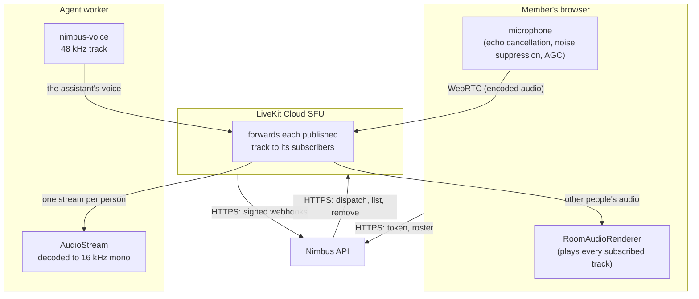
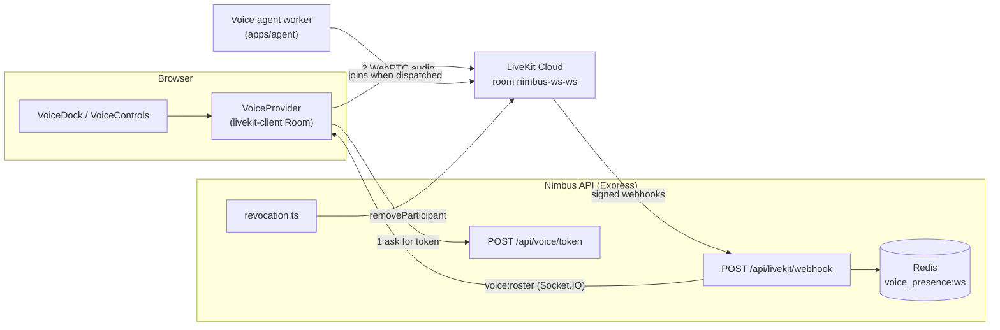
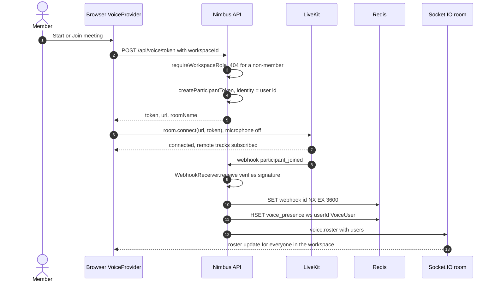
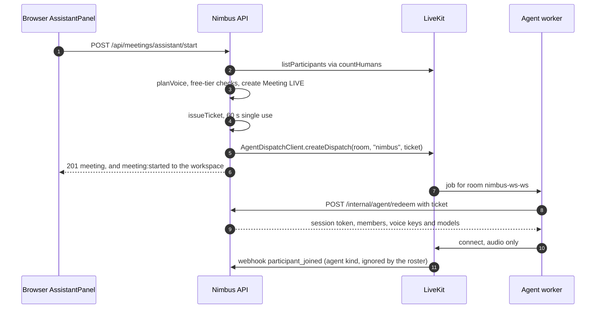
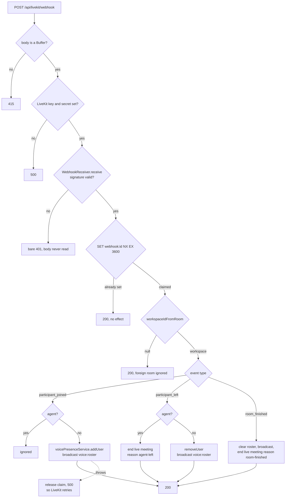
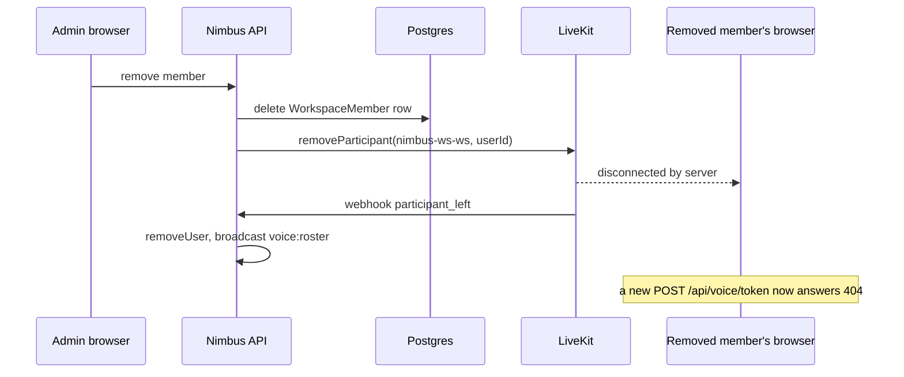
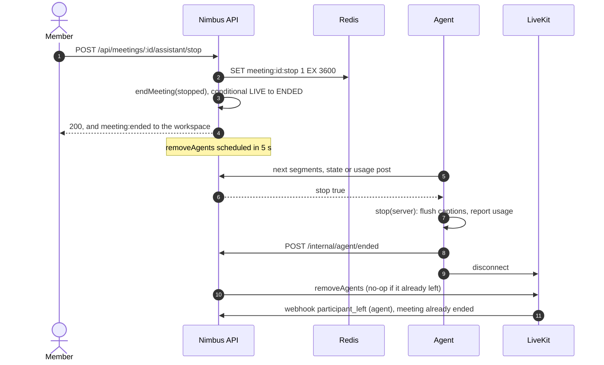
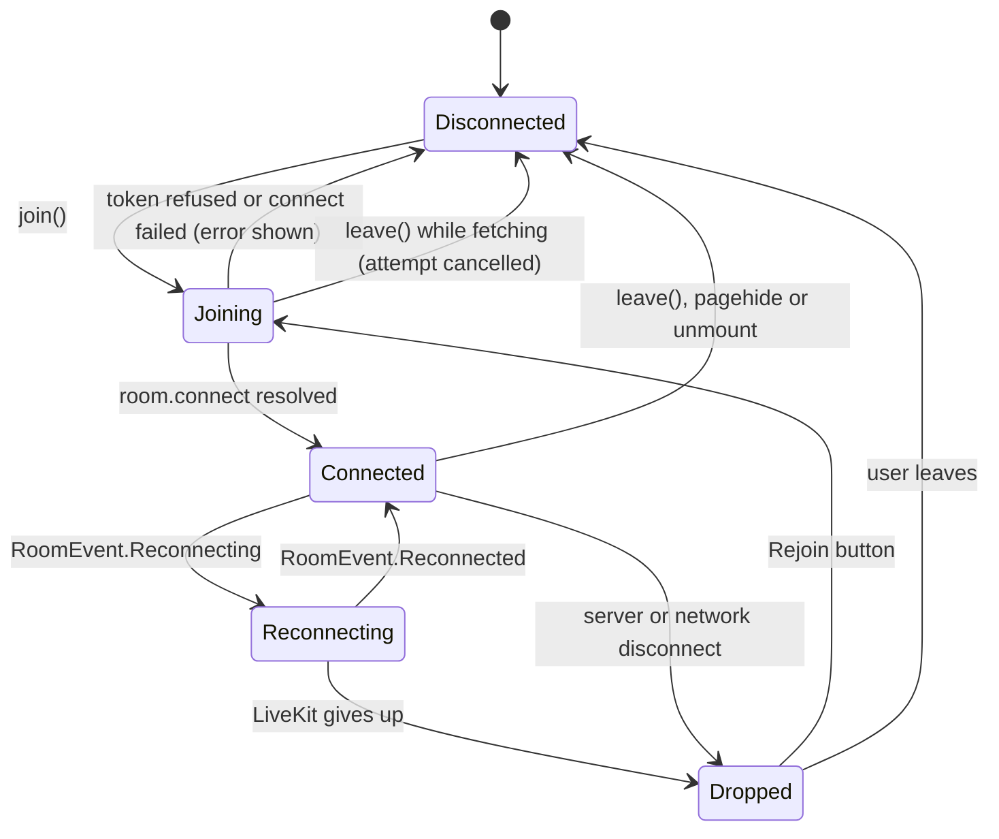

# Voice calls and LiveKit

Every Nimbus workspace has one voice call that its members can join from any page of the workspace. The audio itself runs through LiveKit, a hosted WebRTC media server (an SFU, or selective forwarding unit, which receives each person's microphone once and forwards it to everyone else), while the Nimbus API decides who may join, mints the access tokens, keeps the call roster from LiveKit's signed webhooks, and kicks people out the moment their membership ends. This page covers that plumbing end to end: room naming, tokens, webhooks, the Redis roster, revocation, what happened to the old TURN relay, and the browser-side `VoiceProvider` that owns the call.

## What a call is, and what it is not

A call is a LiveKit **room**. There is exactly one room per workspace, created by LiveKit the first time someone connects and closed by LiveKit when the last participant leaves. Nimbus never creates or deletes rooms itself; it only hands out tokens that name the room.

A call is **not** a meeting. A plain call creates no database row at all. A `Meeting` row exists only while (and after) someone has started the in-call assistant, Nimbus, which is a separate worker process that joins the room as an extra participant to transcribe, summarise and answer questions. That process is described in [the voice agent page](voice-agent.md), and the meeting record it produces in [transcripts and notes](transcripts-and-notes.md).

The split matters because voice is optional at three levels (see `lib/ai/voiceAvailability.ts`):

| Level | Needs | Without it |
|---|---|---|
| Plain call | LiveKit credentials on the API | No call at all |
| Captions, transcript, notes | A transcription model (a workspace key or the free voice tier) | The call works, the assistant cannot start |
| Spoken answers | A speech model as well | The assistant answers in chat instead of aloud |

## LiveKit in six concepts

The rest of this page assumes these terms. They are LiveKit's own, and Nimbus uses each in a specific, narrow way.

| Concept | What it is in LiveKit | How Nimbus uses it |
|---|---|---|
| **Room** | A named session on the media server. Created implicitly when the first participant connects with a token naming it, closed after the last one leaves (and its empty timeout passes), at which point LiveKit sends `room_finished` | One per workspace, `nimbus-ws-<workspaceId>`; never created or deleted by the API |
| **Participant** | A connection in a room, identified by a unique `identity` within that room, with a display `name`, free-form `metadata` and a `kind` (standard, agent, ingress, egress, SIP) | Humans have identity = user id; the agent is `kind: AGENT`. A second connection with the same identity replaces the first, so one user is one seat however many tabs they open |
| **Track** | A media stream a participant **publishes** (here only a microphone, or the agent's `nimbus-voice`). Other participants **subscribe** to it; the server forwards packets without decoding them | Browsers subscribe to everything (`RoomAudioRenderer`); the agent subscribes audio-only and publishes one track |
| **Access token** | A JWT signed with the project's API secret, carrying identity and *grants* (which room, publish/subscribe rights, allowed sources) | Minted by the API per join; the only way into a room |
| **Webhook** | A signed HTTP POST from LiveKit to a configured URL for room and participant events | The sole writer of the call roster and one of the ways a meeting ends |
| **Agent dispatch** | LiveKit Agents' job system: workers register under an `agentName`, and a *dispatch* for that name and room makes LiveKit hand a job (with metadata) to one idle worker process | Explicit dispatch only, carrying a single-use ticket as metadata |

Two more are used in one place each: **RPC** (a request/response call between participants over the data channel, used by **Stop talking**) and **active speakers** (LiveKit's server-computed list of who is currently loud, used for the green ring in the call card; the agent's own speaking set is separate, see [the voice agent](voice-agent.md)).

### What travels where

Media never touches the Nimbus API, and the API never touches media: it speaks to LiveKit only over LiveKit's REST APIs (dispatch, list participants, remove participant) and receives webhooks. The browser's audio processing (echo cancellation in particular) is what stops the assistant's voice, played by one person's speakers, from being re-captured by their microphone and transcribed or treated as a barge-in.

## The moving parts

| Piece | Where | Role |
|---|---|---|
| LiveKit server | LiveKit Cloud (project in [`livekit.toml`](../../apps/agent/livekit.toml)) | Carries the audio, runs ICE/TURN for NAT traversal, posts webhooks |
| Room naming | [`rooms.ts`](../../apps/api/src/lib/livekit/rooms.ts) | `nimbus-ws-<workspaceId>`, agent detection |
| Server clients | [`client.ts`](../../apps/api/src/lib/livekit/client.ts) | Lazily built `RoomServiceClient` and `AgentDispatchClient` |
| Join tokens | [`tokens.ts`](../../apps/api/src/lib/livekit/tokens.ts) | Narrow, 10-minute JWTs |
| Token and roster endpoints | [`voice.router.ts`](../../apps/api/src/routers/voice.router.ts), [`voice.controller.ts`](../../apps/api/src/controllers/voice.controller.ts) | `POST /api/voice/token`, `GET /api/voice/:workspaceId/roster` |
| Webhook receiver | [`livekitWebhook.router.ts`](../../apps/api/src/routers/livekitWebhook.router.ts) | Verifies signatures, maintains the roster, ends meetings |
| Roster store | [`voicePresence.ts`](../../apps/api/src/lib/voicePresence.ts) | Redis hash per workspace |
| Revocation | [`revocation.ts`](../../apps/api/src/lib/livekit/revocation.ts) | Removes ex-members from the room |
| Room queries for the assistant | [`agentRoom.ts`](../../apps/api/src/lib/livekit/agentRoom.ts) | Count humans, remove agents, list live rooms |
| Browser call owner | [`VoiceProvider.tsx`](../../apps/web/providers/VoiceProvider.tsx) | Wraps a `livekit-client` `Room` |
| Token fetch | [`voiceApi.ts`](../../apps/web/lib/voiceApi.ts) | `fetchVoiceToken` |
| Call UI | [`VoiceDock.tsx`](../../apps/web/components/VoiceDock.tsx), [`VoiceControls.tsx`](../../apps/web/components/VoiceControls.tsx), [`VoiceOverlay.tsx`](../../apps/web/components/VoiceOverlay.tsx) | Dock, call card, speaking badges |

## Joining a call, start to finish

The browser never talks to LiveKit without a token from the API, and the API never trusts the browser about who is on the call: the roster is written only from LiveKit's webhooks.

Starting the assistant is a separate, later step: once at least one person is on the call, any member can press **Start Nimbus**, which calls `POST /api/meetings/assistant/start`. That creates the meeting row and asks LiveKit to dispatch the agent into the same room:

The details of start-up checks, tickets and the meeting lifecycle are in [transcripts and notes](transcripts-and-notes.md); the worker side is in [the voice agent page](voice-agent.md).

## The room naming contract

[`rooms.ts`](../../apps/api/src/lib/livekit/rooms.ts) is small but load-bearing:

- `roomNameFor(workspaceId)` returns `nimbus-ws-<workspaceId>`. Every token, every dispatch, every `Meeting.roomName` uses it.
- `workspaceIdFromRoom(room)` reverses it, returning `null` for anything that is not exactly `nimbus-ws-` followed by `[A-Za-z0-9_-]+`. The LiveKit project may hold rooms Nimbus did not create (test rooms, other apps), and a room that does not parse must never touch a workspace's roster, so every webhook is filtered through this.
- `AGENT_NAME = "nimbus"` is the name the worker registers under. Because the worker sets `agentName`, LiveKit only ever sends it a job when something explicitly dispatches it by that name.
- `isAgentIdentity` / `isAgentParticipant` decide whether a participant is the agent: by the participant kind LiveKit reports (`ParticipantInfo.Kind.AGENT`, numeric `4`) or, failing that, an identity starting with `agent-`. Human identities are database cuids and never start with that prefix.

## Join tokens

`createParticipantToken` in [`tokens.ts`](../../apps/api/src/lib/livekit/tokens.ts) signs an `AccessToken` with the API key and secret:

| Field | Value | Why |
|---|---|---|
| `identity` | the user's id | The roster, revocation and the agent's speaker attribution all key on it |
| `name` | the user's display name | Shown by other clients and stored in captions |
| `metadata` | `{"image": <avatar url or null>}` | Read back by `imageFromMetadata` on both the API and the web |
| `ttl` | `TOKEN_TTL = "10m"` | The connect window only; LiveKit keeps a connected participant alive past expiry |
| `roomJoin`, `room` | `true`, `nimbus-ws-<id>` | One room, never a wildcard |
| `canPublishSources` | `[MICROPHONE]` | A client cannot publish camera or screen even with a hand-built SDK call |
| `canSubscribe`, `canPublishData` | `true` | Hear others; data channel and RPC (used by the **Stop talking** button) |

`createVoiceToken` in [`voice.controller.ts`](../../apps/api/src/controllers/voice.controller.ts) runs `requireWorkspaceRole` on every request, so a removed member cannot get a fresh token. A non-member gets the same 404 as any other workspace read, so the endpoint never confirms that a workspace exists. Misconfiguration (an unset LiveKit secret) becomes a curated 500, "Voice is unavailable right now".

## Server-side LiveKit clients

[`client.ts`](../../apps/api/src/lib/livekit/client.ts) builds two clients from `livekit-server-sdk` on first use and caches them:

- `getRoomServiceClient()` lists rooms and participants and removes participants.
- `getAgentDispatchClient()` creates the explicit dispatch that sends the agent into a room.

`LIVEKIT_URL` is the WebSocket URL handed to browsers (`wss://…`); the REST clients need HTTP, so `livekitHttpUrl()` maps `ws` to `http` and `wss` to `https`. Settings are read from `process.env` at call time, and `resetLivekitClients()` drops the cache for tests. A process that never touches voice never builds a client.

## Webhooks: the only writer of the roster

LiveKit posts an event to `POST /api/livekit/webhook` whenever a participant joins or leaves and when a room closes. The handler in [`livekitWebhook.router.ts`](../../apps/api/src/routers/livekitWebhook.router.ts) is public (LiveKit holds no session), so the signature is its only authentication.

Two mounting rules in [`app.ts`](../../apps/api/src/app.ts) keep verification possible:

1. It is mounted **before** `express.json()` with `express.raw({ type: "application/webhook+json" })`. The signature covers LiveKit's exact bytes; once the JSON parser has touched the body, verification can no longer succeed.
2. It is mounted outside `master.router.ts`, like `/api/health`, so the master router's "everything here is authenticated" rule stays literally true. The request logger skips the path explicitly as well.

Points worth knowing:

- **At-least-once delivery.** LiveKit may deliver an event more than once, so each event id is claimed in Redis with `SET webhook:<id> 1 EX 3600 NX` (`DEDUPE_TTL_SECONDS = 3600`). A repeat answers 200 without effect. If handling fails, the claim is deleted and the response is 500, so LiveKit's retry is processed instead of being mistaken for a duplicate.
- **Agents never enter the human roster.** The agent's `participant_joined` is ignored. Its `participant_left` is instead what ends the workspace's live meeting (reason `agent-left`), and `room_finished` ends it too (reason `room-finished`).
- **Late events are ignored.** `endLiveMeetingFor` compares the event's `createdAt` with the live meeting's `startedAt`; an event more than `STALE_EVENT_MARGIN_MS = 2000` older than the meeting belongs to a previous meeting's agent or room and does nothing, so a stale delivery cannot end a meeting that was just started.
- **Nothing from an unverified body is read, logged or echoed.** Failures log by error message only.

## The roster in Redis

[`voicePresence.ts`](../../apps/api/src/lib/voicePresence.ts) stores the roster as a Redis hash per workspace:

| Key | Field | Value | TTL |
|---|---|---|---|
| `voice_presence:<workspaceId>` | user id | JSON `VoiceUser` (`userId`, `name`, `image`) | 86 400 s (24 h), refreshed on every add |

`VoiceUser` is defined in [`socket/voice.ts`](../../packages/types/src/socket/voice.ts). The roster carries **no mute state**: whether someone is muted is a property of their published microphone track, and clients read it from the room itself. The TTL is a stale-data guard for a room whose `room_finished` webhook was lost.

The roster is how people who are *not yet* in the call see who is: `GET /api/voice/:workspaceId/roster` seeds the server-rendered workspace page, and the `voice:roster` socket event keeps it live. Once a browser is connected, `VoiceProvider` reads participants from the room directly instead.

## Revocation: removed members leave the call immediately

A join token outlives the membership it was minted for, and a connection outlives the token. Without an explicit kick, someone removed from a workspace would stay on its call. [`revocation.ts`](../../apps/api/src/lib/livekit/revocation.ts) closes that gap:

- `removeFromCall(workspaceId, userId)` calls `RoomServiceClient.removeParticipant(roomNameFor(workspaceId), userId)`.
- `removeAllFromCall(workspaceId, userIds)` does it for a list.

Both are best effort: a 404 (the room or participant is already gone, the common case) is silent, any other failure is logged and swallowed, and revocation never blocks or fails the operation that triggered it.

| Trigger | Caller | What is removed |
|---|---|---|
| A member is removed, or leaves (`DELETE /api/workspace/leave/:wsid` uses the same function) | `removeMember` in [`workspace.controller.ts`](../../apps/api/src/controllers/workspace.controller.ts) | That user, after the membership row is gone |
| A workspace is deleted | `deleteWorkspace` | Every member of it |
| An account is deleted | `cascadeOwnedWorkspaces` in [`accountDeletion.ts`](../../apps/api/src/lib/accountDeletion.ts) | The user from every workspace, plus every member of workspaces they owned |

The removal runs after the row is deleted, so a LiveKit failure can only leave someone connected for longer, never leave a member whose removal did not happen.

## Room queries the assistant uses

[`agentRoom.ts`](../../apps/api/src/lib/livekit/agentRoom.ts) answers three questions the meeting lifecycle asks:

| Function | Used by | Behaviour |
|---|---|---|
| `countHumans(roomName)` | `startAssistant` (refuses with 409 "Join the call before starting Nimbus" when zero) | Non-agent participants; a missing room counts as 0, any other error throws so an outage is not mistaken for an empty room (the controller answers 502) |
| `removeAgents(roomName)` | Stop (after `STOP_REMOVAL_DELAY_MS = 5000`), the free-budget backstop, the dispatch timeout | Removes every agent participant; best effort |
| `liveRoomNames()` | `recoverOrphanedMeetings` at boot | The set of room names LiveKit holds; throws when unreachable, and the caller then ends nothing |

## Stopping the assistant, end to end

There is no push channel from the API to the agent, so Stop is a **flag the agent reads**, backed by a forced removal:

- The flag is read on **every** agent request, and an idle agent still posts usage every 10 s, so the agent normally learns within a few seconds. The forced removal after `STOP_REMOVAL_DELAY_MS` (5 s) covers an agent that cannot reach the API at all.
- The meeting is ended **at once**, not when the agent leaves. Captions the agent flushes during its shutdown are still stored, because the API accepts segments for `INGEST_GRACE_MS` (two minutes) after the end.
- **Stop talking** is different: it is a LiveKit RPC straight to the agent (`nimbus.stop`), stops only the current answer and leaves the meeting running.

## Health

`GET /api/health` probes LiveKit with a `RoomServiceClient` call and reports it as `checks.livekit`, but LiveKit never decides the overall status: voice is optional, and an outage there must not mark the API unhealthy and get it restarted for nothing. The probe result is cached in-process for `LIVEKIT_PROBE_TTL_MS`, with concurrent requests sharing one probe, so anonymous health hits cannot turn into a stream of authenticated LiveKit calls (see [`health.controller.ts`](../../apps/api/src/controllers/health.controller.ts) and [the runbook](../operations/runbook.md)).

## What happened to TURN and Coturn

Earlier versions of Nimbus ran voice as a peer-to-peer WebRTC mesh: the API relayed `voice:offer` / `voice:answer` / `voice:ice-candidate` socket events, minted TURN credentials, and a self-hosted Coturn container relayed media for users behind restrictive NATs. That design was removed when voice moved to LiveKit (commits "LiveKit voice tokens, signed webhook roster and call revocation; remove TURN relay" and "remove coturn and TURN env").

Today:

- There is no `socket/voice.ts`, no TURN credential module, no `/api/turn` route and no `TURN_*` variables in [`env.ts`](../../apps/api/src/lib/env.ts) or `.env.example`.
- [`docker-compose.yml`](../../docker-compose.yml) contains only the `api` service.
- NAT traversal, including TURN relaying, is LiveKit Cloud's job. Media never touches the Nimbus API.

The marketing copy on the landing page ([`app/page.tsx`](../../apps/web/app/page.tsx)) still mentions a Coturn relay; that text is out of date.

## The browser side: `VoiceProvider`

[`VoiceProvider.tsx`](../../apps/web/providers/VoiceProvider.tsx) is mounted once per workspace page (`apps/web/app/workspace/[id]/page.tsx`), outside `MeetingProvider`, and owns a single `livekit-client` `Room` for the life of the page. It is created with echo cancellation, noise suppression and automatic gain control on. Nothing else in the app calls `room.connect` or `room.disconnect`; everything goes through the context's `join` and `leave`, so the provider's state cannot drift from the room.

### What it exposes (`useVoice()`)

| Field | Meaning |
|---|---|
| `join()`, `leave()` | Fetch a token and connect; disconnect |
| `isConnected`, `isJoining`, `connectionState` | Projection of the room's `ConnectionState` |
| `isMuted`, `toggleMute()` | Local microphone, via `setMicrophoneEnabled`; you join muted |
| `isDeafened`, `toggleDeafen()` | Mutes the hidden `RoomAudioRenderer`, which also covers tracks that arrive later |
| `voiceUsers` | The server roster before joining (`voice:roster`, seeded from SSR) |
| `participants` | Everyone in the room once joined, agents included, as `VoiceParticipant` |
| `speakingUsers` | From `RoomEvent.ActiveSpeakersChanged` |
| `room` | The live room, for data channel and RPC features |
| `error`, `canRejoin` | A curated message, and whether an unexpected drop can be retried |

### Connection states

Behaviours to be aware of:

- **Join attempts are numbered** (`joinAttempt` ref). A `leave()` while a token fetch is in flight cancels that join; if the connect finishes anyway, the provider disconnects again rather than surfacing a call nobody wants.
- **An intentional leave is not an error.** `leavingRef` and `DisconnectReason.CLIENT_INITIATED` distinguish it from a drop; only an unexpected drop sets `CONNECTION_LOST_MESSAGE` and `canRejoin`.
- **The room is dropped on `pagehide`** and on unmount, so closing a tab leaves the call promptly instead of waiting for LiveKit's timeout.
- **The assistant is shown as "Nimbus"** (`AGENT_DISPLAY_NAME`), detected by `ParticipantKind.AGENT`, never by name, and never shown as muted (it publishes no microphone while only listening).
- **Muting Nimbus is per device.** The viewer's `muteAssistant` caption preference (from [`useCaptionPrefs`](../../apps/web/hooks/useCaptionPrefs.ts)) sets agent participants' volume to zero locally, reapplied whenever a participant or track arrives.
- **Errors never throw into React.** Curated messages: `MIC_DENIED_MESSAGE`, `MIC_FAILED_MESSAGE`, `JOIN_FAILED_MESSAGE`, `CONNECTION_LOST_MESSAGE`, or the server's own message from `fetchVoiceToken` (which resolves to `{ ok: false, message, status }` rather than throwing).

### Call UI

- [`VoiceDock.tsx`](../../apps/web/components/VoiceDock.tsx): the floating pill in the bottom-right corner ("Start meeting", "Join meeting" with a head count, or "In meeting"). Opening or closing the card never joins or leaves. Its header has an "Open meetings" shortcut to the workspace settings Meetings tab.
- [`VoiceControls.tsx`](../../apps/web/components/VoiceControls.tsx): the call card: participants (green ring while speaking, red dot while muted, a badge on the assistant), the assistant panel, the running transcript, and mute, deafen and leave.
- [`VoiceOverlay.tsx`](../../apps/web/components/VoiceOverlay.tsx): speaking badges over the canvas that linger 1.5 s after someone stops, swept on a 100 ms interval; the live captions share this layer.
- [`AssistantPanel.tsx`](../../apps/web/components/meeting/AssistantPanel.tsx): start and stop Nimbus, its status, and **Stop talking**, which calls the agent over LiveKit RPC (`room.localParticipant.performRpc` with method `AGENT_RPC_STOP = "nimbus.stop"`) addressed to the agent's identity, found by participant kind.

## Configuration

| Variable | Read by | Purpose |
|---|---|---|
| `LIVEKIT_URL` | API (`env.ts` requires `ws://` or `wss://`), agent framework | Media server URL; handed to browsers verbatim |
| `LIVEKIT_API_KEY`, `LIVEKIT_API_SECRET` | API, agent framework | Sign tokens, verify webhooks, call the room and dispatch APIs |
| `NEXT_PUBLIC_BACKEND_URL` | Web | Where `fetchVoiceToken` posts |

The LiveKit project must be configured to post webhooks to `<api origin>/api/livekit/webhook`. Full variable lists are in [the environment reference](../reference/environment.md).

## Surface summary

| Kind | Name | Auth | Notes |
|---|---|---|---|
| REST | `POST /api/voice/token` | session cookie, member | Body validated by `voiceTokenSchema`; returns `{ token, url, roomName }` |
| REST | `GET /api/voice/:workspaceId/roster` | session cookie, member | `{ users: VoiceUser[] }` |
| Webhook | `POST /api/livekit/webhook` | LiveKit signature | Raw body, deduplicated |
| Socket (server to client) | `voice:roster` | workspace room | `{ users }` after every roster change |
| LiveKit RPC | `nimbus.stop` | in-room | Browser to agent: stop speaking |

## Failure modes

| What fails | Effect | Recovery |
|---|---|---|
| LiveKit Cloud is down | No one can join or stay on a call; `checks.livekit` reports it but `/api/health` stays healthy | Automatic when it returns; nothing in Nimbus holds call state |
| LiveKit credentials unset on the API | `POST /api/voice/token` answers "Voice is unavailable right now"; webhooks answer 500 | Configure the variables |
| Webhook URL not configured in the LiveKit project | Calls work, but the roster never updates and meetings do not end on `agent-left` or `room-finished` (Stop, the budget backstop and the agent's own exit still end them) | Configure the webhook |
| Redis down | Every webhook answers 500 (the dedupe claim fails) and LiveKit retries; roster reads fail | The roster catches up from retried deliveries |
| A webhook is lost for good | A stale roster entry (until the 24 h TTL) or a meeting left `LIVE` until another trigger ends it | `recoverOrphanedMeetings` at boot ends meetings whose room is gone |
| The browser's network drops | `Reconnecting`, then either `Reconnected` or a drop with **Rejoin** | LiveKit's client reconnects on its own for short drops |
| Microphone permission denied | `MIC_DENIED_MESSAGE`; the user stays connected and can listen | Grant permission and unmute |
| A member is removed while on the call | `removeParticipant` disconnects them; a new token is refused | None needed; if LiveKit was unreachable they stay until they leave |

## Tests

| Suite | What it pins |
|---|---|
| [livekitTokens.test.ts](../../apps/api/src/__tests__/unit/livekitTokens.test.ts) | Token identity, name, metadata, TTL and the narrow grants |
| [livekitRooms.test.ts](../../apps/api/src/__tests__/unit/livekitRooms.test.ts) | Room naming in both directions and agent detection |
| [voice.http.test.ts](../../apps/api/src/__tests__/integration/http/voice.http.test.ts) | Tokens for members only (404 otherwise, the same for unknown workspaces), no secret in the response, the curated 500, no token after removal, the roster endpoint |
| [livekitWebhook.http.test.ts](../../apps/api/src/__tests__/integration/http/livekitWebhook.http.test.ts) | Signature verification (forged, mismatched, unsigned, wrong content type), no session needed, deduplication and its one-hour window, releasing the claim on failure, roster adds and removes, no mute state |
| [livekitWebhook.meeting.http.test.ts](../../apps/api/src/__tests__/integration/http/livekitWebhook.meeting.http.test.ts) | Ending the live meeting on the agent leaving or the room closing, agent detection by kind, people leaving do not end it, foreign rooms and stale events ignored, the `meeting:ended` broadcast |
| [voiceRevocation.test.ts](../../apps/api/src/__tests__/integration/voiceRevocation.test.ts) | Removal on member removal, workspace and account deletion; best-effort error handling |
| [agentRoom.test.ts](../../apps/api/src/__tests__/integration/agentRoom.test.ts) | Counting humans, removing agents, listing live rooms, and errors that must not read as an empty room |
| [VoiceControls.test.tsx](../../apps/web/tests/components/VoiceControls.test.tsx), [VoiceDock.test.tsx](../../apps/web/tests/components/VoiceDock.test.tsx), [AssistantPanel.test.tsx](../../apps/web/tests/components/AssistantPanel.test.tsx) | The call card, the dock's states, starting and stopping Nimbus and the Stop talking RPC, against a mocked `useVoice` |

`VoiceProvider` itself has no direct suite: `livekit-client` needs a real WebRTC stack, so the provider is exercised only through the components above (with `useVoice` mocked) and by hand.

## Design trade-offs and limits

- **SFU instead of mesh.** A mesh needed every browser to send its audio to every other browser and a self-hosted TURN relay; LiveKit sends each stream once and handles NAT traversal. The cost is a paid external dependency and a hard requirement on its availability: if LiveKit is down there is no call, though the rest of Nimbus keeps working and `/api/health` stays green.
- **The roster lags the room slightly.** It is driven by webhooks, so a join appears to non-participants only after LiveKit's webhook lands. In exchange, a client can never claim a seat it does not hold.
- **Roster TTL is a backstop, not a guarantee.** If a `participant_left` and the `room_finished` for a room are both lost, a stale entry can linger up to 24 hours.
- **Revocation is best effort.** If LiveKit is unreachable when a member is removed, they stay connected until they leave or the room closes; their token cannot be renewed, but an established connection is not tied to token expiry.
- **Webhook deduplication relies on Redis.** A Redis outage makes every webhook fail with 500, which LiveKit retries; the roster catches up when Redis returns.
- **Audio only.** Tokens grant microphone publishing only; there is no video or screen sharing, by design of the grant rather than the UI.
- **Stop is polled, not pushed.** The agent learns of a Stop on its next API request; a forced removal five seconds later bounds the delay when it cannot reach the API.
- **The provider is untested in isolation.** `VoiceProvider`'s connection handling is covered only through mocked components and manual testing, because `livekit-client` needs a real WebRTC stack.
- **One call per workspace.** There are no breakout rooms or multiple concurrent calls in one workspace.

## Related documentation

- [The voice agent](voice-agent.md)
- [Transcripts and notes](transcripts-and-notes.md)
- [The in-call assistant and its tools](assistant-and-tools.md)
- [Architecture overview](../architecture/overview.md)
- [Authentication](../architecture/auth.md)
- [Presence and chat](../realtime/presence-and-chat.md)
- [Quotas and the free tier](../ai/quotas-and-free-tier.md)
- [REST API reference](../reference/rest-api.md)
- [Deployment](../operations/deployment.md)
