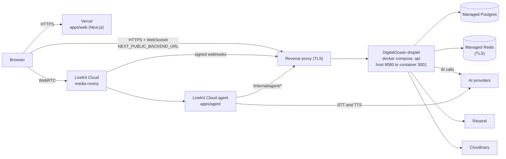
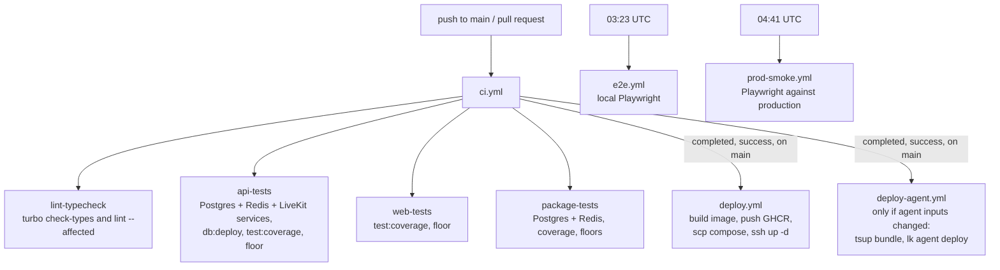
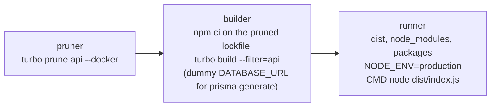

# Deployment and CI/CD

Where each part of Nimbus runs in production and how code gets there. The three apps deploy to three different places: the web app on Vercel, the API as a Docker container on a DigitalOcean droplet, and the voice agent on LiveKit Cloud. Postgres and Redis are managed services the API connects to. Five GitHub Actions workflows gate and ship it all: CI on every push and pull request, two deploy workflows that run only after CI passes on `main`, and two nightly browser suites.

## Production topology

| Component | Runs on | Built by | Configured by |
| --- | --- | --- | --- |
| `apps/web` | Vercel | Vercel's own Git integration | Vercel project env (`NEXT_PUBLIC_*`) |
| `apps/api` | Droplet, `ghcr.io/tejasnasa/nimbus-api:latest` via [`docker-compose.yml`](../../docker-compose.yml) | [`deploy.yml`](../../.github/workflows/deploy.yml) | `.env` on the droplet |
| `apps/agent` | LiveKit Cloud ([`livekit.toml`](../../apps/agent/livekit.toml)) | [`deploy-agent.yml`](../../.github/workflows/deploy-agent.yml) | LiveKit Cloud agent secrets |
| Postgres, Redis | Managed services | — | `DATABASE_URL`, `REDIS_URL` |

There is no self-hosted TURN server any more: media relaying is LiveKit's job ([Voice and LiveKit](../meetings/voice-and-livekit.md)).

## The workflows

| Workflow | Trigger | Does |
| --- | --- | --- |
| [`ci.yml`](../../.github/workflows/ci.yml) | Every pull request; pushes to `main` | Four jobs. **Lint & typecheck** runs `check-types` and `lint` with `--affected` (lint is blocking under the `--max-warnings` budgets). **API** starts Postgres 16, Redis 7 and a LiveKit dev server as service containers on the same ports as `docker-compose.test.yml`, applies migrations with `db:deploy`, runs `test:coverage` and then `scripts/check-coverage.mjs apps/api`. **Web** runs coverage and its floor check. **Shared packages** runs the package suites (with Postgres and Redis for `@nimbus/db`) and their floors. Concurrency group `ci-<ref>`. |
| [`deploy.yml`](../../.github/workflows/deploy.yml) | `workflow_run` of CI completing on `main` (only on success), or manual | Builds the API image from [`apps/api/Dockerfile`](../../apps/api/Dockerfile), pushes it to GHCR, copies `docker-compose.yml` to the droplet over SCP, then over SSH runs `docker compose pull`, `docker compose up -d` and `docker image prune -f`. Secrets: `DROPLET_HOST`, `DROPLET_SSH_KEY`. |
| [`deploy-agent.yml`](../../.github/workflows/deploy-agent.yml) | Same as above | Diffs the commit against the previous green CI run on `main` and deploys only if `apps/agent`, `packages/types`, `packages/utils` or the workflow changed (manual runs always deploy). Bundles with `tsup` and runs `lk agent deploy` with the LiveKit CLI. Deploys queue rather than cancel each other. Secrets: `LIVEKIT_URL`, `LIVEKIT_API_KEY`, `LIVEKIT_API_SECRET`. |
| [`e2e.yml`](../../.github/workflows/e2e.yml) | Nightly 03:23 UTC; manual | The local Playwright suite with service containers ([End-to-end](../testing/end-to-end.md)). |
| [`prod-smoke.yml`](../../.github/workflows/prod-smoke.yml) | Nightly 04:41 UTC; manual | The production smoke suite; deliberately no `pull_request` trigger because it writes to production. Secrets: the four `SMOKE_*` credentials. |

## The API image

[`apps/api/Dockerfile`](../../apps/api/Dockerfile) is a three-stage build on `node:20-alpine`:

`turbo prune` copies only the API and the workspaces it depends on, so the image does not contain the web app or the agent. The dummy `DATABASE_URL` exists because `prisma generate` wants one; nothing connects to it at build time. The container listens on 3001 and the compose file maps it to host port 8080 behind the proxy.

## Database migrations in production

Neither the image nor `deploy.yml` applies migrations. A schema change is deployed by running `npx turbo run db:deploy` (`prisma migrate deploy`) against the production `DATABASE_URL` from a trusted machine, **before** the API that needs it is rolled out, and only with migrations that are safe to apply while the old API is still serving. See [Change the schema](../guides/change-the-schema.md).

## Deploy order for a cross-cutting change

Because the three apps ship independently, a change to a shared contract needs ordering:

1. **Migrations first**, additive only (new nullable columns, new tables).
2. **The API**, accepting both the old and the new client behaviour.
3. **The agent and the web app**, which start using the new behaviour.
4. **Cleanup** (dropping old columns, removing compatibility code) in a later release.

## Design trade-offs and limits

- **A single droplet.** The API runs as one container on one host. That is cheap and simple, and it matches the process-local document state (one replica means no sticky-session problem), but there is no redundancy: a droplet outage is an API outage. Scaling out needs shared document state first ([Realtime overview](../realtime/overview.md)).
- **`latest` tag deploys.** The compose file pulls `:latest`, so rolling back means re-running a deploy of an older commit rather than pinning a previous tag.
- **Deploys briefly drop connections, and can lose a few seconds of edits.** `docker compose up -d` replaces the container and open sockets reconnect. The API registers no shutdown handler, so edits still inside the save debounce (5 s for markdown, 3 s for canvases) when the old container stops are not persisted by the server.
- **Migrations are manual.** Safer than auto-migrating on boot, but a forgotten migration surfaces as runtime errors.
- **Three platforms, three consoles.** Vercel, the droplet and LiveKit Cloud each have their own logs and env configuration ([Runbook](runbook.md)).
- **Deploys depend on CI's `workflow_run`.** A deploy triggered manually skips that gate, by design, for emergencies.

## Related documentation

- [Runbook](runbook.md)
- [Environment variables](../reference/environment.md)
- [Testing overview](../testing/overview.md)
- [End-to-end and production smoke](../testing/end-to-end.md)
- [The monorepo](../getting-started/monorepo.md)
