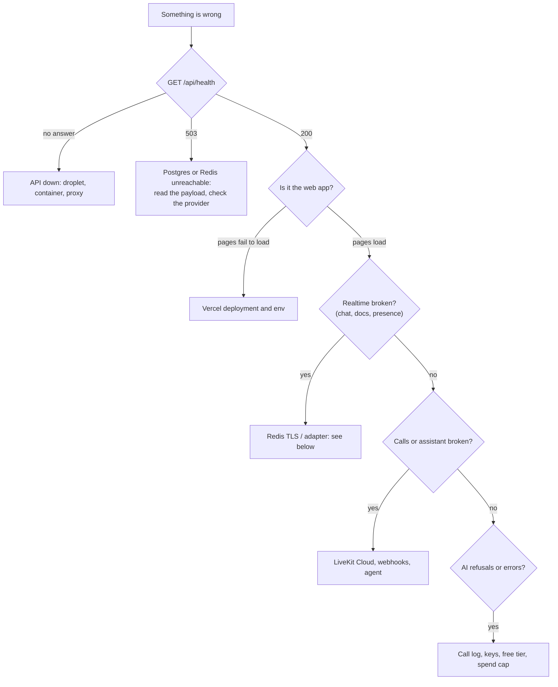

# Runbook

What to check and what to do when production Nimbus misbehaves, plus the routine procedures: rotating secrets, applying migrations, re-running notes, and the limits you will hit if usage grows. Each symptom points at the module that owns the behaviour, so a fix starts from the code rather than from guesswork.

## First checks

| Check | How |
| --- | --- |
| API liveness and dependencies | `GET /api/health` answers 200 when Postgres and Redis both respond within their timeouts, 503 with a per-dependency payload otherwise ([`health.controller.ts`](../../apps/api/src/controllers/health.controller.ts)) |
| API logs | `make prod-logs` (or `docker compose logs -f` on the droplet) |
| Nightly smoke | The latest `prod-smoke.yml` run and its uploaded report |
| Web app | Vercel's deployment logs |
| Calls and agent | LiveKit Cloud's room and agent logs |
| AI behaviour | The workspace's call log (`GET /api/ai/workspaces/:id/usage`, the Usage tab) |

## Symptoms and fixes

| Symptom | Likely cause | Where to look | Fix |
| --- | --- | --- | --- |
| API exits at boot naming a variable | Missing or invalid env | [`env.ts`](../../apps/api/src/lib/env.ts) | Set it in the droplet's `.env`, `docker compose up -d` |
| API boots, health 200, but chat, presence and editing are dead with no Redis error | TLS mismatch: TLS forced at a plaintext Redis, or the reverse; the client never becomes ready | [`redis.ts`](../../apps/api/src/lib/redis.ts); the connect watchdog logs after 10 s | Use `rediss://`, or set `REDIS_TLS=true` / `false` explicitly |
| Health 503 for Redis during an outage, requests hang | Clients use `maxRetriesPerRequest: null` and queue commands | provider status | Restore Redis; queued commands drain |
| Sign-in returns 200 but the user is not signed in on the web domain | Cookie domain | [`cookieAttributes.ts`](../../apps/api/src/lib/cookieAttributes.ts) (logged at boot) | Set `AUTH_COOKIE_DOMAIN` to the shared parent domain and `BETTER_AUTH_URL` to the API's HTTPS origin |
| Creating a workspace fails with a 500 | NimbusBot's user row missing | [`botUser.ts`](../../apps/api/src/lib/botUser.ts) | Restart the API (it upserts the row at boot); check `BOT_USERID` |
| Call roster wrong or stale | Webhooks not arriving or failing signature checks | [`livekitWebhook.router.ts`](../../apps/api/src/routers/livekitWebhook.router.ts) | Check the webhook URL (`/api/livekit/webhook`) and that `LIVEKIT_API_SECRET` matches |
| "Start assistant" spins, then the meeting ends as `dispatch-failed` | The agent never redeemed its ticket within 90 s | LiveKit agent logs; [`lifecycle.ts`](../../apps/api/src/lib/meeting/lifecycle.ts) | Check the agent is deployed and its `NIMBUS_API_URL` and `NIMBUS_AGENT_SECRET` match the API |
| Agent requests all answer 401 | Secret mismatch, or ticket expired (60 s) | [`agentAuth.middleware.ts`](../../apps/api/src/middleware/agentAuth.middleware.ts) | Align `NIMBUS_AGENT_SECRET` in both places |
| A meeting has no notes | Too short (< 3 segments or < 60 s of speech), still within the 5 s delay, or failed | `Meeting.status`, `failureReason`, `summaryAttempts` | The recovery sweep retries every 10 min up to 3 attempts ([`recovery.ts`](../../apps/api/src/lib/meeting/recovery.ts)) |
| Users see `ai:refused` | No key, free allowance spent, or spend cap reached | The call log's refused rows | Add a key, raise the cap, or adjust `AI_FREE_DOC_LIMIT` / `AI_FREE_VOICE_SECONDS` |
| A saved key stops working | Provider revoked it, or the encryption key changed without `_PREVIOUS` | [`credentialCrypto.ts`](../../apps/api/src/lib/ai/credentialCrypto.ts) | Re-save the key; never change the master key without keeping the old one in `AI_CREDENTIAL_ENCRYPTION_KEY_PREVIOUS` |
| Documents edited just before a deploy lost a few seconds | No shutdown flush; edits inside the 5 s (markdown) or 3 s (canvas) debounce | [`document.ts`](../../apps/api/src/socket/document.ts), [`canvas.ts`](../../apps/api/src/socket/canvas.ts) | Known limit; deploy at quiet times |
| Search misses an old document | Created before search existed, `searchText` empty | [`documentBackfill.ts`](../../apps/api/src/lib/documentBackfill.ts) | Run the backfill (below) |

## Procedures

### Apply a migration

1. Review the SQL in `packages/database/prisma/migrations/<name>/migration.sql`; it must be safe while the current API is serving.
2. From a trusted machine, with the production `DATABASE_URL` exported only in that shell: `npx turbo run db:deploy --filter=@nimbus/db`.
3. Then deploy the API (merge to `main`, or run `deploy.yml` manually).

### Rotate the credential encryption key

1. Generate a new value of at least 32 characters.
2. Set `AI_CREDENTIAL_ENCRYPTION_KEY_PREVIOUS` to the **old** key (comma-separate if there are several) and `AI_CREDENTIAL_ENCRYPTION_KEY` to the new one; restart the API.
3. Existing rows still decrypt with the previous key; each moves to the new key only when an admin re-saves it. There is no bulk re-encryption script, so keep the old key in `_PREVIOUS` until every row has been re-saved. See [Providers and BYOK](../ai/providers-and-byok.md).

### Rotate the agent secret

`NIMBUS_AGENT_SECRET` (at least 32 characters) must match in the API's `.env` and the agent's LiveKit Cloud secrets. Change both, restart the API, redeploy the agent (`deploy-agent.yml`, manual run). Meetings live during the switch will fail their next agent request and end.

### Rotate other secrets

| Secret | Where it lives | Effect of rotating |
| --- | --- | --- |
| `BETTER_AUTH_SECRET` | API `.env` | Invalidates every session; everyone signs in again |
| `LIVEKIT_API_KEY` / `_SECRET` | API `.env`, agent secrets, deploy secrets | Live calls drop; webhook verification uses the new secret |
| `CLOUDINARY_*`, `RESEND_API_KEY`, `GOOGLE_*` | API `.env` | Only new uploads, emails and OAuth sign-ins are affected |
| `SMOKE_*` | GitHub secrets | Re-seed the smoke users (`make seed-smoke-users-apply`) |

### Backfill document search text

`scripts/backfill_document_search.ts` takes an explicit database URL argument and never loads a `.env`. It fills only documents with no search text unless told `all`, and reports the target by host and database name only. Run it against production deliberately, never from a shell where you are unsure what `DATABASE_URL` is.

### Probe the AI providers

`make probe-ai ARGS="--provider groq"` runs [`probe_ai_providers.ts`](../../apps/api/scripts/probe_ai_providers.ts) against the live providers to check models still answer as the registry expects. It spends small amounts on real keys.

## Scaling limits

| Limit | Why | What breaks first | Fix when needed |
| --- | --- | --- | --- |
| One API replica | Yjs documents and canvas state are in-memory `Map`s per process | A second replica splits a document's editors across two divergent copies | Sticky sessions per document, or a shared Yjs store |
| Process-local timers | Notes delay, budget backstop, dispatch timeout, bot-typing counts | A restart delays them (each has a durable fallback) | Already bounded; a job queue would make them exact |
| Socket lookups | Membership is read from Postgres on every event | Database load with many active editors | Cache memberships with invalidation on change |
| `ts_headline` and on-the-fly `tsvector`s | Search cost grows with text size and workspace size | Slow searches in very large workspaces | Generated columns and indexes for decisions, items and chat |
| Webhook dedupe and roster | Redis | Redis availability is a hard dependency for calls and presence | Managed Redis with failover |

## Design trade-offs and limits

- **Health covers dependencies, not features.** A 200 means Postgres and Redis answer; it does not prove LiveKit, the agent, email or AI providers work. The nightly smoke suite covers more, once a day.
- **No metrics or tracing stack.** Diagnosis relies on container logs, the AI call log and the platforms' own consoles.
- **Manual procedures.** Migrations, rotations and backfills are run by hand by design, which keeps them deliberate but makes them easy to forget.
- **Single region, single host.** Recovery from a droplet failure is a redeploy to a new host, not a failover.

## Related documentation

- [Deployment and CI/CD](deployment.md)
- [Environment variables](../reference/environment.md)
- [Local setup](../getting-started/local-setup.md)
- [Security and RBAC](../architecture/security.md)
- [Transcripts and notes](../meetings/transcripts-and-notes.md)
