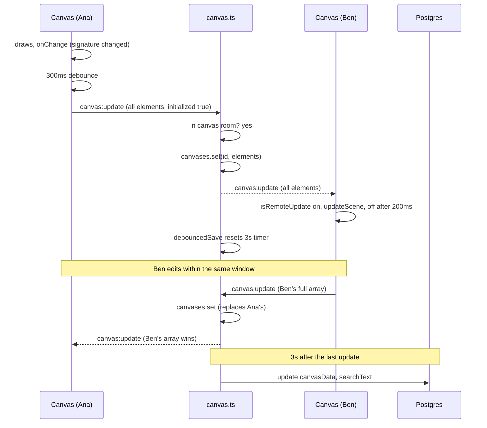
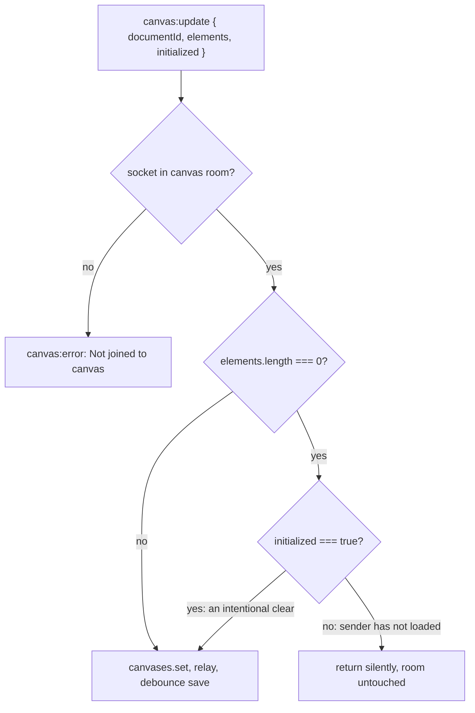
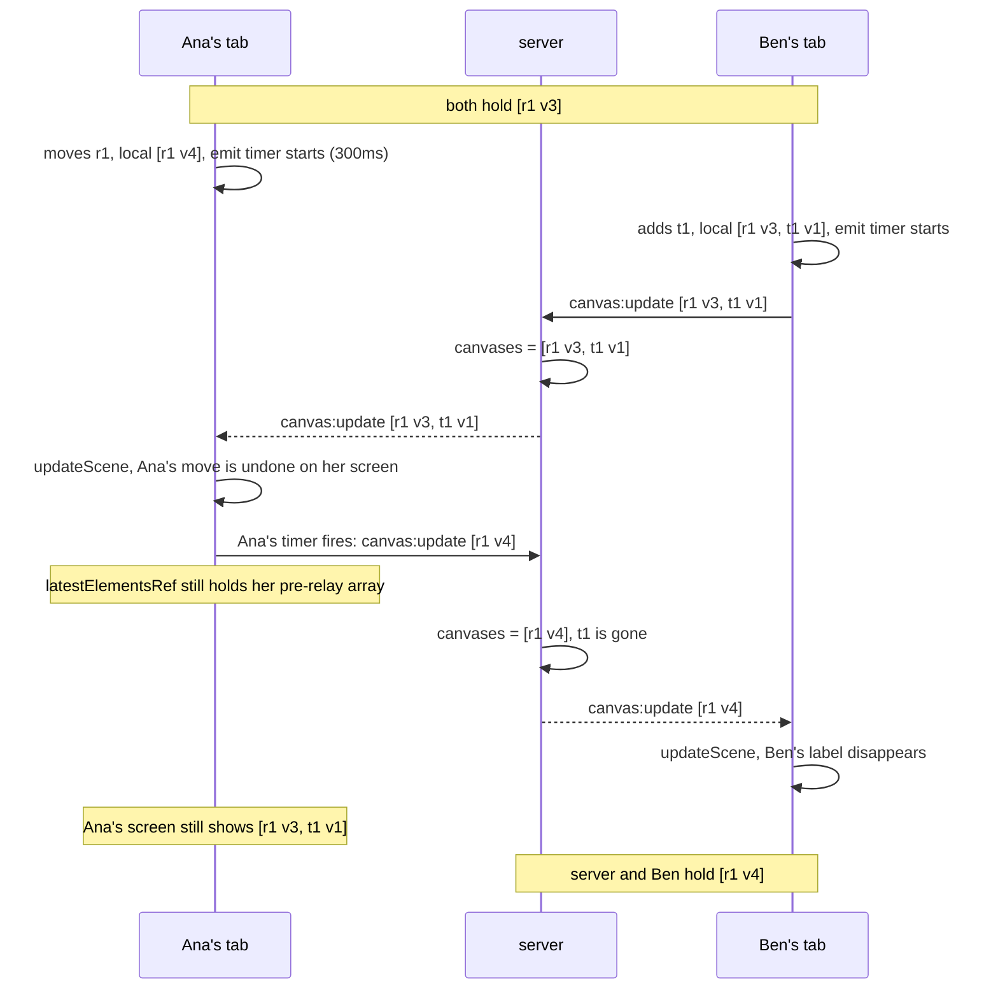
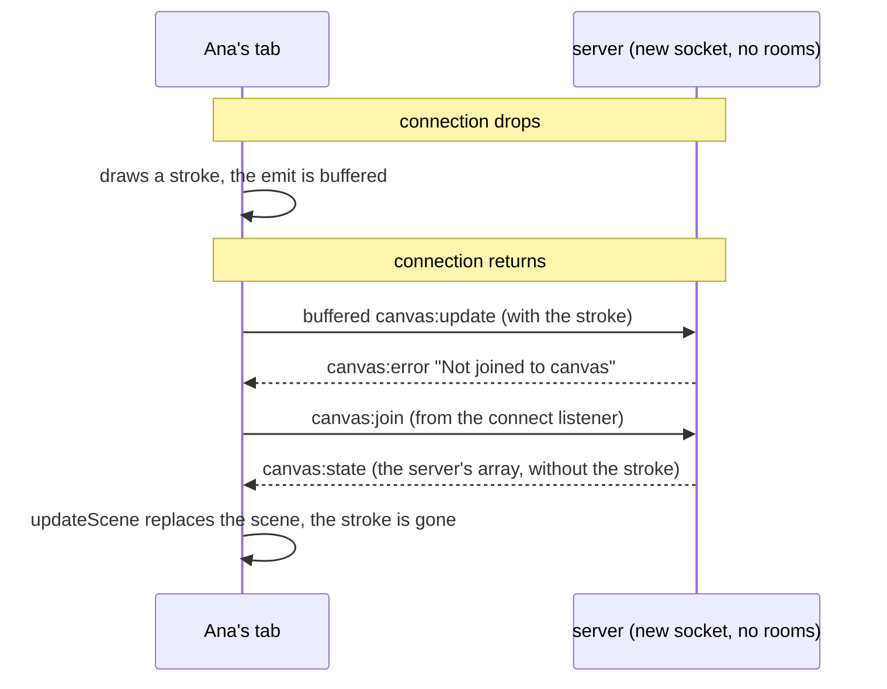
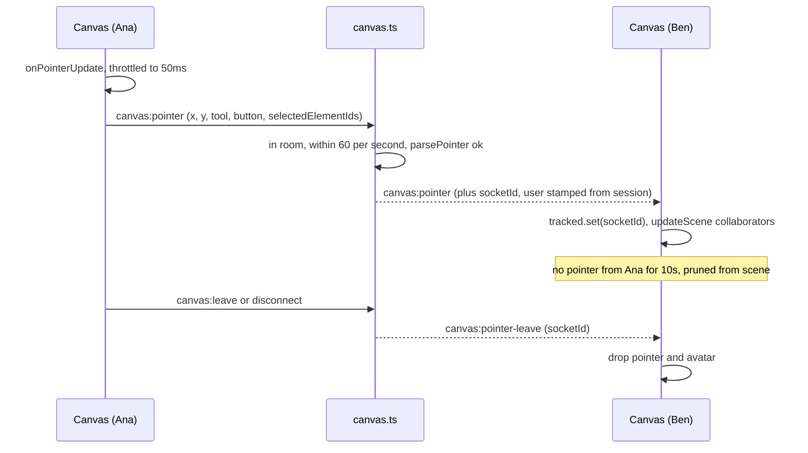
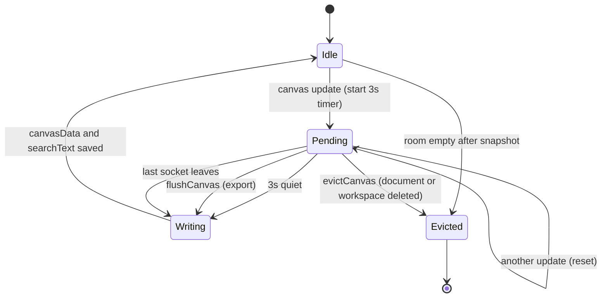

# Canvas sync

Nimbus whiteboards are Excalidraw scenes kept in step by the simplest model that works for them: every change sends the canvas's whole element array, the server replaces its copy, relays it to everyone else in the room and writes it to Postgres on a three-second debounce. This page explains that last-write-wins design, the `initialized` guard that stops a still-loading tab from wiping the board, the client-side guards that stop echo loops, how live pointers are relayed without being stored, and what the model deliberately gives up.

## The model in one paragraph

[Excalidraw](https://excalidraw.com) represents a scene as an array of self-contained elements (rectangles, arrows, text, freehand strokes), each with an `id`, a `version` and a `versionNonce`; deleted elements stay in the array with `isDeleted: true`. Nimbus does not merge those arrays. A client that changes anything sends the **entire** array (`canvas:update`), the server **replaces** what it holds, and peers **replace** their scene with it. Whoever sends last wins. There is no CRDT and no element-level reconciliation, which keeps both ends small and predictable; the cost is spelled out in [Design trade-offs and limits](#design-trade-offs-and-limits).

| Side   | File                                                               | Role                                                         |
| ------ | ------------------------------------------------------------------ | ------------------------------------------------------------ |
| API    | [canvas.ts](../../apps/api/src/socket/canvas.ts)                   | handlers, `canvases` map, the `initialized` guard, pointer relay, persistence, eviction |
| API    | [roomState.ts](../../apps/api/src/socket/roomState.ts)             | `isRoomEmpty`, shared with the Markdown module               |
| API    | [documentText.ts](../../apps/api/src/lib/documentText.ts)          | `extractCanvasText` for keyword search                       |
| Web    | [Canvas.tsx](../../apps/web/components/Canvas.tsx)                 | Excalidraw component, join/leave, debounce, echo guards      |
| Web    | [canvasPresence.ts](../../apps/web/lib/canvasPresence.ts)          | pointer to collaborator mapping, stale pruning, `elementsSignature` |
| Web    | [presence.ts](../../apps/web/lib/presence.ts)                      | `throttle`, `peersFromRoster` for the header avatars         |
| Shared | [socketEvents.ts](../../packages/types/src/socket/socketEvents.ts) | the `canvas:*` event signatures                              |

## Server state

[canvas.ts](../../apps/api/src/socket/canvas.ts) keeps two process-local maps:

| Name         | Type                                       | Purpose                                       |
| ------------ | ------------------------------------------ | --------------------------------------------- |
| `canvases`   | `Map<string, readonly OrderedExcalidrawElement[]>` | the live element array per open canvas |
| `saveTimers` | `Map<string, NodeJS.Timeout>`              | the pending debounced save per canvas         |

Each canvas has a room `canvas:<documentId>` (`CANVAS_ROOM`). Pointers are not state and have no map; presence on a canvas is simply membership of its room.

## Joining

`Canvas.tsx` emits `canvas:join` when it mounts for a document id. The server:

1. Loads the document with its workspace members. Missing: `canvas:error` "Canvas not found". Not a member: `canvas:error` "Not a member".
2. Joins `canvas:<id>`.
3. `getCanvas` returns the cached array or hydrates it from `Document.canvasData` (used only when it is a JSON array, otherwise `[]`) and caches it.
4. Replies to the joiner alone with `canvas:state { documentId, elements }`.

The client renders the board read-only (`viewModeEnabled={!isReady}`) until that state arrives. Excalidraw draws local strokes immediately even if the component would not emit them, so an editable pre-state board would show strokes that the joining `updateScene` then silently erases. On `canvas:state` the client sets `isInitialized`, flips `isReady` and unlocks the board.

## Updating: last write wins

The server's `canvas:update` handler does exactly four things:

1. **Room gate.** `socket.rooms.has("canvas:" + documentId)` or `canvas:error` "Not joined to canvas". This is what keeps a socket that never joined (or was evicted) from forking state, and mirrors the `doc:update` gate.
2. **The `initialized` guard** (below).
3. **Replace and relay.** `canvases.set(documentId, elements)` and `socket.to(room).emit("canvas:update", { documentId, elements })`, excluding the sender.
4. **Debounce a save** of **3 000 ms**.

The payload is not validated beyond that: element arrays are stored and relayed as sent.

### The `initialized` guard

An empty element array is ambiguous. It can mean "I have not loaded the canvas yet" (a tab whose Excalidraw emitted before `canvas:state` arrived) or "I deliberately deleted everything". Treating the first as the second would wipe the room for everyone. The client therefore sets `initialized: true` on every update it sends after applying the authoritative state, and the server drops an empty array that lacks it:

The flag, not the array's length, is what makes an intentional clear expressible: a loaded client sending `[]` really did delete everything. Do not replace the guard with a length check or remove it; the module header of [canvas.ts](../../apps/api/src/socket/canvas.ts) flags it as load-bearing. (In practice Excalidraw usually keeps deleted elements with `isDeleted: true`, so a cleared board is rarely an empty array, but the guard must hold for the case where it is.)

### Client-side guards

[Canvas.tsx](../../apps/web/components/Canvas.tsx) has three of its own, each protecting the room from a different kind of spurious update:

| Guard                       | Mechanism                                                                                          | Prevents                                                                    |
| --------------------------- | -------------------------------------------------------------------------------------------------- | --------------------------------------------------------------------------- |
| Pre-join                    | `onChange` returns while `!isInitialized.current`; the board is in view mode                       | emitting (or showing) strokes before the authoritative state lands          |
| Remote echo                 | `isRemoteUpdate` is set around every `updateScene` from the socket and cleared after `REMOTE_GUARD_MS` (**200 ms**) | re-broadcasting a peer's array back to the room                  |
| Not-an-edit                 | `elementsSignature(elements)` is compared with the last synced signature                           | re-sending the whole canvas when only the selection, tool, scroll or a collaborator pointer changed |

`elementsSignature` in [canvasPresence.ts](../../apps/web/lib/canvasPresence.ts) is a cheap rolling hash of the array length and every element's `id`, `version` and `versionNonce`, so it changes when an element is added, removed or mutated and not when only app state does. Without it, every remote pointer would make an idle viewer's Excalidraw call `onChange`, re-send the entire unchanged canvas and possibly overwrite a peer's edit still in flight.

Local edits are debounced by `EMIT_DEBOUNCE_MS` (**300 ms**) before `canvas:update` is sent, so a drag produces a handful of updates rather than one per frame. On unmount (tab switch, page leave) a pending debounce is **flushed** immediately with `initialized: true`, so the last 300 ms of strokes are not lost; then the component emits `canvas:leave`.

`initialData` is captured once per mount (`useState(() => ...)`) because Excalidraw consumes it a single time. `DocEditor` keys the component by document id, so a different canvas means a fresh mount rather than a re-seed.

### Reconnects

A reconnect produces a new server-side socket with no rooms (the server does not enable Socket.IO's connection-state recovery). `Canvas.tsx` listens for `connect` and re-emits `canvas:join`, then applies the `canvas:state` that comes back. Strokes made while the connection was down are **lost**, not merely delayed: see [Reconnects erase offline strokes](#reconnects-erase-offline-strokes).

## When edits are lost

Last write wins is a choice about which edit survives a conflict. This section shows, concretely, the three ways a stroke can disappear, so that the trade-off at the end of the page is a known quantity rather than a vague warning.

### Two people, one window

The window that matters is not the server's 3-second save debounce but the **client's 300 ms emit debounce plus the network round trip**. A local edit is held for 300 ms, then the tab sends `latestElementsRef.current`, the array *as that tab last saw it*. If a peer's update arrived in the meantime, the pending emit still carries the older local array and overwrites it.

A worked example. The board holds a rectangle `r1` (version 3). Ana moves `r1`; Ben, at almost the same moment, adds a text label `t1`:

Three things to read from it:

- **The loser is whoever sent first,** not whoever edited first, and Ben's own screen shows the loss when the relay comes back.
- **The board can fork until the next edit.** The emit timer sends `latestElementsRef.current`, which `onChange` last set *before* the relay, and `handleUpdate` neither cancels the pending timer nor refreshes that ref. Ana's emit is not echoed back to her, so her screen keeps Ben's array while the server and Ben hold hers. The fork heals at the next edit by anyone (that tab's full array replaces everyone's), or when Ana reloads and gets the server's copy. Cancelling the pending emit in `handleUpdate`, or reading `excalidrawAPI.getSceneElements()` when the timer fires, would remove this case without changing the model.
- **Nothing reconciles by element.** Even without the stale ref, two edits inside one window keep only the later array.

The per-element `version` and `versionNonce` that Excalidraw maintains would let a merge keep the higher version of each element by id (Excalidraw's own collaboration uses exactly that, via `reconcileElements`). Nimbus does not merge; see [Design trade-offs and limits](#design-trade-offs-and-limits).

### The remote-guard window

`isRemoteUpdate` is set before every `updateScene` from the socket and cleared by a `setTimeout` of `REMOTE_GUARD_MS` (**200 ms**), because Excalidraw calls `onChange` asynchronously after `updateScene` and there is no callback that says "the scene you set has been applied". While the flag is set, `onChange` returns before it looks at the elements, so a **local** edit that finishes inside those 200 ms is not recorded: `lastSignatureRef` is not updated and no emit is scheduled. The edit is still on the user's screen and is sent with the next change they make, or overwritten by the next remote update if one comes first.

Two smaller consequences of the same mechanism:

- Each remote update schedules its own timer, and none cancels the previous one. Two relays 150 ms apart clear the flag 50 ms after the second, a little early. If Excalidraw's `onChange` for the second relay lands after that, the signature check catches it: `handleUpdate` stores the relayed array's signature before calling `updateScene`, so a replay of what was just received compares equal and is not re-sent.
- The guard is time-based, so on a very slow device where Excalidraw takes longer than 200 ms to apply a large scene, the echo is again stopped only by the signature check. The signature check is the real echo guard; the timer is a cheap first filter.

### Reconnects erase offline strokes

Socket.IO's client buffers emits while it is disconnected and flushes them when the connection comes back. In socket.io-client 4.8.3, `onconnect` calls `emitBuffered()` **before** it fires the `connect` event, so the order on the new socket is:

`handleState` replaces the scene wholesale, and it also sets `lastSignatureRef` to the server's array, so there is no later diff that would notice the missing stroke. Unlike [the markdown case](markdown-sync.md#reconnects-and-lost-updates), nothing stays stuck afterwards: the next edit sends a complete array and the room is healthy again. The cost is exactly the strokes drawn while offline (and any that were inside the 300 ms debounce when the connection dropped).

The same shape applies to an **API restart**: the new process hydrates from the last snapshot, so up to 3 s of edits the old process had applied but not saved come back missing in every tab's `canvas:state`. Here the edits disappear for everyone, not only for the tab that made them.

A fix would be to remember on the client that an emit was rejected or sent while disconnected, and on the following `canvas:state` either re-send the local array (accepting last-write-wins against whatever changed meanwhile) or merge by element version.

### Images

Excalidraw stores an image as an `image` element that points at a `fileId`, with the bytes held separately in the scene's `BinaryFiles` map. Nimbus syncs and saves **only the element array**: `Canvas.tsx` neither sends nor receives files, `canvasData` has no place for them, and `initialData` carries only `elements`. An image pasted into a board therefore shows for the person who pasted it, as an empty placeholder for everyone else, and as a placeholder for its author too after a reload. (Generated diagrams do not use image elements, so they are unaffected.)

### Payload size

Every update carries the whole array, and the server's Socket.IO instance is created with only `cors` options ([app.ts](../../apps/api/src/app.ts) `createIoServer`), so the default `maxHttpBufferSize` of **1 MB** applies. A message above it is not rejected with an error: the server closes that client's connection. Freehand strokes are the heavy elements (each keeps its point list), so a long-lived sketch-heavy board can approach the limit. Past it, each edit from that tab disconnects it, the reconnect replays the server's smaller array and the edit is gone, which looks to the user like a board that keeps undoing them. Nothing in Nimbus measures board size today; raising `maxHttpBufferSize`, or sending deltas, are the two ways out.

## Pointers and selection

Other people's cursors are drawn through Excalidraw's collaborator layer. They are relayed, never stored.

On the server, `canvas:pointer`:

- requires the socket to be in the canvas room (`canvas:error` otherwise);
- drops the event silently once the socket exceeds `POINTERS_PER_SECOND` (**60**) in a one-second window (clients send about 20);
- narrows the payload with `parsePointer`: finite numeric `x`/`y`, `tool` of `"pointer"` or `"laser"`, `button` of `"up"` or `"down"`, and `selectedElementIds` filtered to strings of at most `MAX_ID_LENGTH` (**64**) and cut to `MAX_SELECTED_IDS` (**200**);
- relays it with `socketId` and a `user` built from `socket.data.user` (`userId`, `name`, `presenceColor(user.id)`, `image`). Any identity field in the payload is ignored.

`canvas:leave` and `disconnecting` send `canvas:pointer-leave { canvasId, socketId }` to the room. In `disconnecting` this happens synchronously and first, so a slow snapshot never keeps a ghost pointer on screen.

On the client:

| Constant              | Value     | File                                                   |
| --------------------- | --------- | ------------------------------------------------------ |
| `POINTER_INTERVAL_MS` | 50 ms     | [Canvas.tsx](../../apps/web/components/Canvas.tsx)     |
| `PRUNE_INTERVAL_MS`   | 2 000 ms  | [Canvas.tsx](../../apps/web/components/Canvas.tsx)     |
| `COLLABORATOR_TTL_MS` | 10 000 ms | [canvasPresence.ts](../../apps/web/lib/canvasPresence.ts) |

Pointers are sent through `throttle` from [presence.ts](../../apps/web/lib/presence.ts), which keeps a trailing call so the final resting position is never lost, and only once the canvas is initialized. Each received pointer is converted by `collaboratorFromPointer` into Excalidraw's `Collaborator` shape (keyed by socket id, coloured with the sender's presence colour). Collaborators silent for longer than the TTL are pruned from the scene; the "who is here" roster used by the header avatars (`peersFromRoster`) keeps them until `canvas:pointer-leave`, and excludes the signed-in user's own other tabs.

## Persistence

`saveSnapshot(canvasId)` writes the cached array to `Document.canvasData` and its text to `Document.searchText` (`extractCanvasText`, or `null` when the canvas has no text). Errors are caught and logged, because a canvas deleted mid-session has no row and an unhandled rejection from a timer would otherwise surface.

| Path                                     | Function       | Caller                                                                 |
| ---------------------------------------- | -------------- | ---------------------------------------------------------------------- |
| debounce expiry                          | `saveSnapshot` | `debouncedSave` timer                                                  |
| last socket leaves the room              | `saveSnapshot` | `canvas:leave`, `disconnecting`                                        |
| export of the document                   | `flushCanvas`  | `exportDocument` in [document.controller.ts](../../apps/api/src/controllers/document.controller.ts) |
| document deleted                         | `evictCanvas`  | `deleteDocument` in the same controller                                |
| workspace deleted                        | `evictCanvas`  | `deleteWorkspace` in [workspace.controller.ts](../../apps/api/src/controllers/workspace.controller.ts) |

Eviction follows the same rule as Markdown documents: check `isRoomEmpty`, await the snapshot, then check again before `evictCanvas`, so a rejoin that lands during the await keeps its live state. `evictCanvas` clears any pending timer and deletes the map entry.

## AI-generated canvases

A canvas Nimbus draws (from a prompt, from an uploaded image, or from a meeting) is written with its `canvasData` at creation time; there is no seed step as there is for Markdown. `doc:ai:complete` carries the same `canvasData`, which `DocEditor` uses as the new tab's `initialElements` so the board paints before its first `canvas:state`. The generation pipeline is in [Document generation](../ai/document-generation.md).

## Errors

| `canvas:error` message     | Cause                                                          |
| -------------------------- | -------------------------------------------------------------- |
| `Canvas not found`         | no row on `canvas:join`                                        |
| `Not a member`             | `canvas:join` from a non-member                                |
| `Not joined to canvas`     | `canvas:update` or `canvas:pointer` from a socket not in the room |
| `Something went wrong`     | any thrown error inside a handler                              |

The client logs these (`console.error("Canvas sync error:", ...)`); it does not show them.

## Tests

| Suite | What it pins |
| --- | --- |
| [canvas.socket.test.ts](../../apps/api/src/__tests__/integration/socket/canvas.socket.test.ts) | Join replays persisted (or empty) elements and refuses non-members and unknown ids; updates replace and relay; an uninitialized empty update is ignored and an initialized one clears; rapid updates debounce into one 3 s save; a malformed payload is reported without crashing; a socket that never joined is rejected; the room drain persists |
| [canvasPointer.socket.test.ts](../../apps/api/src/__tests__/integration/socket/canvasPointer.socket.test.ts) | Pointers are relayed with the session's identity (client identity fields ignored), not echoed to the sender, malformed ones dropped, oversized selections cut, `canvas:pointer-leave` sent on leave and disconnect, non-joined sockets refused |
| [Canvas.test.tsx](../../apps/web/tests/components/Canvas.test.tsx) | Join and leave, read-only until state, no pre-state emits, `initialized` on every emit, an intentional clear, the unmount flush, re-join on reconnect, wrong-document updates ignored, pointer throttling, collaborator building and pruning, the header roster, and the three echo cases (collaborator-only change, real edit, a peer's array not sent back) |
| [canvasPresence.test.ts](../../apps/web/tests/unit/lib/canvasPresence.test.ts) | `elementsSignature` stability and sensitivity, collaborator mapping and TTL pruning |
| [documentSearchText.test.ts](../../apps/api/src/__tests__/integration/persistence/documentSearchText.test.ts) | Canvas text extraction into `searchText` |

None of them exercises two tabs editing within one debounce window, a reconnect with buffered emits, or an oversized payload, which are the three loss paths described above.

## Design trade-offs and limits

- **Last write wins.** If two people edit within the same debounce window, the later full array replaces the earlier one, and the earlier person's change disappears from everyone's screen (including their own, when the relay arrives). Excalidraw's per-element `version` fields would allow element-level reconciliation; Nimbus does not use them. For a whiteboard where people mostly touch different shapes at different moments this is rarely visible, and it keeps the server free of merge logic.
- **Whole-array payloads.** Every update carries every element, deleted ones included, so traffic grows with the size of the board rather than the size of the change. A large board with many active editors is the case this model handles worst. Above Socket.IO's default 1 MB message limit the connection is closed rather than the update refused ([Payload size](#payload-size)).
- **Offline strokes are discarded.** A reconnect replays the server's array over the local scene, and the buffered emits were already rejected because they arrived before the re-join ([Reconnects erase offline strokes](#reconnects-erase-offline-strokes)).
- **Images are not synced.** Only elements travel; the image bytes Excalidraw keeps in `BinaryFiles` never leave the tab ([Images](#images)).
- **A time-based echo guard.** The 200 ms `REMOTE_GUARD_MS` window can swallow a local edit finished right after a remote update; it is sent with the next change. The signature check, not the timer, is what reliably stops echoes.
- **No server-side validation of elements.** The array is stored and relayed as sent by any room member. Membership is the only gate.
- **Debounced persistence.** At most three seconds of edits are at risk if the API process dies; flushes happen on export and when the room drains.
- **Process-local state.** Two replicas would hold diverging arrays and the last snapshot would win in Postgres. The Redis adapter shares broadcasts, not the `canvases` map.
- **Pointers are fire-and-forget.** They are rate-limited and never stored; a dropped pointer is superseded by the next one, and a peer who goes quiet fades after ten seconds.

## Related documentation

- [Realtime overview](overview.md)
- [Markdown sync](markdown-sync.md)
- [Presence and chat](presence-and-chat.md)
- [Socket events reference](../reference/socket-events.md)
- [Document generation](../ai/document-generation.md)
- [Data model](../reference/data-model.md)
- [Frontend overview](../frontend/overview.md)
