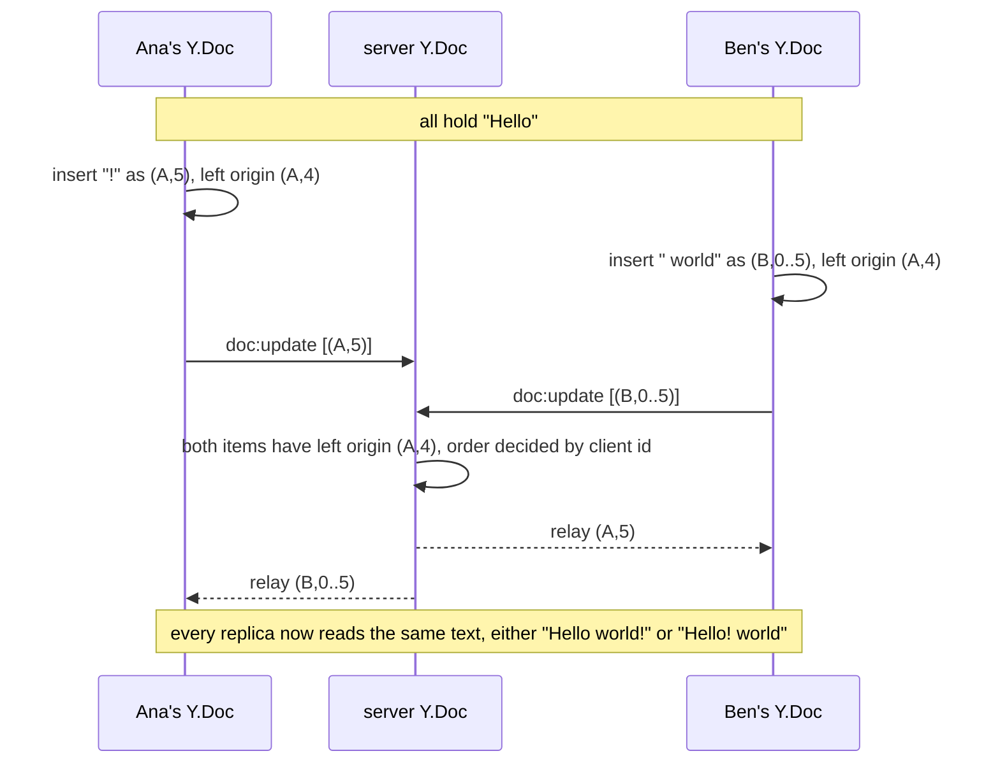
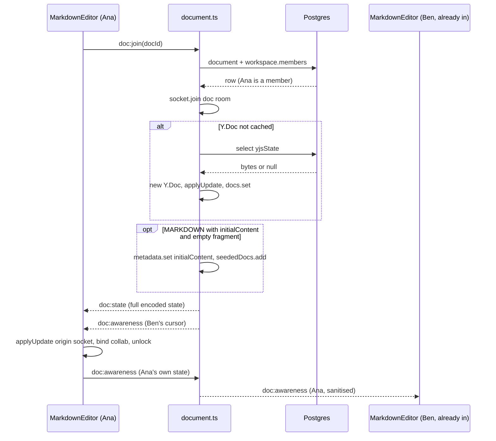
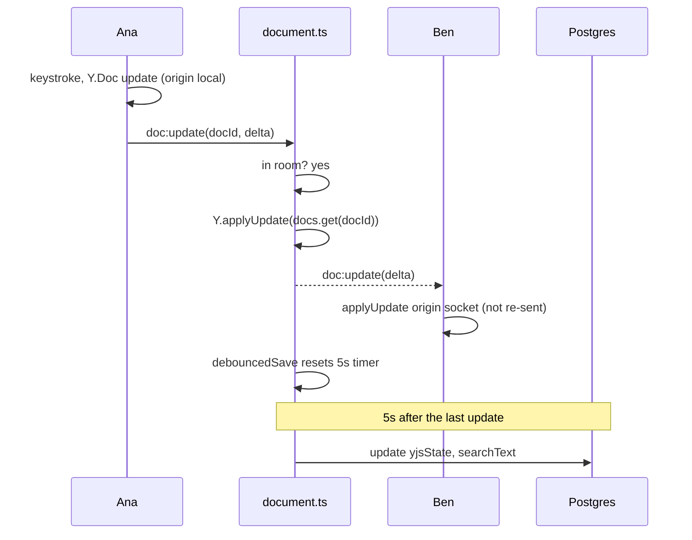
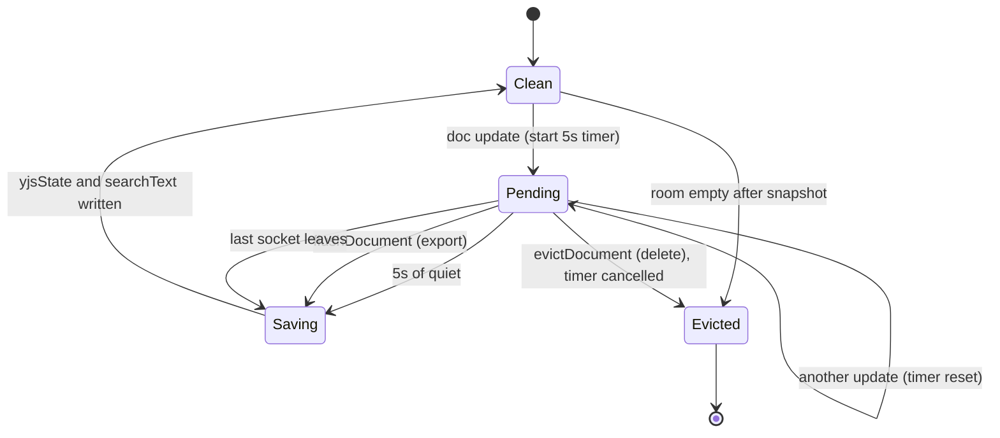
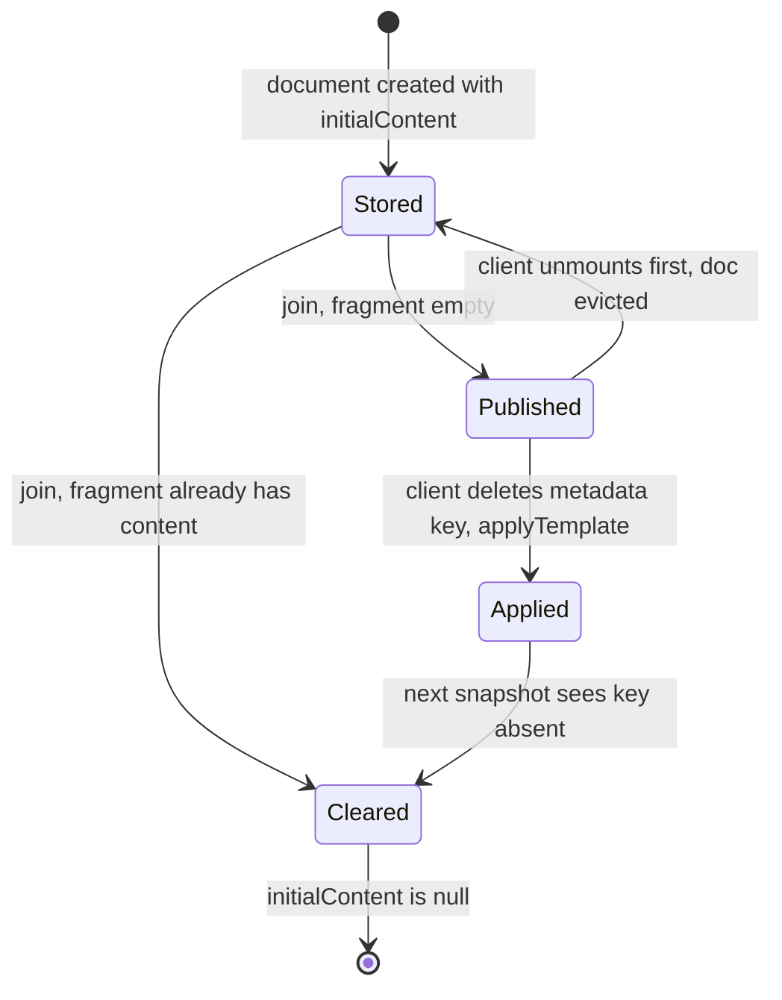
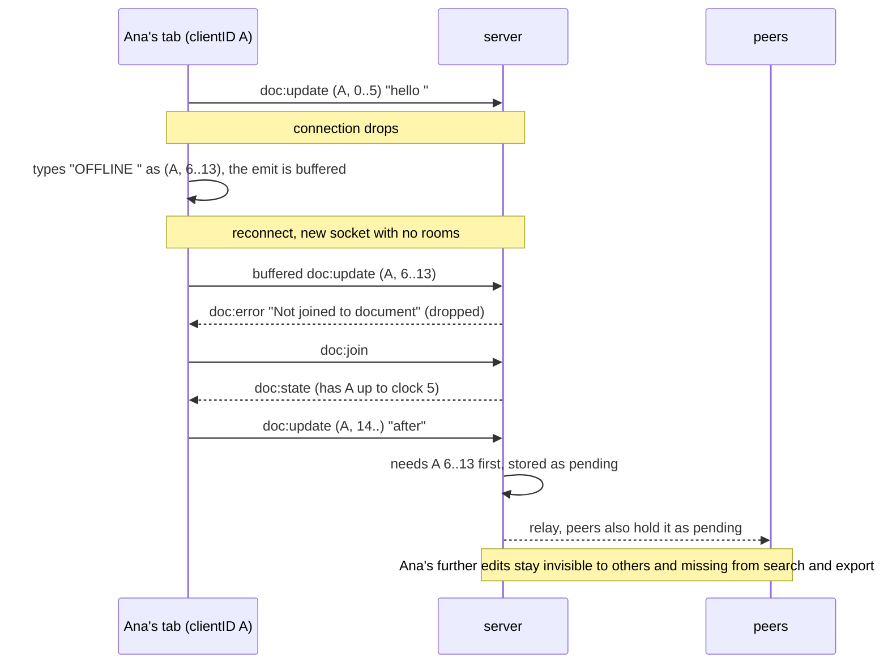
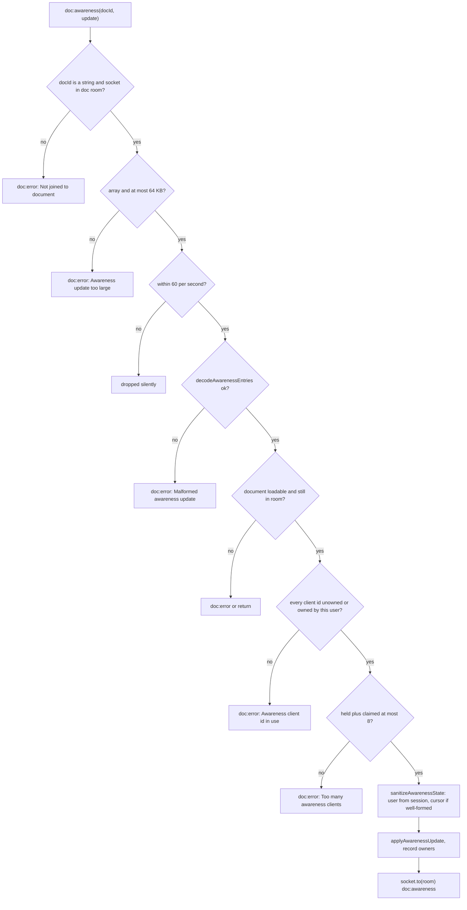
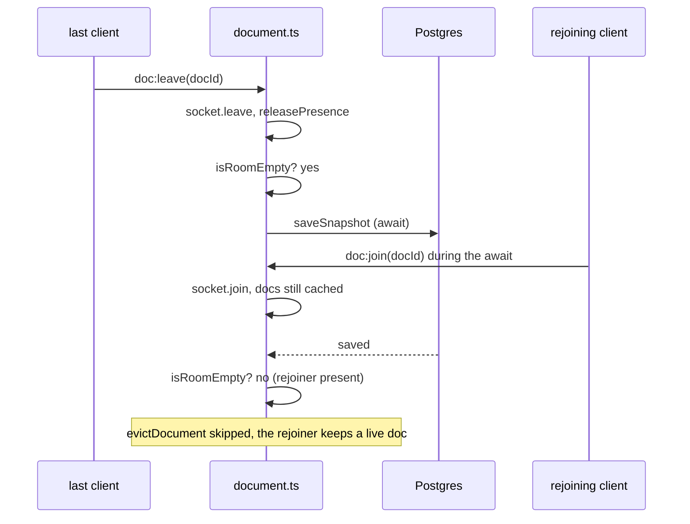

# Markdown sync

Markdown documents in Nimbus are edited by several people at once with no conflicts and no locking, because each document is a Yjs CRDT that the API holds in memory, relays between editors and persists to Postgres on a short debounce. This page follows a document from the moment someone opens it to the moment the last editor leaves: the join handshake, how edits travel, how live cursors (awareness) are validated, how and when the state is written, how AI-generated content is seeded exactly once, and how in-memory state is evicted without losing edits.

## Yjs in one paragraph

[Yjs](https://yjs.dev) is a CRDT (conflict-free replicated data type) library: every client holds a full copy of a shared document (`Y.Doc`), local edits produce small binary *updates*, and applying the same set of updates in any order on any copy converges to the same result. Nothing needs to arbitrate who "wins". Nimbus's editor is [Milkdown](https://milkdown.dev) (a ProseMirror-based Markdown editor) with `@milkdown/plugin-collab`, which binds the editor to a `Y.Doc` through y-prosemirror. Two parts of that `Y.Doc` matter here:

| Shared type                    | Name           | Holds                                                                          |
| ------------------------------ | -------------- | ------------------------------------------------------------------------------ |
| `Y.XmlFragment`                | `"prosemirror"` | the document body, as ProseMirror nodes (`paragraph`, `heading`, `bullet_list`, ...) |
| `Y.Map`                        | `"metadata"`   | out-of-band flags; today only `initialContent`, the one-shot AI seed            |

Cursor and selection positions travel separately as **awareness**, the y-protocols companion to Yjs for ephemeral per-client state that is never persisted.

The files involved:

| Side   | File                                                                 | Role                                                       |
| ------ | -------------------------------------------------------------------- | ---------------------------------------------------------- |
| API    | [document.ts](../../apps/api/src/socket/document.ts)                 | handlers, in-memory docs and presence, persistence, eviction |
| API    | [awareness.ts](../../apps/api/src/lib/awareness.ts)                  | decoding, sanitising and re-encoding awareness updates     |
| API    | [roomState.ts](../../apps/api/src/socket/roomState.ts)               | `isRoomEmpty`, shared with the canvas module               |
| API    | [documentText.ts](../../apps/api/src/lib/documentText.ts)            | `extractYjsText` for search, `yjsToMarkdown` for export    |
| API    | [rateLimiter.ts](../../apps/api/src/lib/rateLimiter.ts)              | the fixed-window awareness budget                          |
| Web    | [MarkdownEditor.tsx](../../apps/web/components/MarkdownEditor.tsx)   | Milkdown + Yjs session, join/leave, echo suppression       |
| Web    | [presence.ts](../../apps/web/lib/presence.ts)                        | local awareness identity, peer list for the header avatars |
| Shared | [socketEvents.ts](../../packages/types/src/socket/socketEvents.ts)   | the `doc:*` event signatures                               |

## How Yjs merges, concretely

The guarantees above come from how Yjs represents text, and that representation explains every failure mode later on this page.

- **Every `Y.Doc` has a random `clientID`.** Each tab gets its own, chosen when `MarkdownEditor` creates the document. The server's copy has one too, but the server never edits, so it never uses it.
- **Every inserted piece of content is an *item* with an id `(clientID, clock)`.** A client's clock starts at 0 and increases by one per inserted character (or embedded element). Ana's tab typing "hi" creates items `(A, 0)` and `(A, 1)`.
- **An item remembers its neighbours at insertion time** (its *origin* on the left and its *right origin*), not a numeric index. Two people inserting at "the same position" therefore never fight over an index: both items are kept, and a deterministic rule on their client ids decides which goes first on every replica.
- **Deletion marks items as deleted** (a delete set of tombstones) rather than removing them, so a concurrent insert next to deleted text still has a valid origin. Garbage collection later shrinks deleted content to small placeholders.
- **A state vector** maps `clientID → next clock`, summarising "everything I have". `Y.encodeStateAsUpdate(doc)` encodes everything; `Y.encodeStateAsUpdate(doc, stateVector)` encodes only what the other side lacks.
- **Items from one client must be applied in clock order.** An update whose items depend on clocks the receiver has not seen is stored as **pending** (`doc.store.pendingStructs`), not applied, until the missing range arrives. This is what makes delivery order irrelevant, and it is also why a single lost update matters (see [Reconnects and lost updates](#reconnects-and-lost-updates)).

A worked example. The document holds `Hello` (items `(A,0)` to `(A,4)`). At the same moment Ana types `!` after `Hello` and Ben types ` world` after `Hello`:



Neither edit is lost, no replica needs to ask the others, and the server does nothing but apply and forward. The same rules hold for the structure around the text: paragraphs, headings and list items are `Y.XmlElement`s in the `"prosemirror"` fragment, and y-prosemirror maps ProseMirror transactions onto them.

## Server state

[document.ts](../../apps/api/src/socket/document.ts) keeps four module-level structures, all process-local:

| Name         | Type                                  | Purpose                                                                           |
| ------------ | ------------------------------------- | --------------------------------------------------------------------------------- |
| `docs`       | `Map<string, Y.Doc>`                  | the authoritative live copy of every open document, keyed by document id          |
| `presence`   | `Map<string, DocPresence>`            | one `Awareness` per open document plus `owners: Map<clientId, {socketId, userId}>` |
| `seededDocs` | `Set<string>`                         | documents whose AI seed was published but not yet seen consumed                    |
| `saveTimers` | `Map<string, NodeJS.Timeout>`         | the pending debounced save for each document                                       |

Each document has a room named `doc:<id>` (`DOC_ROOM`). `docs` and `presence` are exported so tests can inspect them; `evictDocument` and `flushDocument` are exported for the document controller.

## Opening a document

When a Markdown tab mounts, `MarkdownEditor` creates a fresh `Y.Doc` and `Awareness`, subscribes to the `doc:*` events and emits `doc:join`. The server's `doc:join` handler:

1. Loads the document row with its workspace members. Missing: `doc:error` "Document not found". Caller not a member: `doc:error` "Not a member".
2. Joins the socket to `doc:<id>`.
3. Calls `getDoc(docId)`, which returns the cached `Y.Doc` or hydrates one: `prisma.document.findUnique` for `yjsState`, `Y.applyUpdate` when it is non-null, then caches it in `docs`. A row that has vanished returns `null` and is never cached.
4. Handles the AI seed (see [The AI seed](#the-ai-seed)).
5. Replies to the joiner alone with `doc:state`: `Array.from(Y.encodeStateAsUpdate(doc))`, the full state as one update.
6. Replays every other collaborator's awareness to the joiner (one `doc:awareness` carrying all states it does not own), so a newcomer sees cursors immediately instead of waiting for each peer to move.



### The client side of the join

The client is careful about two failure modes, both described in the module header of [MarkdownEditor.tsx](../../apps/web/components/MarkdownEditor.tsx):

- **Read-only until bound.** Binding the collab plugin renders the `Y.Doc` into the view and *replaces* whatever the view held. Keystrokes typed before that would never reach a Yjs update and would be silently lost. The editor is therefore created with `editorViewOptionsCtx` set to `editable: () => false` (merged into the slice with `ctx.update`, so the nord theme's classes survive) and only unlocked inside `connectCollab`, after `collabService.connect()` has rendered the document.
- **A join that never answers.** If no `doc:state` has been applied after `STATE_RETRY_MS` (**2 000 ms**), the editor emits `doc:join` again rather than binding an empty document, which would look like data loss.

`handleState` applies the state with origin `"socket"`, marks `stateAppliedRef`, calls `tryConnectCollab` and then publishes the tab's own awareness. `tryConnectCollab` reads `metadata.initialContent`; when present it deletes the key and passes the Markdown to `connectCollab` as a template, otherwise it binds immediately. The server's metadata map is authoritative once a full state has arrived, so the client never waits for a seed that is not coming.

## Editing

Every local change fires the `Y.Doc`'s `update` event. The client forwards it only when it did not come from the socket:

```ts
const onDocUpdate = (update: Uint8Array, origin: unknown) => {
  if (origin !== "socket") {
    socket.emit("doc:update", documentId, Array.from(update));
  }
};
```

Remote updates are applied with `Y.applyUpdate(doc, update, "socket")`, so the origin check is what stops two tabs echoing the same update back and forth forever. Updates travel as plain `number[]`; both ends convert with `Array.from` and `Uint8Array.from`.

On the server, `doc:update`:

1. **Room gate.** `socket.rooms.has("doc:" + docId)` or `doc:error` "Not joined to document". Only a socket that passed the `doc:join` membership check is in the room, so this replaces a database query per keystroke. The canvas module guards `canvas:update` the same way.
2. **Rehydrate if missing.** `docs.get(docId) ?? await getDoc(docId)`. A socket in the room with no cached doc is an invariant violation, and rehydrating keeps an eviction bug from becoming silent data loss.
3. **Apply** with `Y.applyUpdate`, **relay** with `socket.to(room).emit("doc:update", update)` (the sender is excluded), and **debounce a save**.



Because Yjs merges, two people typing at once in different paragraphs, or even the same one, both keep their characters. The server's copy is just one more replica that happens to be persisted.

## Persistence

### The debounce

`debouncedSave(docId)` clears any pending timer for the document and starts a new **5 000 ms** one. A burst of typing therefore collapses into one database write five seconds after the last keystroke. The timer calls `saveSnapshot`, which:

1. Encodes the full state (`Y.encodeStateAsUpdate`) and extracts plain text with `extractYjsText` from [documentText.ts](../../apps/api/src/lib/documentText.ts) (capped at `SEARCH_TEXT_MAX`, **200 000** characters, because Postgres refuses a `tsvector` over 1 MB).
2. Writes `Document.yjsState` (as a `Buffer`) and `Document.searchText`. While a document's seed is still unconsumed and the Yjs tree has no text yet, `searchText` is left alone so the text the document was created with stays searchable.
3. Calls `clearSeedIfConsumed`.
4. Catches and logs errors: a document deleted mid-session has no row to update, and an unhandled rejection from a timer would otherwise surface.



### Other paths that write

| Trigger                              | Function                         | Why                                                                                 |
| ------------------------------------ | -------------------------------- | ----------------------------------------------------------------------------------- |
| `doc:leave` / `disconnecting` that drains the room | `saveSnapshot` directly | the last editor's changes are written now, not after a timer that eviction would cancel |
| `GET /api/document/:docId/export`    | `flushDocument` ([document.controller.ts](../../apps/api/src/controllers/document.controller.ts)) | the live copy can be up to one debounce ahead of the row; flushing makes the download current |

`flushDocument` does nothing when no save is pending, so exporting an idle document costs no write.

### What the window means

A crash or restart of the API process loses, from the server's copy, the edits of the last debounce window (up to five seconds) for documents open at the time. Editors still connected hold those changes in their own `Y.Doc`, but nothing re-sends them after the reconnect, and because later edits depend on them, the affected tabs' further edits stay pending on the server too. See [Reconnects and lost updates](#reconnects-and-lost-updates). Lowering the debounce narrows the window at the cost of more writes; it does not close the gap.

## The AI seed

When Nimbus generates a Markdown document ([Document generation](../ai/document-generation.md)) or a meeting's notes are written, the content is stored in `Document.initialContent` as Markdown text, not as Yjs state: only a Milkdown editor can turn Markdown into the ProseMirror node tree the Yjs fragment holds. The seed is handed to the first editor that opens the document and must be applied exactly once.



The steps, in [document.ts](../../apps/api/src/socket/document.ts) and [MarkdownEditor.tsx](../../apps/web/components/MarkdownEditor.tsx):

1. **Publish.** On `doc:join`, for a `MARKDOWN` document with `initialContent` and an empty `"prosemirror"` fragment, the server sets `metadata.initialContent` in its `Y.Doc` and adds the id to `seededDocs`. That value reaches the joiner inside `doc:state`. If the fragment already has content (an earlier attempt got the body into Yjs), the column is redundant and is cleared on the spot.
2. **Consume.** The client deletes the metadata key and calls `collabService.applyTemplate(markdown)`. Both changes are ordinary Yjs updates, so they travel to the server with `doc:update`. `applySeed` skips the template when the fragment is already non-empty, because `applyTemplate` appends and a late seed would duplicate the body.
3. **Clear.** After each snapshot, `clearSeedIfConsumed` checks: the document is in `seededDocs` and `metadata` no longer has `initialContent`. Only then does it null the column.

The column is deliberately **not** cleared at join time. A client that unmounted before applying the template would otherwise leave a document whose only copy of its content had been deleted. Until a snapshot proves consumption, a rejoin simply publishes the seed again.

## Reconnects and lost updates

Socket.IO reconnects automatically after a network drop or an API restart, and the server sees the reconnect as a **new socket** that belongs to no rooms (the server does not enable connection-state recovery). `MarkdownEditor` handles this by re-emitting `doc:join` from its `connect` listener, receiving a fresh `doc:state` and merging it. Because `doc:state` is a full Yjs update, merging it again is idempotent.

What that does **not** do is send the server anything the tab has and the server lacks. Two everyday situations create such a gap:

| Situation | What the server misses |
| --- | --- |
| The user types while the connection is down | socket.io-client buffers emits while disconnected and flushes them on reconnect **before** the `connect` listeners run (in socket.io-client 4.8.3, `onconnect` calls `emitBuffered()` before `emitReserved("connect")`). The buffered `doc:update`s therefore reach the new socket before its `doc:join` and are rejected with "Not joined to document". |
| The API restarts (a deploy) | Updates the old process applied in memory but had not snapshotted, up to the 5 s debounce. The new process hydrates from the older row. |

Because a client's items must be applied in clock order, every **later** update from that tab depends on the missing range. The server stores those later updates as pending instead of applying them, relays them to peers who do the same, and persists them, still pending, inside the snapshot:



This was reproduced directly against Yjs 13.6.30: after a skipped update the server's text stays at the last applied content, a snapshot reloaded from the database still holds the rest as pending, and the text is complete as soon as the client sends `Y.encodeStateAsUpdate(doc, serverStateVector)`. In practice the affected user's own tab looks fine (it has all its items) while collaborators stop seeing their edits. Reloading that tab creates a new client id and abandons the stuck range.

The fix belongs in `handleState`: after applying a `doc:state`, derive the server's state vector from it (`Y.encodeStateVectorFromUpdate`) and send the difference back as one `doc:update`. Until that exists, this is the main correctness limit of markdown sync. Canvases fail differently: their buffered updates are rejected the same way, but the replayed `canvas:state` then overwrites the tab's scene, so the offline strokes are lost and nothing stays stuck ([Canvas sync](canvas-sync.md#reconnects-erase-offline-strokes)).

## Awareness: live cursors

Awareness carries each tab's cursor (y-prosemirror relative positions for anchor and head) and identity. Milkdown's collab plugin draws remote cursors from it; `peersFromAwareness` in [presence.ts](../../apps/web/lib/presence.ts) turns it into the "Also editing" avatars, de-duplicated by `userId` so a user's second tab never shows them to themselves.

### What the client sends

`MarkdownEditor` sets the local `user` field with `localAwarenessUser` (id, name, `presenceColor(userId)`, image) and publishes `encodeAwarenessUpdate(awareness, [doc.clientID])` after every applied `doc:state`, which covers rejoins after a reconnect. Afterwards it re-sends only when its own client id changed and the change did not come from the socket. On unmount it detaches the awareness listener *before* destroying the awareness, so the destroy's own "state cleared" update is not sent to a room the socket has just left.

### What the server accepts

Awareness states are arbitrary client-authored JSON, so the server treats them as untrusted. `doc:awareness` runs this pipeline:



| Limit                    | Value       | Defined in                                         |
| ------------------------ | ----------- | -------------------------------------------------- |
| `MAX_AWARENESS_BYTES`    | 64 KB       | [awareness.ts](../../apps/api/src/lib/awareness.ts) |
| `MAX_AWARENESS_ENTRIES`  | 8 client ids per update and per socket | [awareness.ts](../../apps/api/src/lib/awareness.ts) |
| `AWARENESS_PER_SECOND`   | 60          | [document.ts](../../apps/api/src/socket/document.ts) (`createRateLimiter(60, 1000)`) |

`decodeAwarenessEntries` mirrors the y-protocols wire layout (varuint count, then per entry varuint client id, varuint clock and a JSON varstring) and rejects trailing bytes, more than eight entries, or a state that is neither `null` nor a plain object. `sanitizeAwarenessState` rebuilds each state from an allow-list: `user` is always `{ userId, name, color, image }` from `socket.data.user`, and `cursor` is kept only when it is `null` or has object `anchor` and `head`. Everything else a client sends is discarded, so nobody can render a cursor under someone else's name.

Ownership follows what the `Awareness` actually accepted: a stale clock is ignored by y-protocols, and recording an owner for a state that was never stored would leave a client id nothing could later remove. Another session of the *same* user may take over a client id (a reconnect can arrive before the old socket's disconnect is noticed); a different user may not.

### Removal

| When                                         | What happens                                                                                    |
| -------------------------------------------- | ----------------------------------------------------------------------------------------------- |
| `doc:leave`                                  | `releasePresence` removes the client ids this socket owns and sends the removal to the room     |
| `disconnecting`                              | the same, synchronously, for every `doc:` room, before any awaited snapshot                     |
| a client goes silent                         | y-protocols' own timeout expires the state; the server's `"update"` listener with origin `"timeout"` broadcasts the removal, because no socket handler is on the stack |
| the document is evicted                      | `awareness.destroy()` (it owns a timer) and the map entry is deleted                            |

The server's own `Awareness` belongs to a throwaway `Y.Doc` and its local state is set to `null`, so the server never appears as a collaborator in what it replays.

## Export and search text

### Export

`GET /api/document/:docId/export` ([document.controller.ts](../../apps/api/src/controllers/document.controller.ts) `exportDocument`) checks membership (404 otherwise), calls `flushDocument` and `flushCanvas` so a pending debounce is written first, then reads the row:

- **Markdown with a `yjsState`:** `yjsStateToMarkdown` applies the bytes to a scratch `Y.Doc` and renders the `"prosemirror"` fragment with `yjsToMarkdown` ([documentText.ts](../../apps/api/src/lib/documentText.ts)). It knows Milkdown's node names: `paragraph`, `heading`, `blockquote`, `code_block` (fenced, with its language), `hr`, `bullet_list` and `ordered_list` (nested), `table` and `image`, plus inline marks; `hardbreak` becomes two spaces and a newline. A state that cannot be applied renders as an empty string rather than failing the request.
- **Markdown without a `yjsState`** (never opened): the `initialContent` seed is returned as is.
- **Canvas:** the element array.

The web app turns the body into a `.md` or `.excalidraw` download ([documentDownload.ts](../../apps/web/lib/documentDownload.ts)).

One gap: a seeded document that was opened and closed before the editor consumed the seed has been snapshotted with the seed in `metadata` and an empty fragment. Export then prefers the non-null `yjsState` and returns an empty file, although the seed is still stored and the next open will apply it.

### Search text

Every snapshot also writes `Document.searchText` from `extractYjsText`: a walk over the fragment that emits one line per block element, keeps image alt text and turns hard breaks into newlines. It is capped at `SEARCH_TEXT_MAX` = 200,000 characters, because a larger `tsvector` would be refused by Postgres and take the snapshot down with it. A generated `tsvector` column over `searchText` and the title, with a GIN index, serves keyword search ([Memory and search](../ai/memory-and-search.md)). While a seed is unconsumed the tree has no text, so the column keeps the text written at creation instead of being blanked.

## Where seeds come from

| Source | Code |
| --- | --- |
| Nimbus writes a markdown document from chat | `chat.ts` → `generateMarkdownDocument` |
| The assistant's `create_document` | `meeting/documents.ts` `runMarkdownDocument` |
| A meeting's notes | `meeting/notes.ts`: the notes markdown becomes a new MARKDOWN document's `initialContent`, in the same transaction that links it to the meeting |

All three only create the row; the first editor to open the document turns the markdown into Yjs content.

## Leaving and eviction

When a tab closes or switches documents, `MarkdownEditor`'s cleanup re-locks the view, disconnects the collab binding, emits `doc:leave` and destroys the local `Y.Doc` and `Awareness`. On the server:



The emptiness check is made **twice**, once before and once after the awaited snapshot. A rejoin that lands during the await has already re-registered the room; evicting afterwards would leave a live socket with no `Y.Doc` (the `doc:update` handler rehydrates as a safeguard, but the joiner's awareness and seed state would already be gone). `isRoomEmpty(io, room, socket)` in [roomState.ts](../../apps/api/src/socket/roomState.ts) discounts the departing socket itself, because during `disconnecting` the socket is still listed in its rooms.

`evictDocument(docId)` is the only sanctioned way to drop a document: it cancels a pending save, deletes the `docs` entry and the `seededDocs` flag, and destroys the presence entry. It is also called by:

| Caller                                                      | Reason                                                                         |
| ----------------------------------------------------------- | ------------------------------------------------------------------------------ |
| `deleteDocument` in [document.controller.ts](../../apps/api/src/controllers/document.controller.ts) | a pending debounce would otherwise re-persist a deleted row |
| `deleteWorkspace` in [workspace.controller.ts](../../apps/api/src/controllers/workspace.controller.ts) | rows cascade in Postgres, but the in-memory maps do not |

When a member is removed, `evictUserFromWorkspace` ([socketEviction.ts](../../apps/api/src/lib/socketEviction.ts)) runs each of their local sockets' own `doc:leave` listeners for that workspace's documents, so cursor removal, the final snapshot and eviction behave exactly as for a voluntary leave.

## Errors

All failures are reported to the sender as `doc:error` with a short string; the client logs them (`console.error("Document sync error:", ...)`).

| Message                          | Cause                                                             |
| -------------------------------- | ----------------------------------------------------------------- |
| `Document not found`             | no row on join, update or awareness                              |
| `Not a member`                   | `doc:join` from a non-member                                      |
| `Not joined to document`         | `doc:update` or `doc:awareness` from a socket outside the room    |
| `Awareness update too large`     | not an array, or over 64 KB                                       |
| `Malformed awareness update`     | the bytes do not decode                                           |
| `Awareness client id in use`     | a client id owned by a different user                             |
| `Too many awareness clients`     | more than eight client ids for one socket                         |
| `Something went wrong`           | any thrown error inside a handler                                 |

## Tests

| Suite | What it pins |
| --- | --- |
| [document.socket.test.ts](../../apps/api/src/__tests__/integration/socket/document.socket.test.ts) | Membership on join, relaying, the seed lifecycle (delivered but kept, cleared once consumed, re-seeded if never consumed, not re-seeded once in Yjs, stale seeds cleared, canvases untouched), snapshots on drain, eviction after a mid-session delete |
| [yjs.convergence.test.ts](../../apps/api/src/__tests__/integration/socket/yjs.convergence.test.ts) | Two clients editing concurrently converge on the server and on each other; a late joiner gets the merged state; a first edit on a never-seeded document is kept |
| [awareness.socket.test.ts](../../apps/api/src/__tests__/integration/socket/awareness.socket.test.ts) | Identity stamping, size and rate limits, client id ownership, removal on leave and disconnect, replay to newcomers |
| [debouncedSave.test.ts](../../apps/api/src/__tests__/integration/persistence/debouncedSave.test.ts) | One write per burst, flushing, eviction cancelling a pending save |
| [memberRemoval.socket.test.ts](../../apps/api/src/__tests__/integration/socket/memberRemoval.socket.test.ts) | A removed member's sockets leave the document rooms |

None of them covers a reconnect with buffered updates, which is how the gap above went unnoticed.

## Design trade-offs and limits

- **A CRDT for text.** Concurrent edits never conflict and the server needs no merge logic of its own, at the cost of an opaque binary format: the database holds `yjsState`, not Markdown, so search and export need dedicated extractors (`extractYjsText`, `yjsToMarkdown`) that track Milkdown's node names.
- **Full state on join, deltas afterwards.** `doc:state` is the whole encoded document every time. That is simple and idempotent (a rejoin merges cleanly) but grows with the document's history; there is no state-vector exchange to send only what the client lacks.
- **Five-second debounce.** Few writes, a bounded loss window on a crash, and exports that flush on demand.
- **Room membership as the write gate.** One `Set.has` per keystroke instead of a query. Sound only because member removal evicts sockets from rooms, and only fully for sockets on the same replica.
- **No resync after a reconnect.** A tab re-joins and merges the server's state but never sends back what the server is missing, so an update lost to a disconnect or a restart stalls every later edit from that tab for everyone else ([Reconnects and lost updates](#reconnects-and-lost-updates)). A state-vector exchange on join would close it.
- **Process-local documents.** Two API replicas would each hydrate their own `Y.Doc` for the same document and persist over each other. Today's single-container deployment avoids this; scaling needs sticky routing or a shared Yjs store.
- **Awareness is best effort.** A dropped awareness update only means a stale cursor until the next one. A newcomer on another replica is replayed only the cursors its own replica holds.
- **The seed is Markdown, not Yjs.** Seeding needs a live editor, which is why the column survives until a snapshot proves it was consumed. A document whose first opener never stays long enough is re-seeded on the next open, by design, but exporting it in that state returns an empty file.
- **Number arrays on the wire.** Updates travel as JSON `number[]`, which spends up to four characters per byte. Simple and debuggable, but several times larger than binary frames.

## Related documentation

- [Realtime overview](overview.md)
- [Canvas sync](canvas-sync.md)
- [Presence and chat](presence-and-chat.md)
- [Socket events reference](../reference/socket-events.md)
- [Document generation](../ai/document-generation.md)
- [Memory and search](../ai/memory-and-search.md)
- [Data model](../reference/data-model.md)
- [Frontend overview](../frontend/overview.md)
