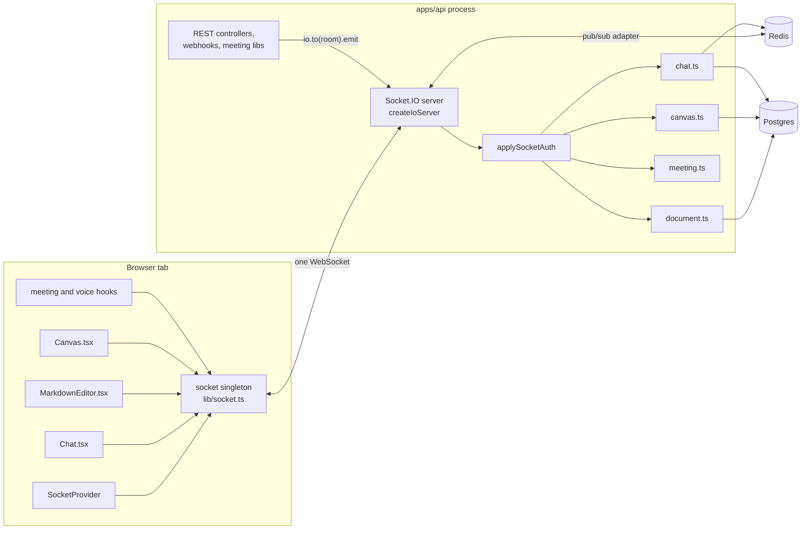
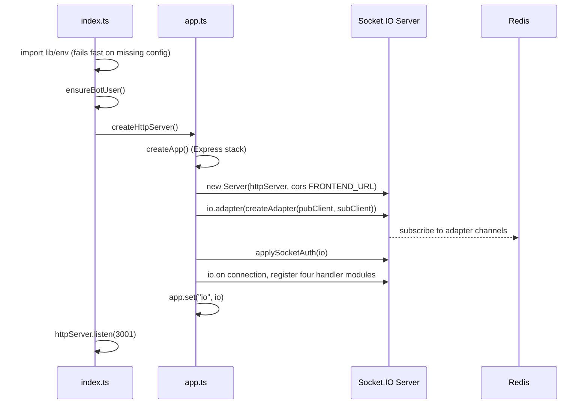
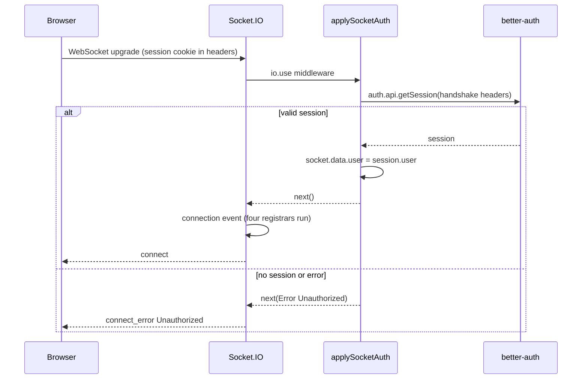
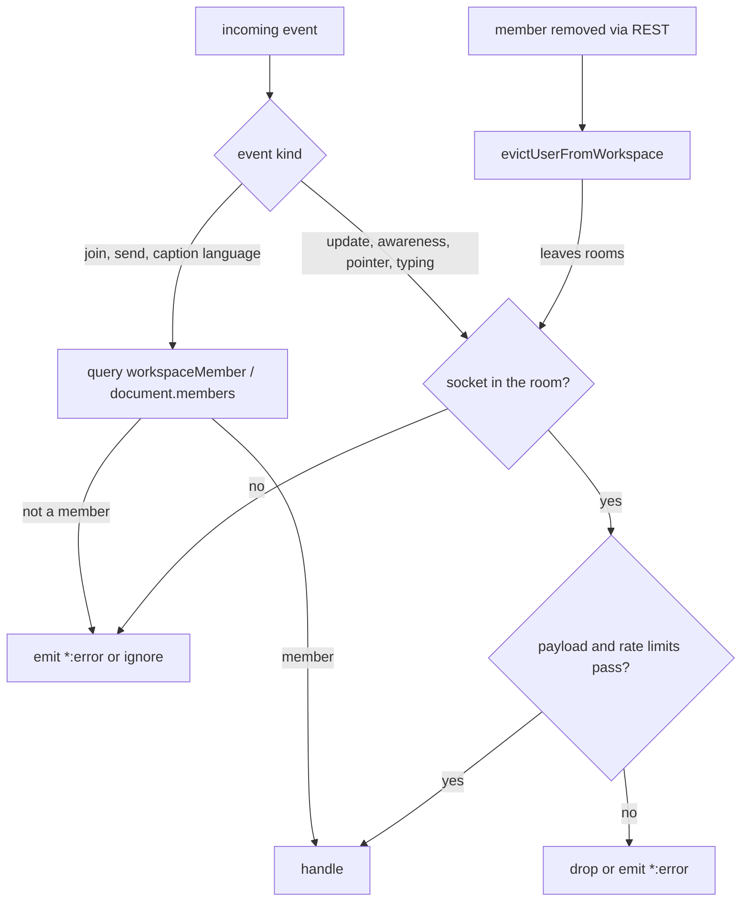
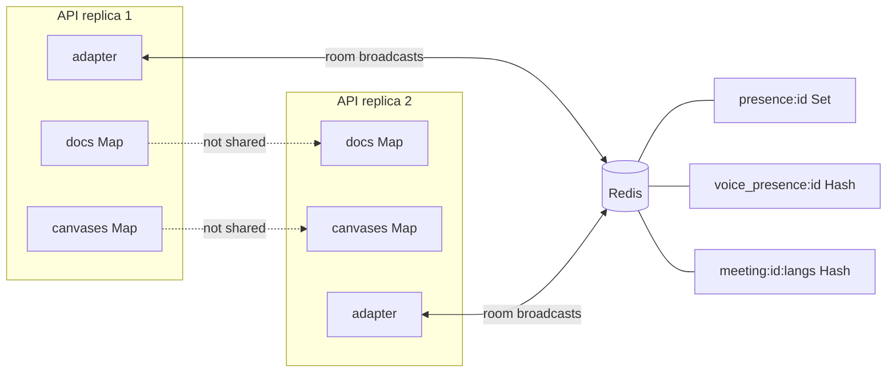

# Realtime overview

Every live feature in Nimbus (chat, online presence, typing indicators, collaborative Markdown, the shared whiteboard, the call roster and the meeting captions) travels over one authenticated Socket.IO connection between the browser and the Express API. This page explains how that server is built, how a connection is authenticated, how rooms and per-event checks keep one workspace's traffic away from everyone else, and why the three kinds of shared state (Yjs documents, last-write-wins canvases and Redis-backed presence) are synchronised in three deliberately different ways.

## What runs over the socket

Socket.IO is a WebSocket library with rooms (named groups of connections a server can broadcast to), automatic reconnection and acknowledgement-free events. Nimbus opens **one** connection per browser tab and multiplexes every feature over it. The API registers four handler modules on each authenticated socket, in [app.ts](../../apps/api/src/app.ts) (`createIoServer`):

| Registrar                 | File                                                   | Owns                                                                                      |
| ------------------------- | ------------------------------------------------------ | ----------------------------------------------------------------------------------------- |
| `registerChatHandlers`    | [chat.ts](../../apps/api/src/socket/chat.ts)           | `workspace:join/leave`, Redis presence, `typing:*`, `message:send` and the Nimbus pipeline |
| `registerDocumentHandlers` | [document.ts](../../apps/api/src/socket/document.ts)   | Yjs Markdown documents: `doc:join/update/awareness/leave`                                 |
| `registerCanvasHandlers`  | [canvas.ts](../../apps/api/src/socket/canvas.ts)       | Excalidraw canvases: `canvas:join/update/pointer/leave`                                   |
| `registerMeetingHandlers` | [meeting.ts](../../apps/api/src/socket/meeting.ts)     | `meeting:caption-language`, the per-socket caption translation choice                     |

A fifth file, [roomState.ts](../../apps/api/src/socket/roomState.ts), is not a registrar: it holds `isRoomEmpty`, the predicate the document and canvas modules share to decide when in-memory state may be dropped.

Voice audio does **not** travel over this socket. Calls run between each browser and a LiveKit media server; the socket only carries the server's view of who is on the call (`voice:roster`). That system is described in [Voice and LiveKit](../meetings/voice-and-livekit.md).

Many events are not emitted by a socket handler at all. HTTP controllers and background work broadcast through the same `io` instance: `createHttpServer` stores it with `app.set("io", io)`, and modules such as [documentEvents.ts](../../apps/api/src/lib/documentEvents.ts), [botMessage.ts](../../apps/api/src/lib/botMessage.ts), [botTyping.ts](../../apps/api/src/lib/botTyping.ts), the meeting libraries and the LiveKit webhook router take it as a dependency. The full list of who emits what is in the [socket events reference](../reference/socket-events.md).



## How the server is built

[index.ts](../../apps/api/src/index.ts) is a thin bootstrap: it loads the environment, validates it through `lib/env`, upserts the bot user (`ensureBotUser`), calls `createHttpServer()` from [app.ts](../../apps/api/src/app.ts) and listens on port **3001**. The factories are split out so tests can build the identical wiring on an ephemeral port.

`createIoServer(httpServer)` does four things in a fixed order:

1. **Creates the server** with CORS restricted to `FRONTEND_URL` and `credentials: true`, so the browser is allowed to send its session cookie during the WebSocket handshake.
2. **Attaches the Redis adapter** (`io.adapter(createAdapter(pubClient, subClient))`) before any connection exists. The two ioredis connections come from [redis.ts](../../apps/api/src/lib/redis.ts); a single Redis connection cannot be both publisher and subscriber, hence the pair.
3. **Registers handshake authentication** (`applySocketAuth(io)`), which must precede the `connection` listener.
4. **Fans each connection out** to the four registrars above.



The Redis client's transport (TLS or plaintext) is derived from the connection string rather than the scheme alone; a TLS mismatch makes the client silently never ready, which would leave the API serving HTTP with no presence and no cross-replica broadcast. [redis.ts](../../apps/api/src/lib/redis.ts) runs a 10-second connect watchdog (`CONNECT_WATCHDOG_MS`) that logs that case. The [runbook](../operations/runbook.md) covers diagnosing it.

## Handshake authentication

Every connection is authenticated once, during the handshake, by [socket.middleware.ts](../../apps/api/src/middleware/socket.middleware.ts):

```ts
const session = await auth.api.getSession({
  headers: fromNodeHeaders(socket.handshake.headers),
});
if (!session) return next(new Error("Unauthorized"));
socket.data.user = session.user;
```

The browser's better-auth session cookie arrives in the handshake headers because the client is created with `withCredentials: true` ([socket.ts](../../apps/web/lib/socket.ts)). A rejected handshake never reaches any `connection` handler, so **every handler can trust `socket.data.user`** and none re-authenticates. Identity used in broadcasts (names, avatars, presence colours, awareness `user` fields, pointer identities) is always stamped from `socket.data.user`, never taken from the payload. `registerChatHandlers` additionally disconnects a socket that somehow has no `user.id`, as a defensive backstop.



Because the session is read only at connect time, a session revoked later does not drop an open socket by itself; what stops a removed member is the membership model below. The broader auth design (cookie attributes, cross-subdomain cookies, the agent's separate credentials) is in [Authentication](../architecture/auth.md).

## Rooms

Rooms scope every broadcast. Nimbus uses three naming schemes, plus the per-socket room Socket.IO creates automatically:

| Room                  | Name                               | Joined by                             | Carries                                                                                         |
| --------------------- | ---------------------------------- | ------------------------------------- | ----------------------------------------------------------------------------------------------- |
| Workspace             | the workspace cuid, unprefixed     | `workspace:join` (`chat.ts`)          | chat, presence, typing, `bot:typing`, `doc:ai:*`, `document:*`, `voice:roster`, every `meeting:*` |
| Markdown document     | `doc:<documentId>` (`DOC_ROOM`)    | `doc:join` (`document.ts`)            | `doc:update`, `doc:awareness`                                                                   |
| Canvas                | `canvas:<documentId>` (`CANVAS_ROOM`) | `canvas:join` (`canvas.ts`)        | `canvas:update`, `canvas:pointer`, `canvas:pointer-leave`                                       |
| Own socket            | `socket.id`                        | automatic                             | direct replies via `socket.emit` (`doc:state`, `canvas:state`, `presence:online_users`, `ai:refused`, errors) |

The workspace room name is the bare id, which is why the chat module's `disconnecting` handler treats "every room except `socket.id`" as a workspace and the document and canvas modules recognise their own rooms by prefix.

## The membership model

The handshake proves *who* the user is. Whether they may touch a given workspace is checked separately, in one of two ways depending on the event.

**Database-checked events** run a membership query every time they arrive:

| Event                      | Check                                                                               | Refusal                                       |
| -------------------------- | ----------------------------------------------------------------------------------- | --------------------------------------------- |
| `workspace:join`           | `workspaceMember.findUnique` on `(userId, workspaceId)`                             | `workspace:error` "Not a member of this workspace" |
| `workspace:leave`          | same                                                                                 | silently ignored                              |
| `message:send`             | Zod `messageSendSchema`, then the same membership query                            | silently ignored (image ownership: `workspace:error`) |
| `doc:join`                 | document row with `workspace.members` included                                     | `doc:error` "Document not found" / "Not a member" |
| `canvas:join`              | same                                                                                 | `canvas:error` "Canvas not found" / "Not a member" |
| `meeting:caption-language` | Zod `captionLanguageSchema`, meeting must be `LIVE`, then `requireWorkspaceRole` ([workspaceAccess.ts](../../apps/api/src/lib/workspaceAccess.ts)) | silently ignored |

**Room-gated events** are high-frequency (keystrokes, cursor moves, pointer moves) and are allowed only from a socket that is currently in the matching room, without a database round-trip. Joining the room is what required the membership check:

| Event            | Gate                                       |
| ---------------- | ------------------------------------------ |
| `typing:start/stop` | `socket.rooms.has(workspaceId)`         |
| `doc:update`     | `socket.rooms.has("doc:" + docId)`         |
| `doc:awareness`  | same, plus size, rate and ownership limits |
| `canvas:update`  | `socket.rooms.has("canvas:" + documentId)` |
| `canvas:pointer` | same, plus a rate limit                    |

A room gate is only as good as the guarantee that removed members leave their rooms, because a socket that only listens never sends an event that could be refused. That guarantee is [socketEviction.ts](../../apps/api/src/lib/socketEviction.ts): when `removeMember` in the workspace controller deletes a membership row (a removal by an admin or a member leaving), it calls `evictUserFromWorkspace`, which takes every socket of that user out of the workspace room and runs each local socket's own `doc:leave` / `canvas:leave` handlers for that workspace's documents. Details are in [Presence and chat](presence-and-chat.md).



The REST side has its own guard (`requireWorkspaceRole`, 404 for non-members, 403 for insufficient role). The full RBAC matrix is in [Security](../architecture/security.md).

## Broadcast patterns

Three emit forms appear throughout the handlers, and the choice between them is deliberate:

| Form                          | Reaches                          | Used for                                                                                       |
| ----------------------------- | -------------------------------- | ---------------------------------------------------------------------------------------------- |
| `io.to(room).emit(...)`       | everyone in the room, sender included | `message:new` (the sender's own message comes back this way), `presence:joined`, `doc:ai:*`, `document:*`, `bot:typing`, `meeting:*`, `voice:roster` |
| `socket.to(room).emit(...)`   | everyone in the room except the sender | `doc:update`, `doc:awareness`, `canvas:update`, `canvas:pointer`, `canvas:pointer-leave`, `typing:*`, `presence:left` on disconnect |
| `socket.emit(...)`            | only the sender                  | `doc:state`, `canvas:state`, `presence:online_users`, `voice:roster` on join, `ai:refused`, every `*:error` |

The "except the sender" form exists because the sender already applied its own change locally. Echoing a Yjs update or a canvas array back to its author would be wasted bandwidth at best and, for the canvas, could overwrite a newer local edit.

## The Redis adapter, and what it does not share

The `@socket.io/redis-adapter` publishes every room broadcast to Redis so that other API replicas deliver it to their own sockets. That makes `io.to(room).emit` correct across replicas. It does **not** move any state. Several pieces of state live only in the memory of the process that created them:

| Process-local state                       | Where                                         | Consequence with several replicas                                          |
| ----------------------------------------- | --------------------------------------------- | -------------------------------------------------------------------------- |
| `docs: Map<string, Y.Doc>`                | [document.ts](../../apps/api/src/socket/document.ts) | two replicas would each hold and persist their own copy of a document |
| `presence: Map<string, DocPresence>` (awareness) | same                                    | a newcomer is replayed only the cursors its own replica knows              |
| `seededDocs`, `saveTimers`                | same                                          | seed clearing and debounces are per replica                                |
| `canvases: Map<string, CanvasState>`      | [canvas.ts](../../apps/api/src/socket/canvas.ts) | last-write-wins per replica, then the last save wins in Postgres        |
| `pending` mention counts                  | [botTyping.ts](../../apps/api/src/lib/botTyping.ts) | the bot indicator can clear early; the 60-second timer bounds the other error |
| per-socket rate limiters                  | [rateLimiter.ts](../../apps/api/src/lib/rateLimiter.ts) | fine: a socket lives on exactly one replica                           |

Shared state that *must* agree across replicas is kept in Redis instead:

| Redis key                       | Type | Written by                                          |
| ------------------------------- | ---- | --------------------------------------------------- |
| `presence:<workspaceId>`        | Set  | [presence.ts](../../apps/api/src/lib/presence.ts) (`presenceService`) |
| `voice_presence:<workspaceId>`  | Hash | [voicePresence.ts](../../apps/api/src/lib/voicePresence.ts), fed by LiveKit webhooks |
| `meeting:<meetingId>:langs`     | Hash | [captionLanguages.ts](../../apps/api/src/lib/meeting/captionLanguages.ts), socket id to language |



Production runs a single API container ([Deployment](../operations/deployment.md)), so none of this bites today. Scaling out would need either sticky routing by document (so every editor of a document lands on one replica) or a shared Yjs and canvas store.

## The three sync models compared

The most important thing to understand before touching collaboration code is that the three kinds of shared state use three different models, each chosen for the data it carries:

| Aspect              | Markdown documents                               | Canvases                                         | Presence (workspace, typing, roster)               |
| ------------------- | ------------------------------------------------ | ------------------------------------------------ | -------------------------------------------------- |
| Model               | CRDT (Yjs): concurrent edits merge               | full-state, last write wins                      | ephemeral membership sets and relays               |
| Server memory       | `Y.Doc` per document in `docs`                   | element array per canvas in `canvases`           | none for workspace presence (Redis), none for typing |
| Wire payload        | binary Yjs delta as `number[]`                   | the whole `OrderedExcalidrawElement[]`           | ids and names                                      |
| Join reply          | `doc:state` (full encoded state)                 | `canvas:state` (full array)                      | `presence:online_users`, `voice:roster`            |
| Persistence         | `Document.yjsState` + `searchText`, debounced **5 s** | `Document.canvasData` + `searchText`, debounced **3 s** | Redis, 24 h TTL guard; typing never stored |
| Conflict behaviour  | none lost; Yjs merges both                       | the later full array replaces the earlier one    | not applicable                                     |
| Cursor presence     | y-protocols awareness, sanitised server-side     | `canvas:pointer` relay, never stored             | not applicable                                     |
| Pages               | [Markdown sync](markdown-sync.md)                | [Canvas sync](canvas-sync.md)                    | [Presence and chat](presence-and-chat.md)          |

```mermaid
flowchart TB
  subgraph MDM["Markdown: CRDT"]
    m1["local keystroke"] --> m2["Y.Doc update (delta)"]
    m2 -->|"doc:update"| m3["server applies to its Y.Doc"]
    m3 -->|"relay delta"| m4["peers merge, no conflict"]
    m3 --> m5["debounce 5s, yjsState"]
  end
  subgraph CVM["Canvas: last write wins"]
    c1["local stroke"] --> c2["debounce 300ms on client"]
    c2 -->|"canvas:update, whole array"| c3["server replaces its array"]
    c3 -->|"relay array"| c4["peers replace their scene"]
    c3 --> c5["debounce 3s, canvasData"]
  end
  subgraph PRM["Presence: Redis set"]
    p1["workspace:join"] --> p2["SADD presence:id"]
    p2 --> p3["presence:joined to room"]
    p4["disconnecting"] --> p5["SREM presence:id"]
    p5 --> p6["presence:left to room"]
  end
```



Why not one model for everything? Text is edited character by character by several people at once, and losing a sentence because someone else typed elsewhere is unacceptable, so it gets a CRDT. A whiteboard is mostly edited one shape at a time, Excalidraw's scene is an array of self-contained elements, and a full-state replace is far simpler to reason about; the cost (a concurrent edit inside the same debounce window can be overwritten) is accepted and documented in [Canvas sync](canvas-sync.md). Presence is not content at all: it must be cheap, must survive replicas, and must expire on its own, which is what a Redis set with a TTL does.

## Disconnection

Socket.IO fires `disconnecting` while the socket is still listed in its rooms and `disconnect` after it has left them. The handlers that need to know which rooms a socket was in use `disconnecting`:

| Module        | Event           | Does                                                                                                         |
| ------------- | --------------- | ------------------------------------------------------------------------------------------------------------ |
| `chat.ts`     | `disconnecting` | for every room except `socket.id`: `presenceService.userLeft`, then `presence:left` to the rest of the room |
| `document.ts` | `disconnecting` | first, synchronously, removes the socket's awareness client ids and tells each room; then snapshots and evicts any document whose room drains |
| `canvas.ts`   | `disconnecting` | first, synchronously, sends `canvas:pointer-leave`; then snapshots and evicts any canvas whose room drains |
| `meeting.ts`  | `disconnect`    | removes the socket's entry from the meeting's caption-language hash                                          |

Cursor and pointer cleanup runs before any awaited snapshot so that a slow database write never leaves a ghost cursor on other people's screens. The re-check of room emptiness after that await is explained in [Markdown sync](markdown-sync.md).

## The client side in brief

The browser holds a single typed socket created in [socket.ts](../../apps/web/lib/socket.ts) with `autoConnect: false`. [socketProvider.tsx](../../apps/web/providers/socketProvider.tsx) is mounted once in the root layout, connects on mount, logs `connect_error`, and disconnects on unmount. Components import the singleton directly; there is no socket context. Emits issued before the connection opens are buffered by socket.io-client and sent once it connects.

A reconnect produces a brand-new server-side socket with no rooms. `MarkdownEditor`, `Canvas` and `useCaptionLanguage` listen for `connect` and re-send their join or subscription. The frontend structure is covered in [Frontend overview](../frontend/overview.md).

## Design trade-offs and limits

- **One connection for everything.** Simpler auth (one handshake), one reconnect path, and one place to scope traffic. The cost is that a burst on one feature (a large canvas array) shares a pipe with chat.
- **Handshake-only authentication.** Cheap per event, but an existing socket outlives a revoked session until it reconnects. Membership is the real access control, and it is enforced per event or by room plus eviction.
- **Room gates instead of per-keystroke queries.** `doc:update`, `doc:awareness`, `canvas:update`, `canvas:pointer` and `typing:*` trust room membership, which makes them O(1). This is only sound because `evictUserFromWorkspace` removes a departing member's sockets from those rooms. A socket held by *another* replica can be taken out of its rooms through the adapter but its `doc:leave` / `canvas:leave` handlers cannot be run from here.
- **Process-local collaboration state.** Yjs documents, awareness, canvas arrays and bot-typing counts live in one process. The Redis adapter makes broadcasts multi-replica, but horizontal scaling still needs sticky routing or a shared store.
- **The workspace room is not re-joined on reconnect.** `Chat.tsx` emits `workspace:join` when it mounts and on its `wsid` changing, and its `connect` listener only refreshes AI status. After a network drop the editors re-join their rooms, but chat, presence and workspace-wide events stop arriving until the page is reloaded or the chat panel remounts.
- **The server's Socket.IO instance is untyped.** The browser socket is `Socket<ServerToClientEvents, ClientToServerEvents>`, but `new Server(...)` in `app.ts` and the handler `Socket` parameters carry no event generics, so server-side emits are not type-checked against the contract. The event *names* are pinned by a golden-list test ([contract.test.ts](../../apps/api/src/__tests__/integration/contract.test.ts)).
- **No acknowledgements.** No event uses a Socket.IO ack callback. Errors come back as `*:error` events or are dropped silently; a client cannot correlate a refusal with the request that caused it.

## Related documentation

- [Markdown sync](markdown-sync.md)
- [Canvas sync](canvas-sync.md)
- [Presence and chat](presence-and-chat.md)
- [Socket events reference](../reference/socket-events.md)
- [Voice and LiveKit](../meetings/voice-and-livekit.md)
- [Authentication](../architecture/auth.md)
- [Security](../architecture/security.md)
- [Add a socket event](../guides/add-a-socket-event.md)
- [Frontend overview](../frontend/overview.md)
