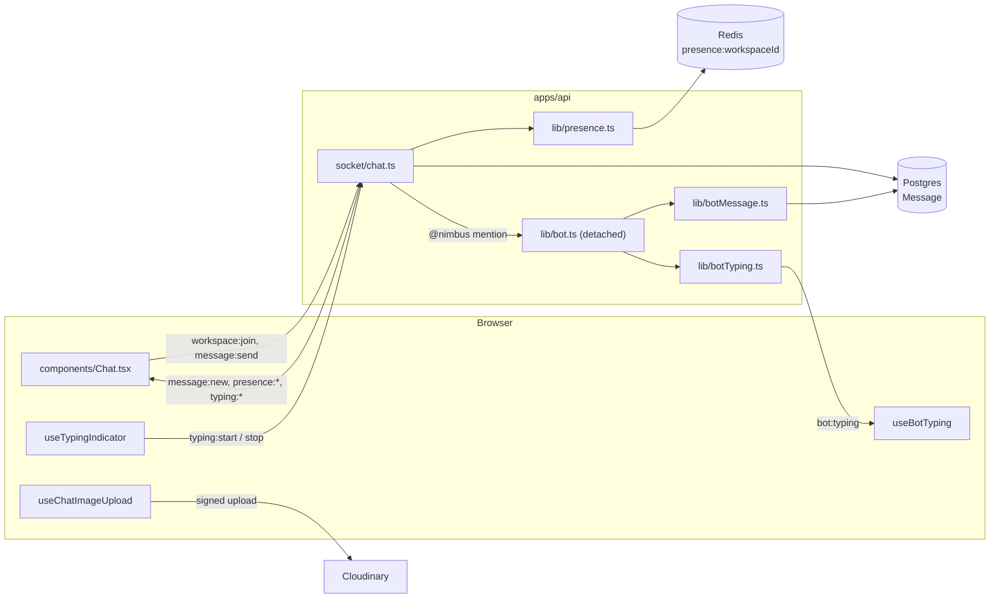
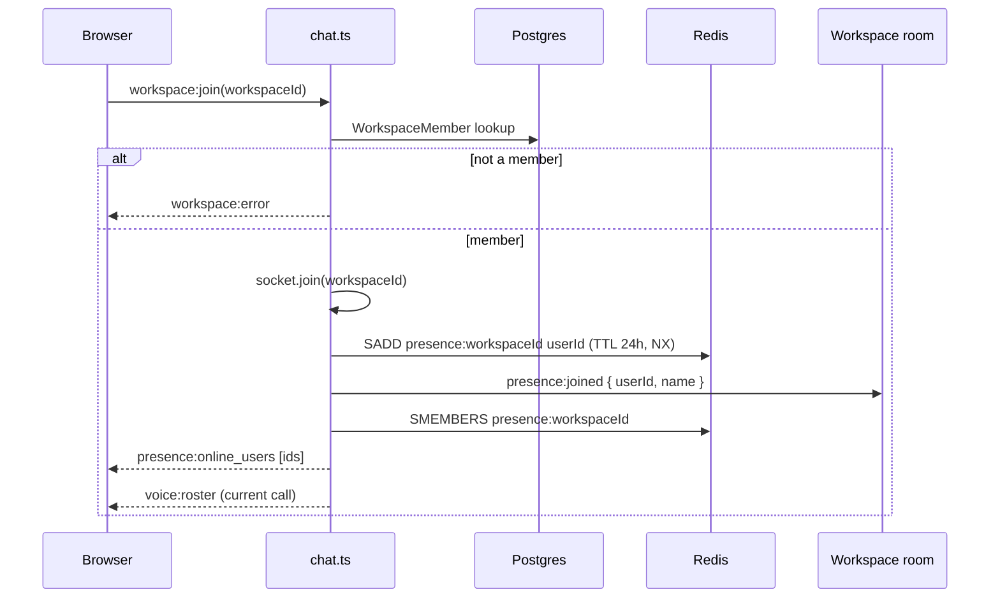
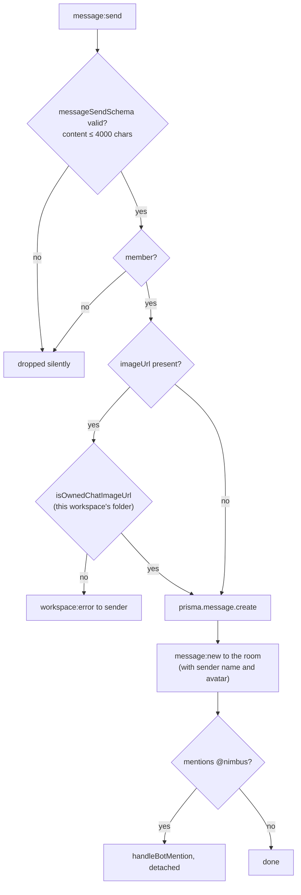
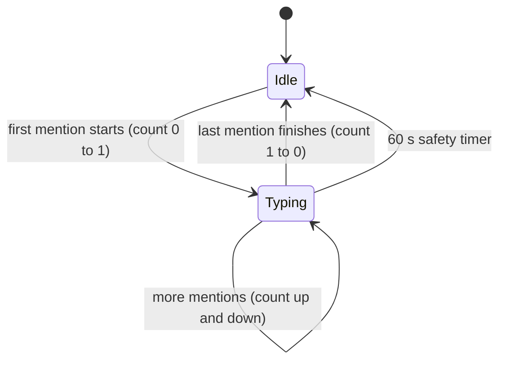

# Presence and chat

Workspace chat, who is online, who is typing, and how the assistant joins the conversation. These are the lightest realtime features in Nimbus: chat messages go straight to Postgres and are fanned out over the workspace's Socket.IO room, online presence is a Redis set per workspace, and typing indicators are relayed without being stored at all. All of it lives in one handler module, [`socket/chat.ts`](../../apps/api/src/socket/chat.ts).

## The pieces

## Joining a workspace

When the workspace page mounts, [`Chat.tsx`](../../apps/web/components/Chat.tsx) emits `workspace:join`. The handler:

The workspace room is named by the workspace's cuid. Everything addressed to "the workspace" (chat, presence, document list changes, meeting events) is broadcast there. `workspace:leave` reverses the join after re-checking membership.

## Presence

[`presence.ts`](../../apps/api/src/lib/presence.ts) keeps one Redis set per workspace, `presence:<workspaceId>`, holding user ids. `SADD` and `SREM` make joins and leaves idempotent, so a user who opens the workspace twice is counted once. Each key gets a 24-hour TTL with `NX` (set only if none exists) as a guard against stale data if a process dies without cleaning up; normal leaves remove members explicitly.

On `disconnecting`, the handler walks every room the socket was in and removes the user from each one's presence set, telling the others `presence:left`. When a member is removed from a workspace, [`socketEviction.ts`](../../apps/api/src/lib/socketEviction.ts) does the same for their live sockets and takes them out of the rooms.

Presence in documents and canvases ("who else is editing", live cursors) is a different mechanism: Yjs awareness for markdown and pointer events for canvases, described in [Markdown sync](markdown-sync.md) and [Canvas sync](canvas-sync.md). The pure helpers that de-duplicate those by person rather than by tab are in [`apps/web/lib/presence.ts`](../../apps/web/lib/presence.ts).

## Sending a message

`message:send` carries `{ workspaceId, content, imageUrl?, timeZone?, clockOverride? }`.

The message is stored **before** it is broadcast, so a client never shows a message that a reload would lose. History comes from REST: `GET /api/messages/:wsid` returns the latest 50, oldest first ([REST API](../reference/rest-api.md)).

### Images

The browser never sends image bytes to the API. [`useChatImageUpload`](../../apps/web/hooks/useChatImageUpload.ts) fetches a signature from `GET /api/upload/chat-image-signature?workspaceId=…`, uploads the file directly to Cloudinary into `nimbus/chat/<workspaceId>` (formats `jpg,png,webp,heic`, limited to 2048×2048 by [`cloudinary.ts`](../../apps/api/src/lib/cloudinary.ts)), and puts the returned `secure_url` on the message. The API re-checks with `isOwnedChatImageUrl` that the URL lives in this workspace's folder, so a signature or URL for one workspace cannot be used to post an image into another.

### Time context

The sender's IANA time zone rides on every message so the assistant resolves "on Tuesday" in the sender's own day. Outside production, [`chatClock.ts`](../../apps/web/lib/chatClock.ts) can also send a clock override read from `localStorage["nimbus:agent-now"]` to test date handling; the API ignores it in production.

## Typing indicators

Typing state is never stored. `typing:start` and `typing:stop` are relayed to the rest of the room as `{ userId, name }`, and only if the socket has already joined that room. The client hook [`useTypingIndicator`](../../apps/web/hooks/useTypingIndicator.ts) does the shaping:

| Constant | Value | Purpose |
| --- | --- | --- |
| `RESEND_INTERVAL_MS` | 2 s | Throttle for outgoing `typing:start` while typing continues |
| `IDLE_STOP_MS` | 3 s | Auto-send `typing:stop` after idle |
| `INBOUND_TTL_MS` | 5 s | Drop a peer's indicator if their `typing:stop` never arrives (crashed tab) |

It also filters out the user's own id, because the same user in a second tab is a different socket and would otherwise see "You are typing".

## The assistant in chat

A message matching `BOT_MENTION` (`/@nimbus(?:bot)?\b/i` in [`packages/types/src/api/bot.ts`](../../packages/types/src/api/bot.ts)) starts `handleBotMention` **detached**: the handler does not await it, so a slow model never delays chat delivery. The bot decides whether to reply or create a document, posts its reply through [`postBotMessage`](../../apps/api/src/lib/botMessage.ts) (persist, then `message:new`, the same path as a human message), and refusals (no key, quota spent, spend cap) go to the asking socket alone as `ai:refused`. The whole pipeline is in [NimbusBot](../ai/nimbusbot.md).

While a mention is being answered, [`botTyping.ts`](../../apps/api/src/lib/botTyping.ts) tells the room `bot:typing { typing: true }`. Mentions overlap, so the state per workspace is a **count**: the signal flips only on the 0→1 and 1→0 transitions. Every start arms a `BOT_TYPING_TIMEOUT_MS = 60_000` safety timer so a crash cannot leave the room showing a bot that types forever. [`useBotTyping`](../../apps/web/hooks/useBotTyping.ts) on the client also clears the indicator when a bot message arrives.

## Design trade-offs and limits

- **Presence is per user, not per socket.** The Redis set holds user ids, and any one socket disconnecting removes the user. A user with two tabs who closes one shows as offline to others until the remaining tab re-joins. Counting sockets per user would fix it at the cost of more Redis bookkeeping.
- **Disconnect cleanup walks every room** the socket was in, including `doc:` and `canvas:` rooms, and issues a harmless `SREM` against keys that are not presence sets.
- **No delivery guarantees beyond Socket.IO's.** A client that is disconnected when `message:new` fires misses it until it reloads history; there is no per-client cursor or replay.
- **History is the latest 50 only.** There is no pagination for older messages in the API today.
- **Invalid payloads are dropped silently** rather than answered with an error, which keeps the handler simple but gives a buggy client no feedback.
- **The bot-typing count is process-local.** With several API replicas the indicator can clear slightly early; the safety timer bounds the opposite error.

## Related documentation

- [Realtime overview](overview.md)
- [Socket events](../reference/socket-events.md)
- [NimbusBot](../ai/nimbusbot.md)
- [Security and RBAC](../architecture/security.md)
- [Frontend overview](../frontend/overview.md)
