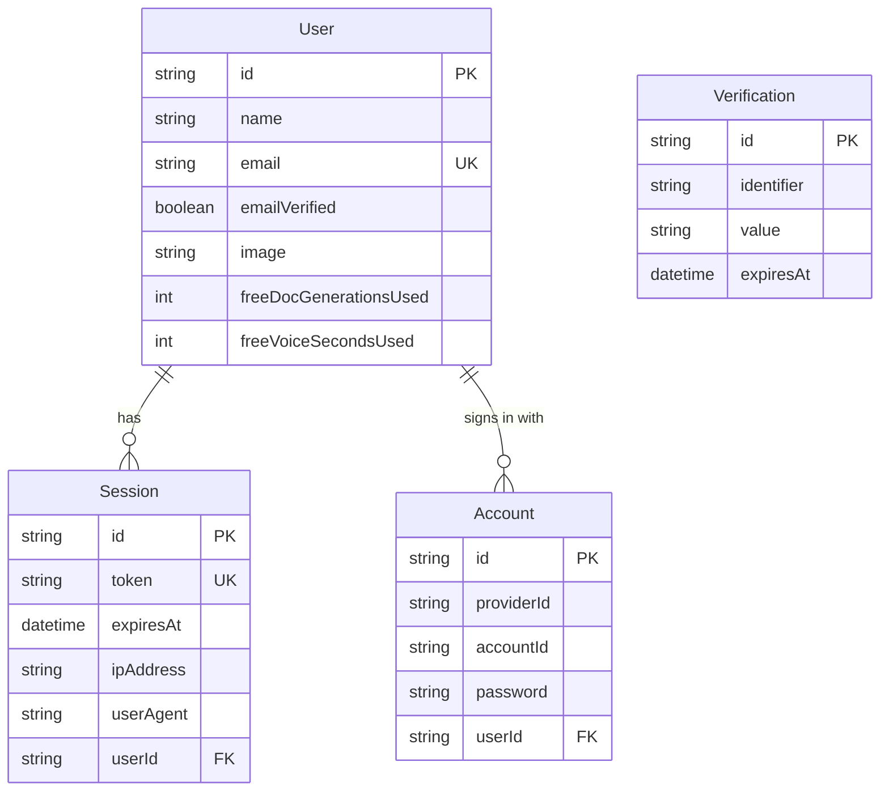
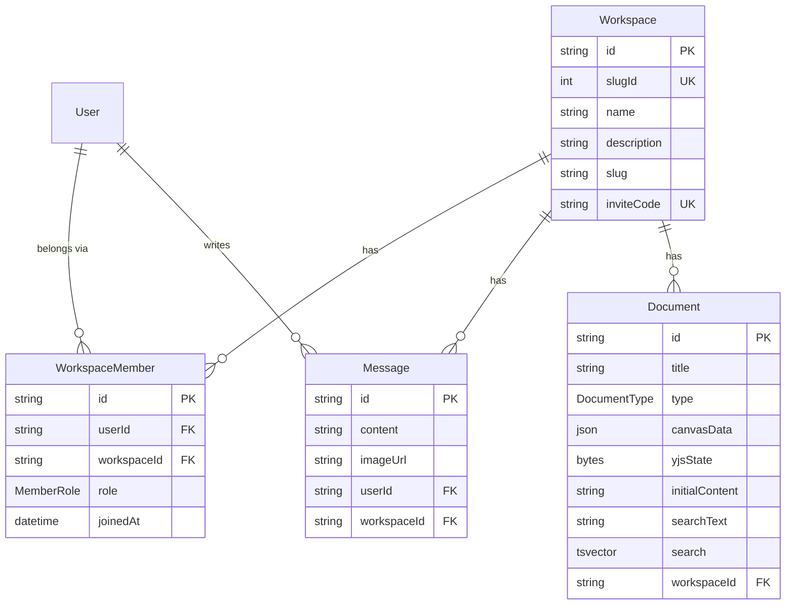
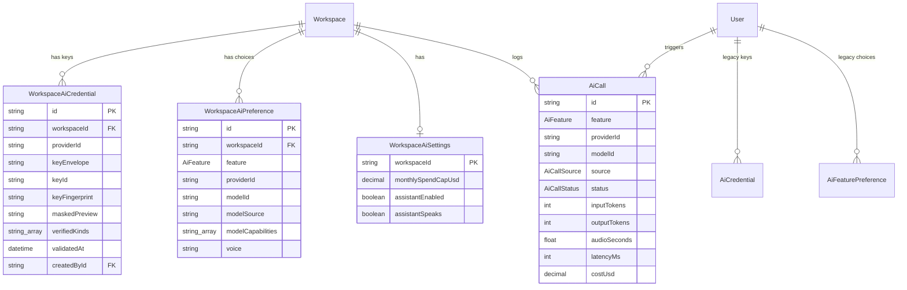
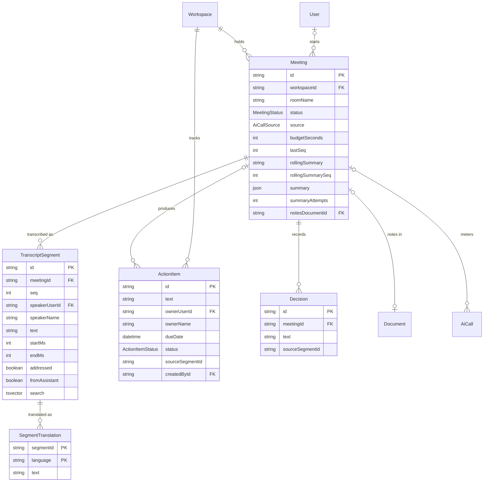
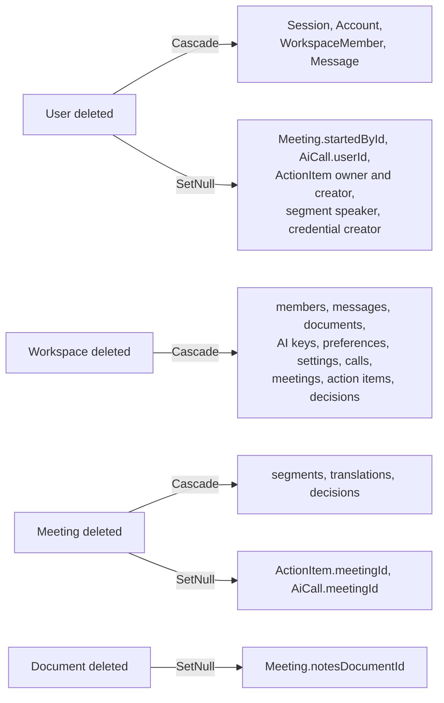

# Data model reference

Every table Nimbus stores in Postgres, defined once in [`schema.prisma`](../../packages/database/prisma/schema.prisma) and shipped as the `@nimbus/db` package (directory `packages/database`). The page groups the 19 models into identity, workspaces and documents, AI, and meetings, shows each group as an entity-relationship diagram, and ends with the cascade rules, the partial indexes the code depends on, and the migration history.

## The package

`@nimbus/db` is the only workspace that resolves through `dist` rather than source: [`src/client.ts`](../../packages/database/src/client.ts) creates the Prisma client (generated into the gitignored `src/generated/prisma`), and [`src/index.ts`](../../packages/database/src/index.ts) re-exports it with the generated types. Generate it with `npx turbo run db:generate` before the first type-check. Schema changes follow [Change the schema](../guides/change-the-schema.md).

Two naming conventions coexist. The tables better-auth owns, and every table added since the AI work, are mapped to snake-case names with `@@map` (`user`, `session`, `ai_call`, `transcript_segment`); the original workspace tables keep their Prisma names (`Workspace`, `WorkspaceMember`, `Message`, `Document`, `Meeting`). Ids are cuids, except better-auth's tables, whose ids better-auth generates.

## Identity

better-auth owns these four tables and writes them through its Prisma adapter ([Auth](../architecture/auth.md)). Nimbus adds two counters to `user` for the free tier.

| Model | Purpose |
| --- | --- |
| `User` (`user`) | A person. `freeDocGenerationsUsed` and `freeVoiceSecondsUsed` are the lifetime free-tier counters ([Quotas and the free tier](../ai/quotas-and-free-tier.md)). NimbusBot is a row here too, with id `BOT_USERID`, upserted at boot by [`botUser.ts`](../../apps/api/src/lib/botUser.ts). |
| `Session` (`session`) | A signed-in browser. The cookie carries `token`. |
| `Account` (`account`) | A credential: `providerId = "credential"` holds the password hash, `"google"` the OAuth tokens. |
| `Verification` (`verification`) | Email-verification and password-reset tokens. |

## Workspaces, chat and documents

| Model | Notes |
| --- | --- |
| `Workspace` | `slugId` is an autoincrement integer used in URLs (`/workspace/42`); everything internal uses the cuid `id`. `inviteCode` is a cuid rotated by ADMIN+. |
| `WorkspaceMember` | The join table and the role. Unique on `(userId, workspaceId)`. |
| `Message` | One chat message; `imageUrl` is a Cloudinary URL. Bot messages are rows with `userId = BOT_USERID`. |
| `Document` | Both document kinds in one table. MARKDOWN uses `yjsState` (the encoded Yjs document, saved on a debounce) and `initialContent` (generated text injected into the Yjs doc on the next join, then nulled). CANVAS uses `canvasData` (the Excalidraw element array). `searchText` is plain text extracted for search, and `search` is a Postgres generated `tsvector` over `searchText` and `title` with a GIN index. |

The sync behaviour behind `yjsState` and `canvasData` is in [Markdown sync](../realtime/markdown-sync.md) and [Canvas sync](../realtime/canvas-sync.md).

## AI configuration and metering

| Model | Notes |
| --- | --- |
| `WorkspaceAiCredential` | A provider key a workspace brought (BYOK), one per `(workspaceId, providerId)`. The key itself is only ever stored as `keyEnvelope`, an encrypted envelope; `keyId` names the encryption key version, `keyFingerprint` detects duplicates, `maskedPreview` is what the UI shows. `verifiedKinds` records which capabilities (chat, transcription, speech) the save-time probe confirmed. See [Providers and BYOK](../ai/providers-and-byok.md). |
| `WorkspaceAiPreference` | The provider and model a workspace chose for one `AiFeature`, with `voice` for speech. |
| `WorkspaceAiSettings` | Spend cap and the assistant switches. Primary key is the workspace id (one row at most). |
| `AiCall` | One row per model call, with tokens or audio seconds, latency and estimated cost: the source for usage, spend caps and the admin call log. |
| `AiCredential`, `AiFeaturePreference` | The earlier per-user BYOK tables. Nothing in the request path reads them any more; [`copyAiCredentialsToWorkspaces.ts`](../../apps/api/src/scripts/copyAiCredentialsToWorkspaces.ts) copies them into the workspace tables. They remain so that copy can be re-run. |

## Meetings

| Model | Notes |
| --- | --- |
| `Meeting` | One run of the in-call assistant in a workspace's call. `source` says whether it runs on the workspace's key (BYOK) or the free tier; `budgetSeconds` caps a free meeting. `lastSeq` allocates transcript sequence numbers. `rollingSummary` is the running summary the assistant reads, refreshed up to `rollingSummarySeq`. `summary` is the final structured summary (validated by `MeetingSummarySchema`), `summaryAttempts` and `failureReason` record retries, and `notesDocumentId` links the generated notes document. |
| `TranscriptSegment` | One utterance. `(meetingId, seq)` is unique, which makes segment posts idempotent. `addressed` marks speech directed at the assistant, `fromAssistant` its own replies. `search` is a generated `tsvector` with a GIN index for transcript search. |
| `SegmentTranslation` | A caption translation of one segment into one language, cached so each segment is translated once per language. |
| `ActionItem` | A to-do, from a meeting or added by hand. `ownerName` keeps the name as spoken when no member matched; it is cleared whenever the owner changes. |
| `Decision` | A decision recorded from a meeting. |

The lifecycle that moves `status` through `LIVE → ENDED → SUMMARIZED` (or `FAILED`) is in [Transcripts and notes](../meetings/transcripts-and-notes.md).

## Enums

| Enum | Values | Used by |
| --- | --- | --- |
| `MemberRole` | `OWNER`, `ADMIN`, `MEMBER` | `WorkspaceMember.role` |
| `DocumentType` | `CANVAS`, `MARKDOWN` | `Document.type` (default `CANVAS`) |
| `AiFeature` | `CHAT`, `MARKDOWN`, `CANVAS`, `VISION`, `TRANSCRIPTION`, `SPEECH`, `MEETING` | preferences and `AiCall` |
| `AiCallSource` | `BYOK`, `FREE` | `AiCall.source`, `Meeting.source` |
| `AiCallStatus` | `OK`, `ERROR`, `REFUSED`, `CANCELLED` | `AiCall.status` |
| `MeetingStatus` | `LIVE`, `ENDED`, `SUMMARIZED`, `FAILED` | `Meeting.status` |
| `ActionItemStatus` | `OPEN`, `DONE` | `ActionItem.status` |

## Deletion and cascades

Deleting a workspace removes everything in it. Deleting a user removes what is theirs alone (sessions, memberships, messages) and keeps shared history readable by nulling the pointers to them. Account deletion has an application-level step before the row goes: [`accountDeletion.ts`](../../apps/api/src/lib/accountDeletion.ts), run from better-auth's `beforeDelete`, deletes every workspace the user owns (with everything in it) and removes the user from every live call, because once the membership rows cascade away nothing can tell what they owned. Deleting a meeting keeps its action items (they become workspace items) and its notes document.

## Indexes the code depends on

| Index | Defined in | Why it matters |
| --- | --- | --- |
| `Meeting_workspaceId_live_key`: unique `(workspaceId) WHERE status = 'LIVE'` | `20261107102054_add_meetings` | At most one live meeting per workspace. When several assistant starts race, one insert wins and the rest re-read and return it. |
| `Meeting_startedById_free_live_key`: unique `(startedById) WHERE status = 'LIVE' AND source = 'FREE'` | `20261116120000_one_free_meeting_per_user` | At most one live free meeting per user across all workspaces, because the free allowance is charged only when a meeting ends. |
| `transcript_segment (meetingId, seq)` unique | `20261107102054_add_meetings` | Idempotent segment ingestion from the agent. |
| GIN on `Document.search` and `TranscriptSegment.search` | `20261110120000_document_search`, `20261112135146_assistant_segments` | Keyword search for documents and transcripts. |
| `ai_call (workspaceId, createdAt)` | `20261106015911_add_workspace_ai` | The monthly spend sum and the paged call log. |

Partial unique indexes cannot be expressed in Prisma's schema language, so they live only in the migration SQL. A `prisma migrate dev` that regenerates a migration from the schema would not recreate them; keep them in hand-written migrations.

## Migration history

| Migration | What it did |
| --- | --- |
| `20260316000830_init` | A placeholder `Test` table that started the history. |
| `20260316004220_init2` | better-auth's `user`, `session`, `account` and `verification` tables. |
| `20260317010140_add_workspace_schemas` | `Workspace`, `WorkspaceMember`, `Message`, `Document` and `MemberRole`; drops `Test`. |
| `20260320012502_add_invitation_code` | `Workspace.inviteCode`. |
| `20260325063207_modify_workspace_table` | `Workspace.description` and `updatedAt`. |
| `20260327110528_migrate_from_yjs_to_canvas` | Replaced the original `yjsState` column with Excalidraw `canvasData`. |
| `20260328132838_add_markdown_using_yjs` | Brought `yjsState` back for markdown documents, with the `DocumentType` enum. |
| `20260601102026_add_initial_content` | `Document.initialContent` for generated documents. |
| `20260927063526_add_ai_credentials` | Per-user BYOK keys, preferences and the free document counter. |
| `20261102180310_add_preference_model_source` | `modelSource` and `modelCapabilities` on preferences. |
| `20261106015911_add_workspace_ai` | Workspace keys, preferences, settings and `AiCall`. |
| `20261106120000_add_message_image` | `Message.imageUrl`. |
| `20261107102054_add_meetings` | Meetings, transcript segments, action items, the one-live-meeting index. |
| `20261109151150_segment_translation` | Caption translations. |
| `20261110090000_meeting_brain` | Rolling summary, final summary, decisions and the notes document link. |
| `20261110120000_document_search` | `searchText` and the generated `search` column on documents. |
| `20261112135146_assistant_segments` | `addressed` and `fromAssistant` on segments, and transcript search. |
| `20261116120000_one_free_meeting_per_user` | The one-free-live-meeting-per-user index. |

Read the SQL in [`prisma/migrations`](../../packages/database/prisma/migrations) for the exact statements; the descriptions above summarise their names and effects.

## Why the schema is shaped this way

A few choices recur across the tables and explain most of the rest:

- **Ownership is a role, not a column.** `Workspace` has no `ownerId`; the owner is the one `WorkspaceMember` row with role `OWNER`. Every permission check therefore reads one row (the asker's membership) and compares roles, and transferring ownership is a change to two membership rows inside one transaction rather than a change to the workspace. The cost is that "exactly one owner" is an application invariant enforced in [`workspace.controller.ts`](../../apps/api/src/controllers/workspace.controller.ts), not a database constraint ([Security and RBAC](../architecture/security.md)).
- **Free-tier counters live on `User`.** The free allowances belong to a person across every workspace they are in, so the counters sit on the user row, where an atomic `updateMany ... WHERE used < limit` can claim one without a separate ledger table. Per-call detail lives in `AiCall` instead ([Quotas and the free tier](../ai/quotas-and-free-tier.md)).
- **Deletes are hard, and history survives through `SetNull`.** There is no `deletedAt` anywhere. A deleted workspace takes everything in it; a deleted person leaves meetings, captions and action items behind with their pointer nulled and, where it matters, a copied name (`TranscriptSegment.speakerName`, `ActionItem.ownerName`) so the record still reads sensibly. The trade-off is that nothing can be restored.
- **Copies of derived text are stored.** `Document.searchText`, `TranscriptSegment.speakerName` and `Meeting.title` duplicate information available elsewhere, because the original is either opaque (a Yjs blob) or may be deleted.
- **Ordering keys are integers chosen by the writer.** `TranscriptSegment.seq` comes from the agent and `Meeting.lastSeq` only moves forward, which is what makes ingestion idempotent and ordering independent of insert time.
- **One Prisma client per process.** [`client.ts`](../../packages/database/src/client.ts) builds the client on the `pg` driver adapter and, outside production, caches it on `globalThis`, so a hot reload in development reuses the pool instead of opening a new one each time.

## Design trade-offs and limits

- **Two document kinds share one table** with mutually exclusive columns (`yjsState` for markdown, `canvasData` for canvas). It keeps listing, permissions and search uniform at the cost of columns that are always null for half the rows and no database check that the right one is set.
- **Yjs state is an opaque blob.** Postgres cannot query inside `yjsState`, which is why `searchText` exists as a separately extracted copy, kept in step by the save path.
- **Generated `tsvector` columns use the `simple` configuration** (no stemming, no stop words), so search matches words as written in any language but does not match "running" to "run".
- **Invariants outside Prisma.** The partial unique indexes and generated columns are SQL-only, so they are invisible in `schema.prisma` (marked `Unsupported` or absent) and easy to lose in a regenerated migration.
- **Legacy tables remain.** `AiCredential` and `AiFeaturePreference` are dead weight in the request path, kept for the copy script; dropping them is a future migration.
- **Cost is an estimate.** `AiCall.costUsd` is computed from list prices in [`packages/utils/src/ai/cost.ts`](../../packages/utils/src/ai/cost.ts), not read from provider invoices.

## Related documentation

- [Change the schema](../guides/change-the-schema.md)
- [Architecture overview](../architecture/overview.md)
- [Security and RBAC](../architecture/security.md)
- [Providers and BYOK](../ai/providers-and-byok.md)
- [Transcripts and notes](../meetings/transcripts-and-notes.md)
