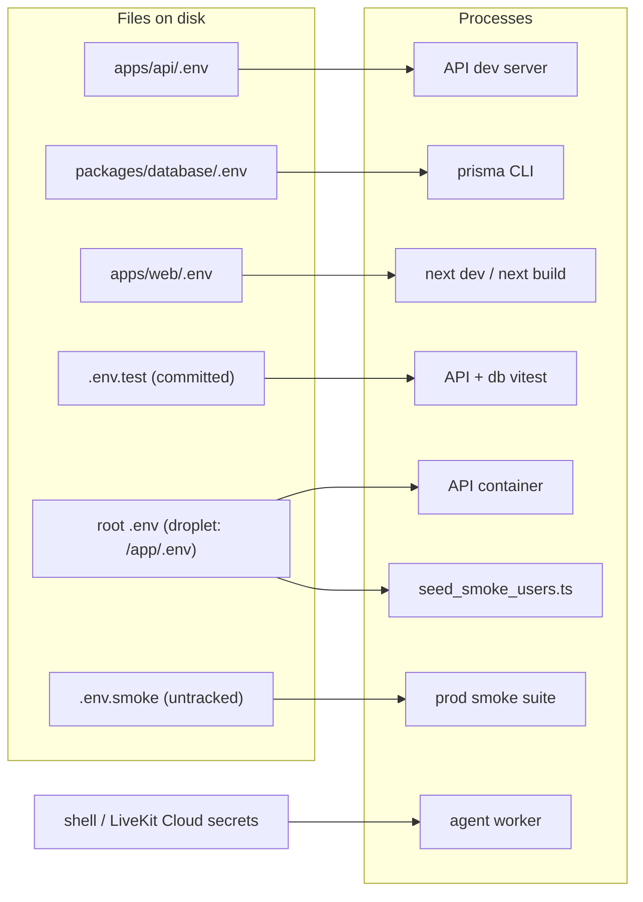
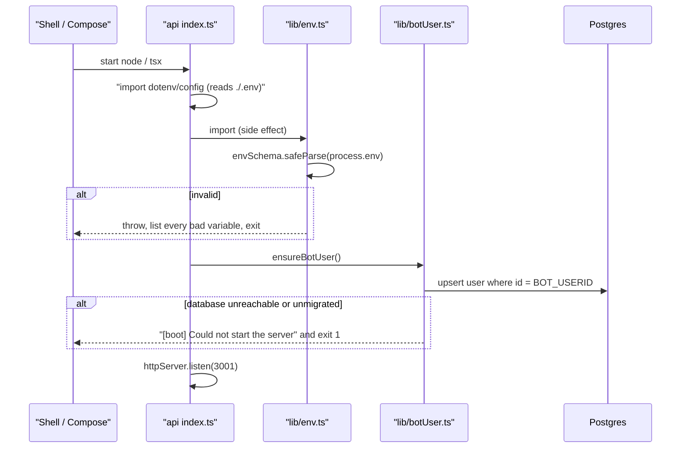
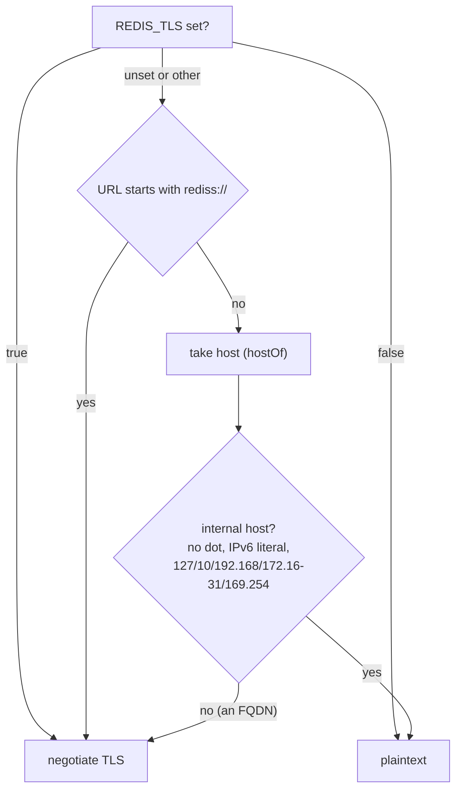

# Environment variables

This is the complete list of environment variables that Nimbus reads, for every process: the API server, the web app, the voice agent, the test suites, CI, and the operational scripts. For each one it says whether the variable is required, what it defaults to, and which module reads it. The API and the agent check their environment when they start and refuse to boot if something is missing, so this page doubles as the checklist for that failure.

## How configuration reaches each process

Nimbus has three long-running processes and several one-off scripts, and **they do not all read the same file**. Most first-run configuration problems come from putting a value in the wrong file, so this table comes first.

| Process | Where its variables come from | Loader |
| --- | --- | --- |
| API (`apps/api`), local | `apps/api/.env`, because `import "dotenv/config"` in [index.ts](../../apps/api/src/index.ts) reads `.env` in the **current working directory**, which is `apps/api` under both `npm run dev -w apps/api` and turbo. `DOTENV_CONFIG_PATH` swaps in a different file. | `dotenv/config` |
| API, production | The droplet's `/app/.env`, injected by `env_file: .env` in [docker-compose.yml](../../docker-compose.yml), plus `NODE_ENV=production` from that compose file's `environment:` block (the [Dockerfile](../../apps/api/Dockerfile) sets the same value). The image itself contains no `.env`. | Docker Compose |
| Prisma CLI (`packages/database`) | `packages/database/.env` (loaded by `import "dotenv/config"` in [prisma.config.ts](../../packages/database/prisma.config.ts)), or a `DATABASE_URL` already in the shell, which turbo passes through for `db:*` tasks | `dotenv/config` |
| Web (`apps/web`) | `apps/web/.env*` files, read by Next.js. Process env wins over the file. `NEXT_PUBLIC_*` values are **inlined into the browser bundle at build time**. On Vercel, the project's environment settings. | Next.js |
| Voice agent (`apps/agent`) | The shell only. The agent loads no `.env` file. On LiveKit Cloud, the agent's secrets, set with `lk agent update-secrets`. | none |
| API and `@nimbus/db` test suites | The committed root [.env.test](../../.env.test), loaded explicitly by each `vitest.config.mts`, because **Vitest does not read `.env` files** | `dotenv.config({ path })` |
| Web test suite | Hard-coded `env` block in [apps/web/vitest.config.mts](../../apps/web/vitest.config.mts) | Vitest |
| Local Playwright suite | `webServer[].env` in [apps/web/e2e/playwright.config.ts](../../apps/web/e2e/playwright.config.ts), with the API started with `DOTENV_CONFIG_PATH` pointing at `.env.test` | Playwright |
| Production smoke suite | Shell or CI secrets, then an untracked root `.env.smoke` (it never overwrites a variable that is already set), see [e2e-prod/env.ts](../../apps/web/e2e-prod/env.ts) | hand-rolled loader |



`.env.example` at the repo root documents the API's variables (and the two main client ones), but nothing reads a root `.env` during local development. The root `.env` is the deployment's file: Compose reads it on the droplet, and [seed_smoke_users.ts](../../apps/api/scripts/seed_smoke_users.ts) reads it on purpose because it targets production. Copy `.env.example` to `apps/api/.env` for local work; see [local-setup.md](../getting-started/local-setup.md).

> **Safety.** A `.env` file on a developer machine may point at the production database. Everything that writes to a database in this repo either loads `.env.test` explicitly or refuses loopback targets on purpose. Read which file a script loads before you run it.

## Validation at boot

### The API: `lib/env.ts`

[apps/api/src/lib/env.ts](../../apps/api/src/lib/env.ts) defines a Zod schema (`envSchema`) and parses `process.env` once, at import. It is imported for its side effect from [index.ts](../../apps/api/src/index.ts), right after `dotenv/config` and before anything else is built. If any value is missing or malformed, `parseEnv` throws a single error that lists **every** offending variable, so a failed boot reads as a checklist:

```text
Invalid environment configuration:
  - LIVEKIT_URL: must be a ws:// or wss:// URL
  - NIMBUS_AGENT_SECRET: Too small: expected string to have >=32 characters
Set the missing values (see .env.example) and restart. Refusing to start rather than serving with the affected features broken.
```

(The exact wording of each issue comes from Zod.)

The module guarantees the state the process **started** with. It does not freeze the values: most call sites still read `process.env.X` when they run, so a value changed after boot (which the test suites do) takes effect. Only a few modules read the parsed `env` object directly: [redis.ts](../../apps/api/src/lib/redis.ts) (`REDIS_URL`), [botUser.ts](../../apps/api/src/lib/botUser.ts), [botMessage.ts](../../apps/api/src/lib/botMessage.ts), [tickets.ts](../../apps/api/src/lib/meeting/tickets.ts), the `leaveWorkspace` path in [workspace.controller.ts](../../apps/api/src/controllers/workspace.controller.ts) (`BOT_USERID`), and [documentBackfill.ts](../../apps/api/src/lib/documentBackfill.ts) (`DATABASE_URL`).

A valid environment is not enough to boot. `main()` in `index.ts` calls `ensureBotUser()` before the server listens, which upserts the bot's `user` row, so **the database must also be reachable and migrated**. If it is not, the process logs `[boot] Could not start the server:` and exits with code 1.

### The agent: `config.ts`

[apps/agent/src/config.ts](../../apps/agent/src/config.ts) does the same for the worker. `loadConfig()` runs once at module load in [index.ts](../../apps/agent/src/index.ts) (`startupConfig`) and again for each job. It names the bad variables without their values (`Invalid agent environment: NIMBUS_API_URL, NIMBUS_AGENT_SECRET`), and it adds one rule Zod cannot express: when `NODE_ENV` is not `development`, `NIMBUS_API_URL` must start with `https://`, because the shared secret and a meeting's voice key travel over it.



## API server variables

Required means `lib/env.ts` refuses to boot without it. An empty string counts as missing for every `required` variable.

> **Empty is not the same as unset.** Several optional variables are declared `z.string().min(1).optional()` or `.min(32).optional()`. Zod's `optional()` accepts a variable that is absent, but a line such as `AUTH_COOKIE_DOMAIN=` sets it to the empty string, which then fails the length check and stops the boot. [env.test.ts](../../apps/api/src/__tests__/unit/env.test.ts) pins this behaviour for `AUTH_COOKIE_DOMAIN`. `.env.example` ships three such lines empty: `AUTH_COOKIE_DOMAIN=`, `AI_API_KEY=` and `AI_CREDENTIAL_ENCRYPTION_KEY_PREVIOUS=`. When you copy it, delete or comment out the ones you do not fill in. `CONTACT_TO_EMAIL` and `AI_VOICE_API_KEY` are the exceptions: they accept an empty value on purpose.

### Storage, auth and origin

| Variable | Required | Default | Read by | Notes |
| --- | --- | --- | --- | --- |
| `DATABASE_URL` | yes | — | [packages/database/src/client.ts](../../packages/database/src/client.ts) (`createPrismaClient`, pg pool of 10), [prisma.config.ts](../../packages/database/prisma.config.ts), [documentBackfill.ts](../../apps/api/src/lib/documentBackfill.ts) | Postgres connection string. |
| `REDIS_URL` | yes | — | [redis.ts](../../apps/api/src/lib/redis.ts) `createRedisClients` | Transport (TLS or not) is derived from it, see [Redis transport](#redis-transport). |
| `REDIS_TLS` | no | derived | [redis.ts](../../apps/api/src/lib/redis.ts) `tlsOverrideFromEnv` | `true` or `false` overrides the derivation; any other value means "derive". Read directly, not through `env.ts`. |
| `BETTER_AUTH_SECRET` | yes | — | better-auth itself (the library reads it from the environment; [auth.ts](../../apps/api/src/lib/auth.ts) does not pass it) | Signs session cookies and tokens. Rotating it signs everyone out. |
| `BETTER_AUTH_URL` | yes | — | [auth.ts](../../apps/api/src/lib/auth.ts) (`baseURL`), [index.ts](../../apps/api/src/index.ts) (boot log), [cookieAttributes.ts](../../apps/api/src/lib/cookieAttributes.ts) via `resolveCookieAttributes` | The API's own public origin. An `https://` value makes the session cookie `Secure`. |
| `FRONTEND_URL` | yes | — | [app.ts](../../apps/api/src/app.ts) (Express CORS and Socket.IO CORS origin), [auth.ts](../../apps/api/src/lib/auth.ts) (`trustedOrigins`, email-verification callback) | One origin only. Requests from any other origin fail CORS. |
| `AUTH_COOKIE_DOMAIN` | no | unset | [auth.ts](../../apps/api/src/lib/auth.ts), [index.ts](../../apps/api/src/index.ts), through `resolveCookieAttributes` | Set it when web and API are on sibling subdomains (production) so the session cookie covers both. On `localhost`, remove the line entirely: an empty value fails validation. |
| `BETTER_AUTH_API_KEY` | no | unset | validated by `env.ts` only | `@better-auth/infra` is a dependency but no application module imports it, so nothing reads this today. |
| `NODE_ENV` | no | `development` | `env.ts` (enum `development`, `test`, `production`), [clock.ts](../../apps/api/src/lib/time/clock.ts), [providers.ts](../../apps/api/src/lib/ai/providers.ts), [client.ts](../../packages/database/src/client.ts) | `production` disables `AGENT_NOW`; `test` enables `AI_TEST_BASE_URL`; anything but `production` caches the Prisma client on `globalThis`. |

### Nimbus (the chat assistant)

| Variable | Required | Default | Read by | Notes |
| --- | --- | --- | --- | --- |
| `BOT_USERID` | yes | — | [botUser.ts](../../apps/api/src/lib/botUser.ts), [bot.ts](../../apps/api/src/lib/bot.ts), [botMessage.ts](../../apps/api/src/lib/botMessage.ts), [chat.ts](../../apps/api/src/socket/chat.ts), [workspace.controller.ts](../../apps/api/src/controllers/workspace.controller.ts), [accountDeletion.ts](../../apps/api/src/lib/accountDeletion.ts), [tickets.ts](../../apps/api/src/lib/meeting/tickets.ts) | The id of the bot's `user` row. Any string works: `ensureBotUser` creates the row (`nimbusbot@nimbus.invalid`, name `Nimbus`) at boot. Must match the web app's `NEXT_PUBLIC_BOT_USERID`. |
| `AGENT_NOW` | no | unset | [clock.ts](../../apps/api/src/lib/time/clock.ts) | Pins the assistant's "now" to an ISO date or timestamp so date questions can be tried against seeded data. Ignored when `NODE_ENV=production`. |

### Voice (LiveKit) and the voice agent

| Variable | Required | Default | Read by | Notes |
| --- | --- | --- | --- | --- |
| `LIVEKIT_URL` | yes | — | [livekit/client.ts](../../apps/api/src/lib/livekit/client.ts) `setting()` | Must match `^wss?://`. Handed to browsers with each call token. The REST clients use the same host with `ws` mapped to `http` (`livekitHttpUrl`). |
| `LIVEKIT_API_KEY` | yes | — | [livekit/client.ts](../../apps/api/src/lib/livekit/client.ts) `livekitCredentials` | Signs join tokens, verifies webhooks, authorises the room and dispatch APIs. |
| `LIVEKIT_API_SECRET` | yes | — | same | Never logged. |
| `NIMBUS_AGENT_SECRET` | yes, at least 32 characters | — | [agentAuth.middleware.ts](../../apps/api/src/middleware/agentAuth.middleware.ts) | Bearer secret for `/internal/agent/*`, compared with `timingSafeEqual` over SHA-256 digests. The agent holds the same value. `.env.example` suggests `openssl rand -base64 48`. |

### Email, OAuth and uploads

| Variable | Required | Default | Read by | Notes |
| --- | --- | --- | --- | --- |
| `RESEND_API_KEY` | yes | — | [email.ts](../../apps/api/src/lib/email.ts) | The Resend client is built at module load, so the key is required even if email goes unused. Sender is the fixed `SENDER` constant in that file. |
| `CONTACT_TO_EMAIL` | yes (an address, or exactly empty) | — | [contact.controller.ts](../../apps/api/src/controllers/contact.controller.ts) | Recipient of the public contact form. Schema: `z.email().or(z.literal(""))`. |
| `GOOGLE_CLIENT_ID` | yes | — | [auth.ts](../../apps/api/src/lib/auth.ts) `socialProviders.google` | Google OAuth. |
| `GOOGLE_CLIENT_SECRET` | yes | — | same | |
| `CLOUDINARY_CLOUD_NAME` | yes | — | [cloudinary.ts](../../apps/api/src/lib/cloudinary.ts) | Signed avatar and chat-image uploads, plus cleanup after account deletion. |
| `CLOUDINARY_API_KEY` | yes | — | same | |
| `CLOUDINARY_API_SECRET` | yes | — | same | |

### AI: the free text tier

When a workspace has no key of its own (BYOK, "bring your own key"), chat and document generation can fall back to an operator-funded free tier. These variables configure it. Per-provider keys (OpenAI, Groq, DeepSeek, OpenRouter) are **not** environment variables; workspace admins store them in the app, encrypted. See [providers-and-byok.md](../ai/providers-and-byok.md) and [quotas-and-free-tier.md](../ai/quotas-and-free-tier.md).

| Variable | Required | Default | Read by | Notes |
| --- | --- | --- | --- | --- |
| `AI_API_KEY` | no | unset | [providers.ts](../../apps/api/src/lib/ai/providers.ts), [entitlements.ts](../../apps/api/src/lib/ai/entitlements.ts), [ai.controller.ts](../../apps/api/src/controllers/ai.controller.ts) | Unset disables the free tier rather than failing. If it is set, it must be non-empty: `env.ts` rejects `AI_API_KEY=` (a present empty string) with `min(1)`, even though `.env.example` ships it that way. Delete the line or comment it out to disable the tier. |
| `AI_PROVIDER` | no | `deepseek` | [providers.ts](../../apps/api/src/lib/ai/providers.ts) | One of `openai`, `groq`, `deepseek`, `openrouter`. |
| `AI_MODEL` | no | `deepseek-flash` | [providers.ts](../../apps/api/src/lib/ai/providers.ts) | |
| `AI_FREE_DOC_LIMIT` | no | `5` | [quota.ts](../../apps/api/src/lib/ai/quota.ts) | Free document generations per user. Integer, at least 0. |
| `AI_TEST_BASE_URL` | no | unset | [providers.ts](../../apps/api/src/lib/ai/providers.ts) | Redirects every provider call to a fake server, **only when `NODE_ENV=test`**. The Playwright suite points it at `fake-provider.mjs` on `127.0.0.1:4010`. Not in `env.ts`. |

### AI: the free voice tier

The in-call assistant needs speech-to-text and text-to-speech. A workspace can bring its own voice key; otherwise these operator settings apply, up to a per-user time allowance.

| Variable | Required | Default | Read by | Notes |
| --- | --- | --- | --- | --- |
| `AI_VOICE_API_KEY` | no | unset | [providers.ts](../../apps/api/src/lib/ai/providers.ts) | Unset or empty disables free voice. (Unlike `AI_API_KEY`, an empty string is accepted here.) |
| `AI_VOICE_BASE_URL` | no | `https://openrouter.ai/api/v1` | [providers.ts](../../apps/api/src/lib/ai/providers.ts) | OpenAI-compatible endpoint. The agent refuses a non-HTTPS address outside development (`isAllowedProviderUrl`). |
| `AI_TRANSCRIBE_MODEL` | no | `openai/gpt-transcribe` | [providers.ts](../../apps/api/src/lib/ai/providers.ts) | |
| `AI_SPEECH_MODEL` | no | `heygen/heygen-voice-1-turbo` | [providers.ts](../../apps/api/src/lib/ai/providers.ts) | |
| `AI_SPEECH_VOICE` | no | `default` | [providers.ts](../../apps/api/src/lib/ai/providers.ts) `freeSpeechVoice` | `default` picks the model's first voice. A voice the model does not offer is ignored in favour of its first one. |
| `AI_FREE_VOICE_SECONDS` | no | `600` | [quota.ts](../../apps/api/src/lib/ai/quota.ts) | Free assistant time per user, in seconds (10 minutes). |

### BYOK credential encryption

| Variable | Required | Default | Read by | Notes |
| --- | --- | --- | --- | --- |
| `AI_CREDENTIAL_ENCRYPTION_KEY` | yes, at least 32 characters | — | [credentialCrypto.ts](../../apps/api/src/lib/ai/credentialCrypto.ts) (`MASTER_KEY_ENV`) | Passphrase that HKDF-SHA256 derives into the AES-256-GCM key for stored provider keys. There is no unencrypted mode. |
| `AI_CREDENTIAL_ENCRYPTION_KEY_PREVIOUS` | no, but each entry needs at least 32 characters | unset | [credentialCrypto.ts](../../apps/api/src/lib/ai/credentialCrypto.ts) (`PREVIOUS_KEYS_ENV`, `candidateKeys`) | Comma-separated, decrypt-only. Used during a rotation; see [runbook.md](../operations/runbook.md). Outside a rotation, remove the line: `env.ts` validates the whole string with `min(32)`, so an empty value fails the boot. |

### Redis transport

`REDIS_URL`'s scheme alone does not decide TLS, because production is configured `redis://` against a managed host that only speaks TLS. `resolveTls` in [redis.ts](../../apps/api/src/lib/redis.ts) decides:



Forcing TLS at a plaintext server is not a loud failure: ioredis emits no `error` event and simply never becomes ready. The `watchForStall` watchdog logs a diagnosis after `CONNECT_WATCHDOG_MS` (10 000 ms). With TLS on, certificate verification is relaxed (`rejectUnauthorized: false`). Every test config pins `REDIS_TLS=false`.

### Variables in `.env.example` that the API never reads

`.env.example` also carries the two client variables (`NEXT_PUBLIC_BACKEND_URL`, `NEXT_PUBLIC_BOT_USERID`). The API ignores them; they are there so one file documents both sides. Older local `.env` files may also still contain names nothing reads any more, from the Coturn era or from earlier AI wiring: `TURN_SECRET`, `TURN_SERVER_URL`, `TURNS_SERVER_URL`, `EXTERNAL_IP`, `GROQ_API_KEY`, `GROQ_MODEL`, `GROQ_CANVAS_MODEL`, `OPENAI_MODEL`, `FRONTEND_URL_2`, `FRONTEND_URL_3`. They are harmless but misleading. Delete them.

## Web app variables

All three are `NEXT_PUBLIC_*`, so Next.js inlines them into the client bundle **at build time**. Changing one on Vercel needs a redeploy, not a restart. None is validated: an unset one turns into the string `"undefined"` inside URLs, which shows up as requests to `undefined/api/...`.

| Variable | Read by | Used for |
| --- | --- | --- |
| `NEXT_PUBLIC_BACKEND_URL` | [lib/socket.ts](../../apps/web/lib/socket.ts), [lib/auth-client.ts](../../apps/web/lib/auth-client.ts), every server-side helper in [apps/web/api/](../../apps/web/api/workspace.ts) (`ai.ts`, `document.ts`, `message.ts`, `voice.ts`, `workspace.ts`), client API modules ([aiApi.ts](../../apps/web/lib/aiApi.ts), [documentApi.ts](../../apps/web/lib/documentApi.ts), [meetingApi.ts](../../apps/web/lib/meetingApi.ts), [voiceApi.ts](../../apps/web/lib/voiceApi.ts)) and most `hooks/use*.ts` | The API's absolute origin. The browser talks to it directly: there are no Next.js rewrites or proxy routes. Also listed in turbo's `build.env`, so changing it invalidates the build cache. |
| `NEXT_PUBLIC_FRONTEND_URL` | [LoginForm.tsx](../../apps/web/components/LoginForm.tsx), [SignupForm.tsx](../../apps/web/components/SignupForm.tsx), [useForgotPasswordForm.ts](../../apps/web/hooks/useForgotPasswordForm.ts), [useChangePasswordForm.ts](../../apps/web/hooks/useChangePasswordForm.ts) | The web app's own origin, used to build OAuth `callbackURL` (`/home`) and password-reset `redirectTo` (`/reset-password`). **Missing from `.env.example`.** |
| `NEXT_PUBLIC_BOT_USERID` | [Chat.tsx](../../apps/web/components/Chat.tsx), [useBotTyping.ts](../../apps/web/hooks/useBotTyping.ts), [WorkspaceMembershipControls.tsx](../../apps/web/components/WorkspaceMembershipControls.tsx), [api/workspace.ts](../../apps/web/api/workspace.ts) | Renders the bot's messages as bot messages and filters it out of member lists. Must equal the API's `BOT_USERID`. |
| `NODE_ENV` | [chatClock.ts](../../apps/web/lib/chatClock.ts) | Set by Next.js. Outside production, the `localStorage["nimbus:agent-now"]` clock override is sent with chat messages (the API ignores it in production anyway). |

Process env wins over `apps/web/.env`. The Playwright config relies on that to point a local web server at a local API even when `apps/web/.env` names the deployed one.

## Voice agent variables

| Variable | Required | Default | Read by | Notes |
| --- | --- | --- | --- | --- |
| `NIMBUS_API_URL` | yes | — | [config.ts](../../apps/agent/src/config.ts) | The API's origin. Trailing slashes are stripped. Must be `https://` unless `NODE_ENV=development`. |
| `NIMBUS_AGENT_SECRET` | yes, at least 32 characters | — | [config.ts](../../apps/agent/src/config.ts) | Same value as the API's. |
| `NODE_ENV` | no | **`production`** | [config.ts](../../apps/agent/src/config.ts) | Note the default differs from the API's. Locally you must set `development` to use an `http://localhost:3001` API, and in production `http://` provider URLs are refused. |
| `AGENT_IGNORE_LOAD` | no | `false` | [config.ts](../../apps/agent/src/config.ts), used in [index.ts](../../apps/agent/src/index.ts) | `true` makes the worker report zero load (`loadFunc: async () => 0`) so a busy CI runner is still offered jobs. Never set it in a deployment. |
| `LIVEKIT_URL` | yes | — | the `@livekit/agents` framework (`cli.runApp`), and [scripts/dispatch.ts](../../apps/agent/scripts/dispatch.ts) | Which LiveKit server the worker registers with. |
| `LIVEKIT_API_KEY` | yes | — | same | |
| `LIVEKIT_API_SECRET` | yes | — | same | |

The agent has no AI provider settings at all. Each meeting's speech endpoint, model and key arrive from the API when the worker redeems its dispatch ticket. The comment in `deploy-agent.yml` mentions "free-tier keys" among the agent's LiveKit Cloud secrets, but the agent reads no such variable.

## Test, CI and turbo variables

### `.env.test`

[.env.test](../../.env.test) is committed on purpose. Every value in it is a throwaway placeholder matching [docker-compose.test.yml](../../docker-compose.test.yml): Postgres on `localhost:5434`, Redis on `localhost:6381`, LiveKit in dev mode on `ws://localhost:7880` with LiveKit's published development key pair. It defines `DATABASE_URL`, `REDIS_URL`, `NODE_ENV`, `FRONTEND_URL`, `BETTER_AUTH_URL`, `BETTER_AUTH_SECRET`, `GOOGLE_CLIENT_ID`, `GOOGLE_CLIENT_SECRET`, `RESEND_API_KEY`, `CONTACT_TO_EMAIL`, `BOT_USERID`, `AI_API_KEY`, `AI_PROVIDER`, `AI_MODEL`, `AI_FREE_DOC_LIMIT`, `AI_CREDENTIAL_ENCRYPTION_KEY`, `LIVEKIT_URL`, `LIVEKIT_API_KEY`, `LIVEKIT_API_SECRET`, `CLOUDINARY_CLOUD_NAME`, `CLOUDINARY_API_KEY`, `CLOUDINARY_API_SECRET`, `NIMBUS_AGENT_SECRET` and `NIMBUS_API_URL`. The API's [vitest.config.mts](../../apps/api/vitest.config.mts) adds `REDIS_TLS=false` on top.

### Workflow-level `env:` blocks

[ci.yml](../../.github/workflows/ci.yml) and [e2e.yml](../../.github/workflows/e2e.yml) repeat the connection values at the top level, so Prisma's config (which reads the environment, not `.env.test`) agrees with Vitest: `DATABASE_URL`, `REDIS_URL`, `LIVEKIT_URL`, `LIVEKIT_API_KEY`, `LIVEKIT_API_SECRET`. Playwright reads `CI` (set to `"true"` in the workflows) to forbid `.only`, retry twice and use the GitHub reporter.

### Turbo's strict env mode

Turbo runs every task in strict env mode: a task's child process gets **only** the variables named in that task's `env` / `passThroughEnv` or in `globalPassThroughEnv` (plus a small set of system variables). A variable exported in your shell but not named in [turbo.json](../../turbo.json) silently does not reach the task. Files that the process itself reads (`.env`, `.env.test`) are unaffected.

| Scope in `turbo.json` | Variables | Why |
| --- | --- | --- |
| `globalPassThroughEnv` (every task) | `AGENT_NOW`, `AI_FREE_VOICE_SECONDS`, `AI_SPEECH_MODEL`, `AI_SPEECH_VOICE`, `AI_TEST_BASE_URL`, `AI_TRANSCRIBE_MODEL`, `AI_VOICE_API_KEY`, `AI_VOICE_BASE_URL` | Lets these reach the API under `turbo run dev` and `turbo run test`. |
| `build.env` (part of the cache hash) | `DATABASE_URL`, `NEXT_PUBLIC_BACKEND_URL` | A change re-runs the build instead of replaying a cached one. `build.inputs` also includes `.env*`. |
| `db:generate`, `db:migrate` `passThroughEnv` | `DATABASE_URL`, `NEXT_PUBLIC_BACKEND_URL` | Prisma needs the URL. Without it, CI's `prisma migrate deploy` once received nothing. |
| `db:deploy` `passThroughEnv` | `DATABASE_URL` | |
| `test`, `test:coverage` `passThroughEnv` | `DATABASE_URL`, `REDIS_URL`, `NODE_ENV`, `LIVEKIT_URL`, `LIVEKIT_API_KEY`, `LIVEKIT_API_SECRET`, `NIMBUS_AGENT_SECRET`, `NIMBUS_API_URL` | Lets CI's workflow `env:` override the file values. |

The shared ESLint config enables `turbo/no-undeclared-env-vars` as a warning, which flags reads of variables turbo does not know about. That rule is one source of the API's standing lint warnings. Adding a variable that a turbo task must see means adding it to `turbo.json` as well.

## End-to-end and smoke-suite variables

| Variable | Read by | Notes |
| --- | --- | --- |
| `E2E_BASE_URL` | [e2e/playwright.config.ts](../../apps/web/e2e/playwright.config.ts) | Defaults to `http://localhost:3000`. |
| `DOTENV_CONFIG_PATH` | `dotenv/config` in the API | The local E2E config and [global-setup.ts](../../apps/web/e2e/global-setup.ts) set it to `.env.test`, which is what keeps the suite off any real database. |
| `SMOKE_BASE_URL` | [e2e-prod/env.ts](../../apps/web/e2e-prod/env.ts) | Required, HTTPS only, hostname must be in the allowlist (default `nimbus.tejasnasa.me`). |
| `SMOKE_API_URL` | same | Defaults to `https://nimbus-api.tejasnasa.me`, checked against its own allowlist. |
| `SMOKE_ALLOWED_HOSTS`, `SMOKE_ALLOWED_API_HOSTS` | same | Comma-separated overrides for the two allowlists. Matching is exact hostname equality, never a substring. |
| `SMOKE_USER_EMAIL`, `SMOKE_USER_PASSWORD`, `SMOKE_MEMBER_EMAIL`, `SMOKE_MEMBER_PASSWORD` | same, and [seed_smoke_users.ts](../../apps/api/scripts/seed_smoke_users.ts) | Repository secrets in CI, or `.env.smoke` locally. All four missing ones are named together. |
| `SMOKE_SKIP_AI` | [journey.spec.ts](../../apps/web/e2e-prod/journey.spec.ts) | `1` skips the step that makes a real model call. The workflow maps its `skip_ai` input to this. |

## Operational script variables

| Script | Variables | Which file it loads |
| --- | --- | --- |
| [scripts/seed_e2e.ts](../../apps/api/scripts/seed_e2e.ts) | `DATABASE_URL`, `REDIS_TLS` (defaulted to `false`), `BOT_USERID` | `.env.test`. It **truncates every table**. dotenv does not override variables that are already set, so a `DATABASE_URL` exported in your shell wins. |
| [scripts/seed_smoke_users.ts](../../apps/api/scripts/seed_smoke_users.ts) | `DATABASE_URL`, `SMOKE_USER_EMAIL`, `SMOKE_MEMBER_EMAIL`, their passwords, `SMOKE_SEED_CONFIRM` | The root `.env` (the deployment's). It refuses a loopback `DATABASE_URL` and writes nothing without `SMOKE_SEED_CONFIRM=yes`. |
| [scripts/seed_e2e_meeting.ts](../../apps/api/scripts/seed_e2e_meeting.ts) | `DATABASE_URL` | Called by the meeting E2E spec. |
| [scripts/backfill_document_search.ts](../../apps/api/scripts/backfill_document_search.ts) | `DATABASE_URL` | None: the URL must be given explicitly. Supports `--dry-run`. |
| [scripts/probe_ai_providers.ts](../../apps/api/scripts/probe_ai_providers.ts) | `AI_API_KEY` or `DEEPSEEK_API_KEY`, `OPENAI_API_KEY`, `GROQ_API_KEY`, `OPENROUTER_API_KEY` (it also rewrites `OPENAI_API_KEY` / `OPENAI_BASE_URL` / `OPENAI_MODEL` internally) | `apps/api/.env`. Makes real, billed calls. Never prints a key. |
| [src/scripts/verifyProvider.ts](../../apps/api/src/scripts/verifyProvider.ts) | `PROVIDER_ID`, `PROVIDER_API_KEY`, `MODEL_ID` | Whatever the caller passes. |
| [src/scripts/copyAiCredentialsToWorkspaces.ts](../../apps/api/src/scripts/copyAiCredentialsToWorkspaces.ts) | the API's environment (database and encryption key) | Shipped compiled in the API image as `dist/scripts/copyAiCredentialsToWorkspaces.js`. Supports `--dry-run`. |
| [apps/agent/scripts/dispatch.ts](../../apps/agent/scripts/dispatch.ts) | `LIVEKIT_URL`, `LIVEKIT_API_KEY`, `LIVEKIT_API_SECRET` | Shell. |

## Deployment-only secrets

These live in GitHub repository secrets, not in any process's environment file.

| Secret | Used by | Purpose |
| --- | --- | --- |
| `GITHUB_TOKEN` (automatic) | [deploy.yml](../../.github/workflows/deploy.yml), [deploy-agent.yml](../../.github/workflows/deploy-agent.yml) | Push to GHCR. Read earlier CI runs (`gh run list`). |
| `DROPLET_HOST`, `DROPLET_SSH_KEY` | [deploy.yml](../../.github/workflows/deploy.yml) | SCP the compose file and SSH into the droplet. |
| `LIVEKIT_URL`, `LIVEKIT_API_KEY`, `LIVEKIT_API_SECRET` | [deploy-agent.yml](../../.github/workflows/deploy-agent.yml) | Project credentials for `lk agent deploy`. |
| `SMOKE_USER_EMAIL`, `SMOKE_USER_PASSWORD`, `SMOKE_MEMBER_EMAIL`, `SMOKE_MEMBER_PASSWORD` | [prod-smoke.yml](../../.github/workflows/prod-smoke.yml) | The two seeded production accounts. |

`deploy.yml` also passes a dummy `DATABASE_URL` as a Docker `build-args`, but [apps/api/Dockerfile](../../apps/api/Dockerfile) declares no `ARG`. The dummy URL the build actually uses is written inline on the `turbo build` line. Prisma's config needs some URL to load; nothing connects with it.

## Design trade-offs and limits

- **Fail at boot, read at call time.** Refusing to start on a missing variable turns a misconfiguration into an obvious crash loop instead of a mystery 500 an hour later. The cost is that a deployment cannot run with one feature switched off by leaving its variables out (voice, email and Cloudinary are all mandatory), and that the parsed values and the live `process.env` can drift apart in tests by design.
- **Several files, not one.** Each process loads the file in its own working directory, which keeps the test and seed scripts' explicit `.env.test` loading safe. The cost is that a new contributor's root `.env` is silently ignored during local development.
- **Client variables are unvalidated and baked into the bundle.** A missing `NEXT_PUBLIC_*` value fails at runtime in the browser, and changing one needs a rebuild.
- **Strict env mode is easy to trip.** A variable that works when you run a script directly can be absent under `turbo run`. The lint rule only warns.
- **Some optional settings are only half-optional.** `AI_API_KEY` is optional but rejects an empty string, while `AI_VOICE_API_KEY` accepts one. `BETTER_AUTH_API_KEY` is validated but unused.
- **Redis TLS verification is relaxed** (`rejectUnauthorized: false`). That keeps managed hosts with unusual certificates working, at the cost of not authenticating the Redis server.

## Related documentation

- [local-setup.md](../getting-started/local-setup.md) — which files to create and what to put in them
- [monorepo.md](../getting-started/monorepo.md) — turbo tasks and the env contract in context
- [deployment.md](../operations/deployment.md) — where production variables are set
- [runbook.md](../operations/runbook.md) — rotation procedures and boot failures
- [providers-and-byok.md](../ai/providers-and-byok.md) — what the encryption key protects
- [quotas-and-free-tier.md](../ai/quotas-and-free-tier.md) — the free-tier settings in use
- [auth.md](../architecture/auth.md) — how `BETTER_AUTH_URL` and `AUTH_COOKIE_DOMAIN` shape the session cookie
