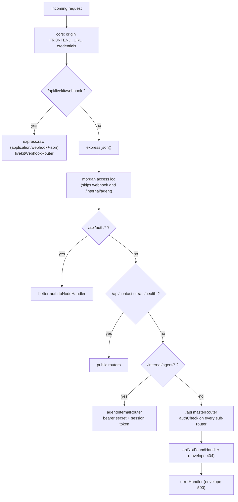

# REST API reference

Every HTTP endpoint the Express API in `apps/api` answers, grouped by router, with its authentication, request validation, the role it requires and what it returns. The page opens with the conventions all routes share (the response envelope, validation, thin routers), because they are what make the tables below short.

## How the API is mounted

[`app.ts`](../../apps/api/src/app.ts) builds the app in a fixed order, and the order is load-bearing:



| Prefix | Router | Authentication |
| --- | --- | --- |
| `/api/livekit/webhook` | [`livekitWebhook.router.ts`](../../apps/api/src/routers/livekitWebhook.router.ts) | LiveKit webhook signature over the raw body |
| `/api/auth/*` | better-auth (see [Auth](../architecture/auth.md)) | better-auth's own |
| `/api/contact` | [`contact.router.ts`](../../apps/api/src/routers/contact.router.ts) | none (public) |
| `/api/health` | [`health.router.ts`](../../apps/api/src/routers/health.router.ts) | none (public) |
| `/internal/agent/*` | [`agentInternal.router.ts`](../../apps/api/src/routers/agentInternal.router.ts) | `NIMBUS_AGENT_SECRET` bearer, then a session token |
| `/api/{ai,workspace,messages,document,upload,voice,meetings,action-items}` | [`master.router.ts`](../../apps/api/src/routers/master.router.ts) | session cookie via `authCheck` |

The webhook is mounted before `express.json()` because LiveKit signs the exact bytes it sent; a parsed body can no longer be verified. The agent routes sit outside `/api` on purpose: their caller is a process holding a shared secret, not a signed-in user, and they must never be reachable through the cookie-guarded master router.

## Conventions

### The response envelope

Every response, including errors and unknown paths, is a [`ServerResponse`](../../packages/types/src/api/serverResponse.ts):

```json
{ "success": true, "message": "Workspace created", "responseObject": { }, "statusCode": 201 }
```

Controllers build it with static factories (`ServerResponse.ok`, `.created`, `.badRequest`, `.unauthorized`, `.forbidden`, `.notFound`, `.conflict`, `.unprocessableEntity`, `.tooManyRequests`, `.serviceUnavailable` and a few more) and return it rather than throwing. Routers then do `res.status(response.statusCode).json(response)`. The two terminal handlers in [`error.middleware.ts`](../../apps/api/src/middleware/error.middleware.ts) keep the envelope universal: an unmatched `/api/*` path is a JSON 404, and a throw that escapes a controller is a JSON 500 rather than Express's HTML stack page.

### Validation

Bodies are checked by [`validate(schema)`](../../apps/api/src/middleware/validate.middleware.ts) against Zod schemas from [`packages/types/src/validations`](../../packages/types/src/validations). A failure is a 400 envelope whose `responseObject` is the treeified Zod error. The middleware does not forward the parsed value: the controller re-reads `req.body`, which is now trusted. Query strings are parsed inside the controller with the matching `*QuerySchema`, so defaults such as `limit` apply there.

### Thin routers, fat controllers

A router extracts `req.user.id`, params and body, calls one controller function and serialises its envelope. Membership and role checks live in controllers and in [`workspaceAccess.ts`](../../apps/api/src/lib/workspaceAccess.ts) (`requireWorkspaceRole`, ranking `MEMBER < ADMIN < OWNER`). Workspace-scoped reads answer a non-member with **404, not 403**, so the API never confirms that a workspace, document, meeting or action item exists to someone outside it.

### Realtime side effects

Several routers read the Socket.IO server with `req.app.get("io")` and pass it down, so a REST write is announced to everyone in the workspace (for example `document:created`, `meeting:action-items`). The events are listed in [Socket events](socket-events.md).

## Workspaces — `/api/workspace`

Controller: [`workspace.controller.ts`](../../apps/api/src/controllers/workspace.controller.ts). Workspaces are URL-routed by `slugId` (an autoincrement integer) while every other route uses the cuid `id` (`wsid`).

| Method | Path | Body | Role | Does |
| --- | --- | --- | --- | --- |
| POST | `/create` | `workspaceSchema` (`name`, `description`) | any user | One transaction: the workspace, the caller as OWNER, a seeded CANVAS and MARKDOWN document, and NimbusBot as ADMIN. 201. |
| GET | `/` | — | any user | The caller's workspaces. |
| POST | `/join` | `workspaceJoinSchema` (`inviteCode`) | any user | Joins as MEMBER. |
| PUT | `/regenerate-invite/:wsid` | — | ADMIN+ | Rotates the invite code. |
| PUT | `/role/:wsid` | `workspaceRoleSchema` (`memberId`, `role`) | ADMIN+ | Changes a role. Nobody can be made OWNER, the OWNER's role is immutable, and an ADMIN cannot promote to ADMIN. |
| DELETE | `/leave/:wsid` | `workspaceMemberSchema` (`memberId`) | ADMIN+ to remove others; anyone to remove themself | Removes a member or leaves. The OWNER cannot leave or be removed. Takes the member's live sockets out of the workspace rooms and revokes their call. |
| PUT | `/transfer/:wsid` | `workspaceMemberSchema` (`memberId`) | OWNER | Hands ownership to another member (not NimbusBot); the old owner becomes ADMIN in the same transaction. |
| PUT | `/update/:wsid` | `workspaceSchema` | ADMIN+ | Renames and re-describes. |
| DELETE | `/delete/:wsid` | — | OWNER | Deletes the workspace; documents, members and meetings cascade. |
| GET | `/:slugId` | — | member | The workspace, its members and documents. 404 for non-members. |

## Documents — `/api/document`

Controller: [`document.controller.ts`](../../apps/api/src/controllers/document.controller.ts).

| Method | Path | Input | Role | Does |
| --- | --- | --- | --- | --- |
| POST | `/create` | `documentSchema` (`title` 3–50, `type` CANVAS or MARKDOWN, `workspaceId`) | member | Creates a document and broadcasts it. |
| GET | `/workspace/:workspaceId` | — | member | Lists the workspace's documents. |
| GET | `/search` | query `documentSearchQuerySchema` (`workspaceId`, `q` ≤ 200, `limit` ≤ 50, default 20) | member | Keyword search over extracted document text (see [Memory and search](../ai/memory-and-search.md)). |
| GET | `/:docId/export` | — | member | Exports the document's content for download. |
| PATCH | `/:docId` | `documentRenameSchema` (`title` 1–100) | member | Renames and broadcasts. |
| GET | `/:docId` | — | member | One document's metadata. |
| DELETE | `/:docId` | — | ADMIN+ | Deletes and evicts its live Yjs or canvas state. |

## Messages — `/api/messages`

| Method | Path | Role | Does |
| --- | --- | --- | --- |
| GET | `/:wsid` | member | The latest 50 chat messages, oldest first ([`message.controller.ts`](../../apps/api/src/controllers/message.controller.ts)). Sending is a socket event, not REST. |

## Uploads — `/api/upload`

[`upload.controller.ts`](../../apps/api/src/controllers/upload.controller.ts) never receives file bytes. It signs a Cloudinary upload so the browser can post the file directly, keeping `CLOUDINARY_API_SECRET` on the server. Responses are `Cache-Control: no-store` because the signature is a temporary credential.

| Method | Path | Input | Does |
| --- | --- | --- | --- |
| GET | `/avatar-signature` | — | Signs an avatar upload with the user id as a deterministic `public_id` (`overwrite`, `invalidate`). |
| GET | `/chat-image-signature` | query `workspaceId` | Signs a chat image upload for a workspace the caller belongs to. |

## Voice — `/api/voice`

[`voice.controller.ts`](../../apps/api/src/controllers/voice.controller.ts); the call system itself is described in [Voice and LiveKit](../meetings/voice-and-livekit.md).

| Method | Path | Input | Role | Does |
| --- | --- | --- | --- | --- |
| POST | `/token` | `voiceTokenSchema` (`workspaceId`) | member | Mints a LiveKit access token for the workspace's room, after a fresh membership check. |
| GET | `/:workspaceId/roster` | — | member | Who is in the call now (from Redis). |

## Meetings — `/api/meetings`

[`meeting.controller.ts`](../../apps/api/src/controllers/meeting.controller.ts). See [Transcripts and notes](../meetings/transcripts-and-notes.md).

| Method | Path | Input | Role | Does |
| --- | --- | --- | --- | --- |
| POST | `/assistant/start` | `assistantStartSchema` (`workspaceId`) | member | Starts the in-call assistant: checks there is a call with people in it, the voice entitlement and free allowance, creates the LIVE meeting, a ticket and an agent dispatch. Idempotent: a live meeting is returned as-is. 403 `free-voice-in-use` when the caller already has a free meeting live elsewhere. |
| GET | `/` | query `workspaceId`, `cursor`, `limit` ≤ 50 (default 10) | member | Past meetings, cursor-paged. |
| GET | `/live` | query `workspaceId` | member | The workspace's live meeting, if any. |
| GET | `/search` | query `workspaceId`, `q`, `sinceDays`, `limit` ≤ 50 | member | Keyword search over transcripts. |
| GET | `/:meetingId` | — | member | One meeting with its notes and action items. |
| POST | `/:meetingId/assistant/stop` | — | member | Stops the assistant and ends the meeting. |
| GET | `/:meetingId/segments` | query `afterSeq`, `limit` ≤ 200 (default 100), `language` | member | Transcript segments after a sequence number, optionally translated. |
| GET | `/:meetingId/catch-up` | — | member | A "catch me up" summary of the meeting so far. |
| POST | `/:meetingId/diagram` | — | member | Draws the discussion as a canvas document (streams `doc:ai:*`). |
| DELETE | `/:meetingId` | — | ADMIN+, or whoever started it | Deletes an ended meeting; 409 while it is live. |

## Action items — `/api/action-items`

[`actionItem.controller.ts`](../../apps/api/src/controllers/actionItem.controller.ts); the rules live in [`lib/meeting/actionItems.ts`](../../apps/api/src/lib/meeting/actionItems.ts) and are shared with the assistant's tools.

| Method | Path | Input | Role | Does |
| --- | --- | --- | --- | --- |
| GET | `/` | query `workspaceId`, `status` open/done/all (default open), `owner=me`, `cursor`, `limit` ≤ 100 (default 30) | member | Lists items. |
| POST | `/` | `actionItemCreateSchema` (`workspaceId`, `text` ≤ 500, optional `meetingId`, `ownerUserId`, `dueDate` YYYY-MM-DD) | member | Adds an item; an owner must be a current member. |
| PATCH | `/:id` | `actionItemPatchSchema` (any of `status`, `ownerUserId`, `dueDate`, `text`) | member | Changes an item. |
| DELETE | `/:id` | — | ADMIN+, the item's owner, or its creator | Deletes an item. |

Every change broadcasts `meeting:action-items` to the workspace.

## AI — `/api/ai`

[`ai.controller.ts`](../../apps/api/src/controllers/ai.controller.ts). Everything but `free-usage` goes through `requireWorkspaceRole`: keys, preference and settings writes, usage, the catalogue and the probe need ADMIN; the status, preference list and settings read need membership. See [Providers and BYOK](../ai/providers-and-byok.md) and [Quotas and the free tier](../ai/quotas-and-free-tier.md).

| Method | Path | Input | Role | Does |
| --- | --- | --- | --- | --- |
| GET | `/me/free-usage` | — | any user | The caller's remaining free document generations and voice minutes. |
| GET | `/workspaces/:workspaceId/status` | — | member | Which AI features work in this workspace and from what source; `canManage` for the UI. |
| GET | `/workspaces/:workspaceId/credentials` | — | ADMIN+ | Stored provider keys, as metadata only (never the envelope, key id or fingerprint). |
| POST | `/workspaces/:workspaceId/credentials` | `aiCredentialCreateSchema` | ADMIN+ | Probes the key against the provider, then saves it encrypted. A failed probe is a 400 and nothing is stored. |
| DELETE | `/workspaces/:workspaceId/credentials/:providerId` | — | ADMIN+ | Deletes a key. |
| GET | `/workspaces/:workspaceId/preferences` | — | member | Per-feature model choices. |
| PUT | `/workspaces/:workspaceId/preferences` | `aiPreferenceSchema` | ADMIN+ | Sets a feature's provider and model; 422 when the workspace has no verified key for the provider or the model lacks the feature's requirements. |
| GET | `/workspaces/:workspaceId/settings` | — | member | Spend cap and assistant switches. |
| PUT | `/workspaces/:workspaceId/settings` | `aiSettingsSchema` (`monthlySpendCapUsd`, `assistantEnabled`, `assistantSpeaks`) | ADMIN+ | Updates them. |
| GET | `/workspaces/:workspaceId/usage` | query `cursor`, `limit` ≤ 100, `feature`, `status`, `userId` | ADMIN+ | The call log, cursor-paged. |
| GET | `/workspaces/:workspaceId/catalog/openrouter` | query `feature` | ADMIN+ | OpenRouter's model catalogue filtered to models fit for a feature. |
| POST | `/workspaces/:workspaceId/models/probe` | `aiModelProbeSchema` (`providerId`, `modelId`) | ADMIN+ | Tests a model with the workspace's key before it is chosen. |

## Public routes

| Method | Path | Does |
| --- | --- | --- |
| POST | `/api/contact` | `contactSchema`. Emails the operator address (`CONTACT_TO_EMAIL`) through Resend. Reads no session and touches no database, so it still works when Postgres is down ([`contact.controller.ts`](../../apps/api/src/controllers/contact.controller.ts)). |
| GET | `/api/health` | Probes Postgres and Redis, each raced against a real timeout because both clients queue commands forever while disconnected; 200 when both answer, 503 otherwise ([`health.controller.ts`](../../apps/api/src/controllers/health.controller.ts)). |
| GET | `/` | The string envelope "Nimbus API". |
| ALL | `/api/auth/*` | better-auth: sign-up, sign-in, sign-out, session, email verification, password reset, Google OAuth, profile update, password change and account deletion. See [Auth](../architecture/auth.md). |

## LiveKit webhook — `POST /api/livekit/webhook`

Verified with LiveKit's `WebhookReceiver` over the raw body; a bad signature is a bare 401 and nothing from the body is read or logged. Deliveries are at-least-once, so each event id is claimed in Redis (`SET webhook:<id> NX EX 3600`) and a repeat is acknowledged without effect; if handling fails the claim is released and the answer is a 500 so the retry runs. `participant_joined` and `participant_left` maintain the voice roster, `room_finished` empties it, agent participants never join the human roster, and an agent leaving or the room closing ends the live meeting. Events stamped well before the live meeting started are ignored as stale.

## Agent internal API — `/internal/agent/*`

The voice agent ([The voice agent](../meetings/voice-agent.md)) is the only caller. Every response is `Cache-Control: no-store`, the router is excluded from the access log, and every failure is the same bare 401 so a prober learns nothing. Layers, in order ([`agentAuth.middleware.ts`](../../apps/api/src/middleware/agentAuth.middleware.ts)):

1. `requireAgentSecret`: the bearer must equal `NIMBUS_AGENT_SECRET`, compared with `timingSafeEqual` over SHA-256 digests.
2. `redeemRateLimit` (only on `/redeem`): at most `REDEEM_LIMIT = 10` failed redemptions per `REDEEM_WINDOW_SECONDS = 60` per IP. It runs after the secret check, and successes are refunded, because behind the production proxy every caller shares one `req.ip`.
3. `requireAgentSession` on every other route: the session token handed out by `/redeem`.

| Method | Path | Body schema ([`validations/agent.ts`](../../packages/types/src/validations/agent.ts)) | Does |
| --- | --- | --- | --- |
| POST | `/redeem` | `redeemSchema` | Exchanges the one-time meeting ticket for a session token, the meeting context and the provider key the agent will use. The only plaintext key in any HTTP response. |
| POST | `/segments` | `segmentsInSchema` | Appends transcript segments and broadcasts them. |
| POST | `/state` | `agentStateSchema` | Reports the agent's state (listening, thinking, speaking). |
| POST | `/answer` | `answerSchema` | Asks the assistant a question; streams `application/x-ndjson` lines as the reply is generated, and the agent hanging up cancels it. |
| POST | `/notice` | `noticeSchema` | Posts a notice to the call (for example a budget warning). |
| POST | `/usage` | `usageInBodySchema` | Reports speech-to-text and speech usage for metering. |
| POST | `/ended` | `endedSchema` | Reports that the agent left, ending the meeting. |

## Design trade-offs and limits

- **The envelope duplicates the HTTP status.** `statusCode` repeats what the status line says. It costs a few bytes and buys clients that can treat every response the same way, including the 404s and 500s Express would otherwise answer in HTML.
- **Validation does not forward the parsed value.** Controllers re-read `req.body`, so a schema's transforms (trimming, defaults) do not reach the controller for bodies. Query schemas are parsed inside controllers to get their defaults. A future change that relies on a body transform must parse again in the controller.
- **No versioning.** There is no `/v1` prefix. The only clients are this repo's web app and agent, deployed together, so a breaking change is coordinated rather than versioned.
- **No general HTTP rate limiting.** Only the agent's ticket redemption is limited over HTTP; socket cursor streams are limited in process. A public deployment that expects abuse would need a limiter at the proxy.
- **404 for non-members is deliberate**, and it makes "you lost access" and "it was deleted" indistinguishable to the client.
- **Mount order is a correctness property**, not style: moving `express.json()` above the webhook, or the 404 handler above better-auth, silently breaks those routes. The comments in `app.ts` say so; keep them.

## Related documentation

- [Architecture overview](../architecture/overview.md)
- [Auth](../architecture/auth.md)
- [Security and RBAC](../architecture/security.md)
- [Socket events](socket-events.md)
- [Add an endpoint](../guides/add-an-endpoint.md)
