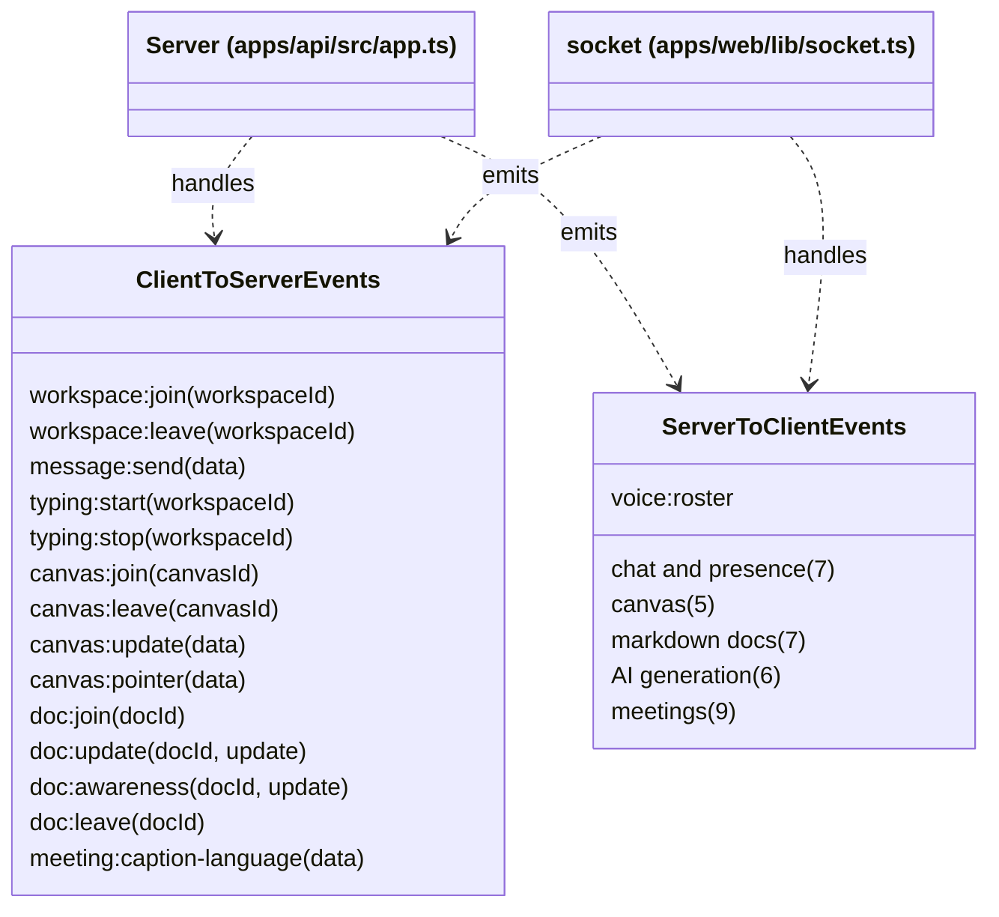
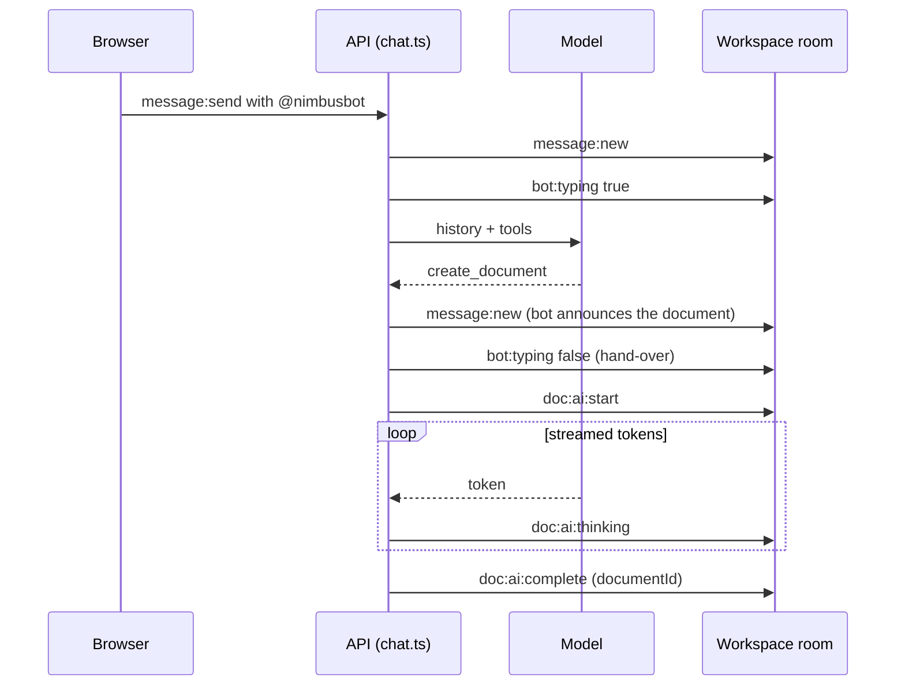

# Socket events reference

Every Socket.IO event Nimbus sends or receives, with its payload, the handler that owns it and who receives it. The single source of truth is the typed contract in [`socketEvents.ts`](../../packages/types/src/socket/socketEvents.ts): `ClientToServerEvents` and `ServerToClientEvents` are consumed by the server (`new Server<…>`) and by the client singleton in [`apps/web/lib/socket.ts`](../../apps/web/lib/socket.ts), so a renamed event or a changed payload fails type-checking on both sides at once.

## How to read this page

- Names follow **`namespace:verb`** (`doc:update`, `meeting:ended`). A name that appears in both directions (`typing:start`, `canvas:update`, `doc:update`, `doc:awareness`) has a different payload each way: the client sends an id, the server relays with the sender stamped.
- **Rooms.** A socket joins the workspace room named by the workspace's cuid on `workspace:join`, a document room `doc:<id>` on `doc:join`, and a canvas room `canvas:<id>` on `canvas:join` (`DOC_ROOM` in [`document.ts`](../../apps/api/src/socket/document.ts), `CANVAS_ROOM` in [`canvas.ts`](../../apps/api/src/socket/canvas.ts)).
- **Receivers.** "Sender" means the emitting socket only (`socket.emit`). "Room, not sender" is `socket.to(room)`. "Room" is `io.to(room)`, which includes the sender. Broadcasts go through the Redis adapter, so they reach sockets on every API replica.
- Every handler trusts `socket.data.user`, set by the handshake guard in [`socket.middleware.ts`](../../apps/api/src/middleware/socket.middleware.ts), and **re-checks workspace membership on each event**, so a removed member's next event is refused.

## Client to server

| Event | Payload | Handler | What the server does |
| --- | --- | --- | --- |
| `workspace:join` | `workspaceId: string` | [`chat.ts`](../../apps/api/src/socket/chat.ts) | Checks membership, joins the workspace room, adds the user to the Redis presence set, sends the joiner `presence:online_users` and `voice:roster`, tells the room `presence:joined`. On failure: `workspace:error` to the sender. |
| `workspace:leave` | `workspaceId: string` | `chat.ts` | Leaves the room and presence; `presence:left` to the room. |
| `message:send` | `{ workspaceId, content, imageUrl?, timeZone?, clockOverride? }` | `chat.ts` | Validates with `messageSendSchema`, persists, broadcasts `message:new` to the room. An `@nimbusbot` mention starts the bot detached (see [NimbusBot](../ai/nimbusbot.md)). `timeZone` and `clockOverride` are passed to the bot so it can reason about dates. |
| `typing:start` / `typing:stop` | `workspaceId: string` | `chat.ts` | Relays to the room, not sender, as `{ userId, name }`. |
| `canvas:join` | `canvasId: string` | [`canvas.ts`](../../apps/api/src/socket/canvas.ts) | Checks membership, loads state if needed, joins `canvas:<id>`, sends `canvas:state` to the sender. Errors: `canvas:error`. |
| `canvas:leave` | `canvasId: string` | `canvas.ts` | Leaves; persists and evicts when the room drains. |
| `canvas:update` | `{ documentId, elements, initialized? }` | `canvas.ts` | Replaces the whole element array (last write wins), schedules a save, relays `canvas:update` to the room, not sender. An empty array is dropped unless `initialized: true`. |
| `canvas:pointer` | `{ canvasId, x, y, tool?, button?, selectedElementIds? }` | `canvas.ts` | Rate-limited to `POINTERS_PER_SECOND = 60`; relayed with `socketId` and `user`. Selection capped at `MAX_SELECTED_IDS = 200`. |
| `doc:join` | `docId: string` | [`document.ts`](../../apps/api/src/socket/document.ts) | Checks membership, loads or creates the `Y.Doc`, seeds `initialContent` once, joins `doc:<id>`, sends `doc:state`. Errors: `doc:error`. |
| `doc:update` | `docId, update: number[]` | `document.ts` | Applies the Yjs update, schedules a save, relays to the room, not sender. |
| `doc:awareness` | `docId, update: number[]` | `document.ts` | Cursor and selection awareness; rate-limited to `AWARENESS_PER_SECOND = 60`; relayed. |
| `doc:leave` | `docId: string` | `document.ts` | Leaves; snapshots and evicts when the room drains. |
| `meeting:caption-language` | `{ meetingId, language: string or null }` | [`meeting.ts`](../../apps/api/src/socket/meeting.ts) | Subscribes the socket to live caption translation into a language, or clears it. One subscription per socket, stored in a Redis hash and removed on disconnect. |

The lifecycle event `disconnecting` is handled by chat, document and canvas (presence cleanup, room-drain persistence), and `disconnect` by meeting (dropping the caption subscription).

## Server to client

### Chat and presence

| Event | Payload | Emitted by | Receivers |
| --- | --- | --- | --- |
| `message:new` | `Message` | `chat.ts`, [`botMessage.ts`](../../apps/api/src/lib/botMessage.ts) | Workspace room |
| `presence:joined` | `{ userId, name }` | `chat.ts` | Workspace room |
| `presence:left` | `{ userId }` | `chat.ts`, [`socketEviction.ts`](../../apps/api/src/lib/socketEviction.ts) | Workspace room |
| `presence:online_users` | `userIds: string[]` | `chat.ts` | Sender, on join |
| `typing:start` / `typing:stop` | `{ userId, name }` | `chat.ts` | Room, not sender |
| `workspace:error` | `message: string` | `chat.ts` | Sender |
| `bot:typing` | `{ workspaceId, typing }` | [`botTyping.ts`](../../apps/api/src/lib/botTyping.ts) | Workspace room |
| `ai:refused` | `{ feature, reason, message, cta }` | `chat.ts` | Sender: the bot could not run (no key, quota spent, cap reached); `cta` is `add-key`, `manage-ai` or null |

### Canvas

| Event | Payload | Receivers |
| --- | --- | --- |
| `canvas:state` | `{ documentId, elements }` | Sender, on join |
| `canvas:update` | `{ documentId, elements }` | Canvas room, not sender |
| `canvas:pointer` | `{ canvasId, socketId, user, x, y, tool?, button?, selectedElementIds? }` | Canvas room, not sender |
| `canvas:pointer-leave` | `{ canvasId, socketId }` | Canvas room |
| `canvas:error` | `message: string` | Sender |

### Markdown documents and the document list

| Event | Payload | Emitted by | Receivers |
| --- | --- | --- | --- |
| `doc:state` | `update: number[]` (full Yjs state) | `document.ts` | Sender, on join |
| `doc:update` | `update: number[]` | `document.ts` | Doc room, not sender |
| `doc:awareness` | `docId, update: number[]` | `document.ts` | Doc room |
| `doc:error` | `message: string` | `document.ts` | Sender |
| `document:created` | `{ document: DocumentSummaryDTO }` | [`documentEvents.ts`](../../apps/api/src/lib/documentEvents.ts) | Workspace room |
| `document:renamed` | `{ documentId, title }` | `documentEvents.ts` | Workspace room |
| `document:deleted` | `{ documentId, deletedById }` | `documentEvents.ts` | Workspace room |

### AI generation

Streamed while NimbusBot or the meeting assistant writes a document ([Document generation](../ai/document-generation.md)). Emitted by `chat.ts`, [`lib/meeting/documents.ts`](../../apps/api/src/lib/meeting/documents.ts) and [`lib/meeting/diagram.ts`](../../apps/api/src/lib/meeting/diagram.ts) to the workspace room.

| Event | Payload |
| --- | --- |
| `doc:ai:start` | `{ type: "MARKDOWN" or "CANVAS", label }` |
| `doc:ai:thinking` | `{ token }`, one streamed chunk |
| `doc:ai:complete` | `{ documentId, label, type, canvasData? }` |
| `doc:ai:error` | `{ message }` |

### Voice and meetings

| Event | Payload | Emitted by | Receivers |
| --- | --- | --- | --- |
| `voice:roster` | `{ users: VoiceUser[] }` | [`livekitWebhook.router.ts`](../../apps/api/src/routers/livekitWebhook.router.ts); `chat.ts` on join | Workspace room; sender on join |
| `meeting:started` | `MeetingDTO` | [`meeting.controller.ts`](../../apps/api/src/controllers/meeting.controller.ts) | Workspace room |
| `meeting:ended` | `{ meetingId, reason }` | [`lifecycle.ts`](../../apps/api/src/lib/meeting/lifecycle.ts) | Workspace room |
| `meeting:assistant-state` | `{ meetingId, state }` | [`agentInternal.controller.ts`](../../apps/api/src/controllers/agentInternal.controller.ts), [`assistant.ts`](../../apps/api/src/lib/meeting/assistant.ts) | Workspace room |
| `meeting:speaking` | `{ meetingId, userIds }` | `agentInternal.controller.ts` | Workspace room |
| `meeting:segment` | `{ meetingId, segment: SegmentDTO }` | [`segments.ts`](../../apps/api/src/lib/meeting/segments.ts) | Workspace room |
| `meeting:translation` | `{ meetingId, seq, language, text }` | [`translation.ts`](../../apps/api/src/lib/meeting/translation.ts) | Workspace room |
| `meeting:notes-ready` | `{ meetingId, documentId }` | [`notes.ts`](../../apps/api/src/lib/meeting/notes.ts) | Workspace room |
| `meeting:action-items` | `ActionItemsChangedDTO` | [`actionItems.ts`](../../apps/api/src/lib/meeting/actionItems.ts) | Workspace room |
| `meeting:deleted` | `{ meetingId }` | `meeting.controller.ts` | Workspace room |

Note that most meeting events are produced by REST calls (from the browser or from the voice agent's internal API), not by socket handlers: the socket is the delivery channel, and the API process that handled the request emits through the shared `io`.

## Design trade-offs and limits

- **One contract, no runtime schema for most payloads.** The TypeScript types guarantee the two sides agree at compile time, but only `message:send` (Zod) and a few bounded fields (pointer selections, update sizes) are validated at runtime. A hostile client can send malformed payloads; handlers defend the fields they read rather than validating whole objects.
- **Mirrored names with different payloads** (`doc:update` carries a `docId` up but not down) keep the vocabulary small at the cost of the payloads not being symmetric; the tables above are the place to check.
- **Workspace-wide broadcasts.** Meeting translations go to the whole workspace room and the client filters by language. Per-language rooms would save bandwidth in large workspaces; at the current scale the simpler fan-out won.
- **In-memory limiters.** The 60-per-second pointer and awareness budgets are per process and per socket; they shed excess traffic, they are not an abuse defence.
- **Process-local document state.** Broadcasts cross replicas through Redis, but the `Y.Doc` and canvas maps they describe do not; see [Realtime overview](../realtime/overview.md).

## Related documentation

- [Realtime overview](../realtime/overview.md)
- [Markdown sync](../realtime/markdown-sync.md)
- [Canvas sync](../realtime/canvas-sync.md)
- [Presence and chat](../realtime/presence-and-chat.md)
- [Add a socket event](../guides/add-a-socket-event.md)
