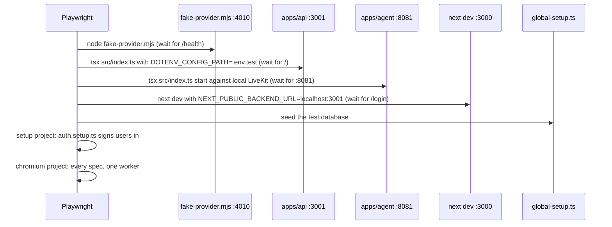
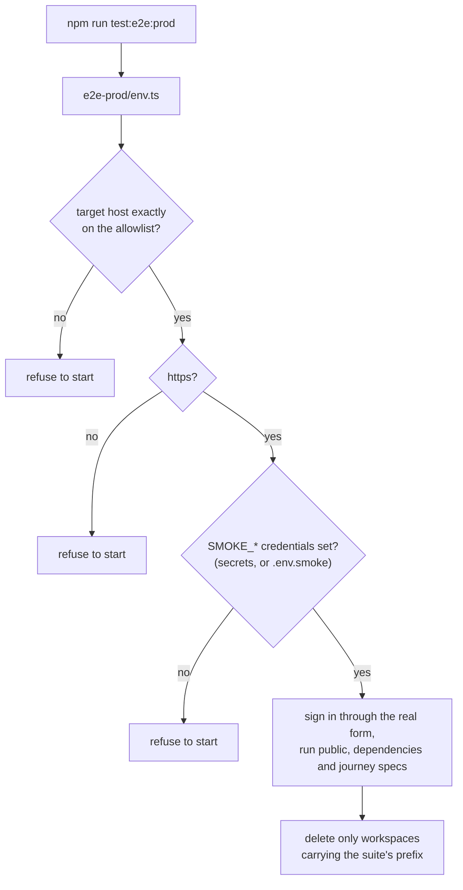

# End-to-end and production smoke tests

Nimbus has two Playwright suites that drive a real browser. The **local end-to-end suite** (`apps/web/e2e`) boots the whole stack itself, the API, the web app, the voice agent and a fake AI provider, against the test database, and runs nightly. The **production smoke suite** (`apps/web/e2e-prod`) signs in to the deployed site as seeded users and exercises it for real, also nightly. They are kept far apart on purpose: one is allowed to wipe its database, the other must never be able to.

## The two suites side by side

| | Local e2e | Production smoke |
| --- | --- | --- |
| Directory | [`apps/web/e2e`](../../apps/web/e2e) | [`apps/web/e2e-prod`](../../apps/web/e2e-prod) |
| Config | [`e2e/playwright.config.ts`](../../apps/web/e2e/playwright.config.ts) | [`e2e-prod/playwright.config.ts`](../../apps/web/e2e-prod/playwright.config.ts) |
| Target | `http://localhost:3000`, started by the suite | The deployed site, allowlisted host over HTTPS |
| Database | The test database from `.env.test`, re-seeded | Production (writes real rows) |
| `webServer` | Fake provider, API, agent, web | None |
| `globalSetup` | Seeds the database | None |
| Traces | On first retry | Off (a trace records sign-in `fill` values) |
| Workflow | [`e2e.yml`](../../.github/workflows/e2e.yml), 03:23 UTC and on demand | [`prod-smoke.yml`](../../.github/workflows/prod-smoke.yml), 04:41 UTC and on demand |
| Run locally | `make test-e2e` | `make test-e2e-prod` |

Neither runs on pull requests. The local suite boots four processes and three services, which takes minutes; the smoke suite writes to production, so it must never run on someone else's branch.

## The local suite

### What the config starts

Postgres, Redis and a LiveKit dev server come from [`docker-compose.test.yml`](../../docker-compose.test.yml) (`make test-infra-up`, ports 5434, 6381 and 7880). In CI they are service containers in `e2e.yml`, which also builds the API's workspace dependencies and applies migrations first.

Three environment details are load-bearing:

- **`DOTENV_CONFIG_PATH` points the API at `.env.test`**, so the suite can never reach a real database even though `apps/api/.env` points at production.
- **`NEXT_PUBLIC_BACKEND_URL` is passed explicitly** to the web server, because process env wins over `apps/web/.env`, which points at the deployed API.
- **`AI_TEST_BASE_URL` points provider calls at the fake provider**, which the API honours only when `NODE_ENV` is `test`.

### The fake provider

[`fake-provider.mjs`](../../apps/web/e2e/fake-provider.mjs) stands in for every AI provider so no test spends a real key. It keys its behaviour on the bearer token and the request shape:

| Input | Answer |
| --- | --- |
| Token containing `rejected` | 401, like a wrong key |
| Token containing `no-audio` | Text probe passes, audio probes 403 ("saved with warnings") |
| A routing call whose tool offers `fromImage` | A `create_document` call that sets it |
| A streamed JSON-mode call | A three-node diagram, after a short pause so the overlay is visible |
| Instructions to "write the notes for a meeting" | A fixed, valid set of notes naming the two seeded users |
| Token containing `agent` (transcription) | A fixed sentence, so a caption appears without a speech model |
| Anything else | A plain "ok" |

### Identity

Identity comes from fixtures in [`fixtures.ts`](../../apps/web/e2e/fixtures.ts) and the `setup` project in [`auth.setup.ts`](../../apps/web/e2e/auth.setup.ts), not from a project-level `use.storageState`. Playwright applies context options to every context it creates, so a project-wide storage state would silently sign in the contexts that specs create to test anonymous behaviour.

### The specs

| Spec | Covers |
| --- | --- |
| `smoke.spec.ts` | Anonymous redirects, the contact form, the seeded owner's dashboard |
| `auth.spec.ts` | Signing in through the form, bad credentials, client-side email validation |
| `workspace.spec.ts` | The dashboard, the "My Workspaces" filter, creating a workspace with its seeded documents |
| `chat.spec.ts` | A message reaching another member live, Enter and Shift+Enter, whitespace-only messages |
| `documents.spec.ts` | Seeded document tabs, switching editors, members seeing the same set |
| `image-canvas.spec.ts` | An attached picture becoming a canvas; the upload signature scoped to the workspace |
| `ai-settings.spec.ts` | An owner adding and removing a key, the spend cap, a member's read-only view |
| `settings.spec.ts` | Renaming, the active sessions list, changing the password |
| `voice.spec.ts` | Two people joining a call through the local LiveKit server and seeing each other's mute state |
| `assistant.spec.ts` | Starting the assistant, captions for everyone on the call, stopping |
| `meeting-notes.spec.ts` | Ending a meeting writes notes, a notes tab and action items |

`workers: 1` and `fullyParallel: false`, for the same reason the API suites run files serially: the seeds and the in-memory document state are shared. In CI the suite retries twice and uploads an HTML report.

## The production smoke suite

[`env.ts`](../../apps/web/e2e-prod/env.ts) makes every misconfiguration a startup failure: the host must equal an allowlisted hostname exactly (a substring check would accept `nimbus.tejasnasa.me.attacker.tld`), plain HTTP is rejected so the suite cannot be pointed at localhost, and a variable already in the environment is never overwritten by `.env.smoke`, so CI secrets always win. Every workspace the suite creates carries a fixed prefix, and its janitor deletes only workspaces with that prefix, so a mistake can leave litter but never touch a real person's workspace.

| Spec | Covers |
| --- | --- |
| `public.spec.ts` | The deployed web app answers, anonymous redirects, the sign-in page renders |
| `dependencies.spec.ts` | The free tier is configured, a workspace's AI status reports chat enabled, the voice token endpoint signs a token |
| `journey.spec.ts` | A signed-in journey: creating a workspace, its seeded documents, a markdown edit surviving a reload, and more across the two seeded users |

The suite signs in through the real form, so it covers the cross-subdomain cookie path; that requires `AUTH_COOKIE_DOMAIN` to be set on the droplet. Credentials are `SMOKE_USER_EMAIL`, `SMOKE_USER_PASSWORD`, `SMOKE_MEMBER_EMAIL` and `SMOKE_MEMBER_PASSWORD`. The two accounts are created or repaired by [`seed_smoke_users.ts`](../../apps/api/scripts/seed_smoke_users.ts) (`make seed-smoke-users` reports, `make seed-smoke-users-apply` writes).

## Design trade-offs and limits

- **Nightly, not per pull request.** Breakage that only the browser suites catch is found the next morning, not before merge. The fast suites in [Testing overview](overview.md) carry the per-PR gate.
- **Chromium only.** Firefox and Safari differences (especially WebRTC and audio) are not covered.
- **A fake provider tests the plumbing, not the models.** Prompt regressions and provider API changes are invisible to the local suite; `make probe-ai` checks real providers by hand.
- **The smoke suite writes to production.** It is bounded by the prefix janitor and two dedicated accounts, but it does create and delete real rows every night.
- **Serial execution** makes the local suite slow as it grows; parallelism would need per-worker databases.
- **Voice is tested against a local LiveKit dev server**, not LiveKit Cloud, so cloud-specific behaviour (agent dispatch at scale, regions) is not exercised.

## Related documentation

- [Testing overview](overview.md)
- [Deployment and CI/CD](../operations/deployment.md)
- [Environment variables](../reference/environment.md)
- [Auth](../architecture/auth.md)
- [The voice agent](../meetings/voice-agent.md)
