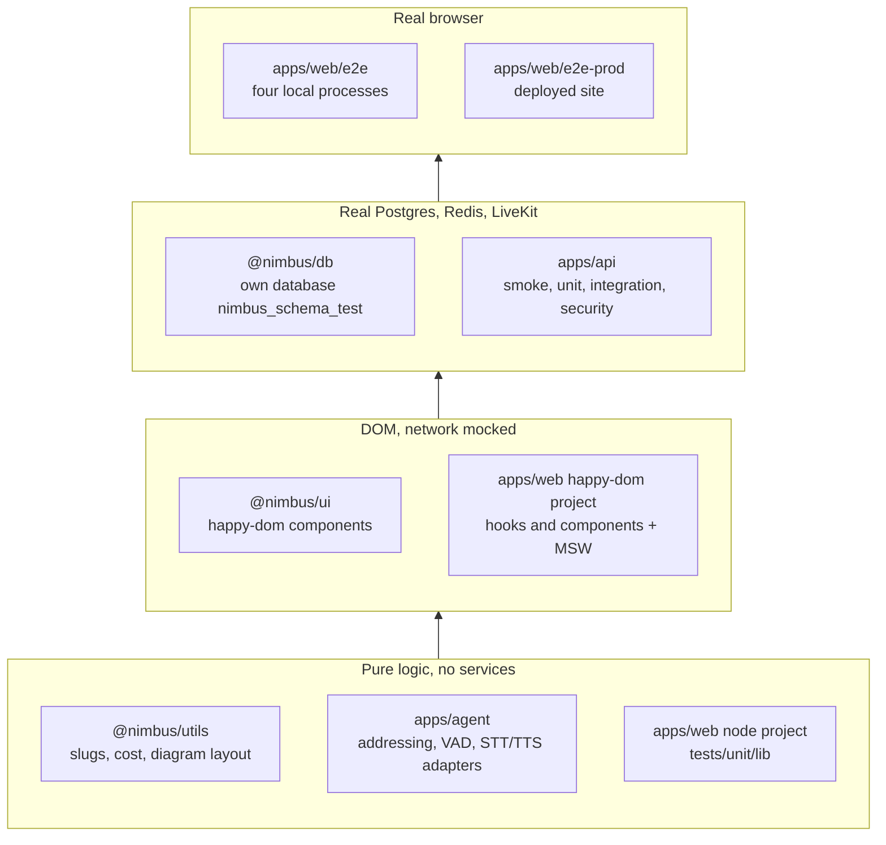
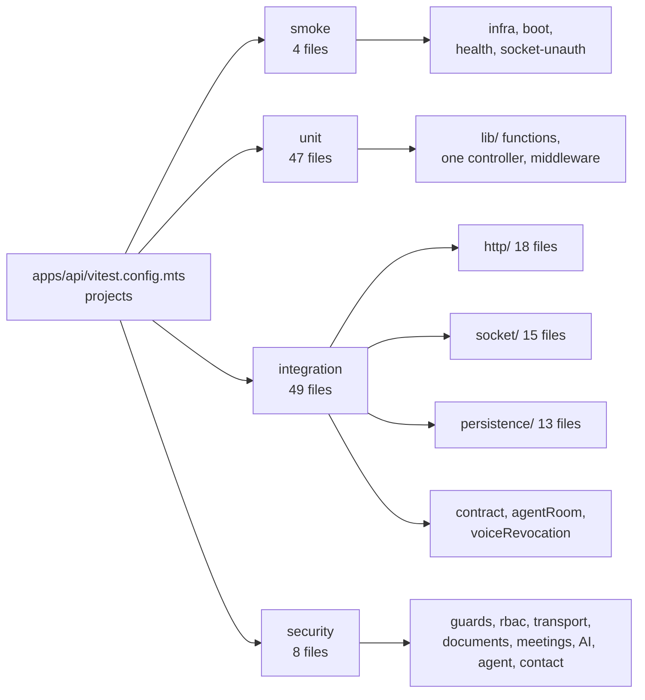
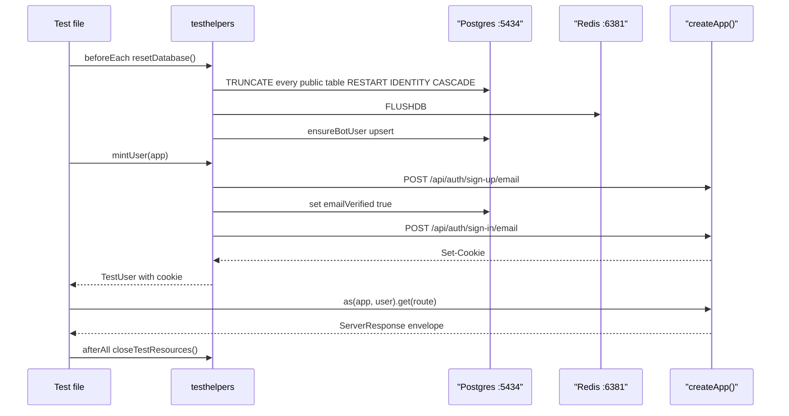
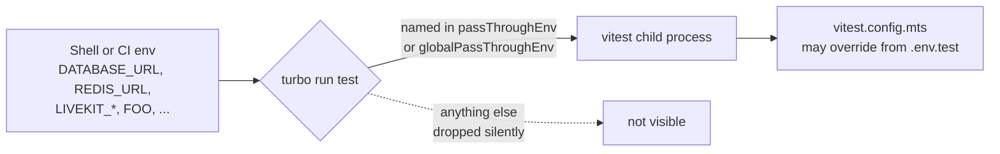
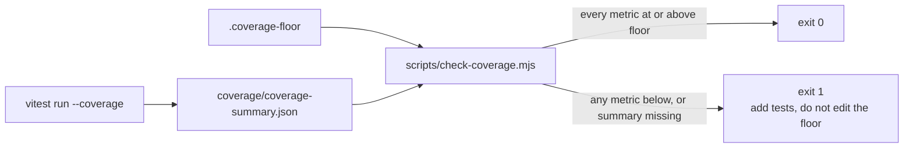
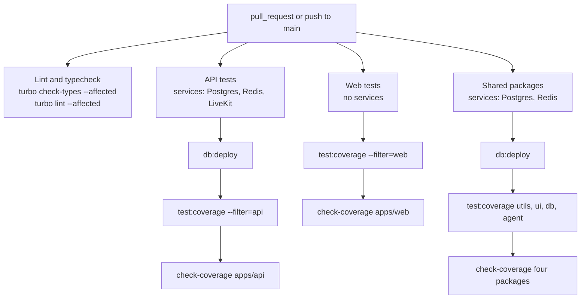

# Testing overview

Nimbus is tested by six Vitest suites (one per workspace that carries tests) and two Playwright suites, and the server-side suites run against a real Postgres, a real Redis and a real LiveKit media server instead of mocks. This page maps every suite, explains how the API suite is split into shards, lists the fixtures and helpers each suite gives you, and documents the two pieces of plumbing that most often surprise people: Turbo's strict environment filtering and the fixed coverage floors. Browser-level testing (the local end-to-end suite and the production smoke suite) is covered on its own page, [end-to-end.md](end-to-end.md).

## Why the suites look like this

A collaborative app fails in the seams: a socket handler that trusts a room it should re-check, a Prisma unique constraint that behaves differently from the schema text, a cookie that a browser will not store. Mocks tend to hide exactly those failures, so the repository takes a firm line:

- **Postgres and Redis are never mocked** in the API and `@nimbus/db` suites. They come from [docker-compose.test.yml](../../docker-compose.test.yml) locally and from GitHub service containers in CI.
- **LiveKit is real too.** The test compose file runs `livekit/livekit-server` in `--dev` mode, so voice tests talk to a genuine media server.
- **Only things that cost money, send email or leave the machine are faked**: AI providers (stub clients injected through `vi.mock`), Resend (mocked at the module boundary), Cloudinary (mocked per file), and in the web suite the whole API (intercepted by MSW).

That choice makes the suites slower than a pure unit-test setup, and it forces some discipline around shared state (covered below), but it means a green run says something about the real stack.

## The suites at a glance

| Suite | Location | Environment | Needs Docker | What it exercises |
|---|---|---|---|---|
| API | [apps/api/src/__tests__](../../apps/api/src/__tests__) | Node, real HTTP and Socket.IO servers | Yes (Postgres, Redis, LiveKit) | Routes, socket handlers, persistence, AI pipelines with stub models, the security matrix |
| Web | [apps/web/tests](../../apps/web/tests) | `node` and `happy-dom` projects | No | Client libraries, hooks and components, with MSW standing in for the API |
| Agent | [apps/agent/src/__tests__](../../apps/agent/src/__tests__) | Node | No | The voice agent's addressing, barge-in, budget, STT/TTS adapters and VAD against WAV fixtures |
| `@nimbus/db` | [packages/database/__tests__](../../packages/database/__tests__) | Node, its own database | Yes (Postgres) | Schema text, deployed columns, constraints, cascades, migration ledger |
| `@nimbus/ui` | [packages/ui/__tests__](../../packages/ui/__tests__) | `happy-dom` | No | The shared component library |
| `@nimbus/utils` | [packages/utils/__tests__](../../packages/utils/__tests__) | Node | No | Pure helpers: slugs, cost, model selection, languages, the diagram parser and layout |
| Local E2E | [apps/web/e2e](../../apps/web/e2e) | Playwright, Chromium | Yes | The full stack in a browser; see [end-to-end.md](end-to-end.md) |
| Production smoke | [apps/web/e2e-prod](../../apps/web/e2e-prod) | Playwright, Chromium | No | The deployed site; see [end-to-end.md](end-to-end.md) |

`@nimbus/types` has no suite of its own. Its socket event contract and Zod schemas are exercised through the API and web suites, and the API's contract test reads its source text directly (see [The contract test](#the-contract-test)).

The diagram below shows the suites as layers. The lower a layer, the cheaper and more numerous its tests; the higher, the more of the real system each test touches.



### Which suite a change belongs in

- A pure function (a formatter, a validator, a slug generator, the diagram layout) gets a unit test in `packages/utils`, or in the API's `unit` shard if it lives in `apps/api/src/lib`.
- A route's status code, permission check or persisted row gets an HTTP integration test in `apps/api/src/__tests__/integration/http/`.
- Realtime behaviour (delivery, rooms, per-event membership re-checks, CRDT convergence) gets a socket test in `integration/socket/`.
- An authorization property ("a non-member cannot ...") belongs in the `security` shard, so the whole posture can be reviewed in one place.
- How a component renders or a hook reacts gets a web test.
- Routing, cookies, or anything that only breaks in a real browser gets an end-to-end spec.

Covering one change at several layers is normal and expected.

## Test infrastructure

[docker-compose.test.yml](../../docker-compose.test.yml) defines three services. Their host ports are offset from a sibling project's 5433/6380 so both can run on one machine.

| Service | Image | Host port | Used by |
|---|---|---|---|
| `postgres-test` | `postgres:16` | 5434 (user, password and database all `nimbus` / `nimbus_test`) | API suite, `@nimbus/db` suite, local E2E |
| `redis-test` | `redis:7` | 6381 | API suite, local E2E |
| `livekit-test` | `livekit/livekit-server:latest` in `--dev` mode | 7880 (signalling), 7881/tcp and 7882/udp (media) | API voice tests (7880 only), local E2E calls |

The credentials are throwaway local values. LiveKit's `devkey` / `secret` pair is the server's published development default, not a credential. The compose file pins `--node-ip 127.0.0.1` so a browser on the host receives ICE candidates it can reach.

The committed [.env.test](../../.env.test) at the repo root mirrors those ports and holds placeholder values for every variable the API refuses to boot without (see [../reference/environment.md](../reference/environment.md)). It is committed on purpose: nothing in it grants access to anything.

```bash
make test-infra-up       # start the three containers
make test-schema         # apply migrations to the test database (first run, and after every migration)
make test-infra-down     # stop them, keeping the data volume
make test-infra-reset    # stop them and delete the data volume
```

`make test-schema` runs `npx turbo run db:deploy --filter=@nimbus/db` with `DATABASE_URL` set explicitly to the test database, so it can never pick up a developer `.env`.

> **Safety note.** Developer `.env` files in this repository can point at a production database. Every test entry point described here loads `.env.test` explicitly or sets `DATABASE_URL` itself, and several refuse to run unless the URL contains port 5434. Do not "simplify" that loading.

## Running tests

All of these are in the [Makefile](../../Makefile); `make help` prints the list.

| Command | What it runs |
|---|---|
| `make test` | `npx turbo run test --force`, every workspace, bypassing Turbo's cache |
| `make test-api` | `npx turbo run test --filter=api` |
| `make test-web` | `npx turbo run test --filter=web` |
| `make test-packages` | `npx turbo run test --filter="./packages/*"` |
| `make test-suite SUITE=smoke` | One API shard: `cd apps/api && npx vitest run src/__tests__/smoke` |
| `make test-file W=apps/web FILE=tests/unit/lib/socket.test.ts` | One file in one workspace |
| `make test-watch W=apps/web` | Watch mode for one workspace |
| `make test-coverage` | `npx turbo run test:coverage --force` |
| `make test-coverage-check` | Coverage, then the floor check over all six packages |

Vitest's own selectors work inside a workspace:

```bash
cd apps/api
npx vitest run src/__tests__/unit/bot.test.ts     # one file
npx vitest run -t "refuses to promote"            # one test by name
npx vitest run --project security                 # one shard by project name

cd apps/web
npx vitest run --project node                     # the web split is by environment
```

Running through Turbo (`npm test`, `make test`) matters on a fresh checkout because the `test` task depends on `db:generate`; running Vitest directly skips that, and a missing Prisma client shows up as `Cannot find module './generated/prisma/client'`.

## The API suite

The API suite lives in [apps/api/src/__tests__](../../apps/api/src/__tests__) and is configured by [apps/api/vitest.config.mts](../../apps/api/vitest.config.mts). It is the largest suite by far because most of its tests drive a real Express app and real Socket.IO clients against the real database.

### Configuration that matters

| Setting | Value | Why |
|---|---|---|
| Environment | `.env.test` parsed with `dotenv`, then passed as `test.env`, plus `REDIS_TLS: "false"` | `lib/auth.ts` and `lib/redis.ts` read env at import time, so values must be in place before any test file is evaluated. The config throws if `.env.test` is missing. |
| `REDIS_TLS` | forced `"false"` | The test Redis is plaintext. `lib/redis.ts` derives TLS from the URL, and a TLS handshake against a plaintext server hangs silently. |
| `@nimbus/db` alias | `packages/database/src/index.ts` | Tests exercise the working tree, not a possibly stale `dist` build. |
| `@testhelpers` alias | `apps/api/testhelpers/index.ts` | Test files sit at varying depths, so the harness is imported by name. |
| `setupFiles` | `./testhelpers/setup.ts` | Mocks `resend` for every file. |
| `fileParallelism` | `false` | Suites truncate shared tables between tests and would otherwise race. |
| `testTimeout` / `hookTimeout` | 20 000 ms / 30 000 ms | Socket and auth-heavy tests need the headroom. |
| `passWithNoTests` | `true` | An empty shard is not a failure. |
| Coverage | v8, reporters `text` and `json-summary`, `src/**/*.ts` minus `src/__tests__/**` and `src/generated/**` | `json-summary` is what the floor check reads. |

### Shards

The four top-level directories are four Vitest *projects* in one config. A directory is a shard, so `npx vitest run src/__tests__/smoke` and `npx vitest run --project smoke` both run exactly one. Fixtures live in `src/__tests__/fixtures/` (a canvas-generation fixture set and a recorded OpenRouter model catalogue) and belong to no shard.



File counts are as of this writing; the runner prints the current figures.

#### smoke

Makes no behavioural claims; it proves the environment is usable so a broken stack fails in seconds rather than as hundreds of confusing failures.

| File | Checks |
|---|---|
| `infra.test.ts` | Postgres is reachable, the Prisma schema is applied, Redis answers. Failures carry the hint `Is the test stack up? Run: docker compose -f docker-compose.test.yml up -d`. |
| `boot.test.ts` | The app composes; `/` answers in the `ServerResponse` envelope; better-auth is mounted ahead of the routers; an anonymous REST call gets 401 before body validation; unknown `/api` paths 404; a truncated database still yields the bot row so workspace creation succeeds. |
| `health.test.ts` | `/api/health` against the real stack, plus its failure modes through injected fakes: a media server that is down, rejects or never answers; the cache window for LiveKit probes; Redis not ready; the per-probe deadline `PROBE_TIMEOUT_MS`. |
| `socket-unauth.test.ts` | A handshake with no session is refused and never emits `connect`. |

#### unit

Covers `apps/api/src/lib` modules, middleware and one controller with their collaborators faked. "Unit" here describes the scope of the code under test, not the absence of services: several unit files (for example `meetingTools.test.ts`) still use the real test database, and only the model resolver and generation calls are stubbed. Topics include the AI client factory, registry, entitlements, quotas, probes and the OpenRouter catalogue; credential encryption; the NimbusBot pipeline (`bot`, `botMemory`, `botMention`, `botTyping`, `botUser`, `textToolCalls`); canvas, image-canvas and markdown generation; the meeting tool registry, notes, tickets, translation and summary schema; LiveKit rooms and tokens; cookies, email, env validation, Redis transport derivation, presence and the awareness wire format; `serverResponse`, `error.middleware`, `validate.middleware` and `workspace.controller`.

#### integration

Runs the real app.

- **`http/`** drives Express through supertest, roughly one file per router or feature: action items, the agent's internal routes, workspace AI settings, the assistant's answer and start routes, auth (sign-up, verify, sign-in), contact, documents, the LiveKit webhook (roster and meeting variants), meetings (lifecycle, list, diagram), messages, uploads, voice and workspaces.
- **`socket/`** boots a real Socket.IO server on an ephemeral port and connects real `socket.io-client` instances: chat (plain, images, memory), the bot and bot typing, documents and Yjs convergence, awareness, canvas and canvas pointers, meetings, meeting notes, caption languages, member removal, and `redis-adapter.test.ts` for fan-out across two server instances.
- **`persistence/`** covers stateful back-end behaviour: the debounced document save, document search text and backfill, AI quota, spend cap and cascade, copying AI credentials, meeting lifecycle, rolling summaries, notes, segment search, translation and memory recall.
- **Top-level files**: `contract.test.ts` (below), `agentRoom.test.ts` (dispatching the agent into a LiveKit room) and `voiceRevocation.test.ts` (removing a member ends their call access).

#### security

Kept as its own shard so the authorization posture can be reviewed as a whole.

| File | Property |
|---|---|
| `guards.security.test.ts` | The authorization matrix: a table-driven `ROUTES` list where every protected route must reject anonymous callers, cross-workspace ids are denied to non-members, and socket events re-check membership instead of trusting a room. |
| `rbac.security.test.ts` | Role invariants: promotion, removal, invite rotation, workspace and document deletion. |
| `transport.security.test.ts` | CORS, malformed JSON (400 not 500), oversized bodies, and the status the error handler carries. |
| `documents.security.test.ts` | Document isolation across workspaces. |
| `meetings.security.test.ts` | Meetings and action items: nothing in another workspace can be read, searched, drawn, changed or deleted, and the answer does not reveal whether it exists. Also its own anonymous-caller table for `/api/meetings` and `/api/action-items`. |
| `ai.workspace.security.test.ts` | Workspace AI settings and credentials by role. |
| `agentInternal.security.test.ts` | The voice agent's `/internal/agent` routes refuse callers without the shared secret and session token. |
| `contact.security.test.ts` | The public contact route's abuse limits. |

### The contract test

[integration/contract.test.ts](../../apps/api/src/__tests__/integration/contract.test.ts) is about friction, not coverage. It holds three golden lists:

- `ROUTE_CONTRACT`: (method, path) pairs that must each answer an anonymous call with **401**. A route that stopped being mounted would answer 404, which is what this catches.
- `EXPECTED_CLIENT_EVENTS` and `EXPECTED_SERVER_EVENTS`: the event names, compared against the source text of [socketEvents.ts](../../packages/types/src/socket/socketEvents.ts), plus a check that every name follows `namespace:verb`.

Renaming or removing a route or event fails here, so the change has to be made consciously in a second place. Editing the list is the review checkpoint. The same file also pins that `/api/contact` sits outside `authCheck` (it answers 400 from validation, not 401) and that better-auth stays mounted ahead of the routers.

Two gaps are worth knowing: `ROUTE_CONTRACT` and the guard matrix do not list the `/api/meetings` and `/api/action-items` routes (those are covered by `meetings.security.test.ts` instead), and neither lists `/api/health`, `/api/contact` or the agent's internal routes, which are deliberately not behind `authCheck`.

### Test helpers

[apps/api/testhelpers](../../apps/api/testhelpers) is imported as `@testhelpers`. Everything below is exported from [index.ts](../../apps/api/testhelpers/index.ts).

| Helper | File | What it gives you |
|---|---|---|
| `testPrisma` | [database.ts](../../apps/api/testhelpers/database.ts) | A Prisma client with its own pool on the test database |
| `resetDatabase()` | database.ts | Truncates every table in `public` except Prisma's ledger (`RESTART IDENTITY CASCADE`), retrying up to 5 times on a deadlock (`40P01`), then `FLUSHDB` on Redis and re-seeds the bot user |
| `closeTestResources()` | database.ts | Disconnects Prisma and quits Redis; call once per file from `afterAll` |
| `mintUser(app, overrides?)` | [session.ts](../../apps/api/testhelpers/session.ts) | Signs up through `/api/auth/sign-up/email`, marks the row verified, signs in, and returns `{ id, email, name, cookie }` |
| `as(app, user)` | session.ts | supertest `get/post/put/patch/delete` with the user's cookie attached |
| `TEST_PASSWORD` | session.ts | The password every minted user gets |
| `startTestServer()` | [socketHarness.ts](../../apps/api/testhelpers/socketHarness.ts) | The app's own `createHttpServer()` on port 0, with a `close()` that waits for disconnect handlers |
| `connectClient(url, headers)` | socketHarness.ts | A real `socket.io-client` over websocket with reconnection off |
| `waitForEvent(socket, event, ms = 5000)` | socketHarness.ts | Resolves with the first payload or rejects on timeout |
| `createUser`, `createWorkspace`, `addMember`, `createDocument`, `createMessage`, `createMeeting` | [factories.ts](../../apps/api/testhelpers/factories.ts) | Direct-to-database row builders that bypass the REST layer |
| `createWorkspaceAiCredential`, `createWorkspaceAiPreference`, `TEST_AI_KEY` | factories.ts | An encrypted workspace key and model preference, using the real `encryptSecret` |
| `signWebhook`, `devRoomService`, `joinCall`, `leaveAllCalls` | [livekit.ts](../../apps/api/testhelpers/livekit.ts) | Sign webhook bodies as LiveKit does; reach the dev server's room API; join a real call |
| `stubResolver`, `refusingResolver`, `modelReply`, `seedTranscript`, `SAMPLE_LINES`, `sampleNotes`, `fakeIo` | [meetings.ts](../../apps/api/testhelpers/meetings.ts) | A `resolveAi` replacement that returns a stub model; transcript seeding; a recording broadcaster for `app.set("io", ...)` |
| `getResendSendMock()` | [setup.ts](../../apps/api/testhelpers/setup.ts) | The shared `resend.emails.send` mock, to inspect sent mail |

A typical test lifecycle, as the helpers are meant to be used:



### Conventions the helpers encode

**Truncation instead of rollback.** Wrapping each test in a rolled-back transaction is tidier but unreliable here: Socket.IO's async hops own the connection, so the transaction a fixture opened is not reliably the one a handler runs on. Truncation is blunt and deterministic. It wipes the NimbusBot user, which `createWorkspace` needs for its ADMIN membership, so `resetDatabase()` re-runs the same `ensureBotUser` the server runs at boot.

**Sessions are minted, never forged.** `mintUser` goes through the real better-auth endpoints, so the auth configuration under test is the one that runs. It replays only the `name=value` part of each cookie, so it works whatever cookie attributes the server sets.

**Arrange directly, act through the API.** Factories write rows straight to the database so a test of one endpoint never depends on another endpoint to set itself up.

**Assert on the other client.** With two sockets, wait for the event the *receiver* gets; polling for your own echo is the main source of flaky two-client tests.

**Close resources once per file.** Calling `closeTestResources()` inside a `describe` tears down the shared Redis client for the describes that follow.

### What is faked in the API suite

| Dependency | How it is replaced |
|---|---|
| Resend | `vi.mock("resend")` in `testhelpers/setup.ts` for every file. The SDK resolves with `{ data, error }` instead of throwing, so without the mock every sign-up would silently call resend.com. |
| AI models | `vi.mock` of `lib/ai/entitlements` (`resolveAi`) or `lib/ai/clientFactory`, returning a stub whose `responses.create` the test controls; `stubResolver` packages this. No real provider is called. |
| Generation | `generateMarkdownDocument` / `generateCanvasDocument` stubbed where a test only needs to know they were started. |
| Cloudinary | Mocked at the module boundary in the upload and cloudinary tests. |
| ioredis | Faked only in `unit/presence.test.ts`. Everywhere else Redis is real. |
| Postgres, Redis, LiveKit | Never mocked outside the files named above. |

## The web suite

[apps/web/vitest.config.mts](../../apps/web/vitest.config.mts) splits the suite by environment, not directory:

| Project | Environment | Includes |
|---|---|---|
| `node` | `node` | `tests/unit/lib/**/*.test.{ts,tsx}` (12 files: socket singleton, API clients, docs loader, presence, formatting) |
| `happy-dom` | `happy-dom`, setup `tests/setup.ts` | `tests/unit/hooks/**` (23 files), `tests/components/**` (49 files), and the co-located `components/`, `hooks/`, `providers/` `__tests__` folders |

The config sets `NEXT_PUBLIC_BACKEND_URL=http://localhost:3001` and `NEXT_PUBLIC_FRONTEND_URL=http://localhost:3000` because Vitest does not read `.env` files and `lib/auth-client.ts` throws without a backend URL. Coverage excludes `e2e/**` and `e2e-prod/**`.

### MSW and the shared setup

[tests/setup.ts](../../apps/web/tests/setup.ts) registers the jest-dom matchers and starts the MSW server from [tests/msw/server.ts](../../apps/web/tests/msw/server.ts) with `onUnhandledRequest: "warn"`. After each test it calls `cleanup()` (the config does not set `globals: true`, so Testing Library cannot self-register it) and `server.resetHandlers()`, so one test's overrides never leak into the next.

[tests/msw/handlers.ts](../../apps/web/tests/msw/handlers.ts) holds a happy-path handler for every endpoint the app calls, each returning the exact `ServerResponse` envelope through the `ok()` builder. `fail(statusCode, message)` builds the failure envelope for `server.use(...)` overrides. [aiFixtures.ts](../../apps/web/tests/msw/aiFixtures.ts) and [meetingFixtures.ts](../../apps/web/tests/msw/meetingFixtures.ts) are override-friendly builders for the larger DTOs.

[tests/components/testUtils.ts](../../apps/web/tests/components/testUtils.ts) must be imported **first** in a component test. It points the backend URL at the MSW origin before anything reads it, and exports:

- `preflight`: an `OPTIONS` handler for `/api/*`. `happy-dom`'s `fetch` implements CORS, so every cross-origin write is preceded by a preflight that MSW must answer. Register it in `beforeEach`.
- `stubAlert()`: `happy-dom` has no `window.alert`; the stub returns a spy.
- `flush()`: waits a macrotask so a stubbed promise settles.

Components that talk to the socket mock it at the module boundary, for example `vi.mock("../../lib/socket", () => ({ socket: socketMock }))`. The editors (`@excalidraw/excalidraw`, Milkdown) are stubbed in component tests, which assert the component's own contract (joining and leaving rooms, subscribing to channels) rather than a real editing session.

### Two configuration traps

- **JSX needs an explicit transform.** The shared tsconfig uses `jsx: "preserve"` for Next.js, so the Vitest config sets `oxc: { jsx: "automatic" }`. Vite 8 transforms with Oxc; an `esbuild` key is accepted but ignored, and one unparseable file empties its whole project.
- **There must be one React copy.** The root pins React 19.2.4. If a second React major is hoisted to the root, renders fail with "Objects are not valid as a React child", and no alias in the config can fix it.

A third, smaller trap is called out in the config itself: a single-element brace glob such as `{tsx}` silently matches nothing, which looks identical to a folder with no tests.

## The package and agent suites

### `@nimbus/db`

[packages/database/vitest.config.mts](../../packages/database/vitest.config.mts) loads `.env.test` (without `override`, so an exported `DATABASE_URL` wins) and runs [testhelpers/globalSetup.ts](../../packages/database/testhelpers/globalSetup.ts) once before the workers start.

The suite seeds rows and asserts on them, so it cannot share a database with the API suite, whose `resetDatabase()` truncates everything mid-run while Turbo runs both workspaces at once. [testhelpers/testDatabase.ts](../../packages/database/testhelpers/testDatabase.ts) therefore swaps the database name in the `.env.test` URL to `nimbus_schema_test`: same server, same credentials, separate storage. Global setup calls `assertThrowawayTestDatabase()` (refuses any URL without `:5434`), creates the database if missing (treating `42P04`, "already exists", as success after a race), and runs `prisma migrate deploy` with `DATABASE_URL` set explicitly in the child environment, with a 180 s timeout. Real migrations are used because the suites assert on `prisma migrate status` and the `_prisma_migrations` ledger.

Within the package, [__tests__/dbTestUtils.ts](../../packages/database/__tests__/dbTestUtils.ts) hands out clients only after the same port check, truncates a fixed list of the core tables with `CASCADE`, and serialises suites that reset the database with a Postgres advisory lock held on a dedicated one-connection pool.

| File | Asserts |
|---|---|
| `schema.test.ts` | The schema text: provider, generator output, the exact `MODELS` list, table mappings, enum values and order |
| `appliedSchema.test.ts` | What the migrations actually deployed, read from Postgres catalogs: column types, the generated `tsvector` search column and its GIN index, enum labels |
| `constraints.test.ts` | Unique constraints, foreign keys and defaults that only a real server enforces |
| `cascade.test.ts` | Deleting a workspace, user or document leaves no orphans |
| `meetings.test.ts` | One live meeting per workspace (a hand-written partial unique index), segment uniqueness, what outlives what |
| `migrations.test.ts` | `prisma migrate status` is clean and every folder in `prisma/migrations` is in the ledger and succeeded |
| `backfill.test.ts` | The one-way backfill in the `add_ai_credentials` migration |

### `@nimbus/ui` and `@nimbus/utils`

`packages/ui` runs 15 component test files in `happy-dom`. `packages/utils` runs 12 pure test files, including the four diagram modules (`parse`, `measure`, `layout`, `excalidraw`), and excludes its own `__tests__` from coverage.

### `apps/agent`

[apps/agent/vitest.config.mts](../../apps/agent/vitest.config.mts) runs 20 test files with a 30 s timeout. Its setup file initialises the LiveKit agents logger, which the framework requires before a VAD stream can be built. [helpers/audio.ts](../../apps/agent/src/__tests__/helpers/audio.ts) cuts the WAV fixtures in `fixtures/` (speech, silence, keyboard noise) into 10 ms frames, and [helpers/vad.ts](../../apps/agent/src/__tests__/helpers/vad.ts) loads the real Silero model once per file with the agent's own `VAD_OPTIONS`. Coverage excludes `src/index.ts` (the worker bootstrap) and `src/audio/trackFrames.ts` (the native track adapter); both need a real media server and are exercised by the end-to-end assistant spec instead. See [../meetings/voice-agent.md](../meetings/voice-agent.md).

## Turbo's environment contract

Turbo runs tasks in **strict environment mode**: a task's child process receives only the variables named in that task's `env` or `passThroughEnv`, plus the repository-wide `globalPassThroughEnv`. Everything else is silently filtered out. A script can therefore pass on your machine because you exported a variable, and fail in CI with no error of its own.



What [turbo.json](../../turbo.json) declares today:

| Task | `dependsOn` | `cache` | Variables passed |
|---|---|---|---|
| `test` | `^db:generate`, `db:generate` | `false` | `DATABASE_URL`, `REDIS_URL`, `NODE_ENV`, `LIVEKIT_URL`, `LIVEKIT_API_KEY`, `LIVEKIT_API_SECRET`, `NIMBUS_AGENT_SECRET`, `NIMBUS_API_URL` |
| `test:coverage` | same | `false`, outputs `coverage/**` | same as `test` |
| `db:generate` | none | `false` | `DATABASE_URL`, `NEXT_PUBLIC_BACKEND_URL` |
| `db:migrate` | none | `false` | `DATABASE_URL`, `NEXT_PUBLIC_BACKEND_URL` |
| `db:deploy` | none | `false` | `DATABASE_URL` |
| `build` | `^build` | default | `env`: `DATABASE_URL`, `NEXT_PUBLIC_BACKEND_URL` (these also key the cache) |
| `check-types` | `^build`, `^check-types` | default | none |
| (all tasks) | | | `globalPassThroughEnv`: `AGENT_NOW`, `AI_FREE_VOICE_SECONDS`, `AI_SPEECH_MODEL`, `AI_SPEECH_VOICE`, `AI_TEST_BASE_URL`, `AI_TRANSCRIBE_MODEL`, `AI_VOICE_API_KEY`, `AI_VOICE_BASE_URL` |

Three rules follow:

1. **A new variable a task reads must be added to that task.** `db:deploy` once received no `DATABASE_URL` in CI, which was masked locally by `packages/database/.env`.
2. **Both entries in `dependsOn` matter.** `^db:generate` generates the client for packages a workspace depends on (what the API needs); the bare `db:generate` generates it for the package under test. Without the bare entry, `@nimbus/db`'s own tests fail on a fresh checkout with `Cannot find module './generated/prisma/client'`, because the generated client lives in `packages/database/src/generated/prisma` and is gitignored.
3. **Tests are never cached.** They hit a real database, so a cached "pass" would be meaningless.

Note that `apps/api/vitest.config.mts` then applies `.env.test` values through `test.env`, so for the API suite the file, not the shell, decides the connection strings. `@nimbus/db` loads the same file without override, so there an exported `DATABASE_URL` wins and the port-5434 check is the safety net.

## Coverage floors

Every package with tests carries a `.coverage-floor` JSON file. [scripts/check-coverage.mjs](../../scripts/check-coverage.mjs) reads each package's `coverage/coverage-summary.json` (written by the `json-summary` reporter, which every Vitest config keeps for this reason) and exits non-zero if any of the four metrics is below the floor. A package without a floor file is skipped; a package with a floor but no summary is a failure.

| Package | Statements | Branches | Functions | Lines |
|---|---|---|---|---|
| [apps/api](../../apps/api/.coverage-floor) | 90 | 85 | 90 | 90 |
| [apps/web](../../apps/web/.coverage-floor) | 85 | 80 | 80 | 85 |
| [apps/agent](../../apps/agent/.coverage-floor) | 90 | 85 | 90 | 90 |
| [packages/database](../../packages/database/.coverage-floor) | 85 | 75 | 90 | 85 |
| [packages/ui](../../packages/ui/.coverage-floor) | 90 | 90 | 90 | 90 |
| [packages/utils](../../packages/utils/.coverage-floor) | 95 | 90 | 95 | 95 |

The floors are **fixed minimums set a few points under the measured numbers**, so run-to-run noise never fails a build while a real drop does. They are changed deliberately in review, never as part of an ordinary change: do not raise one because you added coverage, and never lower one to make a build pass. If a change drops below a floor, add tests.



## Continuous integration

[.github/workflows/ci.yml](../../.github/workflows/ci.yml) runs on every pull request and on pushes to `main`, cancelling superseded runs on the same ref. Its top-level `env` repeats the `.env.test` connection values (`DATABASE_URL`, `REDIS_URL`, `LIVEKIT_URL`, `LIVEKIT_API_KEY`, `LIVEKIT_API_SECRET`), and service containers publish the same ports as the compose file. A service container cannot be given `--dev`, so LiveKit receives `LIVEKIT_KEYS: "devkey: secret"` and its RTC ports through `LIVEKIT_CONFIG` instead.



Lint is blocking. Each workspace's `lint` script carries a `--max-warnings` budget, read from its `package.json`:

| Workspace | Lint command |
|---|---|
| `apps/api` | `eslint . --max-warnings 156` |
| `apps/web` | `eslint --max-warnings 0` |
| `apps/agent` | `eslint . --max-warnings 0` |
| `packages/ui` | `eslint . --max-warnings 0` |

A budget is a ratchet: lowering it is welcome, raising it is not, so a new warning fails the gate. Type checking has a blind spot worth knowing: `apps/api`'s tsconfig excludes `src/__tests__` and `testhelpers`, and `packages/ui`'s includes only `src`, so `check-types` does not type-check those tests. A type error there surfaces only when the test runs.

The end-to-end and production smoke workflows are separate and nightly; see [end-to-end.md](end-to-end.md). The deploy workflows are described in [../operations/deployment.md](../operations/deployment.md).

## Troubleshooting

| Symptom | Cause and fix |
|---|---|
| `Is the test stack up? Run: docker compose -f docker-compose.test.yml up -d` | Docker is down or the containers are stopped. `make test-infra-up`. |
| Smoke `has the Prisma schema applied` fails | The test database has not been migrated. `make test-schema`. |
| Tests hang with no error and realtime features are dead | Redis TLS mismatch. A TLS handshake against the plaintext test Redis never completes and ioredis emits no `error`. Any new entry point that opens a connection needs `REDIS_TLS=false`. |
| `Cannot find module './generated/prisma/client'` | The client is gitignored and generated on demand. `npx turbo run db:generate`, or run through Turbo. |
| Passes locally, fails in CI with no useful error | A variable missing from the task's `passThroughEnv` in `turbo.json`. |
| Random auth or foreign-key failures in the API suite | Two runs are truncating the same test database at once (for example a watcher and a full run). Run one at a time. |
| `Refusing to run destructive tests against ...` | `DATABASE_URL` does not point at port 5434. Unset the exported variable. |
| `document is not defined` in a web test | The file is on a `node` project path; move it under `tests/unit/hooks` or `tests/components`. |
| Every JSX test file fails to parse | The `oxc: { jsx: "automatic" }` override was lost or replaced with `esbuild`. |
| `Objects are not valid as a React child` | A second React major at the repo root; `npm ls react`. |
| `window.alert is not a function` | Use `stubAlert()` from `testUtils`. |
| An MSW warning about an unhandled request | Add the handler to `tests/msw/handlers.ts`, or register `preflight` for a cross-origin write. |
| Coverage below the floor | Add tests for the new branches. Do not edit the floor file. |

## Design trade-offs and limits

- **Real services make the suites slow and serial.** `fileParallelism: false` in the API suite is the price of truncating shared tables; the suite takes minutes rather than seconds. Parallelism would need a database per worker.
- **Truncation is coarse.** It is deterministic, but detached socket handlers can still be writing when the next test truncates, which is why `resetDatabase()` retries on deadlocks. A test that leaves a detached write running can still make the next test flaky.
- **One shared test database per machine.** Two concurrent runs of the API suite (or a watcher plus a run) truncate each other's rows and produce misleading failures. `@nimbus/db` avoids this only by using a separately named database.
- **Fakes stop at the provider boundary.** AI calls are stubbed, so prompt quality and real provider behaviour are not tested here. `scripts/probe_ai_providers.ts` (`make probe-ai`) and the production smoke suite are the only places real models are called.
- **The contract lists are incomplete by design.** Meetings and action-item routes are guarded by their own security file rather than `ROUTE_CONTRACT`. A new router has to be added to one of these lists by hand; nothing generates them from the router tree.
- **Test code is only partly type-checked.** The API and UI test trees sit outside their `tsconfig` includes.
- **Coverage floors measure quantity, not quality.** They catch deleted tests and untested new branches, not weak assertions.

## Related documentation

- [end-to-end.md](end-to-end.md): the Playwright suites
- [../getting-started/local-setup.md](../getting-started/local-setup.md): installing Docker, env files and the first run
- [../getting-started/monorepo.md](../getting-started/monorepo.md): workspaces and the Turbo task graph
- [../reference/environment.md](../reference/environment.md): every environment variable
- [../operations/deployment.md](../operations/deployment.md): all CI and deploy workflows
- [../guides/add-an-endpoint.md](../guides/add-an-endpoint.md), [../guides/add-a-socket-event.md](../guides/add-a-socket-event.md), [../guides/add-an-assistant-tool.md](../guides/add-an-assistant-tool.md), [../guides/change-the-schema.md](../guides/change-the-schema.md): how-to guides that end with how to test the change
